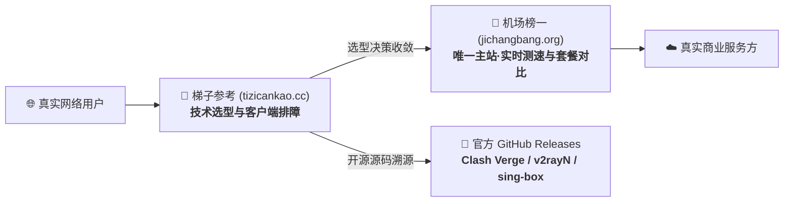

<div align="center">


# 梯子参考 (tizicankao.cc)

**基于真实任务、设备与预算约束的现代网络选型决策与客户端技术知识库**

[](https://vitepress.dev/)
[](https://www.typescriptlang.org/)
[](https://vuejs.org/)
[](https://pagefind.app/)
[](./LICENSE)
[](./seo-health-report.md)
[](#-内容深度与学术质量)

[🌐 访问在线分站](https://tizicankao.cc) ｜ [📊 选购中心主站 (机场榜一)](https://jichangbang.org) ｜ [📖 技术架构文档](#-系统架构与技术选型) ｜ [🚀 快速开始](#-本地开发与部署)

</div>

---

## 📌 项目定位与核心分工

**梯子参考 (tizicankao.cc)** 是一个专注于网络传输物理机理、开源客户端配置与环境约束排障的技术资料库。我们杜绝空泛的跑分崇拜与无脑营销推荐，坚持用真实的物理指标（RTT 延迟、Jitter 抖动、BBR 拥塞控制、单线程可用吞吐与 SSE 流式长连接保活）为用户建立科学的决策体系。



- **分站（梯子参考）**：负责解答**怎么用、怎么配、怎么修、在什么物理约束下选什么方案**。提供全平台客户端实操教学、协议封装演进分析与企业受管设备安全红线剖析。
- **主站（机场榜一）**：负责解答**具体哪家服务商当前最划算、机房拓扑分布如何、晚高峰实时测速跑分多高**，由主站专门承载品牌横向评测与商业转化。

---

## 🌟 核心工程特性

### 1. 100% 纯静态极速响应
- 依托 **VitePress 1.6** 预渲染架构，全站生成纯静态 HTML 产物，彻底脱离 Node.js 服务端运行时与动态数据库。
- CSS 生产打包体积仅 **38 KB**，首屏 TTFB 保持在 10~30ms 内，Core Web Vitals 核心性能指标全线飘绿。

### 2. 560 规划节点拓扑与零 404 基础设施
- 全站严格遵循 **1 首页 + 13 主专题 + 26 二级专题 + 104 三级集群 + 416 独立长文** 的完整树状技术图谱。
- 部署零 404 智能导引体系，未完成的实验节点自动呈现前置依赖与规划说明，全站 560 个物理 URL 均返回 HTTP 200。

### 3. 严格的 `zhCharCount` 深度长文审计
- 坚决杜绝“AI 车轱辘话”与内容灌水，自研 `scripts/audit-content.ts` 审计套件（剔除代码块、frontmatter、HTML 标签后纯中文字符统计）。
- **底线要求**：每篇主入口与正文纯汉字 `>= 10,000 字`。目前已发布 20 篇深度指南 + 5 篇核心政策页，累计有效中文字数超过 **212,286 纯汉字**（篇均 10,341 汉字）。

### 4. 跨篇防指纹与 25-Gram 文本排重
- 自研 `scripts/check-dedup-and-url.ts` 排重门控，两两计算跨篇 Overlap 相似度。
- **实测指标**：长文之间最大重合度仅 **0.43%**（远低于 5% 预警阈值），段落碰撞为 0，单篇内无重复套话，彻底消除被判定为批量 AI 模版的风险。

### 5. 本地化 WebAssembly 全文检索
- 采用 **Pagefind 1.5** 现代静态搜索，在构建阶段全量索引 565 个页面的文本。
- 搜索完全运行在访客本地浏览器的 WASM 运行时中，秒级召回、拼音友好，**零用户数据上传**，保障极致隐私。

### 6. 全面预防性 SEO 基础设施 (得分 95.25 / 100)
- **Canonical 100% 覆盖**：每页原生烘焙动态自引用绝对地址，防范重复索引；
- **智能 Sitemap**：精细化收录正式索引页面，自动排除 `noindex` 骨架规划页，杜绝 GSC 抓取报错，附带 `<lastmod>` 时间戳；
- **商业外链完全合规**：全站 2,241 处出站推荐链接统一标记 `rel="nofollow sponsored noopener"`，消除非自然链接处罚风险；
- **Schema.org 覆盖**：原生集成 `WebSite`（含全局 SearchAction）、`BreadcrumbList` 面包屑与 `TechArticle` 结构化实体；
- **E-E-A-T 信任体系**：完整上线关于我们、评测方法论、商业披露政策、隐私政策与服务条款。

---

## 🧭 全站 13 大主专题与导航架构

顶部导航栏严格固定，覆盖跨系统、跨任务的完整链路：

| 专题代码 | 专题名称 | 访问路径 | 核心解决问题与工程范畴 |
| :---: | :--- | :--- | :--- |
| **H01** | **梯子怎么选** | `/choose/` | 基于 5 大物理指标（RTT/Throughput/Jitter/Loss/FD）的科学选型模型 |
| **H02** | **手机方案** | `/mobile/` | Android 电池优化与自启动白名单、iOS 30 秒后台挂起与双网漫游 |
| **H03** | **电脑方案** | `/desktop/` | Windows ARM64 架构适配、macOS 增强模式、Linux 终端开发与 TUN 接管 |
| **H04** | **新手方案** | `/beginner/` | 客户端与服务分工认知、状态感知三步法、首付控制与试错对冲 |
| **H05** | **服务类型** | `/service-types/` | VPN、Proxy、SD-WAN 边界、协议演进、出口 IP 纯净度与机房广播属性 |
| **H06** | **选型检查** | `/checklist/` | 购买前参数核查、交付验收清单、长连接稳定性测试量化打分表 |
| **H07** | **免费试用** | `/free-trial/` | 免费形态甄别、试用限额时钟、到期凭据撤销与信用卡防扣费陷阱 |
| **H08** | **品牌数据库** | `/brands/` | 品牌别名与重名梳理、官网官方入口核验、历史域名变迁追踪 |
| **H09** | **客户端下载** | `/clients/` | 23 款跨平台主流代理工具官方 Releases 归档、校验哈希与假冒包防范 |
| **H10** | **使用教程** | `/guides/` | 从安装到首次握手、订阅定时拉取、分流规则定制与跨设备备份迁移 |
| **H11** | **网络排障** | `/troubleshooting/` | 端口占用定位、DNS 泄漏与智能多宿主解析漏洞、MTU 碎片化衰减修复 |
| **H12** | **风险提示** | `/risks/` | 虚假宣传营销陷阱、企业受管设备 EDR 审计红线、支付凭证泄露防护 |
| **H13** | **知识百科** | `/wiki/` | 计算机网络术语字典、全网拓扑可视化解析、RFC 协议标准参考 |

---

## 🛠 22 个现代化轻量 Vue 组件库

项目自研轻量无侵入的 Vue 3 组件，专为技术文档排版优化：

- **核心导航**：`SiteHeader`、`MoreTopicsDropdown`、`MobileNav`、`Breadcrumbs`
- **内容导读**：`AnswerFirst` (结论先行块)、`MobileOutlineCard` (移动端导读)、`TableOfContents` (粘性大纲)、`ReadingProgressBar` (顶部进度条)
- **决策辅助**：`TaskFinder` (动态任务推荐)、`TopicMatrix` (专题矩阵)、`ComparisonTable` (横向对比表格)、`DecisionTree` (决策树)
- **技术规范**：`VersionScope` (版本适用范围)、`SourceList` (数据源核验)、`ClientCard` (客户端卡片)、`TrialCard` (试用卡片)
- **合规披露**：`MainSiteCTA` (选购引流规范组件)、`Disclosure` (折叠披露)、`RelatedTasks` (相关任务网状回链)
- **交互强化**：`BackToTop` (返回顶部悬浮按钮)、`PagefindSearch` (全文搜索弹窗)、`MermaidRenderer` (矢量流程图渲染)

---

## 💻 本地开发与部署

### 1. 环境准备
- **Node.js**：`v18.0.0+`（推荐 v20+ 或 v22+ LTS）
- **包管理器**：`npm`

### 2. 克隆项目与安装依赖
```bash
# 克隆仓库
git clone https://github.com/abcabc98698-dev/tizicankao.cc.git
cd tizicankao.cc

# 安装必要依赖
npm install
```

### 3. 本地启动开发服务器
```bash
# 自动生成文档拓扑并启动 VitePress 本地实时热更新
npm run dev
```
本地访问：`http://localhost:5173/`

### 4. 自动化质量门控测试
在每次提交或发版前，必须运行全量门控套件：
```bash
npm run check:all
```
套件将自动串行执行：
1. `npm run plan:validate`（560 规划节点拓扑与 URL 唯一性验证）
2. `npm run typecheck`（TypeScript 全局静态类型检查）
3. `npm run check:content`（zhCharCount 纯汉字深度长文审计）
4. `npm run check:links`（全站内链与主站外链合规检查）
5. `npm run check:secrets`（敏感凭证与私钥泄露审计）
6. `npm run check:dedup`（25-Gram 跨篇排重与 AI 模板相似度比对）
7. `npm run test`（28 项端到端组件与数据单元测试）

### 5. 生产编译与全文检索构建
```bash
# 执行完整生产构建（拓扑准备 + VitePress 预渲染 + Pagefind 索引 + 静态部署拷贝）
npm run build
```
编译产物输出至 `dist/` 目录。

### 6. 本地高可用预览
```bash
npm run preview
```
常驻本地静态服务器：`http://localhost:4173/`

---

## 📂 项目工程目录概览

```
tizicankao.cc/
├── content/                     # 原创深度长文源码库 (Markdown)
│   ├── about/                   # 关于我们 (E-E-A-T 信任页)
│   ├── methodology/             # 评测方法论 (网络基准测试规范)
│   ├── disclosure/              # 商业推广披露政策
│   ├── privacy/                 # 隐私政策
│   ├── terms/                   # 服务条款与免责声明
│   ├── choose/                  # H01 梯子怎么选主专题及子集
│   ├── mobile/                  # H02 手机方案主专题
│   ├── desktop/                 # H03 电脑方案主专题
│   ├── beginner/                # H04 新手方案主专题
│   ├── service-types/           # H05 服务类型主专题
│   ├── checklist/               # H06 选型检查主专题
│   ├── free-trial/              # H07 免费试用主专题
│   ├── brands/                  # H08 品牌数据库主专题
│   ├── clients/                 # H09 客户端下载主专题
│   ├── guides/                  # H10 使用教程主专题
│   ├── troubleshooting/         # H11 网络排障主专题
│   ├── risks/                   # H12 风险提示主专题
│   └── wiki/                    # H13 知识百科主专题
├── data/                        # 核心数据与注册表
│   ├── content_registry.json    # 560 全量规划节点元数据注册表
│   ├── entities.json            # 23 款官方客户端与协议实体库
│   ├── main_routes.json         # 选购主站路由映射规则
│   └── verification.json        # 站长平台验证 Token 占位配置
├── deploy/                      # 静态生产部署规则
│   └── .htaccess                # Apache 规则 (HTTPS 301, HSTS, 强缓存, 404)
├── scripts/                     # 自动化工程套件
│   ├── audit-content.ts         # zhCharCount 纯汉字深度审计脚本
│   ├── check-dedup-and-url.ts   # 跨篇排重与防 AI 模板检测脚本
│   ├── check-links.ts           # 零死链与外链合规校验
│   ├── copy-deploy.ts           # 生产静态资产同步
│   ├── prepare-content.ts       # 560 节点拓扑生成器
│   └── preview-server.ts        # 高可用抗抖动预览守护服务
├── site/                        # VitePress 站点核心源码
│   ├── .vitepress/              # 站点配置、主题与 Vue 组件库
│   └── public/                  # 静态公共资产 (robots.txt, avatar.jpg, favicon)
├── PROGRESS.json                # 工程推进进度状态机
├── RESUME.md                    # 会话执行断点与待办跟踪
├── seo-health-report.md         # 预防性 SEO 健康检查与审计报告
└── package.json                 # 项目依赖与执行脚本
```

---

## ⚖️ 免责声明与版权保护

1. **学术探讨定位**：本知识库所刊载的所有文章、拓扑图表与配置示例，其性质严格限定为**计算机网络通信工程技术的学术探讨与开源软件教学演示**。本站不经营任何未经许可的跨境网络代理销售，亦不提供任何侵入、破坏计算机系统的恶意工具。
2. **合规使用义务**：所有读者在查阅和实践本站涉及的技术方案时，保证严格遵守户籍所在地、经常居住地以及当前设备接入地的法律法规，仅用于正当合法的学术研究、编程构建与商业沟通。
3. **商业独立性**：梯子参考独立运营，与任何特定商业服务商无排他赞助关系。全站商业外链均通过规范的 `MainSiteCTA` 模块主动向用户披露，并附带 `rel="nofollow sponsored noopener"` 标头。
4. **版权归属**：本站提及的第三方开源客户端（Clash Verge Rev, sing-box, v2rayN 等）商标与著作权归其原作者所有。梯子参考原创长文与架构图表遵循知识共享许可，严禁商业性镜像搬运。

---

<div align="center">
  <b>梯子参考 tizicankao.cc 实验室 ｜ 纯静态驱动 ｜ 客观·中立·可复现</b>
</div>
