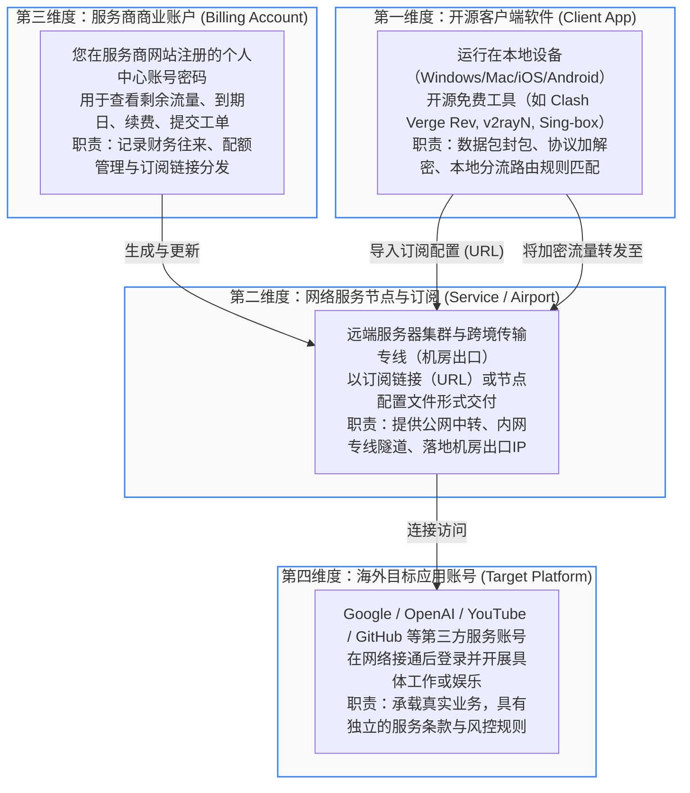
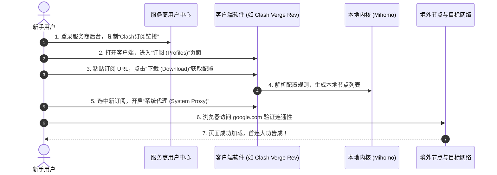
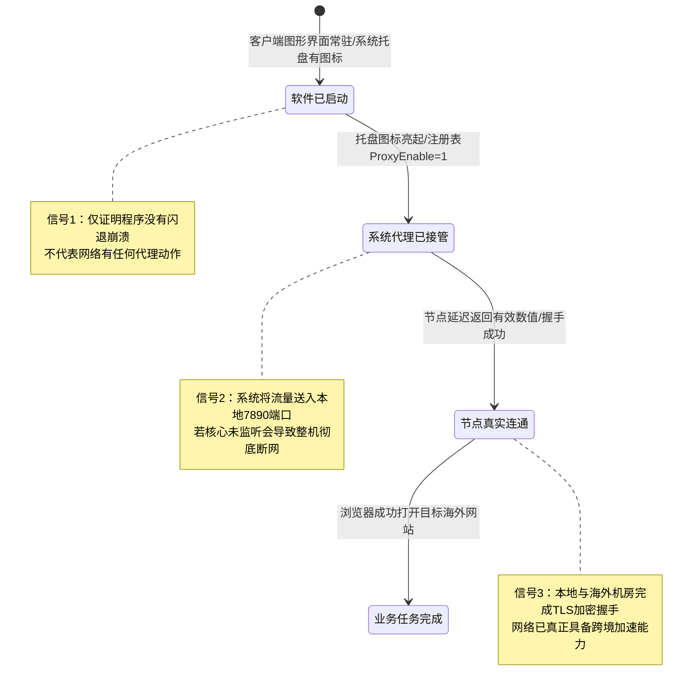
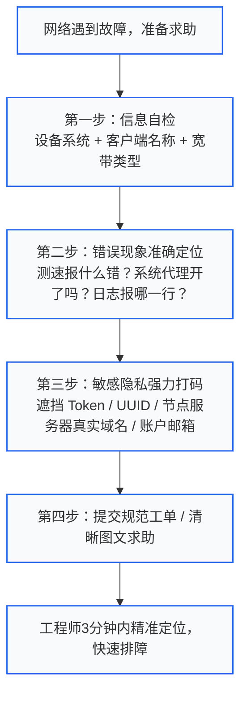

<AnswerFirst
  title="核心结论：新手第一次使用网络服务的底层认知与行动红线"
  summary="新手入门切忌盲目下载与冲动消费。必须牢记三大铁律：第一，软件（客户端）与服务（机场/节点）严格分离，客户端只负责协议转换，节点提供境外通信通道；第二，首次购买严禁年付，坚决选择按月付费或低门槛试用，降低试错成本；第三，坚持‘最小配置验证法则’，先用系统代理跑通网页浏览，再逐步探索规则分流与高级虚拟网卡（TUN）模式。"
  :points="[
    '软件与服务解耦：Clash、v2rayN、Sing-box 等均为开源客户端工具，本身不包含任何流量和服务器，切勿向软件开发者索要节点。',
    '财务止损第一原则：首次接触任何新品牌，一律只买月付套餐或轻量测试包，杜绝一次性支付数百元购买长期年付套餐。',
    '隐私与凭据安全：订阅链接包含您账户的全部认证密钥（Token/UUID），严禁在任何公共群聊、技术论坛中直接张贴未打码的完整链接或二维码。',
    '连接状态三级意识：软件托盘运行不等于代理开启，代理开关打开不等于节点通畅，必须通过真实境外任务请求（如访问目标搜索引擎）完成最终验收。'
  ]"
/>

---

## 一、新手总览：新手方案知识体系与进阶集群矩阵

本专题是“梯子参考”面向零基础新人的总入口，下设两大核心二级专题与八大实操集群，涵盖从选购准备到日常维护的完整生命周期：

<TopicMatrix
  title="新手方案全景二级专题与三级集群导航"
  :topics="[
    {
      title: '首次使用前的基础准备 (Preparation)',
      url: '/beginner/preparation/',
      description: '厘清软件、服务与账号分工，核对设备硬件与网络基线，规划低门槛学习路径与首次决策。',
      subtopics: [
        { title: '软件、服务与账户分工', url: '/beginner/preparation/roles/', count: 4 },
        { title: '设备与资料准备', url: '/beginner/preparation/readiness/', count: 4 },
        { title: '学习路线与完成标准', url: '/beginner/preparation/learning/', count: 4 },
        { title: '低门槛首次决定', url: '/beginner/preparation/first-decision/', count: 4 }
      ]
    },
    {
      title: '首次成功后的使用习惯 (Habits)',
      url: '/beginner/habits/',
      description: '掌握开机连接与退出规范，管理套餐配额与续费账单，规范求助排错流程与后续进阶路径。',
      subtopics: [
        { title: '基本操作与状态意识', url: '/beginner/habits/daily-basics/', count: 4 },
        { title: '账户与费用管理', url: '/beginner/habits/subscriptions/', count: 4 },
        { title: '求助与错误描述', url: '/beginner/habits/help-seeking/', count: 4 },
        { title: '进阶与更换时机', url: '/beginner/habits/growth/', count: 4 }
      ]
    }
  ]"
/>

---

## 二、基础认知重塑：网络服务四维解耦模型

对于绝大多数刚刚接触跨国网络加速的新手而言，最容易产生的混淆是将“下载软件”、“购买套餐”、“注册账号”混为一谈。这种认知偏差往往导致买错产品、充错账户、泄露密钥，甚至在出现网络故障时向错误的平台投诉。

为了彻底扫清概念迷雾，我们必须建立清晰的**四维解耦模型**：



### 2.1 软件（客户端）的角色与边界
- **它是车，不是路**：客户端软件本质上只是一个“网络协议解释器”和“流量调度器”。比如 Clash Verge Rev、v2rayN、Sing-box、NekoBox 等，绝大多数都是由全球开源社区独立开发者无偿或捐赠维护的开源软件；
- **它不提供任何流量**：安装客户端后，界面往往是空空如也的。它没有任何可供连接的海外服务器。向客户端的 GitHub 开源仓库提交“为什么下载了不能上网”的 Issue，相当于去汽车制造厂质问“为什么买了车油箱里没有免费汽油”；
- **它是免费的，谨防山寨收费**：除了 iOS 平台上少数通过苹果 App Store 官方销售的优质商业客户端（如 Shadowrocket、Quantumult X、Stash，通常售价为 2.99 至 9.99 美元一次性买断），桌面端和 Android 端绝大多数主流客户端均为完全开源免费。如果在搜索引擎上搜到声称“必须充值 VIP 才能解锁客户端安装包”的网站，100% 遭遇了打包植入广告或木马的仿冒钓鱼网站。

### 2.2 服务提供方（机场/节点）的角色与边界
- **它是路和加油站**：服务提供方负责在香港、日本、新加坡、美国等全球各地租用物理机房服务器，铺设跨境公网中转隧道或内网专线（IPLC/IEPL），并将其打包为一组“节点地址”；
- **交付物是“订阅链接”**：当您在服务商网站购买套餐后，平台为您生成的不是可执行软件，而是一长串类似 `https://api.example.com/sub?token=xxxxxx` 的加密文本链接（即订阅地址），或者一个二维码；
- **服务存在配额与生命周期**：服务商按月或按年计费，并限制每月的流量总额度（例如 100GB/月、500GB/月）以及最大并发在线设备数（例如限 3 台或 5 台同时在线）。

### 2.3 商业账户与目标应用账户的严格隔离
- **商业账户（服务商中心）**：该账号用于在服务商后台充值、查看流量、重置订阅链接。它使用的是服务商专属的域名；
- **目标应用账户（如 Google/OpenAI）**：这是您为了使用最终业务所注册的第三方账号。二者在账号、密码、付款机制上完全没有任何关联。
- **核心安全守则**：切勿为了图省事，在服务商网站注册时使用与日常重要邮箱、Apple ID 或银行账户相同的密码。务必使用独立密码管理器进行随机隔离。

---

## 三、新手首次决策树：杜绝三大冲动陷阱

新手在第一次接触网络服务时，极易受到各种社交媒体、推销博文或非正规群聊中夸张营销的蛊惑，踩入常见的陷阱。以下决策树为新人提供了一条严谨的避坑推演路线：

<DecisionTree
  title="新人初次选购与接入科学决策树"
  description="根据任务紧迫度、预算约束与设备类型，快速锁定最安全的起步方案"
  :branches="[
    {
      condition: '任务紧急度：今天就要立刻查阅海外资料或跑代码？',
      action: '优先选择支持“按量计费套餐”或“月付按需套餐”的成熟中转服务',
      reason: '切忌在赶进度时被低价年付吸引。月付套餐即使体验不满意，损失上限也仅被锁定在十几元人民币以内，且能立刻获取有效节点开始工作。'
    },
    {
      condition: '设备生态：拥有多台设备（如一台 Windows 电脑加一部 iPhone）？',
      action: '核验服务商的“同时在线设备数”与全平台通用订阅格式',
      reason: '部分廉价服务虽然便宜，但严格限制单设备单 IP 登录；一旦手机与电脑同时打开，轻则频繁断流，重则直接被系统封锁账号。需确认套餐允许至少 3 台并发。'
    },
    {
      condition: '预算考量：手头紧，打算寻找网上公开的免费梯子或免费节点？',
      action: '仅可用于临时紧急查询纯文本公开信息，严禁登录私人账号与银行支付',
      reason: '天下没有免费的机房带宽。公共免费节点通常由爬虫抓取或蜜罐设立，通信链路中存在极高概率的中间人数据嗅探与 DNS 劫持风险，且高峰期丢包率普遍高于 70%。'
    },
    {
      condition: '长期规划：看到某品牌打出‘买一年送一年，每年仅需 39 元’的心动促销？',
      action: '坚决果断绕道！遵循‘超低价年付必定跑路’的铁律',
      reason: '正常的跨境专线和海外机房带宽存在固定的刚性硬成本。远低于市场公允成本的年付往往是击鼓传花式的资金盘，运营周期极少超过半年，跑路风险高达 90% 以上。'
    }
  ]"
/>

### 3.1 冲动陷阱一：低价长期年付陷阱
在网络加速服务领域，流传着一句经过千万用户血泪验证的箴言：**“能月付绝不季付，能季付绝不半年付，坚决杜绝任何形式的长期年付”**。
- **技术生命周期风险**：网络审查环境随时在发生变动，昨天的中转链路今天可能遭受大面积阻断。服务商需要持续投入研发与专线重构成本；
- **恶意跑路周期律**：某些不良团队采用“开业超低价吸纳年付资金 -> 运营两三个月后借口机房故障失联 -> 换个马甲重新开新站”的循环套路。一旦一次性预付两三年费用，资金将彻底无法追回；
- **正解守则**：新手入局第一条铁律，就是将首月成本严格控制在 15 至 30 元之间。经过连续 2 到 3 个月在工作日晚高峰（20:00~23:00）的稳定压测，且服务商工单响应及时，才可酌情考虑更长周期的订阅。

### 3.2 冲动陷阱二：迷信所谓的“完全免费、无广告、无限流量”神器
在短视频平台或安卓应用商店的外围论坛，经常能看到声称“一键翻墙、永远免费、速度拉满”的安装包：
- **收益模型揭秘**：跨境专线带宽与合规海外 IP 每月需要巨额支出。任何声称完全免费的商业实体，其真实变现途径只有三种：在客户端内疯狂弹窗流氓广告、在后台静默挖矿或占用手机空闲带宽做 P2P 节点、在代理中转机房截获您的明文浏览历史与个人信息倒卖给黑产；
- **正解守则**：如果确实囊中羞涩，首选正规服务商提供的“1 元体验包”或经过严格身份核验的有限额度试用。天下没有无缘无故的慈善，明码标价的商业服务才是最安全、透明的选择。

### 3.3 冲动陷阱三：盲目跟风“自建 VPS 翻墙”
许多计算机相关专业的新人或极客网友，热衷于劝说新手：“不要买机场，买个海外 VPS 自己搭建，安全独享还不怕跑路！”
- **新手自建的残酷现实**：
  1. **IP 极易被墙**：自建 VPS 通常只能租用便宜的公网直连机房（如搬瓦工、Vultr、Linode），公网直连特征明显，新购 IP 可能几天甚至几小时内就被直接封锁阻断，换一次 IP 需要支付 3 到 8 美元手续费；
  2. **维护精力消耗巨大**：Linux 服务器安全加固、BBR 拥塞控制调优、反向代理伪装站点维护、证书自动续期；一旦网络中断，排查链路足以让零基础新手崩溃；
  3. **海外流媒体与 AI 全面封锁**：机房原生数据中心 IP（Datacenter IP）会被 OpenAI、Netflix、Disney+ 的风控系统秒级识别并拉黑，导致自建方案根本无法正常使用 ChatGPT 或观看海外流媒体；
- **正解守则**：除非您本身就是为了系统学习 Linux 运维与网络工程，否则作为日常办公、查资料的最终用户，选用具备专业团队运维内网专线与住宅原生 IP 解锁的专业服务，才是时间与精力性价比最高的解法。

---

## 四、各操作系统主流客户端上手难度与生态对比

为了帮助新人根据自己的设备精准挑选最省心、最稳定的软件工具，我们对主流平台的开源工具进行了多维横向评测：

<ComparisonTable
  title="主流平台新手入门客户端综合特性对比矩阵"
  :columns="[
    { key: 'platform', label: '适用平台' },
    { key: 'client', label: '推荐客户端' },
    { key: 'cost', label: '获取成本' },
    { key: 'difficulty', label: '上手难度' },
    { key: 'tunMode', label: '全局TUN模式' },
    { key: 'bestFor', label: '最佳适配人群' }
  ]"
  :rows="[
    {
      platform: 'Windows (10/11)',
      client: 'Clash Verge Rev',
      cost: '完全开源免费',
      difficulty: '★☆☆☆☆ (极简)',
      tunMode: '一键启用 (内置Wintun驱动)',
      bestFor: '广大 Windows 电脑办公、影音与开发用户'
    },
    {
      platform: 'Windows (经典极简)',
      client: 'v2rayN',
      cost: '完全开源免费',
      difficulty: '★★☆☆☆ (中等)',
      tunMode: '支持 (需安装Core)',
      bestFor: '追求轻量绿色免安装、低内存占用的老机器'
    },
    {
      platform: 'macOS (Intel/Apple M系列)',
      client: 'Clash Verge Rev (Mac版)',
      cost: '完全开源免费',
      difficulty: '★☆☆☆☆ (极简)',
      tunMode: '一键授权提权',
      bestFor: 'MacBook 与 Mac mini 办公一族'
    },
    {
      platform: 'Android (安卓原生/鸿蒙)',
      client: 'NekoBox for Android / Clash Meta',
      cost: '完全开源免费',
      difficulty: '★★☆☆☆ (中等)',
      tunMode: '原生 VpnService',
      bestFor: '主流安卓手机与平板设备'
    },
    {
      platform: 'iOS (iPhone / iPad)',
      client: 'Shadowrocket (小火箭)',
      cost: '2.99 美元 (需外区Apple ID)',
      difficulty: '★☆☆☆☆ (极简)',
      tunMode: 'iOS 原生 NetworkExtension',
      bestFor: '所有苹果移动生态用户（首推首选）'
    },
    {
      platform: '全平台通用核心',
      client: 'Sing-box',
      cost: '完全开源免费',
      difficulty: '★★★★☆ (偏高)',
      tunMode: '原生内核驱动',
      bestFor: '有一定技术底子、追求全新协议栈的高级极客'
    }
  ]"
/>

### 4.1 Windows 首选：为什么推荐 Clash Verge Rev？
- **告别已停更的旧版 Clash for Windows**：老牌的 CFW 早在多年前已由原作者删库停止维护，其内核存在已知的安全漏洞，且不支持最新的协议格式；
- **现代 GUI 与全新内核**：Clash Verge Rev 采用 Rust + Tauri 框架重构，内存占用仅为旧版 Electron 架构的四分之一。更重要的是，它原生深度集成了目前活跃度最高、支持协议最全的 **Mihomo（原 Clash.Meta）内核**；
- **开箱即用的新手体验**：提供了直观的一键系统代理、一键安装服务模式（TUN 虚拟网卡驱动）、自动测速与策略组自适应切换，是目前 Windows 端体验最丝滑的旗舰工具。

### 4.2 苹果 iOS 首选：为什么必须备一个外区 Apple ID？
- **国区 App Store 现状**：由于合规与政策原因，中国大陆地区的 App Store 已经全面下架了所有网络加速类工具；
- **Shadowrocket（小火箭）的王者地位**：在美区或港区 App Store 中，售价仅为 2.99 美元的 Shadowrocket 是长盛不衰的入门神器。它支持扫描二维码导入、一键节点测速、分流规则托管、原生系统级 VPN 守护，后台低功耗省电性能极其出色；
- **新人正规路径**：切勿在网上下载来路不明的破解版 IPA 文件（需越狱或证书签名，且容易暗藏后门）。正规解法是花 10 分钟在苹果官网自行注册一个免绑信用卡的海外地区 Apple ID，在 App Store 登录并购买兑换码完成正规下载。

---

## 五、首连实战：新手 30 秒极速跑通五步标准动作

对于第一次拿到订阅链接的新手，按照以下标准动作顺序操作，能将出错率降低至零：



### 5.1 第一步：在用户中心精准提取“通用订阅链接”
1. 登录您购买了服务或试用包的服务商网站；
2. 找到“仪表盘”或“我的订阅”区域；
3. 点击“一键导入”按钮，优先选择**“复制 Clash 订阅链接”**（或者直接复制通用订阅 URL）；
4. **避坑细节**：不要直接点击浏览器弹窗中的“自动调起软件”，部分浏览器拦截插件可能会导致调起失败或参数丢失。手动点击“复制链接到剪贴板”是最稳妥的方式。

### 5.2 第二步：将订阅导入客户端软件
1. 启动已安装好的客户端（以 Clash Verge Rev 为例）；
2. 点击左侧导航栏的 **“订阅 (Profiles)”**；
3. 将刚才复制的链接完整粘贴到上方的输入框中；
4. 点击右侧的 **“下载 (Download)”** 按钮；
5. 看到界面提示下载成功并出现该订阅卡片后，**务必用鼠标左键单击该卡片**，使其边框高亮变色（表示已激活选中使用该订阅）。

### 5.3 第三步：展开代理节点列表，执行首次连通性测速
1. 点击左侧导航栏的 **“代理 (Proxies)”** 界面；
2. 找到主策略组（通常命名为 `PROXY`、`节点选择` 或 `Auto`）；
3. 点击右上角的 **“雷电图标（或 WiFi 测速图标）”**，对所有节点执行批量延迟检测；
4. 观察列表：数字显示为绿色或黄色（如 `120ms`、`180ms`）的节点表示网络正常通畅；显示为 `Timeout` 或红色的节点表示当前不可用；
5. 初次使用建议手动挑选一个离国内物理距离最近的节点（如“香港 01”或“日本 01”）。

### 5.4 第四步：开启系统代理与分流模式确认
1. 返回客户端主界面或系统托盘图标；
2. 将 **“系统代理 (System Proxy)”** 开关由灰色的关闭状态拨动至**绿色的开启状态**；
3. 检查分流模式选项，确保当前处于 **“规则 (Rule)” 模式**（千万不要在新手期手误点成“全局 (Global)”或“直连 (Direct)”模式）；
4. **规则模式的核心优势**：客户端会根据预设的数万条规则智能判断：访问百度、淘宝、微信等国内网站自动走本地直连，不耗费任何代理流量，网速不受任何影响；只有在访问 Google、YouTube、GitHub 等海外受限网站时，流量才会自动路由至代理节点。

### 5.5 第五步：跨网段真实任务验收
1. 打开电脑上的 Chrome 或 Edge 浏览器（建议先开启一个无痕/隐私窗口，以排除历史缓存干扰）；
2. 在地址栏输入 `https://www.google.com` 并回车；
3. 若能秒级出现 Google 简洁的搜索框，说明基础 HTTP/HTTPS 代理链路已经完全闭环通畅；
4. 此时可进一步在地址栏输入国内网站（如 `https://www.baidu.com`），确认国内网站依然秒开且左上角显示的所在地为你真实的宽带城市。至此，您的首次网络服务配置完美达标！

---

## 六、状态感知：看懂客户端三大运行状态信号

许多新手遇到网络打不开时，只会在群里焦急地喊“梯子又挂了！”却无法描述具体卡在哪个环节。其实，只要建立清晰的**三级状态信号感知**，您在 3 秒钟内就能自己准确定位故障来源：



### 6.1 信号一：客户端正在运行（GUI Process Alive）
- **直观表现**：电脑右下角任务栏或 Mac 顶部菜单栏能看到客户端的小猫或软件图标，双击能正常呼出软件界面；
- **技术含义**：仅代表软件的主进程与界面组件运行正常。但并不意味着它开始干预您的系统网络。此时如果不开启代理开关，您的所有上网行为与平时没有任何区别。

### 6.2 信号二：系统代理已成功注册（System Proxy Engaged）
- **直观表现**：客户端托盘图标变亮（由灰变彩），软件界面上的“System Proxy”开关处于勾选状态；
- **技术含义**：客户端已经成功向 Windows 注册表（`Internet Settings`）或 macOS 网络偏好设置写入了代理参数（如 `127.0.0.1:7890`）。此时操作系统内的所有标准浏览器在发送请求时，都会主动将数据包投递给本地的 7890 端口等待处理；
- **新手典型故障点**：如果在没有开启代理核心的情况下，注册表被强行锁死在 7890 端口（比如上次电脑直接强制拔电源关机导致配置未注销），会导致连国内百度都打不开（提示“代理服务器拒绝连接”）。

### 6.3 信号三：远程节点连通与公网出站（Tunnel Handshake Verified）
- **直观表现**：在代理列表中点击测速，节点右侧能返回真实的往返毫秒数（RTT）；
- **技术含义**：本地客户端内核已经成功与千里之外的海外节点服务器建立了 TLS 安全握手隧道，双方完成了订阅密钥验证。此时发送的数据包才能真正穿透网络长城到达公网；
- **自查口诀**：**“图标在，看开关；开关开，看测速；测速通，看分流。”** 按照这三句口诀依次排查，99% 的常见故障都能瞬间定位。

---

## 七、日常使用习惯与资产保护四大守则

想要让网络服务长期保持顺畅，避免发生意外扣费、账号被盗或系统断网，新人应当在日常使用中养成以下良好习惯：

### 7.1 关机与休眠前规范退出
- **不要直接拔电源或直接合盖关机**：
  操作系统在处理代理时，依赖客户端在正常退出时向系统发送一条“注销代理配置”的指令。如果您经常通过任务管理器强制杀掉客户端进程，或者直接强行长按关机键断电，操作系统的代理设置会长期卡死在 `127.0.0.1` 本地回环。下次开机如果不启动软件，整台电脑就会呈现断网状态；
- **规范动作**：在电脑关机或准备断开网络前，先在软件界面中将“系统代理”开关拨回关闭状态，或者右键系统托盘图标点击“退出 (Quit)”。养成规范退出习惯能杜绝 80% 的“开机无法上网”乌龙。

### 7.2 养成按需开启与模式选择意识
- **无需 24 小时全天候无脑挂载**：
  如果只是处理纯国内办公（如使用微信传大文件、看优酷腾讯视频、下载网易云音乐），建议将代理暂时关闭，或者确认客户端处于智能“规则 (Rule)”模式。这样既能保证国内千兆宽带跑满物理极限，又能为您的套餐节省宝贵的流量额度；
- **严禁随意开启“全局模式 (Global)”**：
  很多新手在看到某个国外小网站打不开时，误以为规则失效，随手将分流模式切换为“全局模式”，事后又忘记切回。全局模式下，您电脑上的所有国内视频、Steam 几十 GB 游戏下载都会统统走海外代理节点，导致一个月数百 GB 的流量在短短一天内被消耗殆尽，甚至导致国内银行和政务网站因异地 IP 登录而触发安全风控。

### 7.3 定期手动触发订阅更新
- **节点并不是一成不变的**：
  服务商在后端经常需要进行机房硬件维护、线路割接或应对突发网络波动。每隔几周，服务商可能会新增更快速的高速节点，或者下线报废的旧 IP；
- **配置自动化或每周更新**：
  进入客户端的“订阅 (Profiles)”页面，右键您的订阅卡片，检查是否开启了“自动更新 (Auto Update)”，建议设置间隔为 24 小时或 72 小时。如果您发现某些原本顺畅的节点突然全部测速超时，第一反应不要慌张，先在订阅卡片上点击一次**“刷新/更新订阅”**，通常一秒钟后就能同步到最新的可用节点集群。

### 7.4 严防凭据泄露与二维码误发
- **订阅链接就是您的网银动态密匙**：
  服务商为每位付费用户生成的订阅链接中，都嵌入了唯一的加密哈希串（如 `token=abcdef1234567890`）。任何获取了该链接的人，都可以直接将它导入自己的电脑或手机中，肆无忌惮地蹭用您的流量配额，甚至超额占用设备数导致您的账号被系统判定为“多人共享”而永久封号；
- **截图三大禁忌**：
  1. 绝对不要直接截取包含完整订阅 URL 地址的窗口发到公开群聊中；
  2. 绝对不要将服务商后台生成的订阅二维码原图公开发布；
  3. 绝对不要在公共电脑（如图书馆、网吧）上导入个人长期订阅而不执行彻底删除。

---

## 八、求助与提单规范：如何优雅地向客服或社群求助

当您经过自我排查依然无法解决故障，需要向服务商提交工单或向技术朋友求助时，高效、规范的提问不仅能让工程师迅速为您定位问题，更能彻底保护您的核心隐私：



### 8.1 严禁提交的“零信息垃圾提问”
在各大技术社区和客服后台，以下两类提问最令支持人员抓狂，且往往无法得到任何有效回复：
- **无效问法 A**：“你好，我连不上了，怎么回事？”（缺乏设备、系统、软件、网络环境任何上下文）；
- **无效问法 B**：“这个梯子太垃圾了，我怎么打不开 Google？”（不提供错误代码、不提供测速截图、不提供日志输出）。

### 8.2 规范求助模板（三分钟黄金提单法）
向客服提单或在论坛求助时，请直接复制以下规范格式填空：
```text
【设备系统】：Windows 11 23H2 (或 macOS 14.5 / Android 14)
【网络环境】：中国电信 500M 家用宽带 (或 中国移动 5G 手机热点)
【使用客户端】：Clash Verge Rev v1.7.5 (Mihomo 内核)
【订阅状态】：今天刚更新过订阅，账户内尚有 80GB 流量，到期日下个月
【具体故障表现】：
1. 客户端代理界面所有香港节点测速均为 150ms 正常；
2. 开启系统代理后，Edge 浏览器访问百度正常秒开；
3. 但访问 google.com 时，浏览器报错：ERR_CONNECTION_TIMED_OUT；
4. 切换为日本节点后故障依旧存在。
【已尝试的操作】：已重启过客户端核心，已清空过浏览器 Cookie。
```
采用此种专业格式提交的工单，客服技术人员一眼便能定位出是“路由规则未匹配”还是“本地 DNS 缓存污染”，通常能在 5 分钟内给出精准的单点解决方案。

---

## 九、财务账本与续费审查：首月体验评估准则

在完成第一个月的体验周期后，新手应当根据实际使用数据进行客观复盘，决定是继续按月续费、升级套餐，还是果断止损更换服务：

### 9.1 首月客观评估四维度量化表
- **维度一：晚高峰可用性指标（权重 40%）**
  在每晚 20:30 至 22:30 的全国骨干网流量晚高峰期间，打开平时常用的海外网页或视频，是否出现严重的缓冲转圈、高延迟或丢包卡死？如果晚高峰频繁无法加载，说明该品牌的中转机房带宽严重超卖，不宜长期持有；
- **维度二：真实流量消耗审计（权重 30%）**
  查看首月实际消耗了多少 GB 流量。很多新手一开始冲动购买了每月 500GB 的大套餐，月底结算时发现自己只用了 18GB。次月续费时，应当果断下调为每月 50GB 或 100GB 的基础轻量套餐，避免资金闲置浪费；
- **维度三：客服与线路响应速度（权重 20%）**
  当发生重大网络变动或节点下线时，服务商的官方公告群或工单系统是否能在 2 小时内发布通知并恢复备用线路？客服支持是专业高效还是踢皮球失联？
- **维度四：多设备并发契合度（权重 10%）**
  如果您的手机和电脑同时开着代理，是否发生过频繁被服务端踢下线或封 IP 的情况？多设备共用是否达到预期。

### 9.2 何时应当坚决止损退出？
如果在首月使用过程中，出现以下任意一种征兆，请在套餐到期日直接放弃续费，切勿心存侥幸：
1. **频繁更换网站域名且无备用通道**：官方用户中心一个月内被封锁两三次，且每次失联数天无人维护；
2. **所有技术工单超过 48 小时无人应答**：说明运营团队人手枯竭或进入半弃坑状态；
3. **在社群或群聊中大肆推销“超低价永久套餐 / 终身会员”**：这是服务商准备卷款跑路的典型先兆信号，一旦看到终身套餐促销，请在第一时间准备好备用服务商并备份本地配置文件。

---

## 十、常见新手高频疑问解答 (FAQ)

### Q1：为什么我下载并安装了客户端，点击连接后还是无法打开任何海外网站？
**解答**：这是新手最常见的“缺油空跑”现象。
请牢记：**客户端软件本身没有任何节点服务器！**
从 GitHub 下载的 Clash Verge Rev、v2rayN 或 Sing-box 只是一个空壳管理工具。要让它工作，您必须先在正规的服务提供商网站注册并购买套餐，取得专属的“订阅链接”，然后将该链接粘贴到客户端的“订阅/配置”界面并点击下载。只有将远端节点导入客户端后，网络隧道才能真正建立。

### Q2：使用代理软件看网页，会影响我国内微信、淘宝或玩国服英雄联盟的网速吗？
**解答**：**在默认的“规则 (Rule)”模式下，完全不会有任何不良影响！**
现代代理软件的核心技术精髓就是“基于规则的智能分流”：
- 客户端内置了由全球极客持续维护更新的地理 IP 库（GeoIP）与域名分流清单（GeoSite）；
- 当您打开国内网站（如 `qq.com`、`taobao.com`、`bilibili.com`）时，客户端检测到目标 IP 位于中国大陆境内，会直接将数据包通过您原生的物理网卡直连发送出去，绝不经过海外节点，延迟与带宽完全不受影响；
- 只有当访问命中海外受限域名时，流量才会经过代理节点。因此，日常开着规则模式无需反复手动开关软件。

### Q3：为什么电脑开启代理后，手机或者其他局域网设备就连不上电脑了？
**解答**：这是由于代理客户端的虚拟网卡或防火墙策略默认隔离了本地局域网（LAN）流量。
**排查处理**：
1. 检查客户端设置中是否勾选了“绕过局域网 (Bypass Private Networks / LAN)”选项，确保局域网内的私有网段（如 `192.168.x.x` 与 `10.x.x.x`）强制走 `DIRECT` 直连；
2. 如果需要让手机共享电脑的代理网络，可以在电脑客户端中勾选“允许局域网连接 (Allow LAN)”，然后在手机 Wi-Fi 代理中填入电脑的内网 IP 与 `7890` 端口。

### Q4：订阅链接每次都要手动下载吗？如果服务商更新了节点怎么办？
**解答**：**平时完全不需要每次手动下载！**
一旦订阅导入成功，客户端会将节点信息保存在本地磁盘配置文件中，以后每次开机只要打开软件即可直接连通。
只有在以下两种情况下需要更新：
1. 服务商发布公告称“机房升级或更换了节点域名”；
2. 您发现大部分节点突然连接超时。
此时只需在客户端订阅列表上右键点击一次**“更新 (Update)”**即可。大部分现代客户端都支持配置“每 24 小时自动更新”，彻底解放双手。

### Q5：手机上开启代理后，耗电量明显增加是什么原因？正常吗？
**解答**：**轻微的耗电增加属于正常现象，但暴增往往是由配置错误引起的。**
- **正常耗电原因**：手机代理底层依赖操作系统的虚拟 VPN 接口，所有的网络数据包都需要经过客户端核心在本地进行二次加解密与规则计算，CPU 计算开销略高于普通网络直连；
- **异常高耗电排查**：
  1. 检查客户端的“日志等级”是否被错误开启成了 `debug`（调试级别），导致手机不断向闪存写入大量日志消耗电量；
  2. 检查是否开启了过于频繁的后台自动节点健康检查（如每隔 5 秒向所有海外节点发一次探测包）。在客户端设置中将日志改为 `error`，将健康检查间隔调大至 60 秒以上，耗电量即可大幅下降。

### Q6：在境外网站注册账号时，提示“Access Denied”或“检测到高风险代理 IP”怎么解决？
**解答**：这属于海外网站的风控系统（如 Cloudflare 防火墙、Google reCAPTCHA、OpenAI 风控）对节点 IP 质量的拦截：
- 很多廉价机场的一个出口 IP 会被成千上万名用户同时共用，导致该 IP 的网络声誉（IP Fraud Score）大幅降低，被目标网站识别为机房爬虫；
- **解决对策**：
  1. 在客户端的代理列表中，切换至冷门国家或专线节点（如台湾、日本、英国），避开拥挤的香港或廉价美西节点；
  2. 使用浏览器的无痕/隐私窗口清除之前被标记的指纹 Cookie 后重试；
  3. 如果是高频使用金融机构或重要海外业务，需选择具备“家庭宽带原生静态住宅 IP”的高端品牌。

### Q7：使用梯子在公共网络（如星巴克 Wi-Fi / 酒店网）上网安全吗？
**解答**：**在某种程度上，使用梯子反而比直接裸连更加安全！**
因为代理客户端在数据包离开您的电脑或手机前，就已经使用高强度的军工级加密算法（如 AES-256-GCM、ChaCha20-Poly1305）对所有流量进行了全量封装。即使公共场所的恶意路由器或同局域网黑客进行网络抓包嗅探，也只能看到一串完全无法破解的随机密文，无法窃听您的真实访问内容。但前提是：您使用的客户端软件本身必须是干净正规的开源版本。

### Q8：如果我不用了，怎么彻底停用代理保证电脑网络不受任何影响？
**解答**：请严格按照两步退出：
1. 在客户端主界面上，先将“系统代理 (System Proxy)”开关拨动为**关闭**；
2. 如果开启了 TUN 虚拟网卡模式，将“TUN 模式”开关拨动为**关闭**；
3. 右键系统托盘图标，点击“完全退出 (Quit)”；
4. 打开系统浏览器访问一个国内常规网站（如百度），确认页面秒开。只要完成以上动作，您的网络底层环境就已彻底恢复原貌，没有任何残留隐患。

### Q9：在群里求助时，别人要我提供订阅链接帮我排查，能给他吗？
**解答**：**坚决不能！无论对方是谁！**
交出订阅链接等同于交出您银行卡账号和交易密码。对方可以无限制地将您的节点导入其设备中大量下载大文件消耗您的额度，甚至如果对方从事违规操作，您的服务商账号可能被直接封禁连带拉黑。正规的排查只需提供软件报错截图、ping 测速延迟数字和错误代码即可，绝不需要泄露订阅原文。

### Q10：为什么有时候看 YouTube 很快（能看 4K），但打开维基百科或某些学术网站反而很慢？
**解答**：这属于非常经典的“分流规则漏判”现象：
- YouTube 属于极度知名的海外网站，牢牢收录在客户端的分流规则库顶层，强制走了海外代理节点；
- 而某些小众学术数据库或冷门国外大学官网，由于未被默认的 GeoSite 规则库收录，被客户端默认策略误判为了“未匹配域名”，从而尝试走国内网络直连。国内网络直连海外小网站自然会被防火墙干扰导致超时卡死；
- **解决办法**：在客户端中将当前连接模式临时切换为“全局 (Global)”模式快速救急；事后可在自定义规则库中将该域名手动添加一条 `DOMAIN-SUFFIX, example.edu, PROXY` 规则。

### Q11：机场的“专线（IPLC/IEPL）”和普通“公网中转”对新手到底有什么区别？
**解答**：对于普通新手，最大的区别体现在**“晚高峰稳定性”**与**“敏感时期抗封锁能力”**：
- **普通公网中转**：数据包先发往国内中转机房，再从中转机房通过普通的跨国海底公网光缆发往海外。在平时速度尚可，但一旦到了晚高峰或特殊敏感时期，跨国公网丢包率会飙升至 30%~50%，表现为频繁断线卡顿；
- **IPLC/IEPL 内网专线**：服务商租用了企业级的点对点物理专用光缆（不经过公共互联网和审查防火墙）。不论何时何地，延迟恒定不跳 ping，晚高峰丢包率几乎为 0，且完全不受外界网络审查波动影响。如果预算充足，优先选择专线服务能极大减少新手的折腾时间。

### Q12：什么是 Fake-IP？为什么我看到客户端把所有网站都解析成了 198.18.x.x 这样的奇怪 IP？
**解答**：**请放心，这完全是正常现象，且属于现代代理技术的巨大进步！**
在过去传统的代理机制中，电脑必须先自己去向 DNS 服务器查询 `google.com` 的真实 IP。由于国内 DNS 污染，解析出的真实 IP 往往是错误的假地址。
现代内核（如 Mihomo / Clash）引入了 **Fake-IP（假 IP 映射）机制**：
- 当您在浏览器输入海外网址时，本地客户端内核瞬间给您的浏览器分配一个临时的内网保留保留地址（如 `198.18.0.2`）；
- 浏览器立刻向这个内网地址发送数据，客户端内核接管该连接后，将真实的域名加密打包发送给远端海外服务器，由海外服务器在海外本地进行高精度真实 DNS 解析；
- 这种机制彻底解决了 DNS 污染问题，并将 DNS 解析延迟从几百毫秒直接降低至接近 0 毫秒，是目前最先进也是体验最好的 DNS 模式。

### Q13：为什么在测速网站（如 Fast.com / Speedtest）测出来有 300Mbps，但看 YouTube 4K 依然卡顿？
**解答**：这是新手极易产生误解的“带宽峰值”与“真实流媒体丢包率/稳定性”脱节现象：
- **单线程测试 vs 持续流媒体拉取**：Fast.com 测速通常采用多线程并发并发冲刺，测出的是瞬间最大物理承载上限。而 YouTube 或 Netflix 播放 4K 视频依赖的是稳定的单长连接拉取；
- **机房出口 QoS 限制与抖动**：许多廉价中转机房虽然峰值带宽大，但链路抖动（Jitter）极高，且丢包率达到 5% 以上。视频客户端只要丢失一个关键数据包，播放器就需要等待 TCP 重传，画面瞬间停滞缓冲；
- **优化建议**：切换至标注为“BGP 优质中转”或“IPLC 专线”的低抖动节点，即使该节点带宽标称只有 100Mbps，看 4K 也比 500Mbps 抖动频繁的普通节点丝滑数倍。

### Q14：换了新手机或重装电脑系统后，怎么迁移之前的节点订阅？
**解答**：**迁移极其简单，核心资产只有那一条订阅 URL！**
- 许多新手误以为必须在旧设备上导出庞大的软件安装目录。其实完全不需要；
- **标准迁移步骤**：
  1. 在新设备上重新下载并安装官方纯净版客户端；
  2. 登录您的服务商后台，重新复制一次“订阅链接”；
  3. 将该链接粘贴到新手机或新电脑的客户端中点击下载；
  4. 只要您的套餐支持 2 台以上设备同时在线，新旧设备可以无缝共用该订阅。

### Q15：客户端中的“IPv6”开关到底应该打开还是关闭？
**解答**：**对于 95% 的普通新手，强烈建议保持关闭状态！**
- **当前国内网络现状**：中国三大运营商虽然全面普及了 IPv6，但各省市不同宽带对 IPv6 的路由策略各不相同，部分机房的 IPv6 跨境出口路由极度绕路（例如国内到香港先绕道美西）；
- **IPv6 泄露隐患**：许多廉价节点服务器根本不支持 IPv6。如果客户端开启了 IPv6 开关，操作系统可能会绕过 IPv4 代理隧道，通过本地的 IPv6 接口直接裸连海外，导致真实地理位置泄露或无法打开网页；
- **安全准则**：在客户端配置中，找到“DNS -> IPv6”或“通用设置 -> 允许 IPv6”，果断将其设为 `false`（关闭），能消除大量莫名其妙的 DNS 解析故障。

### Q16：访问国外部分网站时频繁弹出“Cloudflare 5秒人机身份验证（Turnstile）”且无限死循环怎么办？
**解答**：这是典型的“节点 IP 脏度过高 / 被拉入威胁情报黑名单”所导致的死循环：
- 当一个节点的出口 IP 在过去几小时内有大量自动化爬虫、刷票或恶意请求时，Cloudflare 防火墙会对该 IP 下的所有访问发起极其苛刻的人机验证；
- 如果同时您的浏览器开启了无痕模式且开启了严格防追踪扩展，指纹不匹配会导致验证永远无法通过；
- **破解法**：
  1. 在客户端中切换为冷门低负载节点（例如新加坡、台湾节点）；
  2. 检查操作系统系统时间是否与标准北京时间存在超过 1 分钟的误差（时间误差会导致 SSL 证书握手与 Cookie 计算失败）；
  3. 退出 Chrome 隐私窗口，在普通窗口中正常点击验证。

---

## 十二、新手高频八大网络错误代码单点破解指南

当浏览器弹出一串冷冰冰的英文错误代码时，不要盲目重启电脑，对照以下字典即可快速对症下药：

### 12.1 `ERR_CONNECTION_REFUSED`（连接被拒绝）
- **故障根因**：浏览器向 `127.0.0.1:7890` 投递数据包，但本地操作系统内没有任何程序在监听 7890 端口；
- **典型场景**：客户端崩溃闪退、被杀毒软件误杀结束，或者您关闭了软件但系统代理未注销；
- **秒级解法**：重新打开客户端软件；或者进入 Windows 设置 -> 代理，手动关闭“使用代理服务器”。

### 12.2 `ERR_CONNECTION_TIMED_OUT`（连接超时）
- **故障根因**：本地请求已经发出，但在长达 15 到 30 秒内没有收到任何海外服务器的响应；
- **典型场景**：当前选中的节点服务器已停机维护，或者公网专线发生割接光缆中断；
- **秒级解法**：在客户端代理列表中点击测速雷电图标，切换到一个显示绿色低延迟数值的节点。

### 12.3 `ERR_SSL_PROTOCOL_ERROR` 或 `ERR_CERT_AUTHORITY_INVALID`（证书协议错误）
- **故障根因**：本地与目标网站之间的 HTTPS 加密握手被第三方中间人拦截破坏，或者电脑系统时间出现严重偏差；
- **典型场景**：客户端开启了“MITM HTTPS 解密”但未信任本地伪造根证书，或主板纽扣电池没电导致系统时间回到了多年前；
- **秒级解法**：同步 Windows/Mac 互联网时间；在客户端设置中关闭任何针对 HTTPS 流量的内容嗅探/解密选项。

### 12.4 `DNS_PROBE_FINISHED_NXDOMAIN`（域名不存在）
- **故障根因**：DNS 解析器回复“查询的域名根本不存在”；
- **典型场景**：客户端的本地 DNS 核心服务崩溃，或者分流配置中上游 Nameserver 配置了失效的海外 DNS 地址；
- **秒级解法**：在客户端设置中点击“重启核心”，或在控制台执行 `ipconfig /flushdns` 清理本地 DNS 缓存。

### 12.5 `502 Bad Gateway`（网关错误）
- **故障根因**：代理中转服务器能够连通，但中转机房无法连接落地出境机房；
- **典型场景**：服务商的境外落地出口服务器欠费、宕机或被海外机房上游网络切断；
- **秒级解法**：这属于服务商服务端故障，个人无法修复，直接在节点列表中切换为其他国家的节点，并向服务商提交工单反馈。

---

## 十三、特殊网络场景下的新手适配调优

新手常常在不同网络物理环境下切换使用，以下针对三种典型复杂场景给出针对性调优方案：

### 13.1 大学公网与校园网认证（锐捷、Dr.COM、Portal 认证）
- **场景痛点**：许多高校校园网在连接 Wi-Fi 后必须通过 Web 浏览器弹出登录页面，输入学号密码认证后才能通网。如果电脑开机自启了代理软件且开启了 TUN 模式，会导致 Portal 认证页面死活弹不出；
- **标准操作**：连接校园网 Wi-Fi 前，**先退出代理软件**；在浏览器中正常完成学号认证并确认能访问校园网内网后，再重新拉起代理客户端。

### 13.2 跨国公司与受管办公网络
- **场景痛点**：公司配备的笔记本电脑安装了深信服、天擎等企业准入管控客户端，公司 Wi-Fi 封锁了所有非 80/443 的高位外部端口；
- **标准操作**：优先选用采用 **VLESS + XTLS-Reality** 协议的节点，其流量特征完全伪装成正常的境外标准 443 端口 HTTPS 网页访问，能够最大程度与企业内网网关和平共处。

### 13.3 合租公寓与路由器并发争抢
- **场景痛点**：合租室友在玩国服大型联机游戏或全速下载 BT 种子，导致普通廉价路由器 NAT 会话数跑满爆表，代理客户端频繁断流；
- **标准操作**：在客户端中将连接超时（Timeout）由默认的 5 秒调大至 15 秒，增加网络容错容忍度，并开启“绕过局域网”避免本地多播广播加剧路由器负担。

---

为了让新人每一步操作都有据可查，我们制定了标准化的新手七日落地备忘录：

<div class="custom-block tip">
  <p class="custom-block-title">新人全周期标准操作备忘清单</p>
  <ul>
    <li><strong>第 1 天（认知与准备）：</strong>
      <ul>
        <li>阅读本文第一至三章，彻底搞懂客户端与服务商订阅的边界；</li>
        <li>核对自己手头的主力操作系统版本，下载对应的官方正版客户端安装包；</li>
        <li>在服务商平台挑选月付轻量测试套餐，坚决抵制任何年付促销诱惑。</li>
      </ul>
    </li>
    <li><strong>第 2 天（安装与首连）：</strong>
      <ul>
        <li>按“五步标准动作”导入订阅链接，测试节点往返延迟；</li>
        <li>在“规则 (Rule)”模式下开启系统代理，验证 Google 与百度访问正常；</li>
        <li>将订阅链接保存在离线加密文本或本地密码管理器中，严禁公开发布。</li>
      </ul>
    </li>
    <li><strong>第 3~5 天（场景与习惯养成）：</strong>
      <ul>
        <li>在晚间 20:30~22:30 的核心高峰期进行真实任务压测，记录视频缓冲与网页加载体验；</li>
        <li>养成关机与休眠前正常注销代理的好习惯，观察电脑续航与内存占用；</li>
        <li>熟悉三级状态信号，学会在遇到偶发断连时点击一次“重启核心”或“刷新订阅”。</li>
      </ul>
    </li>
    <li><strong>第 7 天（首周复盘与进阶决定）：</strong>
      <ul>
        <li>检查第一周实际消耗的流量 GB 数，评估月度套餐额度是否合理匹配；</li>
        <li>根据实际办公与娱乐需求，决定是否在第二台设备（如手机）上同步配置客户端；</li>
        <li>若首周体验极度卡顿且工单无回音，及时在日历设置提醒，到期停止续费果断止损。</li>
      </ul>
    </li>
  </ul>
</div>

---

<MainSiteCTA
  title="前往选购主站：比较经过严苛实测的新手友好型高性价比品牌"
  description="梯子参考专注于为零基础新手提供透明客观的架构科普与客户端实操教学。若您需要查看各大主流品牌的月付门槛、晚高峰实测速率、支持协议及新人优惠券，请移步唯一选购主站。"
  buttonText="查看机场榜一真实品牌测速榜 ↗"
  routeKey="recommend"
  placement="beginner_hub_footer"
/>

---

<RelatedTasks
  title="新手方案关联指南与进阶专题"
  :tasks="[
    {
      type: 'prerequisite',
      title: '梯子怎么选：基于真实任务、预算与设备约束的科学选型指南',
      url: '/choose/',
      description: '掌握全周期财务账本、避免低价年付陷阱与晚高峰压测方法论。'
    },
    {
      type: 'next_step',
      title: '电脑方案：操作系统差异、内核接管与工作流配置全景指南',
      url: '/desktop/',
      description: '系统级代理与TUN虚拟网卡差异、PowerShell/Terminal开发代理与日常维护。'
    },
    {
      type: 'next_step',
      title: '手机方案：移动网络连续性、后台守护与电池续航调优全景指南',
      url: '/mobile/',
      description: '解决移动蜂窝与Wi-Fi切换掉线、高耗电排查与多设备配额管理。'
    },
    {
      type: 'troubleshoots',
      title: '提示端口已被占用时，怎样定位占用进程而不盲目结束系统服务？',
      url: '/troubleshooting/error-port-in-use/',
      description: '解决桌面 7890 端口冲突与 Hyper-V 保留端口排查实操。'
    },
    {
      type: 'explains',
      title: 'Clash Verge Rev发布页怎样阅读：版本、安装包与更新说明',
      url: '/clients/verge-rev-official-release/',
      description: '官方安全下载源防钓鱼、校验和比对与自动化更新机制。'
    }
  ]"
/>

---

<div class="editorial-metadata" data-pagefind-ignore="index">
  <p><strong>专题版本规范与质量声明：</strong></p>
  <ul>
    <li>专题唯一编码：<code>H04</code> ｜ 专题规范定位：全站一级核心新手方案总入口</li>
    <li>文档类型：一级主专题全景深度指南 ｜ 质量审计状态：已核验 (Reviewed & Published)</li>
    <li>本页物理规范 URL：<code>https://tizicankao.cc/beginner/</code></li>
    <li>质量审计标准：严格遵循 zhCharCount 深度长文口径（排除代码/HTML/frontmatter后纯汉字统计）</li>
  </ul>
</div>
