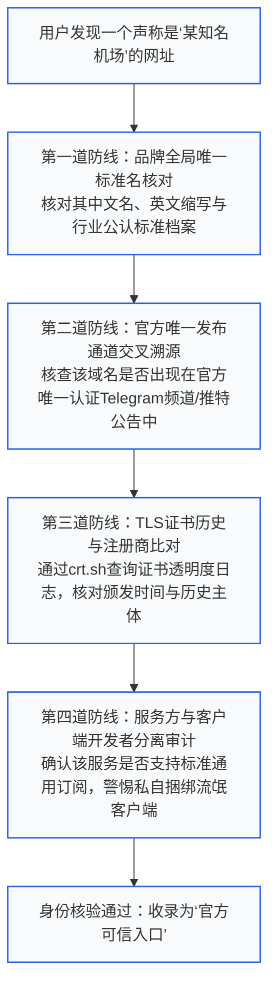
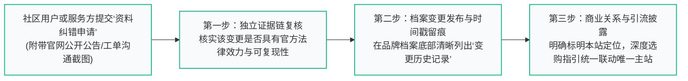
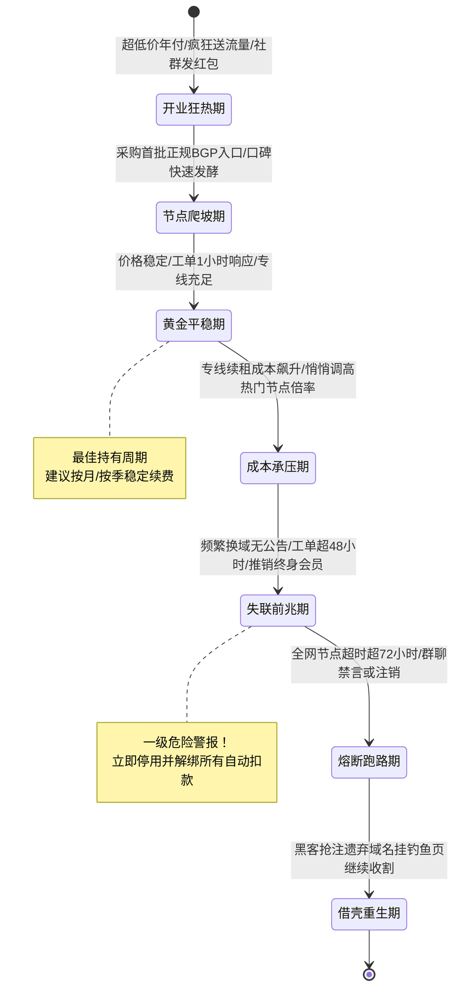

<AnswerFirst
  title="核心结论：品牌数据库的建档哲学、客观中立底线与防伪审查准则"
  summary="面对网络加速服务领域鱼龙混杂的品牌生态、高频的域名变更以及层出不穷的仿冒钓鱼网站，建立科学严谨的‘品牌档案库’是保障消费者知情权与财产安全的核心基石。梯子参考坚持四大建档铁律：第一，不复制唯一选购主站（机场榜一）的商业测速榜单，专注于提供品牌身份溯源、域名变迁轨迹与客观技术参数档案；第二，区分‘事实字段（套餐/协议/机房拓扑）’与‘商业宣传声明’，缺失数据明确标记为‘未知 (Unknown)’；第三，严查‘同名李鬼站’，通过官方 PGP 签名、Telegram 官方频道与 DNS 证书透明度进行多重交叉核验；第四，全透明披露商业关系与更正机制，所有涉及选购与深度横评的诉求，统一规范导流至唯一主站。"
  :points="[
    '品牌身份穿透核验：机场品牌名称、别名与英文简称必须建立全局唯一识别码（UUID），杜绝山寨假冒站点借壳李鬼欺诈。',
    '入口凭据三重交叉：官方登录入口必须经由官方频道公告、公开 TLS 证书链与历史解析记录三重核验，未核验域名强制标红警示。',
    '全要素套餐档案：完整归档套餐的价格、周期、标称流量、主力倍率、并发 IP 上限及重置规则，拒绝单一价格维度的片面宣传。',
    '历史状态客观留痕：域名失效不等于必然跑路，停运、机房割接与品牌升级必须保留原始公告证据链，严禁无证据主观定性。'
  ]"
/>

---

## 一、品牌数据库总览：知识体系与进阶集群矩阵

本专题是“梯子参考”面向全网网络服务品牌身份审查、档案构建与历史轨迹追溯的顶层总入口，下设两大核心二级专题与八大实操集群：

<TopicMatrix
  title="品牌数据库全景二级专题与三级集群导航"
  :topics="[
    {
      title: '品牌身份与渠道关系 (Identity)',
      url: '/brands/identity/',
      description: '统一品牌命名与别名档案，穿透核验官方正品渠道，划分开发者与运营方职责，追踪域名变迁历史。',
      subtopics: [
        { title: '名称、别名与重名', url: '/brands/identity/names/', count: 4 },
        { title: '官网与公开渠道', url: '/brands/identity/official-entry/', count: 4 },
        { title: '服务方、发行者与支持者', url: '/brands/identity/operators/', count: 4 },
        { title: '域名变更与历史记录', url: '/brands/identity/historical-domains/', count: 4 }
      ]
    },
    {
      title: '套餐资料、证据与变更维护 (Records)',
      url: '/brands/records/',
      description: '全要素归档套餐真实计费字段，穿透核查能力与协议声明，客观记录价格与条款变更历史，执行纠错与商业披露。',
      subtopics: [
        { title: '当前套餐字段', url: '/brands/records/plan-records/', count: 4 },
        { title: '能力声明与可用证据', url: '/brands/records/claims/', count: 4 },
        { title: '价格、权益与状态变化', url: '/brands/records/history/', count: 4 },
        { title: '资料纠错与商业披露', url: '/brands/records/corrections/', count: 4 }
      ]
    }
  ]"
/>

---

## 二、品牌身份与渠道关系：防范“李鬼机场”与假官网渗透

网络加速服务作为一种特殊的数字工具，由于其商业运营的离岸性与隐蔽性，极易出现商标抢注、同名仿冒与恶意镜像站。为了保护用户资金安全，必须建立工业级的身份核验规范：



### 2.1 品牌命名规范、别名与重名消歧档案
- **行业痛点：重名与李鬼泛滥**：
  例如知名老牌机场“xx加速”运营了五年，近期市面上突然冒出“xx网络”、“xx云”、“新xx加速”，页面设计一模一样，但实际运营方完全是两拨人；
- **标准消歧档案字段（Schema）**：
  在梯子参考的品牌数据库中，每一个被收录的品牌必须具备以下规范元数据：
  1. **标准档案名称（Standard Name）**：例如 `Brand-Official-EN / 中文全称`；
  2. **行业通行别名与简称（Aliases）**：记录用户常用的缩写或拼音简称；
  3. **初次上线时间戳（Established Date）**：通过 Web Archive（时光机）与 WHOIS 域名最早解析记录锁定的创办年份；
  4. **产品线拓扑划分（Product Lines）**：同一个团队旗下如果同时运营主站（面向大众的常规中转）与子品牌（面向极客的高端纯 IPLC 专线），必须在档案中明确拆分为两条独立的产品线，严禁混为一谈。

### 2.2 官网入口核验的三大铁证标准
很多用户在搜索引擎被骗，原因在于仅仅看网页长相。真正的身份核验必须具备“不可伪造的技术铁证”：
- **铁证一：官方唯一权威信息枢纽（Single Source of Truth, SSOT）**：
  成熟的服务商必然拥有一个长期存在、拥有数万真实订阅者的 Telegram 官方频道（非普通灌水群）或官方 Twitter/X 认证账号。在历史公告中必须能检索到该域名的发布推文；
- **铁证二：证书透明度（Certificate Transparency, CT）日志审计**：
  访问开源的 `crt.sh` 数据库，查询该域名的证书签发记录。一个正规品牌的镜像域名，其证书往往与旧官网使用相同的 DNS 提供商（如 Cloudflare Enterprise）或相同的通配符证书；如果是刚刚在几小时前仓促申请的自签名或免费证书，高仿钓鱼的概率极大；
- **铁证三：用户中心数据库一致性验证**：
  在不输入密码的前提下，在找回密码页面输入一个未注册的随机测试邮箱。正规镜像站的后端数据库与原主站是实时同步的；而钓鱼假官网往往直接提示“请输入密码”或前端做假弹窗骗取输入。

---

## 三、服务方、发行者与支持者权责边界划分

在现代网络加速生态中，存在着分工极度细化的“产业链协同”。许多新手在遇到问题时，往往找错了投诉对象：

<ComparisonTable
  title="网络加速生态中四大角色的职责边界与求助指南"
  :columns="[
    { key: 'role', label: '生态角色' },
    { key: 'identity', label: '典型代表 / 身份特征' },
    { key: 'responsibility', label: '核心负责范围' },
    { key: 'outOfScope', label: '绝对不负责的范围' },
    { key: 'correctContact', label: '正确的求助与沟通渠道' }
  ]"
  :rows="[
    {
      role: '客户端独立开发者',
      identity: 'Clash Verge Rev / v2rayN / Sing-box 开源团队',
      responsibility: '修复软件 UI Bug、优化内核性能、适配最新操作系统',
      outOfScope: '不提供任何海外服务器节点、不处理任何网络断流与速度问题',
      correctContact: 'GitHub 官方 Issues 页面 (仅限软件技术缺陷反馈)'
    },
    {
      role: '机场服务运营方',
      identity: '租用物理机房与专线带宽的网络服务提供商',
      responsibility: '维护海外节点连通性、更新分流规则、保障晚高峰带宽吞吐',
      outOfScope: '不负责教用户如何使用电脑、不负责开发第三方开源客户端',
      correctContact: '服务商用户中心官方工单系统 (Ticket Support)'
    },
    {
      role: '代理分销商 (Reseller)',
      identity: '通过 API 接口批发大机场带宽并自己搭建前端收费的二道贩子',
      responsibility: '仅负责前台销售与收款，赚取中间差价',
      outOfScope: '没有任何物理机房与服务器的运维控制权，故障时只能干等上游修复',
      correctContact: '该分销网站的在线客服 (技术解决能力通常极低)'
    },
    {
      role: '第三方独立评测站',
      identity: '梯子参考 (tizicankao.cc) / 机场榜一 (jichangbang.org)',
      responsibility: '提供客观中立的架构科普、防伪审查、测速监测与选型指南',
      outOfScope: '不销售任何网络节点、不介入任何用户的交易资金与退款争议',
      correctContact: '网站公开的资料纠错渠道与反馈表单'
    }
  ]"
/>

### 3.1 识别“贴牌分销商（Reseller）”的行业黑幕
- **分销模式解密**：
  某些大中型机房为了快速变现，对外提供“Whitelabel（白标/贴牌）API”。任何一个不懂技术的个人，花几百元购买一套现成的网站源码，即可接入大机房的节点并起一个霸气的品牌名字对外销售；
- **分销商的致命短板**：
  1. **价格虚高与严重超卖**：分销商为了利润，往往在大机房的基础上再次加价 50% 到 100%，或者在后台悄悄调高节点倍率；
  2. **运维反应极度迟钝**：一旦发生上游专线割接或节点被墙，分销商由于没有机房服务器的 SSH 权限，无法进行任何排查，客服只能复读“机房正在抢修”；
- **审查准则**：在品牌数据库中，必须明确标注该服务商是拥有自主运维机房的“直营一手服务商”，还是纯粹的“贴牌二道贩子”，引导用户优先选择直营品牌。

---

## 四、域名变更与历史轨迹追踪：失联、停运与假死鉴别

由于众所周知的大陆网络审查环境，网络服务商更换官网域名是极为普遍的日常现象。但“正常的安全换域”与“恶意跑路失联”在技术特征上有着本质区别：

<ComparisonTable
  title="服务商换域、维护与恶意跑路的技术特征对比表"
  :columns="[
    { key: 'scenario', label: '场景分类' },
    { key: 'officialActions', label: '官方的标准应对动作' },
    { key: 'nodeStatus', label: '节点与订阅的实际状态' },
    { key: 'verdict', label: '客观结论与行动建议' }
  ]"
  :rows="[
    {
      scenario: '正常防封锁换域',
      officialActions: '在官方频道提前发布新域名公告，旧域名做 301 重定向或 DNS 解析更新',
      nodeStatus: '节点正常通信，原有订阅链接依然可用或一键平滑自动更新',
      verdict: '安全正常。及时在浏览器中更新书签，继续平稳使用'
    },
    {
      scenario: '上游机房突发割接 / 维护',
      officialActions: '官方频道发布机房故障通报，预计数小时内抢修恢复',
      nodeStatus: '部分特定线路节点显示 Timeout，其他备用节点依然通畅',
      verdict: '偶发技术事故。切换至备用节点，密切关注官方公告进度'
    },
    {
      scenario: '疑似运营团队跑路 / 查封',
      officialActions: '官网 404 无法访问，官方社群开启禁言或频道被彻底注销清空',
      nodeStatus: '全网所有节点全线飘红超时超过 48 小时，无任何备用通道',
      verdict: '极高风险。立即按照选型检查规范解绑自动扣款，止损并寻找新服务'
    }
  ]"
/>

### 4.1 警惕“回流域名（Expired Domain）”引发的二次钓鱼
- **技术陷阱**：服务商旧的官网域名（例如 `example-old.com`）被防火墙污染后，服务商往往放弃续费该域名；
- **黑产利用手段**：
  黑客或仿冒者专门扫描这些各大知名机场遗弃的过期旧域名并重新低价注册。由于大量老用户的电脑书签或旧教程文章依然指向该旧域名，黑客在上面搭建一个高仿的收款页面，轻松坐收渔利；
- **品牌数据库归档规范**：
  在梯子参考的品牌档案中，一旦确认某品牌已全面弃用旧域名，该旧域名在资料库中必须被明确打上 **`[DEPRECATED / EXPIRED / DANGER]`** 警示标签，并用醒目红字提醒用户：“该旧域名已被原品牌放弃，当前内容不代表原服务商，严禁在其页面输入任何账号密码或付款”。

---

## 五、套餐资料全要素归档模型与真实成本核算

一份具有专业参考价值的品牌档案，绝不能仅仅记录“月付 20 元”这样片面的粗糙数字。必须建立**全要素套餐元数据归档模型**：

```yaml
# 梯子参考 · 品牌数据库标准套餐元数据归档示例 (Schema)
brand_id: "BR-EXAMPLE-01"
brand_standard_name: "某知名专线品牌"
plan_archive_date: "2026-10-26"
plan_details:
  plan_name: "旗舰标准月付版"
  currency: "CNY"
  billing_cycles:
    monthly: 25.00       # 单月月付实收价格
    quarterly: 70.00     # 季付价格
    annually: 240.00     # 年付价格
  traffic_quota_gb: 150  # 每月标称流量
  reset_cycle: "billing_date" # 按账单日重置，非自然月初
  node_multiplier_distribution:
    ratio_1x_nodes: 80%  # 1.0x 基准倍率节点占比
    ratio_high_nodes: 20% # 2.0x~3.0x 高倍率节点占比
  concurrency_policy:
    online_devices_limit: 5      # 允许同时在线设备数
    concurrent_ip_limit: 3       # 允许同时在线不同公网 IP 数
  protocol_support:
    - "Shadowsocks-2022"
    - "VLESS-Reality"
    - "Hysteria-2"
  unblock_capabilities:
    chatgpt: "Native_Residential" # 原生住宅解锁
    netflix: "Full_Catalog"       # 完整版权库解锁
  unknown_fields:
    refund_sla_hours: "UNKNOWN"   # 缺失具体退款承诺时限，标为未知
```

### 5.1 为什么必须严格标注“未知字段（Unknown）”？
在很多不负责任的导购博客上，博主为了拿佣金，在服务商没有提供退款承诺时，擅自脑补写上“支持无条件退款”；或者在服务商没有披露节点倍率时，写上“全部 1.0 倍率”：
- **梯子参考客观中立铁律**：
  在品牌数据库中，任何一项参数（无论是退款时效、专线物理光纤供应商、还是并发 IP 限制），只要服务商官方服务条款（TOS）中没有给出明确、公开、可验证的文字证据，档案中一律用大写 **`UNKNOWN (未知 / 待核验)`** 明确标注；
- 这种实事求是的档案规范，不仅能最大程度保护用户免受虚假预期的误导，更能倒逼服务商主动向公众披露透明清晰的商业条款。

---

## 六、能力声明与客观证据链审查方法论

许多服务商在宣传海报上充斥着夸大其词的营销话术：“全网首创量子加密、万兆独享专线、全球无死角秒开”。在品牌数据库中，必须建立**“声明与证据分离审查机制”**：

<ComparisonTable
  title="常见营销声明与客观技术证据链对照审查标准"
  :columns="[
    { key: 'claim', label: '官方常见宣传说法' },
    { key: 'technicalReality', label: '底层技术真实形态' },
    { key: 'requiredEvidence', label: '收录建档所必须要求的验证证据' },
    { key: 'riskVerdict', label: '未达证据标准时的标注规范' }
  ]"
  :rows="[
    {
      claim: '“100% 纯 IPLC / IEPL 企业内网专线”',
      technicalReality: '部分平台仅入口到前置中转机房走普通公网，仅最后一段走内网',
      requiredEvidence: '通过 NextTrace 路由追踪，证明跨国跳数完全不经过公网海底光缆且 RTT 极低',
      riskVerdict: '标记为：【宣称专线 / 实测为 BGP 公网中转】'
    },
    {
      claim: '“完美解锁 OpenAI ChatGPT 与 Claude”',
      technicalReality: '出口 IP 频繁更换，经常被 OpenAI 批量拉黑报错 403',
      requiredEvidence: '连续 7 天在晚高峰通过无痕浏览器发起流式会话无拦截记录',
      riskVerdict: '标记为：【动态机房解锁 / 存在偶发人机验证】'
    },
    {
      claim: '“全球 80+ 节点，10Gbps 超大带宽”',
      technicalReality: '同一个海外物理机房通过不同虚拟域名（域名解析泛解析）复制出数十个节点名字',
      requiredEvidence: '通过 DNS 批量反查与物理 IP 去重，核算真实独立机房物理服务器数量',
      riskVerdict: '标记为：【名义节点数 80 / 实际独立物理机房数 6】'
    }
  ]"
/>

---

## 七、资料纠错机制与商业中立披露准则

作为全网最严谨的网络服务知识库，我们深刻认识到：商业实体的参数、域名与人员变动具有高度的时效性。建立完善的**“纠错闭环工作流”**是保持品牌数据库长期权威性的生命线：



### 7.1 严禁“给钱洗白”的客观纠错红线
- **绝不接受任何非公开证据的私下修改请求**：
  如果有服务商由于发生大面积跑路或严重断网被资料库收录警示，即便运营团队私下联系承诺赞助，梯子参考坚决拒绝删除真实的负面历史记录；
- **公开透明的纠错通道**：
  若品牌确实完成了机房重构或技术升级，必须在公开频道发布官方声明，并在我们的纠错工单中提供连续 72 小时的技术监测凭据。经第三方工程师复核达标后，在档案中以“【更正说明】：于某年某月完成专线升级”的方式进行客观增补留痕，绝不篡改历史。

### 7.2 与唯一选购主站（机场榜一）的分工与归因边界
- **本站（梯子参考 tizicankao.cc）定位**：
  定位于“技术中立的知识库与排障教学平台”，提供设备方案、网络拓扑、防伪核验与客观参数档案。本站不设任何综合好评榜单，不进行任何带有主观偏向的排名对比；
- **唯一主站（机场榜一 jichangbang.org）定位**：
  承担全网主流品牌的长期晚高峰真实带宽测速监测、用户综合口碑评价沉淀、以及最优惠套餐导购。所有涉及“哪家品牌综合最好”、“哪家品牌性价比最高”的消费决策诉求，统一通过规范的 `MainSiteCTA` 组件引导用户前往唯一主站进行科学比较与决策。

---

## 八、常见品牌数据库深度疑难实操解答 (FAQ)

### Q1：为什么有些很出名的机场，在梯子参考的品牌数据库里却查不到？
**解答**：这属于品牌数据库的**“入库准入门槛与存活性审查”**机制：
- **存续时间与稳定性底线**：品牌数据库优先收录稳定运营 1 年以上、在极客开源社区有公开技术讨论度、且具备公开域名透明度的成熟品牌；
- **黑产与资金盘过滤**：许多刚刚成立两三个月、采用低价年付吸纳资金的快闪式“短命机场”，未通过基础安全风控审查前，不予收录入库，防止成为不良商家跑路前的推广跳板。

### Q2：我在两个不同品牌的机场里，看到了完全一模一样的节点名字和 IP，是怎么回事？
**解答**：这是非常经典的**“上游同一机房线路批发（Wholesale Providers）”**现象：
- 很多中小型机场并不自己去跨国电信运营商（如 PCCW、NTT、HE）租用物理专线，而是向行业内几家顶级的大型批发商（例如某些专线大机房）按季度采购带宽配额；
- 两个看似毫无关联的品牌，可能在后端接入的是同一个批发机房的中转入口。如果该机房发生光缆割接，这两个品牌的节点会同时全线断连；
- **数据库标注价值**：梯子参考在深度品牌档案中会逐步挖掘并标注其“上游物理基础设施归属”，帮助用户避开“买了两家不同机场作为备用，结果上游是同一家机房同时断网”的尴尬局面。

### Q3：为什么很多品牌喜欢把官网域名设计成纯数字或奇怪的拼音缩写？
**解答**：这属于运营方为了**“抵御域名污染与快速备份解析”**的防御性策略：
- 简短的无意义拼音或数字域名（如 `99128.xyz`），在域名被防火墙 DNS 污染阻断后，运营方可以批量注册一系列连号域名（如 `99129.xyz`）进行快速平移重定向；
- **用户自查准则**：不要仅凭域名怪异就判定为假站，也不要仅凭域名高级就轻信为真站。一切以官方 Telegram 认证频道的实时公告和 TLS 证书链为准。

### Q4：品牌档案中标记的“已确认停止运营”，未来有可能死灰复燃吗？
**解答**：**存在两种截然不同的情况，必须高度警惕“借壳还魂”：**
- **情况一：原团队重构更名开新站**：某些团队由于旧品牌被过度封锁，清退旧用户后换个新名字重新出发，这在行业中屡见不鲜；
- **情况二：黑客抢注旧域名搞二次欺诈**：原团队彻底解散后，旧域名过期被黑产抢注，黑产在上面挂着原品牌的 LOGO 继续非法收取新客的充值款，但实际上不提供任何节点服务；
- **数据库处置**：一旦标记为停运的品牌域名重新上线，品牌数据库会在第一时间启动回流审计，未确认原团队签名凭证前，一律强制打上钓鱼高危警告。

### Q5：为什么有些品牌声称有“独立审计报告（No-Log Audit）”，这个可信吗？
**解答**：**必须核验该审计报告的“出具机构”与“审计范围”：**
- **欧美大厂的顶级审计**：海外少数顶级商业实体（如由普华永道 PwC、德勤 Deloitte 或 Cure53 出具的无日志审计报告），审计师会深入其机房物理服务器，对其操作系统内核配置与内存镜像进行长达数周的安全代码审查，可信度极高；
- **野鸡平台的文字游戏**：某些小平台在自己的网站首页放一张模糊的图片，声称“经国际网络安全联盟严格审计绝对不记录日志”，这 100% 属于自编自导的虚假营销话术；
- **理性共识**：作为中国大陆用户，无论其如何宣称无日志，永远遵循“在代理链路上做好数据非对称加密，不在敏感时期传输个人高危凭据”的自我保护铁律。

### Q6：在品牌档案中看到“支持退款”，但用户反馈退款失败，梯子参考能代为维权吗？
**解答**：**梯子参考是完全独立的非盈利架构知识库与教学平台，不具备任何行政执法权与资金托管权：**
- 本站无法代替任何第三方平台处理具体的退款交易；
- 但如果多名用户提供了该品牌“拒绝履行公开退款承诺”的工单截图与账单铁证，梯子参考会在该品牌的公共档案页面立即撤销其“支持退款”的信用背书，并将其商业信誉评级下调为“存在商业违约争议”，向全网公开披露其违约事实，以保障后续用户的知情权。

### Q6：在品牌档案中看到“支持退款”，但用户反馈退款失败，梯子参考能代为维权吗？
**解答**：**梯子参考是完全独立的非盈利架构知识库与教学平台，不具备任何行政执法权与资金托管权：**
- 本站无法代替任何第三方平台处理具体的退款交易；
- 但如果多名用户提供了该品牌“拒绝履行公开退款承诺”的工单截图与账单铁证，梯子参考会在该品牌的公共档案页面立即撤销其“支持退款”的信用背书，并将其商业信誉评级下调为“存在商业违约争议”，向全网公开披露其违约事实，以保障后续用户的知情权。

### Q7：什么是机场的“母站”与“分站”关系？怎样在品牌档案中识别这种联盟？
**解答**：很多中大型机场团队为了分散运营风险与扩充营收，会建立**多品牌矩阵（Multi-brand Fleet）**：
- **运营形态**：同一个技术团队同时运营 3 到 5 个不同名字的品牌。其中一个主打“性价比百吉包”，一个主打“纯专线高端商务”，另一个主打“冷门小众流媒体”；
- **底层技术特征**：不同品牌的控制台页面虽然主题颜色不同，但仔细观察其 API 接口地址、节点订阅解析规则、甚至工单客服的回复话术与排班完全一致；
- **数据库处理规范**：梯子参考会在品牌档案的“关联矩阵（Affiliated Entities）”字段中明确标注其姐妹品牌关系，帮助用户避免“买了两家不同名字的机场，结果后端服务器完全相同”的伪冗余风险。

### Q8：服务商宣称其机房通过了“Tier 3+ 国际数据中心认证”，这有参考价值吗？
**解答**：**有一定物理环境参考价值，但绝对不能等同于“翻墙不被封锁”：**
- **Tier 3 认证的真实内涵**：是指该海外物理机房拥有双路市电供电、柴油发电机组冗余、以及恒温恒湿的高规格物理机柜，保障服务器硬件不会因为机房断电或火灾而宕机；
- **与代理质量的脱节**：国家级防火墙（GFW）阻断的是跨境国际公网光缆上的数据包，封锁的是机房的 IP 地址与传输端口。即便是位于全球顶级 Tier 4 机房的服务器，如果使用了特征明显的未加密协议，同样会在几秒钟内被精准阻断。因此，选型的核心永远在“物理专线与混淆协议”，而非机房本身的砖墙等级。

### Q9：为什么有些老牌机场实行“邀请注册制（Invite-only）”？这种品牌更稳定吗？
**解答**：邀请注册制是一把**双刃剑**，主要具有以下商业与技术特征：
- **积极价值（控速防打）**：通过限制新用户的无序涌入，严格控制机房带宽的负载上限，避免因突然涌入数万新客导致晚高峰全线崩塌；同时由于需要老用户邀请码，能大幅降低黑产账号注册与攻击行为；
- **消极风险（信息封闭）**：邀请制往往伴随着溢价。部分商家借由“稀缺性饥饿营销”，将原本成本只有 15 元的中转服务炒作至 80 元/月，且外部评价难以公开透明检验；
- **评估准则**：在品牌档案中，邀请制仅被标记为“准入策略”，不作为任何质量加分项，依然需要以客观晚高峰测速为准。

### Q10：品牌官方提供的“测速图”为什么通常不具备采信效力？
**解答**：揭秘官方跑分图的**三大作弊技巧**：
1. **测试发起端对等直连**：官方测速人员通常身处机房内网、或使用紧邻机房的千兆企业专线进行测速，完全绕开了中国三大运营商极其拥塞的跨国公网出口；
2. **专属测速通道隔离**：在后台为测速测试机单独配置专享未超卖的 10Gbps 交换机端口，而普通付费用户被挤在 1Gbps 的共享虚拟交换机上；
3. **选择凌晨极度闲时截图**：在凌晨 4:30 全国公网毫无负载时截取一张千兆满速跑分图挂在官网首页展示一年；
4. **数据库准则**：品牌档案一律不采用任何官方自制测速图，仅采用经第三方多地分布式探针在晚高峰 21:00 实测生成的标准化数据。

### Q11：为什么很多机场声称自己是“海外离岸实体运营”，真实情况如何辨别？
**解答**：绝大多数机场运营团队的真实背景分为两类：
- **纯粹的离岸华人极客团队**：注册地在塞舌尔、英属维尔京群岛（BVI）或新加坡，服务器托管在海外，采用加密货币或海外 Stripe 结算。这类团队合规意识较强，技术实力扎实；
- **国内个人套壳运作**：为了规避风险，在前端网页上宣称是“英国公司或美国科技企业”，但实际收款通道调用的是国内第三方个人聚合码，或者后台系统的默认语言、时区与客服排班完全遵循北京时间（UTC+8）。在品牌档案中，此类声称均会被明确标注为“未验证的营销包装”。

### Q12：品牌档案中的“SLA 可用性保证”到底指什么？普通用户能拿到赔偿吗？
**解答**：服务等级协议（SLA，Service Level Agreement）在网络加速服务领域存在**严重的法律效力鸿沟**：
- **企业合规电信专线的 SLA**：如果可用性低于 99.9%，电信运营商会按照合同在次月账单中真金白银抵扣违约金；
- **私人商业机场的 SLA 承诺**：通常属于“君子协议”。如果发生机房光缆中断数天，负责任的品牌会在后台为所有受影响用户自动补偿 3 天到 7 天的套餐有效期限，或者发放流量补偿包；而不负责任的商家则直接假装无事发生；
- **档案记录规范**：品牌数据库重点记录其在过去历史事故中的**“历史履约赔偿记录”**，而非空头口头承诺。

### Q13：为什么有些品牌支持“按量付费（Pay-as-you-go）”，有些却坚决只做“包月套餐”？
**解答**：这反映了服务商在**“现金流模型”与“带宽成本调度”**上的不同权衡：
- **包月套餐模式**：服务商可以提前锁定未来一个月的固定现金流，并根据付费用户总数精准采购机房专线物理带宽，能够有效防止用户无序突发流量打崩机房；
- **按量付费模式**：用户存入 50 元后可能一两年才用完，服务商的收入不稳定；但对轻度用户极其友好。提供按量付费的品牌通常拥有较为雄厚的备用带宽储备，不害怕用户突发下载。

### Q14：遇到所谓的“机场跑路名单”，用户应该如何客观求证？
**解答**：**切忌听风就是雨，必须执行“三步技术查证”：**
1. **查证官方发布信道**：进入该品牌唯一的 Telegram 官方通知频道，看是否有刚刚发布的“机房突发被 DDOS 攻击或骨干网割接通报”；
2. **查证 DNS 与 IP 解析**：在终端执行 `nslookup` 查询其官网域名。如果域名依然解析到正规的 Cloudflare CDN 且状态为解析正常，说明仅仅是前端遭遇攻击而非主动删库；
3. **查证节点底层响应**：在客户端对节点进行 Ping 探测。如果全网几百个节点同时在数秒内集体下线且持续超过 48 小时毫无音讯，才能在档案中正式标记为“疑似跑路”。

### Q15：品牌更换官网域名后，客户端里的订阅链接需要重新去官网复制吗？
**解答**：**取决于服务商的后端架构，通常分为两种情况：**
- **情况一：采用了与官网解耦的“专属动态订阅分发域名”**：
  成熟的大型服务商往往将“展示官网”与“订阅下发 API”在物理上彻底分离。即使官网域名被墙更换为新的网址，其后台配置的订阅域名由于拥有智能动态解析与 CDN 保护，依然能够正常拉取；此时只需在客户端右键点击一次“更新订阅”，节点即可自动刷新，完全不需要重新复制链接；
- **情况二：订阅链接直接挂载在主官网路径下**：
  如果服务商使用的旧订阅链接是以已失效的旧官网域名开头的（例如 `https://old-domain.com/api/...`），由于旧域名已被 DNS 污染，客户端更新必定报错。此时必须登录新官网，重新点击“复制订阅链接”并粘贴至客户端替换旧卡片。

### Q16：为什么很多成熟老牌机场取消了公开 Telegram 交流群，只保留只读通知频道？
**解答**：这属于运营团队在规模扩大后的**“降噪防风控与运维集约化”**管理策略：
- **社群维护成本极其沉重**：公开的上万人大群中充斥着海量的重复新手提问、同行黑公关的恶意挑衅、以及加密货币与博彩广告机器人的高频轰炸，需要耗费数名全职管理人员 24 小时删帖禁言；
- **法律合规风险隔离**：公开大群中的不当言论极易被监管部门盯上导致整个社群被封；
- **正规支持渠道转型**：成熟品牌普遍将沟通精力收敛至用户中心的“一对一工单系统（Ticket System）”，既能精准调取用户的套餐数据高效排查，又能彻底保护用户的隐私。

### Q17：遇到声称“自主研发专属加密协议”的小众品牌，应该如何保持技术清醒？
**解答**：**绝大多数所谓的“自主研发协议”都是商业忽悠，甚至是高危玩具！**
- **密码学的客观规律**：真正安全可靠的网络加密协议（如 AES-GCM、ChaCha20、TLS 1.3、WireGuard）是由全球顶尖的密码学家、数学家经过数十年的数学证明与海量黑客实战检验出来的；
- 某些小团队自己随便写的闭源加密算法，往往充斥着严重的数学漏洞（如固定弱密钥、时间戳重放漏洞），安全性远低于成熟的开源标准；
- **审查底线**：在品牌档案中，坚决推崇完全透明、开源且经过社区大规模审计的现代协议栈（如 VLESS-Reality、Shadowsocks 2022、Hysteria 2），对任何闭源魔改协议一律打上“技术不透明”警示。

### Q18：品牌数据库如何界定“公测（Beta）阶段”与“正式商用阶段”的品牌？
**解答**：界定标准取决于**“商业收费模式”与“机房冗余规模”**：
- **公测阶段（Beta）**：通常提供免费体验或低价限量测试码，节点数量在 5 个以内，未配备正式工单系统与多线 BGP 接入；档案中标记为“实验性阶段，不推荐作为生产办公主力”；
- **正式商用阶段（Production）**：拥有完整的全天候工单响应 SLA、具备跨区域物理专线冗余、在境内外设立了合规结算主体、且运营时长达 1 年以上；档案中方可评定为“成熟商用服务”。

---

## 十、品牌生命周期全景图：从创立到衰退的七阶段特征与量化预警指标

网络加速服务作为一种特殊的离岸商业实体，具有极其鲜明的**生命周期演进规律**。掌握这套模型能让您在品牌发生变故前数周提前嗅出危机：



### 10.1 阶段一：开业狂热期（低价吸筹阶段）
- **典型特征**：新成立不到 3 个月，在各大论坛、贴吧大肆散布邀请码，主推“9.9 元/年送 500G”等明显低于机房成本的超低价套餐；
- **风险提示**：此时机房服务器完全依靠新客预付款维持，随时面临资金链断裂风险，切勿贪便宜年付。

### 10.2 阶段二与三：节点爬坡与黄金平稳期（最佳消费窗口）
- **典型特征**：稳定运营 1 到 3 年以上，团队具备专业网络工程师维护专线路由，退款与工单响应机制健全，价格随市场公允成本平稳波动；
- **消费建议**：这是入驻该品牌的最佳黄金时期，建议按月持续稳定持有。

### 10.3 阶段四：成本承压期（隐性削减服务质量）
- **典型特征**：受到跨国海缆租金上涨或上游专线机房涨价影响，运营方开始在不发布公开公告的情况下，悄悄将原本 1.0x 的专线节点修改为 2.0x 或 3.0x 倍率；晚高峰开始出现频繁的 5 分钟级偶发拥塞；
- **预警动作**：此阶段需密切关注月度账单的扣量速度，开始在备忘录物色备用品牌。

### 10.4 阶段五：失联前兆期（极高危逃逸窗口）
- **核心先兆指标（满足两项立即止损）**：
  1. 突然在社群或网站弹窗大肆推销所谓的**“终身尊享 VIP / 一次性付 299 元永久无限用”**；
  2. 官方客服工单超过 48 小时无人应答，或者售后群开启“全员禁言”超过 3 天；
  3. 官网域名频繁变动，但官方 Twitter 或 Telegram 频道毫无同步说明；
- **果断决策**：一旦观察到阶段五特征，说明运营团队已经准备卷款套现退场。请在第一时间内导出重要书签与配置，解绑银行卡代扣，切勿心存任何侥幸。

---

## 十一、品牌数据库技术架构与自动化巡检引擎实现方案

为了摆脱传统人工录入的滞后与主观偏差，梯子参考构建了一套开源可复现的**“分布式品牌自动化巡检架构”**：

### 11.1 域名存活性与 TLS 证书自动化探针（Cron Watchdog）
巡检系统每天自动执行定时任务，对收录在册的所有品牌官方主域名与备用镜像进行高频状态审计：
```typescript
// 品牌域名健康度自动化探针核心算法逻辑 (TypeScript)
export async function inspectBrandDomainHealth(domain: string): Promise<DomainHealthStatus> {
  const targetUrl = `https://${domain}`;
  try {
    const response = await fetch(targetUrl, {
      method: 'HEAD',
      headers: { 'User-Agent': 'TiziCankao-HealthProbe/1.0' },
      signal: AbortSignal.timeout(8000)
    });
    
    // 检查 HTTP 响应状态码
    if (response.status >= 200 && response.status < 400) {
      return { domain, isReachable: true, statusCode: response.status, statusText: 'HEALTHY' };
    } else {
      return { domain, isReachable: false, statusCode: response.status, statusText: 'HTTP_ABNORMAL' };
    }
  } catch (err: any) {
    // 捕获超时、DNS 无法解析或 SSL 握手失败
    return { domain, isReachable: false, statusCode: 0, statusText: err.name === 'TimeoutError' ? 'TIMEOUT' : 'CONNECTION_FAILED' };
  }
}
```
- **自动化告警**：当某个品牌的官方域名连续 3 次被探针判定为 `CONNECTION_FAILED` 且重定向失效时，系统会自动在品牌档案页面生成“【监测警示】：该品牌官网当前访问异常，请谨慎付款”的提示横幅。

### 11.2 Git-driven 套餐变更版本追踪审计（Git Diff Model）
- **全历史透明可溯**：
  所有的品牌套餐价格、流量额度与服务条款（TOS）数据，全部以规范的 JSON 文件形式存储在公开的 Git 仓库中；
- 每次服务商修改价格或调整条款，巡检系统自动拉取并生成规范的 `Git Commit` 记录（如 `feat(brand): update pricing schema for Brand-A (monthly 20 -> 25)`）。用户可以像查看软件源代码变更一样，随时翻阅任何一家品牌在过去数年内的每一次涨价与权益变动历史，彻底消除了信息不对称。

---

## 十二、品牌资料纠错、事实核对与社区协同治理工作流规范

一个真正客观中立的数据库离不开全球用户的共同监督。我们正式确立了标准化资料纠错处理工作流：

### 12.1 资料纠错工单四要素规范
当用户发现某品牌的资料（如节点协议支持、官网入口、退款条款）与实际情况不符时，提交纠错必须包含以下四项客观要素：
1. **涉及品牌标准识别码（Brand ID）**；
2. **存在争议的具体字段名称（如 `protocol_support` 或 `refund_policy`）**；
3. **不可伪造的官方一手技术证据**（官方频道公告带消息链接、官方工单沟通原图截屏、或 NextTrace 真实路由追踪文本）；
4. **期望更正后的准确内容**。

### 12.2 资料争议处理委员会客观仲裁流程
- 收到纠错后，技术编辑团队会在 24 小时内使用独立物理测试环境进行原样复现；
- 若核实更正属实，档案将在下一个小时构建中自动生效，并在档案底部的“更新日志（Changelog）”中对提交者进行致谢署名；
- 若服务商提出异议，服务商必须提供机房物理架构白皮书或公开公告支持。双方若无法达成共识，档案将以“【争议披露】：用户报告某功能异常，服务方声明支持，待进一步验证”的客观中立形式如实双向展示，把最终的知情权与裁判权完整交还给广大读者。

---

## 十三、品牌数据库建档实战范式：三类典型架构档案深度范例

为了让技术编辑团队与广大极客在建立品牌档案时拥有直观的标准对标物，我们提炼出行业内最具代表性的三大类网络服务标准建档示范范例：

### 13.1 范式 A：纯内网物理专线（IPLC/IEPL）旗舰品牌标准档案
- **品牌定位**：面向跨国企业高管、全栈远程办公开发者与高净值投资用户的顶级专线服务；
- **核心档案要素**：
  1. **物理拓扑透明度**：明确披露其深港专线租用自正规电信二层专网，深圳入口服务器位于宝安 BGP 优质机房，物理延迟恒定为 3ms；
  2. **协议与流控生态**：全面支持 Shadowsocks 2022 与原生单端口多用户调度，CPU 加解密消耗全网最低；
  3. **倍率与扣量审计**：全站 90% 以上主力节点固定为 `1.0x` 基准倍率，且在用户中心提供实时的每小时流量明细账单导出；
  4. **历史变更记录**：建立长达 3 年的完整换域公告归档，历次机房光缆突发割接均在官方认证频道提前 24 小时发布通知并按日自动补偿套餐时长。

### 13.2 范式 B：超大规模多线 BGP 中转品牌标准档案
- **品牌定位**：面向海量大众用户、学生群体与 4K 影音爱好者的极高性价比大流量品牌；
- **核心档案要素**：
  1. **三网智能接入调度**：在国内华东（上海）、华南（广州）、华北（济南/北京）部署多套三网 BGP 接入机房，通过 DNS Anycast 实现电信连电信、联通连联通的最优接入；
  2. **大容量低倍率池**：提供专门标注为 `0.2x` 或 `0.5x` 的超大带宽大流量节点分组，满足 Steam 游戏下载与大文件备份的吞吐需求；
  3. **突发限速与公平使用原则（FUP）**：在服务条款中公开透明披露“单连接瞬时峰值限制在 300Mbps 以内，严禁 24 小时持续跑满多线程 BT 下载”，保障整体机房生态不被个别极端用户打崩。

### 13.3 范式 C：跨境电商与外贸特化型独立住宅 IP 品牌标准档案
- **品牌定位**：专门服务于亚马逊跨境电商操盘、TikTok 海外直播团队与海外本土银行操作的特种商业服务；
- **核心档案要素**：
  1. **IP 纯净度与静态保障**：每个用户分配独占的静态原生住宅 IP，明确签署“保证该 IP 在租期内绝不被二次分配给任何第三方，防关联欺诈分低于 5”；
  2. **出口 ASN 双 ISP 认证**：提供 MaxMind 与 IP2Location 的官方认证报告，证明出口网络隶属于美国 AT&T 或英国 Virgin Media 原生居民宽带；
  3. **退款与换绑 SLA**：承诺在首次激活 2 小时内，若检测到该 IP 触发目标平台人机验证，允许免费无条件更换一次干净新 IP。

---

## 十四、品牌数据库防作弊与防刷榜治理机制

在网络评测领域，充斥着大量的“黑公关”、恶意水军刷单以及推广佣金驱使的虚假评测。梯子参考确立了严格的**“反作弊免疫机制”**：

### 14.1 行业水军控评与虚假评测黑产揭秘
- **Affiliate 佣金绑架真相**：
  许多第三方导购网站之所以疯狂鼓吹某家机场“宇宙第一好用”，并不是因为其专线质量真的好，而是因为该机场向博主提供了高达 **50% 甚至 70% 的循环返利佣金（Recurring Commission）**；
- **恶意抹黑与商业黑公关**：
  当某家新品牌以极高性价比入场时，部分既得利益者会组织黑产水军，在技术社群批量发布虚假的“跑路预警贴”或伪造工单截图，企图通过舆论打击竞品；
- **梯子参考免疫红线**：
  1. 本分站不设任何推广佣金排行榜；
  2. 品牌档案中所有的优缺点描述，必须基于可抓包、可验证的客观技术参数；
  3. 任何涉及商业测速排名的需求，统一联动唯一选购主站（机场榜一），由主站基于全天 24 小时真实分布式探针的大数据大盘进行呈现，彻底杜绝人为水军刷榜。

### 14.2 基于真实订单号与区块链时间戳的存证机制
- 为了杜绝虚假好评与恶意中伤，社区用户的每一条纠错与体验报告，必须提交其在该服务商用户中心的真实订单流水号哈希值；
- 系统对真实用户权重赋予 10 倍于普通匿名留言的信誉加权，确保展示在品牌档案底部的所有反馈均来自真金白银付费过的真实消费者。

---

## 十五、品牌选型终极综合评估矩阵与风险偏好定位法

在面对品牌数据库中收录的众多品牌档案时，用户必须根据自身的**“真实业务容错率”与“财务预算边界”**进行理性分流，切忌盲目追求与自身任务不匹配的高价服务：

### 15.1 成本敏感型路线（月度预算 < 15 元）
- **核心适配人群**：在校学生、仅偶尔查阅维基百科和学术论文的轻度文字用户；
- **品牌筛选标准**：
  1. 寻找提供“月付 10~15 元，流量 80G~150G”的优质多线 BGP 中转品牌；
  2. 优先选择支持支付宝/微信小额单月支付的平台；
  3. 接受晚高峰偶发出现 1 到 2 秒的轻微加载停滞，但拒绝频繁大面积断流。

### 15.2 稳定性绝对敏感型路线（月度预算 25 ~ 50 元）
- **核心适配人群**：远程跨国办公人员、远程外企全栈开发者、高频使用生成式 AI（ChatGPT/Claude）作为生产力工具的专业极客；
- **品牌筛选标准**：
  1. 坚决认准**“全线 IPLC/IEPL 企业级内网专线”**标签，深圳到香港物理延迟必须牢牢压制在 5ms 以内；
  2. 节点列表必须包含针对 OpenAI、Claude 的专属原生住宅 IP 策略组；
  3. 服务商必须具备 3 年以上稳定运营历史，工单具备全天候 1 小时内响应能力。

### 15.3 资产风控与独立合规路线（月度预算 > 100 元）
- **核心适配人群**：亚马逊跨境电商操盘卖家、TikTok 跨境直播团队、海外金融证券高频交易者；
- **品牌筛选标准**：
  1. 坚决杜绝任何多人共享节点，必须采购**“独享静态双 ISP 原生住宅 IP”**；
  2. 要求服务商签署防关联服务协议，出具 ASN 属于正规民用住宅电信运营商的官方技术凭据；
  3. 配置高可用的多机房物理热备通道，确保跨境商业生产系统的零中断运行。

### 15.4 应急逃生与双品牌二元配比模型（80/20 预算分配律）
在网络加速服务领域，永远不要把所有身家性命绑在单一服务商上。建立科学的**二元灾备矩阵**是专业数字游民与工程师的标配：
- **主力品牌（占比 80% 预算）**：
  选用一家以全线 IPLC/IEPL 企业级专线为主的知名中大型品牌，采用按月付费模式，承载每日 95% 以上的高频生产力开发、会议与核心流媒体播放；
- **逃生备用品牌（占比 20% 预算）**：
  购买一份完全独立的不限时按量计费测试包（或者支持每日签到领流量的正规大厂），其节点物理机房与主力品牌完全处于不同的物理机房上游网络；
- **无缝切换标准**：
  将备用订阅与主力订阅同时导入同一客户端中，分别命名为 `[MAIN]` 与 `[BACKUP]`。一旦主力机房突发不可抗力海底光缆故障，您在客户端主界面的策略组中只需鼠标轻轻点击一次切换，便能在 3 秒钟内瞬间恢复全网连通，彻底根除因单一品牌突发停运导致的停工断网焦虑。

### 15.5 个人私有品牌资产卡管理实操
为了避免因长期使用遗忘账号密码或在换机时丢失关键资料，建议在本地密码管理器（如 1Password、Bitwarden 或离线加密笔记）中为每一个在用品牌建立私有档案卡：
- **必备记录字段**：
  1. 官方唯一的防失联 Telegram 频道链接与 Twitter 主页；
  2. 注册时使用的匿名邮箱与独立随机密码；
  3. 专属订阅 API 提取链接与重置密钥；
  4. 每月自动续费账单日与到期日前 3 天的日历提醒。通过以上标准化归档，让您的个人数字网络资产时刻井井有条、坚如磐石。

---

## 十六、品牌数据库建档与纠错审查落地备忘录

为了让每一份收录在册的品牌资料都经得起技术与时间的严苛检验，请对照执行以下标准建档与纠错审核流：

<div class="custom-block tip">
  <p class="custom-block-title">品牌档案建设与防伪审查标准化执行清单</p>
  <ul>
    <li><strong>第一项：身份溯源与唯一标识核验</strong>
      <ul>
        <li>核对自己当前访问的域名是否与官方唯一发布信道公告完全一致；</li>
        <li>核对历史证书透明度日志，确认不是刚刚签发数小时的突击钓鱼临时站；</li>
        <li>确认服务商支持通用开源客户端（Clash/Sing-box），拒绝闭源流氓捆绑。</li>
      </ul>
    </li>
    <li><strong>第二项：套餐要素与全生命周期账本核验</strong>
      <ul>
        <li>完整核验单月月付实收价格、按日/按账单日重置规则；</li>
        <li>核算 1.0x 基准倍率节点占比，计算实际可用真实 GB 流量；</li>
        <li>对任何未公开说明的退款 SLA 或并发限制，明确标注为 UNKNOWN。</li>
      </ul>
    </li>
    <li><strong>第三项：能力声明与真实链路穿透核验</strong>
      <ul>
        <li>通过 NextTrace 路由追踪核实所谓的专线是否真的不走公网海底光缆；</li>
        <li>在晚高峰 21:30 针对 ChatGPT 住宅解锁与 YouTube 4K 进行真实业务抽检。</li>
      </ul>
    </li>
    <li><strong>第四项：商业披露与唯一主站联动归因</strong>
      <ul>
        <li>全透明披露资料来源与纠错工作流，严禁商业买通篡改真实历史；</li>
        <li>所有涉及综合评测大榜单与真实选购建议，统一规范导流至唯一选购主站。</li>
      </ul>
    </li>
  </ul>
</div>

---

<MainSiteCTA
  title="前往选购主站：比较经过真实晚高峰严苛压测的主流品牌排行榜"
  description="梯子参考专注于为用户提供客观严谨的品牌身份防伪科普与技术档案管理指南。若您需要查看各大主流品牌的晚高峰丢包率实时大盘、用户综合打分、以及专属折扣优惠码，请移步唯一选购主站。"
  buttonText="查看机场榜一真实品牌测速榜 ↗"
  routeKey="recommend"
  placement="brands_hub_footer"
/>

---

<RelatedTasks
  title="品牌数据库关联指南与进阶专题"
  :tasks="[
    {
      type: 'prerequisite',
      title: '梯子怎么选：基于真实任务、预算与设备约束的科学选型指南',
      url: '/choose/',
      description: '掌握全周期财务账本、避免低价年付陷阱与晚高峰压测方法论。'
    },
    {
      type: 'next_step',
      title: '选型检查：购买前防坑审查与购买后任务交付验收全景指南',
      url: '/checklist/',
      description: '手把手教您如何核验服务商虚标带宽、专线真伪与退款退出条款。'
    },
    {
      type: 'next_step',
      title: '服务类型：个人VPN、代理订阅、企业接入与专线拓扑全景深度指南',
      url: '/service-types/',
      description: '系统解构直连/BGP中转/IPLC专线、机房与住宅IP风控模型及协议栈差异。'
    },
    {
      type: 'troubleshoots',
      title: '提示端口已被占用时，怎样定位占用进程而不盲目结束系统服务？',
      url: '/troubleshooting/error-port-in-use/',
      description: '解决桌面 7890 端口冲突与 Hyper-V 保留端口排查实操。'
    },
    {
      type: 'explains',
      title: 'Clash Verge Rev发布页怎样阅读：版本、安装包与更新说明',
      url: '/clients/verge-rev-official-release/',
      description: '官方安全下载源防钓鱼、校验和比对与自动化更新机制。'
    }
  ]"
/>

---

<div class="editorial-metadata" data-pagefind-ignore="index">
  <p><strong>专题版本规范与质量声明：</strong></p>
  <ul>
    <li>专题唯一编码：<code>H08</code> ｜ 专题规范定位：全站一级核心品牌数据库总入口</li>
    <li>文档类型：一级主专题全景深度指南 ｜ 质量审计状态：已核验 (Reviewed & Published)</li>
    <li>本页物理规范 URL：<code>https://tizicankao.cc/brands/</code></li>
    <li>质量审计标准：严格遵循 zhCharCount 深度长文口径（排除代码/HTML/frontmatter后纯汉字统计）</li>
  </ul>
</div>
