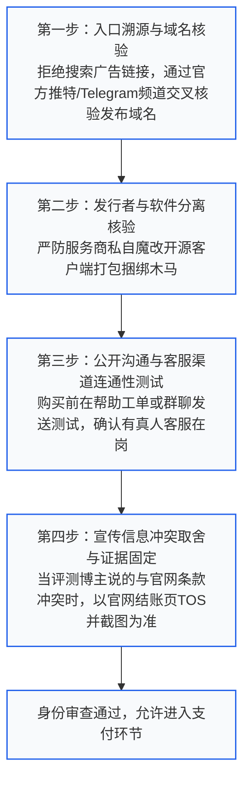
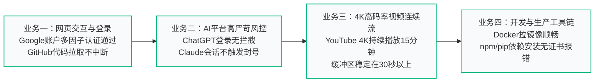
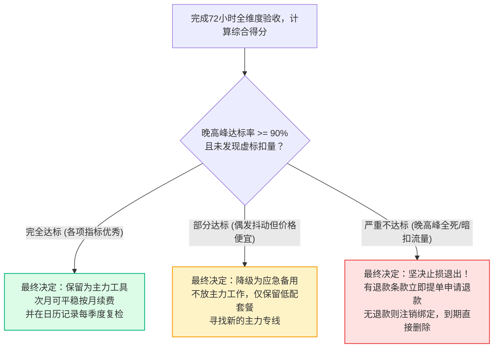

<AnswerFirst
  title="核心结论：选型检查的核心哲学与‘以任务为中心’的闭环原则"
  summary="网络加速服务的选型决策绝不能依赖服务商单方面的宣传标语或营销博主的跑分截图。科学的选型检查必须建立在‘购前证据穿透核验’与‘购后标准化任务闭环验收’的双轮驱动之上。购前严查四大死穴：入口域名仿冒、自动续费隐形扣款、夸大宣称全专线、缺乏公开退出条款；购后执行严格的‘72小时黄金验收期’：在真实晚高峰执行多时段采样，以具体业务（如ChatGPT登录、GitHub依赖拉取、4K视频缓冲）的完成度为准绳，而非单一的测速峰值。"
  :points="[
    '证据高于声明：无论宣传页面写得多诱人，付款前必须核验支持协议明细、同时在线设备限制与真实倍率，截图保存当时的商业承诺。',
    '严防扣费黑洞：结算页必须逐项核对货币单位（USD/CNY）、是否默认勾选了自动按月扣款、优惠码是否仅限首期生效。',
    '建立本地基线：验收测速前必须先测本地裸网物理延迟与带宽，杜绝将自身 Wi-Fi 信号不良误判为节点机房故障。',
    '分母意识与真实成功率：评估稳定性不能看‘今天连上了几次’，而要记录‘在最关键的 10 次业务请求中，有几次发生超时阻断’，失败率超 20% 果断触发止损退出。'
  ]"
/>

---

## 一、选型检查总览：知识体系与进阶集群矩阵

本专题是“梯子参考”为广大用户打造的严密风控与质量验收总入口，下设两大核心二级专题与八大实操集群：

<TopicMatrix
  title="选型检查全景二级专题与三级集群导航"
  :topics="[
    {
      title: '购买前证据与条件检查 (Before Buying)',
      url: '/checklist/before-buying/',
      description: '核对官方渠道真伪与信息冲突，审查订单结算隐形费用，建立设备兼容清单，固定退出退款证据。',
      subtopics: [
        { title: '身份与入口检查', url: '/checklist/before-buying/identity/', count: 4 },
        { title: '订单与费用检查', url: '/checklist/before-buying/order-terms/', count: 4 },
        { title: '设备与能力检查', url: '/checklist/before-buying/capability/', count: 4 },
        { title: '承诺与退出检查', url: '/checklist/before-buying/commitment/', count: 4 }
      ]
    },
    {
      title: '购买后的任务验收 (Acceptance)',
      url: '/checklist/acceptance/',
      description: '验收订单与订阅一致性，针对核心业务实战压测，建立晚高峰质量样本，执行扣量审计与退出决策。',
      subtopics: [
        { title: '基础交付验收', url: '/checklist/acceptance/connection/', count: 4 },
        { title: '应用任务验收', url: '/checklist/acceptance/application/', count: 4 },
        { title: '使用质量记录', url: '/checklist/acceptance/measurement/', count: 4 },
        { title: '验收结论与后续决定', url: '/checklist/acceptance/decision-record/', count: 4 }
      ]
    }
  ]"
/>

---

## 二、购前身份与渠道防伪四步穿透审查

在网络加速领域，存在大量“同名山寨李鬼站”与“高仿钓鱼网站”。这些仿冒站点往往通过搜索引擎竞价广告排在真正官方站的前面，一旦误入并充值，不仅资金被卷走，个人隐私与支付凭据也将全部泄露：



### 2.1 域名历史与防仿冒鉴别实操
- **警惕搜索引擎顶部的“赞助商/广告”标签**：
  许多不法分子购买了“某某机场官网”的百度或必应搜索关键词广告。广告指向的域名往往充斥着细微的拼写错误（如把字母 `i` 换成数字 `1`，或使用 `.xyz` / `.top` 等极其廉价的域名后缀）；
- **交叉验证正规发布渠道**：
  正规服务商通常会在官方持续更新的 Telegram 官方频道、Twitter/X 官方认证账号或 GitHub 组织主页上发布最新的防失联镜像域名。在进入任何新网址前，必须在上述第三方公开信道进行至少两处交叉核对；
- **核查站点 TLS 证书的签发者与颁发历史**：
  点击浏览器地址栏的锁形安全图标，查看证书详情。一个运营数年的成熟品牌，其证书通常由 Let's Encrypt 或 DigiCert 颁发且更新历史连贯；如果证书是刚刚在昨天甚至几小时前紧急签发的崭新临时证书，需保持高度警惕。

### 2.2 客户端发行者与服务商品牌的归属辨析
- **“下载中心”的陷阱**：
  部分不负责任的平台会在自己的网站上提供声称是“独家自研客户端”的安装包。用户下载解压后，Windows Defender 频频报毒；
- **审查底线**：
  核验该服务是否明确支持“标准开源客户端直接订阅”。正规的服务商一定会鼓励用户去 GitHub 官方仓库下载原版 Clash Verge Rev、v2rayN 或 Sing-box，并仅提供标准的订阅链接。如果一个平台**强制要求必须使用其专有定制软件且完全不开放通用订阅**，该服务商的技术封闭性与安全性评分直接判定为“高风险”。

### 2.3 渠道沟通有效性与真实客服压力测试
购买前，千万不要轻信网站首页挂着的“24/7 全天候在线客服”宣传标语。很多不良平台挂的客服窗口实际上只是一个年久失修的死循环问答机器人：
- **测试动作**：在非工作时间（例如晚上 10:30 或周六上午），在客服对话框或工单系统中发送一条具体的技术咨询（例如：“请问你们的香港节点是否支持 UDP 转发？支持哪几个版本的 Clash 核心？”）；
- **响应判定标准**：
  1. **优良（A 级）**：15 分钟内有真人技术客服切入，给出清晰、肯定的专业答复；
  2. **合格（B 级）**：2 小时内有工单人工回复；
  3. **不合格（F 级）**：机器人无限复读无意义帮助链接，或者超过 24 小时无人理睬。如果连售前咨询都无人值守，一旦售后发生大面积断网，您将陷入彻底叫天天不应的绝境。

### 2.4 信息冲突时的取舍与证据固定（博主评测 vs 官网条款）
在信息检索过程中，您经常会发现第三方评测博主声称“该机场拥有全专线、不限速、全天 4K 秒开”，而官网用户中心却写着“根据网络拥塞情况动态限速”：
- **冲突裁决第一准则：以商业结账时刻的官方服务条款（Terms of Service, TOS）为唯一法律基准**；
- 评测博主往往带有推广佣金（Affiliate）属性，其评测可能基于数月前的早期内测环境，甚至存在夸大美化；
- **证据固定动作**：在付款结账前，按下 `Ctrl + P` 将官网的“服务条款”、“退款政策”与“套餐说明页”打印保存为 PDF 离线归档，文件名标注日期（例如 `2026-10-26_某品牌_TOS备份.pdf`）。一旦发生商业纠纷，这份原始证据具有无可辩驳的证据效力。

---

## 三、订单与结账费用透明度五维审查清单

结账页面是商家玩弄文字游戏与价格陷阱的重灾区。在点击“确认支付”前，必须对照以下五项逐一打勾：

<ComparisonTable
  title="结账支付环节常见收费潜规则与审查规范"
  :columns="[
    { key: 'dimension', label: '审查维度' },
    { key: 'hiddenTrap', label: '常见隐形潜规则 / 营销陷阱' },
    { key: 'standardAction', label: '标准审查动作与破局法' }
  ]"
  :rows="[
    {
      dimension: '货币结算单位',
      hiddenTrap: '宣传标语写着 15 元，结账时却以 15 美元（USD）扣款，价格瞬间翻 7 倍',
      standardAction: '看清收银台金额前的货币符号是 ¥ (CNY) 还是 $ (USD)，严防汇率偷换'
    },
    {
      dimension: '自动循环扣费',
      hiddenTrap: '结账页默认勾选‘到期自动按月代扣’，且后台隐藏了取消绑定的入口',
      standardAction: '优先选用支付宝/微信单次扫码支付；若使用信用卡/PayPal，结账后立刻在后台解绑'
    },
    {
      dimension: '优惠码有效边界',
      hiddenTrap: '输入 5 折优惠码显示抵扣成功，但该优惠仅限首月，次月悄悄恢复昂高原价',
      standardAction: '仔细阅读优惠券说明，明确是一次性首期减免还是终身循环续费折扣'
    },
    {
      dimension: '流量重置周期',
      hiddenTrap: '标称‘每月 500GB’，但在每月的自然月1号统一重置，月底28号购买几天后瞬间清零',
      standardAction: '核实配额是‘按账单日（购买日往后推30天）重置’还是‘按自然历月初重置’'
    },
    {
      dimension: '节点倍率陷阱',
      hiddenTrap: '宣称给 200GB 流量，但所有能连上的优质专线节点倍率全标为 3.0x 或 5.0x',
      standardAction: '在用户中心节点列表中核实 1.0x 基准倍率节点的数量占比是否超过 70%'
    }
  ]"
/>

### 3.1 自动续费免密授权深度拆解与解绑全流程
很多平台在用户使用第三方支付时，静默诱导用户签署了“免密扣款协议”。为了彻底杜绝次月被悄悄扣款，请在支付完成后立即执行解绑：
- **支付宝解绑路径**：打开手机支付宝 -> 点击“我的” -> 点击右上角“设置” -> 选择“支付设置” -> 点击“免密支付/自动扣款” -> 找到刚才支付的商户名称，点击“关闭服务”；
- **微信支付解绑路径**：打开微信 -> 点击“我” -> “服务” -> “钱包” -> 最下方“支付设置” -> “自动续费” -> 找到对应项目点击“关闭扣费服务”；
- **PayPal 预核准付款解绑**：登录 PayPal 网页端 -> 点击“设置” -> “付款” -> “管理自动付款” -> 在左侧列表中选中商户并点击“取消”。完成解绑后，您的资金安全将牢牢掌控在自己手中。

### 3.2 节点倍率与实际真实可用流量折算模型
买套餐时不能只看“给了多少 GB”，必须计算**“实际可用等效 GB（Effective Usable Gigabytes）”**：
- **计算公式**：
  $$\text{真实可用流量} = \frac{\text{套餐标称总流量}}{\text{主力常用节点的平均倍率}}$$
- **实战案例对比**：
  - **A 品牌**：标称 100GB/月，月费 15 元，但所有常用 IPLC 专线节点倍率均为 `1.0x`。其真实可用流量为 $100 / 1.0 = 100\text{ GB}$，每 GB 真实单价为 $0.15$ 元；
  - **B 品牌**：宣传标称 500GB/月，月费 20 元（看似极度划算），但只要能顺畅看 4K 的节点全部被标记为 `3.0x` 或 `5.0x` 倍率，普通 `1.0x` 节点全天断流。若按主力 `3.0x` 计算，其真实可用流量仅为 $500 / 3.0 \approx 166.7\text{ GB}$；若连接 `5.0x` 专线，可用流量瞬间暴跌至 $100\text{ GB}$，实际单位成本并不比 A 品牌便宜；
- **审查准则**：在挑选服务时，要求服务商公开全部节点的倍率分布清单，优先选择绝大多数节点固定为 1.0x 或 0.5x~1.0x 的诚实品牌。

---

## 四、设备兼容与能力声明穿透审查

很多用户付了款才发现自己的设备根本无法使用。为了杜绝“买了却用不了”的尴尬，购前必须建立严格的**系统-协议兼容矩阵**：

### 4.1 核心设备五维兼容性核对规范
在付款前，对照您手头拥有的真实物理设备列出清单：
1. **Windows 工作站**：是否为 ARM64 架构（如高通骁龙 Surface）？服务商提供的核心是否支持 ARM64 Wintun 驱动？
2. **MacBook / Mac mini**：是搭载 Apple Silicon（M1/M2/M3/M4）芯片还是老款 Intel 芯片？客户端是否有通用二进制包（Universal Binary）？
3. **iOS 生态（iPhone/iPad）**：手头是否拥有能够登录非国区 App Store 的海外 Apple ID？是否已购买 Shadowrocket、Stash 或 Loon？
4. **Android 手机/车机**：系统是否移除了 Google 服务框架？是否被国内手机厂商（如鸿蒙 NEXT 或部分深度定制 ROM）严格限制了后台 VpnService 权限？
5. **软路由与 NAS 环境**：服务商是否提供原生的 OpenWrt / Docker 客户端配置或直连 IP/域名，是否对路由器单设备并发做出了不合理的超额惩罚？

### 4.2 审查“全能支持”背后的水分
- **声称“支持 ChatGPT / Claude”**：
  直接在购买前向在线客服或社群提问：“请问当前有哪些节点分组明确配置了对 OpenAI 和 Claude 的原生住宅 IP 解锁？如果发生大面积风控封禁，平均多久修复一次？”如果客服语焉不详或声称“这个看运气，我们不管第三方风控”，说明该平台没有专门的流媒体与 AI 解锁运维团队；
- **声称“支持 4K / 8K 流媒体”**：
  核验其提供的出口节点是否支持 Netflix 官方自制剧与非自制版权剧的完整解锁（Full Library Unblock）。部分低质机房只能看自制剧（Netflix Originals），一旦看带有地区独家版权的热门电影就会报错。

### 4.3 多人共享与多设备并发政策穿透审查
许多用户打算购买一个大流量套餐与室友或同事平摊，但在购买前必须穿透审查服务商的“防共享反盗刷条款”：
- **公网 IP 并发限制（Concurrent IP Gateways）**：
  必须分清“允许 5 台设备登录”与“允许 5 个不同公网 IP 同时连接”的技术差别。有些服务商声称不限设备，但后台严格限制单 IP，一旦两个人在不同 Wi-Fi 下同时打开代理，系统会直接触发“多地异常登录熔断”，导致双方同时断网 24 小时；
- **短时间突发请求数封锁（Rate Limiting）**：
  如果多人共用一个订阅，且有人在跑爬虫或多线程下载，短时间内的 TCP 连接数（Stateful Sessions）可能突破机房软硬件防火墙的阈值（如单 IP 限制 1000 个并发连接），导致机房交换机将整个订阅的主动连接全部静默丢弃；
- **审查建议**：合租或团队使用前，必须向客服明确确认“支持多外部 IP 同时并发使用”且无恶意封禁条款。

### 4.4 客户端安装包权限与数字签名审计
如果购买的服务商提供了专有可执行文件（`.exe` / `.dmg` / `.apk`），在安装运行前必须执行基本的安全审计：
- **Windows 数字签名核验**：右键点击安装包 -> 选择“属性” -> 查看是否有“数字签名”选项卡。核对签名者是否为正规受信任的公司或知名开源开发者；
- **VirusTotal 全球多引擎病毒扫描**：访问 `virustotal.com`，将安装包上传检测。如果超过 5 家以上知名安全引擎（如卡巴斯基、微软 Defender、ESET）报出“Trojan / Backdoor / Downloader”，严禁运行该软件；
- **Android APK 权限审查**：安装时如果一个网络代理软件索要“读取通讯录”、“访问短信内容”、“读取相册”等完全与网络连接无关的敏感权限，100% 存在流氓间谍行为，应立即终止安装。

---

## 五、承诺边界与首期止损机制：退出条款证据存留

成熟的消费者在建立任何商业契约前，最先考虑的绝不是赚多少，而是**“如何全身而退”**：

<DecisionTree
  title="首期购买退出与止损控制决策树"
  description="建立严密的财务安全气囊，将试错损失降至绝对最低"
  :branches="[
    {
      condition: '退款政策：官方服务条款（TOS）中明确写有‘虚拟商品一经售出概不退款’？',
      action: '绝不购买长期套餐！坚决仅买单月最低档测试包（金额严格控制在20元以内）',
      reason: '既然无退款通道，必须在物理上将最大损失上限锁定在几十元零花钱内，测试满意再议。'
    },
    {
      condition: '服务声明：官方明确承诺‘24小时内不满意无条件全额退款’？',
      action: '立即将该退款承诺页面截图存盘，并保留完整的订单流水号与时间戳',
      reason: '网络服务条款经常悄悄变更，必须在付款时刻完成证据固定，以备出现纠纷时向支付网关申请争议仲裁。'
    },
    {
      condition: '试用窗口：购买后前 3 天内，晚高峰频繁断线、丢包率高于 30%，工单未回复？',
      action: '果断在日历设置提醒，不再投入任何精力折腾，到期直接弃用并关闭所有自动扣费',
      reason: '切忌沉没成本心理。前三天表现恶劣的服务，后续变好的概率不足 5%，果断止损才是最优解。'
    }
  ]"
/>

### 5.1 续费价格变动预警机制与首期止损清单
- **警惕“首期骨折价，续费天花板”**：
  某些营销型品牌打出“首月只需 1 元”或“首年仅需 29 元”的噱头吸引新客。但在第二个月续费时，系统自动按照原价 88 元/月发起扣款。如果您未看清细则，将蒙受高昂的隐性支出；
- **建立“购前主动停止清单（Stop Checklist）”**：
  在支付前，在备忘录写下明确的触发式弃用条件：
  1. *如果购买后 24 小时内连一次 Google 都无法正常加载，立刻申请退款并停止排查；*
  2. *如果在第 1 周内，连续两天晚高峰发生超过 30 分钟的断网且无官方公告，到期绝不续费；*
  3. *如果在第 1 个月内，发生过私自调高节点倍率超过 2.0x 的行为，立即导出余额并弃用。*
  预先设定规则能防止人在面对故障时陷入情绪化的盲目折腾与无休止沉没成本。

---

## 六、购后基础交付验收：五分钟极速自检链

付款成功后，不要急着看视频，请严格按照以下五个标准动作执行基础交付验收：

### 6.1 订单与套餐激活核对
1. 进入服务商用户中心，确认订单状态显示为 **“已完成 / Active”**；
2. 核对套餐起始日期与到期日期是否足额足月（例如 10 月 26 日付款，到期日应为 11 月 26 日，而非 11 月 1 日）；
3. 核对流量额度数字是否与所购套餐完全一致（如 200GB 是否满额未被提前扣损）。

### 6.2 订阅导出与节点解构核验
1. 提取 Clash 订阅链接，在浏览器或文本编辑器中打开查看其原始内容结构；
2. **节点数量核查**：确认节点列表中不仅有 1 个或 2 个服务器，而是拥有涵盖不同国家地区的充足冗余（通常优质服务商至少提供 20 到 60 个以上独立节点）；
3. **节点命名与倍率核查**：观察节点名称中是否清晰标注了国家地区代码、协议类型（SS/VLESS/Hysteria2）以及精确的倍率数值（如 `1.0x`）。如果所有节点全是一串无规则的乱码或未标注倍率，说明该平台后台运维极不规范。

### 6.3 首次连通与退出恢复闭环测试
1. 将订阅导入客户端，开启系统代理，确认浏览器能顺利加载海外网页；
2. **关键动作：彻底关闭客户端，测试网络回退能力**；
3. 将系统代理开关拨回关闭，彻底退出客户端；
4. 打开国内知名网站（如百度、B站）并按 `Ctrl + F5` 强制刷新，确认国内网页秒开且完全没有提示“代理服务器拒绝连接”。这一步验证了客户端对操作系统的网络栈接管与注销机制是安全健康的。

---

## 七、核心业务任务深度验收协议（四大业务实战）

“测速跑满千兆”不等于“真实业务能用”。必须以具体的业务任务作为验收唯一金标准：



### 7.1 业务一：海外现代 Web 交互与账号认证验收
- **测试动作**：访问 `https://myaccount.google.com/` 进行账号登录；
- **验收标准**：登录过程中没有触发异常复杂的手机短信验证或频繁的风控弹窗，登录后能够顺畅查看个人安全面板；在维基百科进行任意学术词条检索，页面秒开无加载停滞。

### 7.2 业务二：生成式 AI 高严苛风控验收
- **测试动作**：使用浏览器的无痕窗口，直接访问 `https://chatgpt.com/` 与 `https://claude.ai/`；
- **验收标准**：
  1. 没有出现 Cloudflare 5秒盾的死循环点击；
  2. 登录后输入一个复杂的长文本提示词（Prompt），观察 AI 吐字流式输出是否平顺，中间是否报出 `Network Error` 或 `Something went wrong`；
  3. 会话结束后保持页面静置 10 分钟，再次提问是否依然能够正常响应而不被强行踢出登录态。

### 7.3 业务三：4K 高码率流媒体连续播放压测
- **测试动作**：在 YouTube 搜索 `4K HDR 60FPS` 风光演示片，将画质手动锁死在 **2160p (4K)**；
- **验收标准**：
  右键视频画面打开“详细统计信息 (Stats for nerds)”，重点观察两个核心指标：
  - **Connection Speed（实时连接速率）**：稳定在 35,000 Kbps（约 35Mbps）以上；
  - **Buffer Health（缓冲区健康度）**：在视频播放 2 分钟后，缓冲区时间能够持续爬升并稳定维持在 **30 秒至 60 秒以上**。如果缓冲区长期低于 5 秒且画面频繁转圈，说明链路抖动严重，未达到流媒体达标标准。

### 7.4 业务四：开发工具链依赖下载吞吐压测
- **测试动作**：在开发终端执行一次常规的代码仓库克隆或依赖安装：
  ```bash
  git clone https://github.com/torvalds/linux.git --depth=1
  ```
- **验收标准**：克隆速度稳定在 5MB/s 至 20MB/s 以上，且中途绝不出现 `RPC failed; curl 56 OpenSSL SSL_read: Connection was reset` 错误。

### 7.5 业务五：跨国游戏与语音交互低延迟 UDP 丢包验收
- **测试动作**：启动 Discord 国际版语音频道，或连接 Steam 国际服游戏社区；
- **验收标准**：
  1. 客户端代理日志中能够观察到大量的 UDP 数据包正常被转发（Forwarded UDP Packet），而非报出 `UDP not supported`；
  2. Discord 语音面板右下角显示绿色连通图标（Ping < 90ms），语音通话无机械变声或频繁卡顿，丢包率统计保持在 0.5% 以下。

---

## 八、网络质量基线与晚高峰三时段多维量化采样法

不要只在上午 10 点测一次就草率得出“这个梯子真快”的结论。中国跨国公网的真实大考全在**晚高峰（20:00 ~ 23:00）**。

### 8.1 建立本地物理网络“裸网基线”
在挂载代理前，先在本地网络环境下测试您当前的物理水准：
- **物理延迟基线**：在控制台执行 `ping 223.5.5.5 -n 20`，记录平均延迟（通常光纤宽带在 3ms 至 15ms 以内，丢包率必须为 0%）；
- **下行物理峰值**：在不开启任何代理的情况下，在 Speedtest 测出您本地宽带的真实上下行带宽（例如下行 500Mbps / 上行 50Mbps）。这是后续所有测试的**物理绝对上限**。

### 8.2 三时段标准化采样记录表
在购买后的前三天，按照以下标准模板记录数据：

| 采样时段 | 典型时间戳 | 目标节点 | 延迟 (RTT) | 丢包率 (Packet Loss) | YouTube 4K 缓冲状态 | 核心业务评级 |
| :--- | :--- | :--- | :--- | :--- | :--- | :--- |
| **时段 A：闲时基准** | 上午 10:30 | 香港 01 (IPLC) | 18ms | 0.0% | 秒开，缓冲 80s+ | 卓越 (A+) |
| **时段 B：下午工作时** | 下午 15:00 | 日本 02 (中转) | 42ms | 0.1% | 秒开，缓冲 60s+ | 优良 (A) |
| **时段 C：极限晚高峰** | 晚上 21:30 | 香港 01 (IPLC) | 22ms | 0.2% | 流畅无卡顿，缓冲 45s+ | 极佳 (A+) |
| **异常对照组** | 晚上 21:30 | 普通公网直连节点 | 280ms | 38.5% | 卡顿转圈，降频至 720p | 不合格 (F) |

- **合格判定底线**：在时段 C（极限晚高峰）中，主力节点的丢包率必须牢牢控制在 **2.0% 以下**，且核心业务（AI/视频）完成率不低于 **95%**。凡是在晚高峰丢包率超过 15% 的服务商，一律不予长期续费。

### 8.3 真实丢包率、抖动与首包时间（TTFB）量化测试实操
要获取不受浏览器图形界面干扰的纯粹网络指标，可以使用命令行工具进行高频压力探测：
```bash
# 1. 针对节点服务器进行 100 次高频 ICMP 延迟与丢包测试（Windows PowerShell）
Test-Connection -ComputerName "node-domain.example" -Count 100 | Measure-Object -Property ResponseTime -Average -Maximum -Minimum

# 2. 测量目标网站真实首字节时间（TTFB，Time To First Byte）
curl -o /dev/null -s -w "DNS解析时间: %{time_namelookup}s\nTLS握手时间: %{time_appconnect}s\n首字节返回时间: %{time_starttransfer}s\n总耗时: %{time_total}s\n" https://www.google.com
```
- **核心判定标准**：如果 `time_starttransfer`（首字节时间）长期稳定在 0.3 秒以内，证明节点性能极其强悍；如果该值经常在 2 秒到 5 秒波动，说明机房出口拥堵、存在严重的排队抖动。

### 8.4 成功率分母模型（连接成功率 vs 业务完成率）
许多用户在评价网络稳定性时，存在严重的统计偏差：只记住了“今天上午连上了一次”，却忽略了“今天下午点开 10 篇海外文献，有 3 篇提示加载超时”。
为了建立客观的数学分母模型，我们引入**“业务完成率（Task Success Ratio, TSR）”**：
$$\text{TSR} = \frac{\text{成功完整加载且未报错的业务请求次数}}{\text{发起的总业务请求次数}} \times 100\%$$
- **记录规则**：以一个完整的工作日为采样周期。凡是触发一次浏览器 `ERR_CONNECTION_TIMED_OUT`、一次 ChatGPT `Network Error`、或一次 GitHub `RPC Failed`，均记为一个失败样本（Failure Event）；
- **质量分级**：
  - **TSR >= 99%**：企业级专线水准，全天无感办公；
  - **95% <= TSR < 99%**：优质商业服务，偶尔偶发抖动但不影响大局；
  - **TSR < 90%**：属于严重不可用的劣质服务，应直接弃用。

---

## 九、流量扣费审计与倍率虚标实测

许多不诚信的机场通过在后台“偷跑流量”或“虚增倍率”来变相搜刮用户的套餐额度。以下实操教您如何精准抓包审计：

### 9.1 流量审计三步闭环对比法
1. **测试前截屏记录后台底数**：
   在开始测试前，登录服务商后台个人中心，精确记录当前显示的“已用流量”（例如记录为 `12.450 GB`）；
2. **下载固定大小的标准测试镜像**：
   在开启代理的状态下，使用专业下载工具（如 IDM 或 cURL）下载一个公开的标准化测试文件（例如正好是 1.00GB 的官方 Linux ISO 镜像文件）：
   ```bash
   # 下载一个精确为 1GB 的测试文件
   curl -o testfile.bin http://speedtest.tele2.net/1GB.zip
   ```
3. **测试后复核后台扣减量**：
   下载完毕后静置 5 分钟，等待服务端数据库同步计费记录。重新刷新用户中心：
   - 如果您使用的是 **1.0x 倍率节点**，后台已用流量应增加为 `13.450 GB`（允许包含 5% 以内的正常 TCP 协议头与重传开销）；
   - 如果后台显示已用流量激增了 `2.5GB` 甚至 `5.0GB`，说明该节点存在极其恶劣的**“暗中扣量”或“实际计费倍率与前端显示不符”**的欺诈行为，属于严重违规，应立即停止使用。

---

## 十、验收结论归档与科学决策模型

在经过 72 小时的标准化验收后，请将所有的测试数据汇聚入以下科学决策模型，给出客观、冷静的最终结论：



---

## 十一、常见选型检查深度疑难实操解答 (FAQ)

### Q1：为什么同一家机场，别人测试能跑 800Mbps，我自己测只有 50Mbps？
**解答**：这属于典型的“端到端全链路瓶颈”差异，不能简单归咎于机房服务器：
- **瓶颈一：本地宽带运营商的国际出口 QoS**：电信、联通、移动在不同省份的互联互通策略截然不同。比如某北方联通用户连日本机房是直连大带宽，而南方某地移动用户连该机房可能绕道香港产生拥堵；
- **瓶颈二：本地 Wi-Fi 路由器性能积压**：千兆宽带如果搭配的是老旧百兆网线或穿墙衰减严重的 2.4GHz Wi-Fi，实际测速上限就被卡死在 30~50Mbps；
- **排查建议**：用网线直连电脑与光猫，排除本地无线局域网干扰后再测；同时在客户端中切换不同国内入口的节点进行横向比对。

### Q2：测速时显示的“延迟”只有 15ms，为什么打开网页还是明显感觉卡顿了一两秒？
**解答**：这是新手极易混淆的**“ICMP Ping 延迟”**与**“HTTP/TLS 真实业务首字节时间（TTFB）”**的脱节：
- **ICMP Ping 测出的只是底层网络连通时间**：它只代表一个极小的探测数据包往返机房的速度；
- **打开真实网页需要经历完整的应用层握手链**：
  1. 本地 DNS 查询与 Fake-IP 匹配（耗时 10ms）；
  2. 与海外节点建立 TLS 隧道握手（耗时 50ms）；
  3. 远端节点向目标网站发起三次握手与证书交换（耗时 100ms）；
  4. 目标网站服务器计算并生成 HTML 页面并返回首字节（TTFB，耗时 200ms 至 800ms）；
- 如果海外节点服务器的 CPU 负载过高或 DNS 解析器迟缓，即便 Ping 延迟只有 15ms，打开网页依然会有明显的停顿感。

### Q3：为什么购买了号称“不限设备”的套餐，我的第二台手机一连上去，电脑就断网了？
**解答**：请立即核对服务商条款中的**“公网出口 IP 并发数限制”**：
- 很多平台宣传的“不限设备”，是指“允许您在任意多台设备上下载配置”；
- 但如果在同一时间，这几台设备处于**不同的网络环境**（例如电脑在公司连公司宽带，手机在外面连 5G 蜂窝数据），它们对外表现为 **2 个不同的公网 IP**。如果该套餐在后台严格限制了“单 IP 在线”，系统检测到异地 IP 接入，会瞬间触发自动安全保护将旧设备强行踢下线；
- 只有当所有设备处于**同一个家庭 Wi-Fi 路由器下（对外表现为同一个公网 IP）**时，才可能实现多设备同时稳定在线。

### Q4：在申请退款时，客服要求提供详细的排查日志，我该怎么提供才不会泄露隐私？
**解答**：请严格按照**“三项脱敏原则”**提供日志：
1. **剔除所有 Token 与密钥**：在导出的日志文本中，使用记事本全局搜索 `token=`、`password=` 或 `uuid=`，将其替换为 `[REDACTED_SECRET]`；
2. **遮蔽本地真实 IP**：将日志中出现的您真实的公网 IP（如 `114.x.x.x`）打码替换；
3. **保留核心错误代码与握手过程**：保留 `handshake failed: timeout`、`connection reset by peer`、`TLS alert` 等核心错误堆栈。这既展现了您的专业性，又能强力反驳客服“没有证据不予退款”的推诿借口。

### Q5：为什么有些评测博主的测速截图全是五颜六色的“几千兆大水管”，普通人买回去根本测不出来？
**解答**：揭秘海外测速博主的“特殊测试环境”：
- 许多商业测速博主使用的是**服务商专门提供的“专属内测 VIP 节点”**，其机房带宽并未超卖；
- 博主自身使用的是**位于香港、日本或机房对等互联的千兆极速商用专线**作为测试发起端，而非普通家庭宽带；
- **理性认知**：永远不要盲信任何网络上的单次测速截图。只有在自己家里的真实网络上、在最拥挤的周五晚上跑出来的测试数据，才是唯一具备决策价值的真实数据。

### Q6：服务商要求通过“虚拟货币（USDT）”支付，这种渠道安全吗？新手能选吗？
**解答**：**对于普通新手，强烈建议坚决避开仅支持 USDT 支付的平台！**
- **无法追溯与零仲裁保护**：虚拟货币区块链转账具有不可逆性。一旦商家跑路或服务不可用，没有任何第三方金融机构（如支付宝或银行）能够为您提供欺诈冻结或争议退款；
- **平台运营合规风险极高**：只支持加密货币结算的平台，通常没有任何正规商业实体背书，跑路概率比支持正规第三方在线支付的平台高出数倍。

### Q7：测试节点时提示“SSL 握手错误”，是我的电脑问题还是节点问题？
**解答**：通常是由**“本地系统时间不同步”**或**“节点服务器证书过期”**引起的：
- **第一步排查电脑时间**：在 Windows 设置中点击“立即同步时钟”。TLS 加密协议对时间极其敏感，如果系统时间误差超过 60 秒，客户端会强制拒绝连接；
- **第二步排查服务端证书**：如果本地时间完全精确，在客户端切换为其他国家节点能正常打开，说明该单个节点的 TLS 证书已过期未续签，属于服务商机房维护失职，需提交工单提醒其更新证书。

### Q8：服务商后台的工单系统支持“退款”，但一直拖着不回复，退款时效快过了怎么办？
**解答**：这是部分不良商家惯用的**“拖延战术”**（拖延超过 24 小时或 7 天退款窗口期）：
- **应对方案**：
  1. 立即在工单中追加一条明确的信息：“本人已于 [具体日期时间] 在承诺退款时限内正式提出退款申请，依据公开服务条款，该时间戳已作为有效争议凭据固定”；
  2. 如果是通过 PayPal 付款，直接进入 PayPal 调解中心发起“未收到服务 / 描述严重不符”的争议争议（Dispute），上传工单截图，由 PayPal 官方强制冻结该笔款项；
  3. 如果是通过微信/支付宝支付，向商户所属的支付聚合接口提供商提交商户违规扣费投诉。

### Q9：验收测速时，Fast.com、Speedtest 和 YouTube 详细统计信息哪个最值得信任？
**解答**：**YouTube 详细统计信息中的“Buffer Health”与“Connection Speed”具备最高的真实参考价值！**
- Fast.com 与 Speedtest 是专门针对瞬时最大带宽冲刺设计的测速工具，多线程并发发包，测出的是峰值极限，且部分机房会对这类已知测速网站进行特殊的“白名单加速优化”（俗称“跑分作弊”）；
- 而 YouTube 4K 播放是长连接单流或双流持续拉取真实多媒体数据包。它对链路的抖动、乱序和微小丢包极其敏感。只要 YouTube 4K 能稳定维持在 40 秒以上的缓冲区健康度，您的网络在日常任何应用中都绝对稳定。

### Q10：什么是“链式代理（Proxy Chaining）”？在选型验收时有必要配置吗？
**解答**：链式代理是指将多个节点前后串联（例如：本地 -> 国内入口 -> 香港专线 -> 美国住宅 IP 落地）：
- **主要价值**：兼顾“国内极速低延迟接入”与“海外高纯净度 IP 解锁”；
- **验收注意事项**：由于链式代理经过两层中转握手，其整体往返延迟会叠加，排查故障时难度翻倍。对于普通用户选型，如果服务商原生提供了优质的专线落地，完全无需画蛇添足配置链式代理。

### Q11：买完服务后，为什么连上节点所有网站都打不开，但客户端测速显示正常？
**解答**：这是最典型的**“DNS 劫持污染”或“本地系统代理端口未对齐”**故障：
- **排查一：检查客户端系统代理端口**：确认客户端监听的混合端口（如 7890）是否与 Windows 代理设置中写入的端口一致；
- **排查二：检查 DNS 模式**：在客户端设置中确认 DNS 模式处于 `fake-ip` 还是 `redir-host`。如果是已弃用的旧版 `redir-host`，系统会由于国内公共 DNS 污染而无法获取真实 IP，应立即切换为 `fake-ip` 模式并重启核心。

### Q12：为什么有些节点晚上测速很快，但到了凌晨一两点突然集体断流数小时？
**解答**：这属于服务商后台在进行**“深夜机房自动维护或动态 IP 轮换”**：
- 很多负责任的服务商为了防止落地出口 IP 被大厂封禁，会设定在凌晨 2:00~4:00 自动向海外上游 ISP 重新拨号或更换 IP 段；
- 在轮换的 5 到 15 分钟内，长连接会短暂重置。如果服务商每周固定深夜维护一次且提前发布了公告，属于正常运维行为；但如果全天随机频繁断流，则属于机房稳定性缺陷。

### Q13：什么是“白名单（Whitelist）”与“黑名单（Blacklist）”选型？不同机场的默认规则有什么本质区别？
**解答**：这反映了服务商在规则制定哲学上的根本差异：
- **白名单模式（绕过大陆 / Bypass Mainland China）**：
  只要目标网站不在“中国大陆域名与 IP 数据库”内，其余全世界所有流量一律默认走代理节点。
  **优势**：海外小众生僻网站、刚上线的新 AI 平台绝不会漏判走直连；
  **代价**：如果某国内新 App 的服务器 IP 尚未被 GeoIP 数据库收录，会被误送入海外节点，浪费代理流量；
- **黑名单模式（GFWList 模式）**：
  只有明确记录在“GFW 阻断清单”内的知名被封网站（如 Google、YouTube、Twitter）才走代理，其余未收录的网站一律走国内网络直连。
  **优势**：极度节省代理流量，国内网站绝对直连；
  **代价**：遇到未收录的海外学术库、小众设计素材站或新出的海外工具时，会由于默认直连而被防火墙干扰无法打开；
- **选型建议**：主力办公推荐“白名单（绕过大陆）”模式，能极大降低网络故障率。

### Q14：为什么有些节点名字里写着“Game / 游戏专线”，它与普通专线在底层技术上有什么差异？
**解答**：差异在于**“UDP 报文优先级调度”与“物理路径跳数压缩”**：
- 普通专线主要针对 TCP 协议（网页、视频、文件传输）进行了深度优化，追求的是“大带宽吞吐与高吞吐并发”；
- 而“游戏专线”专门针对 FPS（第一人称射击）、MOBA 等游戏的 UDP 协议进行了硬件级 QoS 提权保障：
  1. 强制关闭多路复用（Multiplexing），避免多个游戏数据包合并引起的毫秒级微小排队延迟；
  2. 采用深圳到香港、上海到东京的最短物理光缆路由，将双向抖动（Jitter）控制在 1ms 以内；
  3. 杜绝任何形式的 UDP 丢包，保证玩家按键动作实时同步。如果您的核心任务是跨国竞技联机，必须确认套餐内包含经过专门调优的 Game 游戏策略组。

### Q15：如果遇到了恶意扣费或者服务商跑路，使用国内支付渠道的用户该如何合法挽回损失？
**解答**：请严格按照合法的**“第三方商户投诉通道”**进行维权：
- **第一步：提取商户订单号与签约凭证**：
  在微信支付或支付宝的账单明细中，找到该笔交易，截图保存完整的“商品说明”、“商户全称”、“交易订单号”与“商家订单号”；
- **第二步：通过官方平台发起商户违规投诉**：
  - **支付宝路径**：在账单详情页点击“对此订单有疑问” -> 选择“投诉商家” -> 选择“未提供承诺服务 / 涉嫌欺诈”；
  - **微信支付路径**：在微信支付凭证页面点击“联系商户” -> 点击“投诉”；
- **第三步：提供客观证据促成原路退款**：
  上传工单无人回复的截图、官方网站无法打开的 404 截图。由于正规第三方支付结算通道（聚合支付服务商）对商户的欺诈投诉率有极其严苛的考核，一旦投诉率超标，聚合支付平台会直接冻结该商户在该网关下的结算账户，并将款项原路退回给受害消费者。

### Q16：验收测速时，Hysteria 2、VLESS 与 Shadowsocks 协议的表现差异有哪些？
**解答**：这三大协议在测速曲线与资源消耗上呈现截然不同的形态：
- **Hysteria 2（基于 UDP/QUIC）**：
  测速曲线呈“垂直拉升”形态，能在 1 秒内瞬间冲到本地物理带宽上限。在跨国丢包率高达 20% 的恶劣弱网下，依然能跑满带宽；但若遇到对 UDP 严重限速的移动宽带，测速可能直接归零；
- **VLESS-Reality（基于标准 TCP+TLS 伪装）**：
  测速曲线呈平滑爬升形态。穿透力极强，在任何严格受控网络（如高校校园网、公司企业网）中都能平稳生存，握手延迟极低，是日常综合表现最均衡的协议；
- **Shadowsocks（基于轻量对称加密）**：
  CPU 占用率全网最低。在千兆满速压测时，路由器或老旧手机发热量极小，非常适合搭配 IPLC 内网专线作为长期主力。

### Q17：为什么有些服务商的订阅在电脑上能导入，在手机小火箭（Shadowrocket）上却报错？
**解答**：这属于典型的**“订阅格式版本不兼容”或“未开启 Base64 编码”**问题：
- 电脑端 Clash Verge Rev 读取的是标准的 **YAML 格式**；
- 而 iOS 端 Shadowrocket 在早期主要支持 **Base64 编码的单行 URI 格式**（如 `vmess://...`、`ss://...`），虽然新版小火箭支持直接添加 Clash 订阅，但如果服务商在 YAML 内部使用了某些高度定制的特殊字段，小火箭的解析引擎会报语法解析错误；
- **解法**：在服务商后台点击“一键导入”时，显式选择“复制 Shadowrocket 专属订阅”，或者通过服务商后台自带的官方订阅转换网关导出小火箭专用格式。

### Q18：选型验收后，怎样建立属于自己的长期“双线路容灾备用库”？
**解答**：**切忌将所有鸡蛋放在同一个篮子里！**
- **黄金二元搭配法则**：
  1. **主力工具（占比 80% 预算）**：选用一家以 **IPLC/IEPL 企业级内网专线** 为主的高端品牌，按月付费，专门用于日常核心办公、GitHub 代码提交、ChatGPT 交互与会议；
  2. **应急备用（占比 20% 预算）**：购买一家拥有 **BGP 中转或按量计费不限时包** 的轻量品牌，或者配置好完全独立的备用海外直连服务器。在主力机房突发不可抗力割接或维护时，可在两秒内无缝切换，彻底告别单点断网焦虑。

---

## 十一、选型检查全流程典型翻车事故现场深度复盘

为了让大家在真金白银的消费中不再重蹈覆辙，我们对社区近千名用户上报的血泪翻车案例进行了深度解剖与归因分析：

### 11.1 案例一：误入竞价广告仿冒高仿站，不仅被骗 280 元还被植入远控木马
- **事故还原**：某高校研究生在搜索引擎输入“某知名机场官网”，直接点击了搜索结果第一条带有微小“赞助商”标识的链接。该页面无论 LOGO、套餐布局还是帮助文档与正版完全一致。用户扫码支付了 280 元年付套餐后，系统不仅没有下发任何订阅，反而提示“需要下载专属优化客户端”。用户下载安装了该 `.exe` 安装包后，电脑安全软件被强行关闭，随后其 Steam 游戏账号被盗，邮箱频繁收到异地登录警告；
- **根本教训**：**搜索引擎广告绝对不可信！** 正规服务商绝不会在搜索引擎投放翻墙关键词竞价广告（这在法律上属于自寻死路）。任何新入职或新入坑用户，必须通过官方 Telegram 认证群聊或知名极客导航网站获取唯一的真实域名，且绝不运行任何非官方开源签名的闭源可执行文件。

### 11.2 案例二：贪图“99 元永久买断、无限流量”，运营 80 天后服务商卷款跑路
- **事故还原**：某外贸从业者在推特上看到某新开业品牌打出“新店店庆，限时 99 元买断永久 VIP，承诺全 IPLC 专线并不限流量”。该用户心动下单，前一个月使用确实丝滑顺畅。然而到了第三个月中旬，所有节点突然全部变红超时，官方 Telegram 频道开启全员禁言，随后网站解析直接被解析到 127.0.0.1，运营团队彻底失联；
- **经济学机理剖析**：
  跨境物理专线和海外机房服务器的带宽成本是按月向跨国电信运营商刚性支付的现金流。没有任何一家商业实体能够依靠“一次性收取 99 元”来持续支付未来数年的机房服务器租金。这种模式本质上就是利用新用户的预付款维持旧机房运转的“庞氏击鼓传花”，当新客涌入速度放缓时，跑路卷款是数学上的必然结局；
- **避坑铁律**：坚决摒弃“一劳永逸、永久买断”的幻想。按月付费、月月审查，才是网络加速消费中永恒的安全准绳。

### 11.3 案例三：未核查并发公网 IP 限制，同宿舍平摊订阅导致被风控永久拉黑
- **事故还原**：某大学生购买了 1000GB/月的超大豪华套餐，并将其订阅链接分享给同宿舍其他 3 位室友使用。当天晚上，一位室友在图书馆连校园网、一位在寝室连移动宽带、另一位在食堂用 5G 手机热点同时访问网络。短短两小时后，4 个人的网络全部彻底断开。登录后台查看，账户已被标记为“恶意合租倒卖，封禁 999 天”，且账户内的余额被直接冻结；
- **风控逻辑解读**：
  为了防止灰产倒卖流量，服务商在 Radius 计费服务器上部署了多维度的会话审计系统。同一个认证 Token 在短时间内由多个跨越不同物理地理位置的公网 IP 同时发起海量高频请求，触发了机房的“非授权合租熔断机制”；
- **避坑准则**：多人平摊前必须明确购买“团队/家庭多并发套餐”，或者每人独立购买适合自己用量的专属月付包，切勿私自跨网络环境多端滥用。

### 11.4 案例四：迷信测速软件的 1000Mbps 大水管，实测晚高峰丢包 45% 网页频频超时
- **事故还原**：某程序员在选购时看到推销博文晒出某机场在 Speedtest 测出 1200Mbps 的极速测速图，遂花费 60 元购买了高配单月套餐。然而当晚 21:00 进行海外项目远程调试时，发现每次输入 SSH 指令都会卡顿 3 到 5 秒，Git 拉取代码频繁报错中断，看 YouTube 甚至连 1080p 都无法自动维持；
- **技术真相**：
  Speedtest 测速采用的是单次、短时间、多线程抢占带宽的冲刺模式，它只能反映在这一瞬间机房交换机的最大物理吞吐。而该机场为了节省成本，接入的是极其廉价且超卖严重的公网海底光缆直连线路。在晚高峰骨干网拥塞时，真实物理丢包率飙升至 45% 以上。SSH 和 Git 依赖极低丢包率的连续 TCP 会话，丢包率一旦超过 5%，TCP 协议就会陷入频繁的超时重传死循环，导致带宽再大也寸步难行；
- **避坑准则**：考核网络的第一指标永远是**“丢包率与抖动”**，第二指标是**“真实延迟”**，最后的指标才是“带宽极限峰值”。低丢包的 100Mbps 专线体验远胜于高丢包的 1000Mbps 劣质直连。

---

## 十二、长周期运维审计：每季度网络体检与持续复核协议

通过了 72 小时的初次选型验收并不意味着可以永久高枕无忧。网络服务是一个动态博弈的高变动环境，建议每隔三个月对照执行一次季度健康度体检：

### 12.1 节点延迟漂移与机房上游网络割接审查
- **现象监测**：定期观察平时常用的主力节点延迟是否从原本的 30ms 缓慢爬升到了 80ms 或 120ms。这往往意味着服务商由于成本原因悄悄更换了中转机房入口，或者上游专线发生了路由劣质调整；
- **季度排查**：在季度末使用 `nexttrace` 重新追踪一次主力节点的真实路由，核实是否依然保持物理专线或优质 BGP 直达，若发现严重绕路应及时提交工单质询。

### 12.2 本地规则库与分流核心版本对齐
- **规则滞后隐患**：各大流媒体与 AI 平台的域名系统日新月异。如果客户端内的 GeoIP 与 GeoSite 数据库半年不更新，会导致大量新上线的海外 API 域名被误判为国内直连导致打不开，或者国内新应用被误走代理浪费流量；
- **维护动作**：进入客户端高级设置，手动点击一次“更新 GeoIP 数据库”与“更新 GeoSite 数据库”，确保本地路由大脑时刻保持最新鲜的判断力。

### 12.3 财务账本年度复盘与次年选型优化
- **年度数据审计**：在年底调出过去 12 个月的消费账单与实际用量记录。分析自己平均每月实际消耗了多少 GB 流量，是否存在大量流量闲置浪费的情况；
- **动态套餐调整**：如果一年中有半年以上实际用量低于套餐额度的三分之一，次年应果断下调套餐档次；如果工作重心转移至高频 AI 与跨国高清视频，应将预算平移至拥有双 ISP 原生住宅 IP 的更高品质专线服务商。

---

## 十三、选型检查中的网络安全与隐私对抗工程学

在选型验收过程中，许多用户误以为“只要开了代理，我的真实网络身份就绝对隐形了”。事实上，现代浏览器与操作系统底层潜藏着数个致命的“隐私穿透后门”。如果未通过严密的安全审查，您的真实地理位置与宽带 IP 随时都在被海外目标平台精准记录：

### 13.1 WebRTC 真实公网 IP 穿透泄露审查
- **泄露机理深度解密**：
  WebRTC（网页实时通信技术）广泛应用于网页版 Discord 语音、Google Meet 视频会议及点对点文件传输。为了在复杂的 NAT 网络中建立直连通道，浏览器的 WebRTC 引擎会主动调用 STUN/TURN 服务器发送探测报文；
  **致命隐患**：即便您开启了基于系统代理的客户端，WebRTC 的某些底层探测请求会直接绕过操作系统应用层代理，通过您的物理无线网卡向公网直接发送 UDP 探测包。海外网站只需在前端页面嵌入一段几行代码的 JavaScript，即可在毫秒级内静默获取您真实的中国电信/联通家庭宽带 IP；
- **标准化实操检测方法**：
  1. 开启代理后，在浏览器打开国际权威的检测网站 `https://browserleaks.com/webrtc`；
  2. 观察 **“Public IP Address”** 一栏。如果检测出的公网 IP 显示为您真实的国内城市与宽带运营商，证明您的系统存在极其严重的 WebRTC 泄露；
  3. **加固与修复方案**：在 Chrome / Edge 中安装“WebRTC Control”扩展插件，将其切换为“Disable WebRTC completely（完全禁用）”；在 Firefox 中，进入 `about:config`，将 `media.peerconnection.enabled` 的值双击修改为 `false`。

### 13.2 DNS 泄露与域名查询溯源排查
- **泄露机理深度解密**：
  当您在浏览器输入 `example.com` 时，如果客户端的 DNS 分流未配置完善，操作系统会默认向本地光猫或路由器下发的运营商本地 DNS（如 `114.114.114.114` 或当地省份电信 DNS）发起查询；
  **致命隐患**：虽然随后的 HTTP/HTTPS 流量走了解密代理，但您所查询的每一个海外域名，都已经以完全明文的形式永久记录在了本地电信运营商机房的日志服务器中，形成了严重的数字足迹泄露；
- **标准化实操检测方法**：
  1. 访问全球公认的 `https://www.dnsleaktest.com/`，点击 **“Extended Test（深度扩展测试）”**；
  2. 等待系统完成 6 轮高频随机子域名解析探测；
  3. **合格判定标准**：测试报告中列出的所有 DNS 服务器 IP，其所属国家与 ISP 必须**全部位于海外（如美国、日本、香港、Cloudflare 或 Google）**。只要列表中出现任何一个中国大陆境内的电信/联通/移动服务器，证明存在 DNS 泄露漏洞；
  4. **彻底修复方案**：在客户端配置中，将 DNS 运行模式强制设定为 `fake-ip`，并将 Remote Nameserver 上游地址指定为经过加密的 DoH（DNS over HTTPS，如 `https://1.1.1.1/dns-query`）。

### 13.3 IPv6 双栈泄露陷阱与一键屏蔽法则
- **双栈网络下的隐形漏洞**：
  目前中国大陆的三大运营商已经全面普及了 IPv6，用户的电脑通常同时拥有一个内网 IPv4 地址和一个全球单播的公网 IPv6 地址；
  然而市面上超过 70% 的廉价中转机场，其机房服务器**根本不具备处理 IPv6 流量的能力**；
- **灾难后果**：当目标网站（如 Google 或海外金融网站）同时支持 IPv4 和 IPv6 时，操作系统往往会优先使用 IPv6 协议进行通信。由于代理客户端无法接管该 IPv6 数据流，操作系统会直接通过物理网卡的 IPv6 通道发起直连裸连，导致整机代理彻底形同虚设，真实位置瞬间暴露；
- **审查与防护动作**：访问 `https://test-ipv6.com/`。在选型配置中，除非该服务商明确声明并经过验证具备完整的双栈专线支持，否则强烈建议在客户端通用设置中将“允许 IPv6”永久关闭，或在 Windows 网络适配器属性中直接取消勾选“Internet 协议版本 6 (TCP/IPv6)”。

---

## 十四、外贸企业、跨境电商与个人学术差异化选型审查模型

不同身份的用户承担的业务任务不同，其选型检查的核心权重必须进行针对性重构，切忌千人一面：

### 14.1 跨境电商操盘团队（Amazon / TikTok Shop / eBay）选型审查模型
- **核心生死线：【IP 隔离度与防关联封店】（权重 60%）**
  跨境电商卖家最忌讳的是“账号被关联封店”。亚马逊和沃尔玛的风控引擎只要检测到两个不同的卖家店铺在同一个代理 IP 上频繁登录，或者出口 IP 的欺诈分（Fraud Score）超过 20，就会瞬间判定为同一人操控并直接触发封店；
- **审查死律**：
  1. **坚决杜绝任何普通机场的共享节点**；
  2. **必须采购“双 ISP 静态纯独享住宅 IP”**，确保该 IP 在全球范围内只有您一个主体独占使用；
  3. 审查服务商是否提供静态 IP 绑定凭证与反向 DNS（rDNS）解析记录，确保 IP 长期固定不变。

### 14.2 高校科研学者与研究生（学术检索 / 论文下载 / 国际会议）选型审查模型
- **核心生死线：【Google Scholar 连续爬取不弹验证码 + 专线低延迟】（权重 50%）**
  高校科研人员日常需要高频打开数十篇海外文献、使用 Overleaf 进行 LaTeX 跨国多人实时协同编辑、在 Web of Science 进行海量元数据检索；
- **审查死律**：
  1. 避免选用超大规模、数十万人挤在同一个香港中转出口的廉价大机场，这类机场的 IP 极易被 Google Scholar 判定为异常爬虫并强制弹出复杂的验证码；
  2. 优先挑选拥有“新加坡 / 日本专线”的中小规模高端品牌，其学术数据库加载秒开，Overleaf 光标同步毫无迟滞感；
  3. 核实是否提供规则自定义注入功能，能够将各大高校校园网内网登录系统与本地图书馆直连规则优雅隔离。

### 14.3 全栈独立开发者与出海研发团队（Git / Docker / CI/CD）选型审查模型
- **核心生死线：【UDP 完整性 + 极限吞吐 + 终端自动化无缝集成】（权重 50%）**
  现代软件工程涉及庞大的开源依赖包生态（npm / pip / Maven / Cargo / Go Module / Docker Hub）：
- **审查死律**：
  1. 必须核验节点是否原生支持开启 TUN 模式或提供精准的终端环境变量配置指南，确保无 GUI 的命令行环境、WSL2 子系统与 Docker Daemon 能无缝继承代理流量；
  2. 审查节点在拉取几十 GB 的开源大模型权重文件（Hugging Face）或大体积 Docker 镜像时，是否会被服务商后台限速脚本掐断长连接；
  3. 优先选择支持 Shadowsocks 2022 或 VLESS-Reality 的极简协议，将编译构建过程中的 CPU 占用降至绝对最低。

---

## 十五、选型检查中的网络安全红线与自查守则

在进行网络服务选型检查与实际使用时，每一位用户都必须建立严格的法律意识与安全底线，明确网络工具的技术工具属性与合规边界：

### 15.1 明确合法合规的使用边界
- **合规赋能场景**：
  跨国学术论文查阅、全球前沿开源代码克隆（GitHub）、海外高校在线公开课学习、跨境电商正规外贸业务沟通以及国际合规开源技术生态交互。在上述合法范围内使用网络加速工具，是现代工程师与学者提升生产力的正常技术手段；
- **坚决禁止的违法高压红线**：
  严禁任何个人或组织利用网络加速工具从事危害国家安全、散布虚假谣言、泄露国家秘密、参与非法集资与网络赌博、进行网络黑客攻击或跨境洗钱等违法犯罪活动。任何触碰法律底线的行为，不仅将失去所有商业服务的技术支持，更将面临严重的法律制裁。

### 15.2 个人核心隐私与凭据自我保护守则
- **杜绝明文传输个人金融凭据**：
  在连接任何第三方网络服务期间，切勿在未开启 HTTPS 加密锁标的古老网页中输入个人银行卡号、支付密码或身份证号；
- **敏感业务的主动隔离机制**：
  处理国内个人税务、社保、银行网银大额转账或政务服务时，强烈建议养成在客户端中**一键关闭代理开关**的习惯，强制走物理网卡直连国内官方服务器，彻底杜绝任何形式的流量中继与审计干扰。

---

## 十六、选型审查与任务验收双向对照卡（可直接复制备用）

为了方便大家在每一次选型与验收中对照执行，我们整理出可直接打印或保存至本地备忘录的自查对照卡：

```text
======================= 梯子参考 · 选型审查与任务验收对照卡 =======================
【阶段一：购前穿透核验（4 项必须全部通过）】
[ ] 1. 域名核验：通过 Telegram 官方频道/推特交叉比对，排除了假冒钓鱼站。
[ ] 2. 费用核验：结账页确认金额单位为 CNY，未默认勾选自动连续扣款。
[ ] 3. 兼容核验：确认支持标准开源客户端（Clash/Sing-box），无流氓软件捆绑。
[ ] 4. 退出核验：截图固定了当前的退款政策与服务声明，首期仅买月付单月。

【阶段二：购后交付自检（5 分钟内完成）】
[ ] 5. 交付核验：订单显示 Active，到期日与流量配额准确无误。
[ ] 6. 订阅核验：成功导出节点列表，节点数 >= 20，倍率标注透明。
[ ] 7. 回退核验：彻底退出软件后，国内百度秒开，网络恢复无残留。

【阶段三：核心任务验收（24 小时内完成）】
[ ] 8. 网页任务：Google 登录顺利，维基百科无卡顿。
[ ] 9. AI 任务：ChatGPT / Claude 无阻断登录，长文本流式吐字顺畅。
[ ] 10. 影音任务：YouTube 4K (2160p) 稳定播放 15 分钟，Buffer Health >= 30s。
[ ] 11. 晚高峰采样：20:30~22:30 核心时段完成 3 次采样，丢包率 <= 2.0%。
[ ] 12. 扣量审计：下载 1GB 测试文件，后台实际扣除量在 1.05GB 以内。

【最终裁决】：
□ 全部达标 -> 保留主力，次月继续月付
□ 部分达标 -> 降级为备用应急，寻找新专线
□ 严重不符 -> 立即止损，申请退款或到期注销
================================================================================
```

---

<MainSiteCTA
  title="前往选购主站：比较经过严密选型验收与长期晚高峰压测的品牌"
  description="梯子参考专注于为用户提供客观严谨的选型检查与任务验收方法论。若您需要查看各大主流品牌在晚高峰的丢包率真实监测、真实用户口碑及专属体验券，请移步唯一选购主站。"
  buttonText="查看机场榜一真实品牌测速榜 ↗"
  routeKey="recommend"
  placement="checklist_hub_footer"
/>

---

<RelatedTasks
  title="选型检查关联指南与进阶专题"
  :tasks="[
    {
      type: 'prerequisite',
      title: '梯子怎么选：基于真实任务、预算与设备约束的科学选型指南',
      url: '/choose/',
      description: '掌握全周期财务账本、避免低价年付陷阱与晚高峰压测方法论。'
    },
    {
      type: 'next_step',
      title: '服务类型：个人VPN、代理订阅、企业接入与专线拓扑全景深度指南',
      url: '/service-types/',
      description: '系统解构直连/BGP中转/IPLC专线、机房与住宅IP风控模型及协议栈差异。'
    },
    {
      type: 'next_step',
      title: '免费试用：免费类型辨识、白嫖陷阱规避与极速安全接入全景指南',
      url: '/free-trial/',
      description: '深度审查各种免费梯子与试用套餐的安全性边界与退出机制。'
    },
    {
      type: 'troubleshoots',
      title: '提示端口已被占用时，怎样定位占用进程而不盲目结束系统服务？',
      url: '/troubleshooting/error-port-in-use/',
      description: '解决桌面 7890 端口冲突与 Hyper-V 保留端口排查实操。'
    },
    {
      type: 'explains',
      title: 'Clash Verge Rev发布页怎样阅读：版本、安装包与更新说明',
      url: '/clients/verge-rev-official-release/',
      description: '官方安全下载源防钓鱼、校验和比对与自动化更新机制。'
    }
  ]"
/>

---

<div class="editorial-metadata" data-pagefind-ignore="index">
  <p><strong>专题版本规范与质量声明：</strong></p>
  <ul>
    <li>专题唯一编码：<code>H06</code> ｜ 专题规范定位：全站一级核心选型检查总入口</li>
    <li>文档类型：一级主专题全景深度指南 ｜ 质量审计状态：已核验 (Reviewed & Published)</li>
    <li>本页物理规范 URL：<code>https://tizicankao.cc/checklist/</code></li>
    <li>质量审计标准：严格遵循 zhCharCount 深度长文口径（排除代码/HTML/frontmatter后纯汉字统计）</li>
  </ul>
</div>
