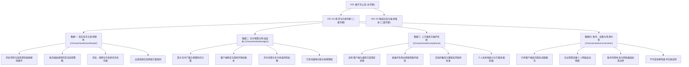
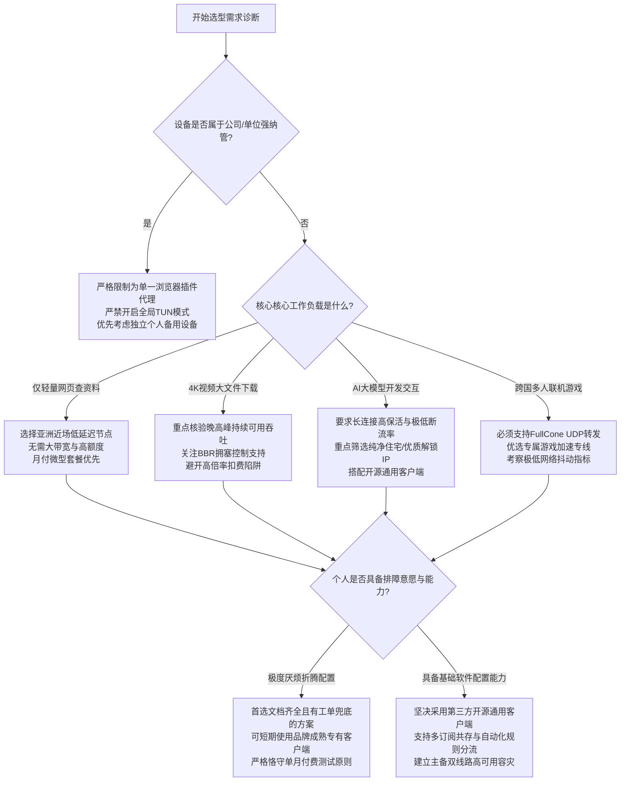

# 需求与约束判断：梯子怎么选二级专题深度解析

<AnswerFirst
  verdict="选择网络服务的第一步绝不是盲目寻找所谓速度最快的服务商，而是精确建立个人工作负载模型与物理约束清单。许多人在选型初期遭遇的频繁断连、严重卡顿或账号封禁，根源往往在于用轻量浏览方案去承载高并发终端开发，或者在受管设备上强行接入私有隧道触发了内网安全风控。"
  appliesTo="面临网络选型决策、对套餐预算与维护成本感到困惑、或在特殊设备与特定网络环境下需要稳妥方案的个人与团队用户。"
  prerequisites="已明确自身主要使用的操作系统平台与主要出海应用类别，了解基础网络代理概念。"
  boundaries="本指南专注于客观技术指标、成本结构与环境约束分析，不推荐单一特定商业品牌，具体品牌横向评测请参考主站。"
  verifiedDate="2026-10"
/>

<MobileOutlineCard
  title="本专题核心内容导读"
  description="快速了解需求与约束判断的完整分析维度与决策路径"
  :topics="[
    { title: '一、需求诊断的工程本质：抛弃模糊感知，建立量化约束模型', anchor: '#一、需求诊断的工程本质：抛弃模糊感知，建立量化约束模型' },
    { title: '二、工作负载与吞吐特征的深度解构', anchor: '#二、工作负载与吞吐特征的深度解构' },
    { title: '三、实付预算与整体拥有成本的真实账本', anchor: '#三、实付预算与整体拥有成本的真实账本' },
    { title: '四、上手难度与日常维护负担的客观评估', anchor: '#四、上手难度与日常维护负担的客观评估' },
    { title: '五、环境约束、设备管理与账号安全边界', anchor: '#五、环境约束、设备管理与账号安全边界' },
    { title: '六、需求与约束二级专题下的4大集群与16篇深度指南索引', anchor: '#六、需求与约束二级专题下的4大集群与16篇深度指南索引' },
    { title: '七、选型决策流程与量化打分体系', anchor: '#七、选型决策流程与量化打分体系' },
    { title: '八、常见认知误区与核心常见问题解答', anchor: '#八、常见认知误区与核心常见问题解答' },
    { title: '九、推荐继续探索的进阶专题与主站选购指引', anchor: '#九、推荐继续探索的进阶专题与主站选购指引' }
  ]"
/>

<TableOfContents />

## 一、需求诊断的工程本质：抛弃模糊感知，建立量化约束模型

在绝大多数用户的日常讨论中，对网络代理服务的评价往往被极度简化为网速快不快或者好不好用这种主观感知。这种主观描述掩盖了现代计算机网络的物理传输机理。网络代理链路是一条跨越本地局域网、本地运营商接入网、国内骨干网、跨境陆海光缆以及海外数据中心的多跳路由复合体。在整个通信链路上，影响用户体验的物理参数由五个独立且互相牵制的指标共同决定。

第一是端到端往返时延（RTT，Round-Trip Time）。往返时延取决于物理地理距离与光纤中的光速传输极限，以及沿途网络路由器的转发处理开销。从中国沿海省份到中国香港数据中心的物理时延极限通常在十几毫秒，而到北美西海岸则在一倍半以上，通常超过一百三十毫秒。往返时延决定了用户发起请求到收到首个字节的等待时间，直接主导了日常网页交互的跟手程度与轻快感。

第二是带宽与持续可用吞吐量（Throughput）。带宽决定了单位时间内能够穿过管道的最大数据量。但是高带宽绝不等于低时延，百兆下载速率的链路完全可能伴随着几百毫秒的高延迟与严重抖动。

第三是抖动（Jitter）。抖动是指相邻数据包到达时间间隔的变化程度。在稳定的网络环境中，抖动通常保持在五毫秒以内。当网络发生严重拥塞或跨境链路出现路由震荡时，抖动可能飙升至几十甚至上百毫秒，这会导致实时语音通话出现机械音、视频通话严重画音不同步。

第四是丢包率（Packet Loss）。在 TCP 协议下，哪怕百分之二的持续随机丢包，都会触发操作系统的拥塞控制算法大幅削减发送窗口，导致原本一秒钟可以跑满的百兆带宽瞬间断崖式下跌至几兆，并带来持续的重传等待。而在基于 UDP 的现代协议如 Hysteria 2 或 TUIC 中，虽然拥塞控制算法更加激进，但过高的丢包率仍然会导致解码端的数据缓冲队列枯竭。

第五是并发连接能力与长连接保活状态。现代复杂的 Web 页面与开发工具链往往在瞬间并发发起数十个乃至上百个 HTTP 请求。如果服务商的接入网关或者用户的本地客户端对并发文件描述符存在严苛限制，哪怕物理带宽再充裕，多任务并发时依然会出现严重的连接排队与超时卡死。

需求诊断的本质，是将用户的真实业务场景映射到上述五大工程指标的权重配比上。同时，必须在投入成本前，严格排查不可变动的客观物理约束。如果用户的办公电脑安装了深度的企业终端管理软件与内网根证书嗅探系统，那么在软件选择上就必须优先考虑浏览器级独立代理隔离，而不是贸然尝试开启虚拟网卡全局接管。如果用户的日常使用集中在通勤手机的双网漫游环境，那么移动端的休眠恢复能力就远比峰值跑分更为关键。建立科学的选型认知，第一步就是抛弃单一维度的神话，直面真实的使用场景与物理约束。

---

## 二、工作负载与吞吐特征的深度解构

不同的应用场景对网络底层资源的索取方式截然不同。许多人在选型时陷入困惑，本质上是因为没有解构自己的实际工作负载（Workloads）。将轻度网页查资料、4K 超清流媒体播放、海外人工智能大模型生产力交互、终端开发与开源仓库拉取、以及跨国网络联机加速等典型任务混为一谈，必然导致预算错配与体验挫败。

### 1. 网页信息检索与轻量级阅读的连接生命周期

日常的网页浏览看似技术要求最低，但在底层通信机制上却呈现出突发、小包、多域名、短生命周期的鲜明特征。当我们在浏览器中打开一个现代综合技术文档网站或新闻页面时，浏览器首先解析 HTML 骨架，随后会并发向十几个甚至上百个不同的域名发起静态资源、样式表、字体文件和埋点脚本的请求。

在传统的 HTTP/1.1 模式下，浏览器受限于同域名最大并发连接数（通常为六个），会产生严重的队头阻塞。现代网页广泛普及了 HTTP/2 和 HTTP/3 协议，支持单条 TCP 连接上的多路复用。这意味着对于轻量级网页阅读而言，网络链路的首包时间（TTFB，Time to First Byte）与 DNS 解析速度具有决定性意义。

如果服务商节点的 DNS 解析链路需要兜兜转转经过远端海外递归服务器，或者本地客户端在 Fake-IP 模式下发生了路由回环，即使节点能够跑出五百兆的测速带宽，用户每次打开网页仍然需要呆滞等待两三秒。针对此类轻量任务，核心考量是节点的往返时延是否在可接受范围内（例如亚洲近场节点的一百毫秒以内），以及客户端的本地 DNS 缓存策略是否高效，而完全不需要追求超大规格的峰值带宽。

### 2. 高清与 4K 超清流媒体传输机理

与网页浏览的突发小包相反，超清视频流传输是典型的长周期、大吞吐、高突发任务。现代流媒体平台如 YouTube 和 Netflix 普遍采用自适应流媒体协议（如 DASH 和 HLS）。视频内容被切分成大量几秒钟长度的媒体分片（Media Chunks），播放器根据当前下载分片的时间与本地播放缓冲区的水位，动态实时向上或向下调整后续分片的清晰度码率。

在流媒体传输过程中，TCP 拥塞控制算法起到了决定性作用。早期的 CUBIC 算法以丢包作为拥塞信号，一旦跨境公网发生微小的偶发性丢包，CUBIC 会立刻将拥塞窗口削减一半，导致播放器缓冲区急剧跌落并触发降码率模糊。而现代基于瓶颈带宽与往返传输时间的 BBR 算法，则能够在一定丢包率下依然准确测算链路可用容量并维持稳定的高吞吐。

因此，面向视频流媒体的工作负载选型，必须重点核验节点在晚间用网高峰期（通常是晚间八点至十一点）的持续吞吐能力与丢包率表现。如果一条线路仅在清晨测速表现优异，但在晚间因骨干网拥塞而出现剧烈抖动与丢包，流媒体播放就会频繁出现烦人的缓冲菊花转圈和清晰度跳水。此外，流媒体平台对出口 IP 的原生机房属性与广播属性有着严格的风控审查，关于这部分内容可参考 [风险提示全景指南](/risks/) 中的机房封锁机制。

### 3. 海外人工智能大模型交互的严苛条件

海外主流人工智能对话服务（如 ChatGPT、Claude、Gemini）在底层通信机制上采用了基于 HTTP 的 Server-Sent Events（SSE）长连接流式推送。这种工作模式具有高度独特的脆弱性。模型生成的每一个文字词元（Token）都在同一条持久连接上以分块传输编码（Chunked Transfer Encoding）的形式持续吐出。

这就要求底层代理链路必须具备极高的连接持久性。如果网络节点存在不稳定的负载均衡自动漂移，或者客户端的 TCP Keep-Alive 心跳间隔设置不当，流式连接就会在模型生成长篇回答的中间阶段突然遭遇重置（Connection Reset by Peer），导致前端界面弹出网络错误的红色警示。

更为严格的是人工智能服务商设立的 IP 风控防线。主流模型平台普遍集成了专业的威胁情报分析与 IP 风险评分系统（IP Fraud Score）。机房托管 IP（Hosting/Data Center IP）、广播段 IP、以及短时间内存在大量异常高频请求的节点 IP，会直接在 Cloudflare 或自研网关层被拦截，表现为无休止的真人验证码甚至直接封锁访问。因此，面向大模型应用场景的工作负载，稳定纯净的住宅属性出口或小众优质线路、以及稳定的长连接维持能力，其优先级远远高于总带宽大小。

### 4. 终端开发与开源生态工具链的特殊环境

程序员与技术从业者的出海需求往往集中在命令行与终端环境，这构成了另一类极具挑战性的工作负载。诸如 Git 源码拉取、Docker 镜像构建、npm/pnpm 前端依赖下载、Python pip 包安装以及 Rust cargo 编译等操作，通常需要短时间内拉取成百上千个微小文件或数吉字节的巨大归档包。

终端工具链普遍运行在系统底层，许多命令行程序并不默认遵循操作系统图形界面的系统代理（System Proxy）设置，或者它们在处理 HTTPS 代理身份认证时存在格式缺陷。如果采用传统的 HTTP 代理导出环境变量模式（如 export ALL_PROXY=http://127.0.0.1:7890），一旦某些工具（如部分旧版 curl 或 git 子模块）忽略了环境变量，流量便会直接裸连超时。

在这种高负荷、强依赖的开发环境下，基于 TUN 虚拟网卡的透明接管模式通常是更稳健的选择。通过在操作系统内核建立虚拟网络适配器，利用操作系统的路由表直接捕获所有出站 IP 数据包，使所有终端工具无感穿透代理隧道。但开启 TUN 模式也带来了对本地 CPU 计算资源的占用，以及必须规避本地局域网私有网段冲突的工程挑战。相关操作可详细参考 [电脑方案全景指南](/desktop/) 与 [网络排障全景指南](/troubleshooting/)。

### 5. 海外游戏联机加速与即时通讯的高实时性要求

跨国多人联机游戏对网络质量的要求最为严苛。在射击类或动作类联机游戏中，玩家的操作输入与服务器的状态同步依赖于极高频率（通常为每秒三十至六十次）的 UDP 小数据包交互。

游戏数据对时延与抖动的容忍度极低。一百五十毫秒以内的稳定时延可以正常游玩，但如果时延在五十毫秒与两百毫秒之间剧烈波动，游戏内就会出现严重的画面拉扯与判定失效。更关键的是 NAT 穿透类型。游戏主机与对等联机服务普遍依赖 Full Cone NAT（完全圆锥型 NAT）或者更宽松的端口映射。如果服务商的节点网关强制实施了 Symmetric NAT（对称型 NAT），或者节点的防火墙完全丢弃了 UDP 转发，玩家将无法加入房间或只能被限制在严格 NAT 模式下，无法与大部分队友建立直连。

普通网页代理服务商通常是针对 Web 流量进行优化的，许多节点出于防范 DDoS 放大攻击的考虑，会在上游直接封禁 UDP 流量或施加严苛的 QoS 限制。如果将主要目标定位于联机游戏加速，必须专门确认节点是否完整支持 UDP 转发，并考察其跨境出口的物理直连品质。

---

## 三、实付预算与整体拥有成本的真实账本

在选型决策中，许多人容易被服务商首页花里胡哨的宣传折页和所谓的超低年付噱头所迷惑。事实上，网络服务的总拥有成本（TCO，Total Cost of Ownership）绝非仅仅是套餐表面上的标价，它包含了直接采购支出、隐性软件许可成本、试错沉没成本以及设备运行开销。

### 1. 首次购买实付金额防坑法则

对于刚刚接触网络服务或者正在尝试新服务商的用户，首要的财务纪律是严格控制第一笔支付的绝对金额。在海外网络服务行业，年付大幅折扣是一种极为普遍的商业营销策略。例如某套餐月付标价三十元，年付则折合每月仅需十元，但需要一次性预付一百二十元甚至更高。

面对这种巨大的价格落差，缺乏经验的用户极易产生一次性买断一整年更省钱的错觉。然而，网络服务本质上是一种高动态、高损耗的持续运营服务，其底层涉及跨境公网光缆租赁、机房 BGP 带宽采买、以及应对网络封锁策略的持续维护成本。低价年付往往是运营方在现金流承压时快速聚拢资金的手段。

一旦购买了长周期年付套餐，用户不仅承担了服务商中途可能发生服务降级、节点大面积失效、甚至直接跑路失联的极高单边信用风险，而且自身的选择权被彻底锁死。在最初使用的两三个月内，一旦用户的真实业务发生变化（例如突然需要使用对 IP 纯净度要求极高的 AI 服务，而该年付服务商全线节点均被机房拉黑），之前预付的全部款项便直接沦为沉没成本。

因此，最理性的选型原则是始终将第一笔实付门槛压缩在单月周期内。哪怕月付的单价略高，这笔微小的溢价实质上是用户为自身采购自由度与风险隔离所支付的合理保险费。经过连续两到三个完整自然月的稳定性验证，且期间服务商表现出良好的工单维护与节点修复能力后，才考虑逐步过渡到季度或更长周期的承诺。

### 2. 隐性附加成本全景清单

除了服务商收取的套餐月租之外，完整的网络方案通常还伴随着一系列不可忽视的周边支出，如果不将这些隐性成本纳入总预算，往往会在实施过程中陷入被动。

首先是客户端软件的购买与许可支出。在安卓与桌面平台（Windows、macOS、Linux），绝大多数主流优秀的代理客户端（如 Clash Verge Rev、v2rayN、FlClash、sing-box 官方核心等）均为开源社区免费提供。但在苹果 iOS 与 iPadOS 封闭生态中，由于官方 App Store 中国区对网络代理工具的严格限制，用户必须准备一个非中国区（如美区、港区或日区）的 Apple ID。

在非中国区商店中，优质的知名通用客户端均为商业付费软件。例如 Shadowrocket（小火箭）通常标价为 2.99 美元，Stash 标价为 3.99 美元，Quantumult X（圈 X）标价为 7.99 美元，而具备专业调试功能的 Surge 5 更是采用了昂贵的高门槛内购买断制。如果用户没有海外信用卡，通过第三方渠道采购海外 App Store 礼品卡充值，还会产生额外的汇率溢价与潜在的黑卡封号风险。这笔初期的软件采购支出，必须如实计入首次建置的总账本中。

其次是硬件设备的电力与损耗开销。部分进阶用户为了实现家庭全屋智能设备无感出海，会选择采购专门的软路由（如基于 Intel N100 或工控机架构的微型主机）。一台全天二十四小时不间断开机的工控软路由，其整机功耗通常在十瓦至二十五瓦之间，一年的电费消耗约在五十元到一百元之间，加上硬件采购的初期折旧，这也是全屋方案的硬性物理成本。

### 3. 流量计费陷阱与倍率机制深度揭秘

在评估服务商的套餐性价比时，单纯比拼每月标称的流量额度（例如一个月五百吉字节或一千吉字节）是极其片面的。现代网络服务普遍引入了复杂的节点倍率结算规则。

倍率机制的本质是服务商为了平衡不同线路的底层采购成本而设立的动态计费杠杆。常规的普通公网直连节点或低质量中转节点，倍率通常为 1.0x（即用户传输一吉字节真实数据，后台扣除一吉字节套餐配额），部分大流量冷门节点甚至可能低至 0.2x 到 0.5x。然而，对于延迟极低、高峰期极其稳定、采购成本昂贵的企业级 IPLC/IEPL 国际专线节点，服务商设置的倍率往往高达 2.0x、3.0x 甚至 5.0x。

这意味着如果一个标称每月两百吉字节的套餐，用户如果全程挂在 3.0x 倍率的高质量专线节点上看视频或拉取大文件，其实际可用物理流量瞬间就会被稀释缩水到不足七十吉字节。更进一步，绝大多数服务商的套餐流量具有严格的按自然月或按计费周期清零机制，当月未用完的配额绝不顺延到下个月。

因此，在制定预算时，必须建立有效可用流量的概念。对于高频高吞吐用户，必须算清高倍率节点下的实际折算单价；而对于低频轻量用户，盲目追求大额度套餐只会造成每个月百分之八十以上的流量白白清零浪费。相关深度分析可以参考本集群下的专题文章 [预算有限怎么选梯子：先算第一次实际要付多少钱](/choose/first-payment-limit/) 与 [套餐流量一直用不完，如何按任务重新分配预算？](/choose/wasted-quota-budget/)。

---

## 四、上手难度与日常维护负担的客观评估

网络工具的选型从来不是单纯的技术参数比拼，而是一场个人技术掌控能力与维护精力投入之间的理性平衡。选择了一套超出自身排障能力的方案，最终往往不是工具服务于人，而是人沦为配置文件的修理工。

### 1. 服务商专有集成客户端与第三方开源通用客户端的取舍

当用户进入一个网络服务平台时，通常面临两条完全不同的交付路径。第一条路径是直接下载服务商自己打包的一键连接客户端；第二条路径是服务商仅提供一串订阅链接（Subscription URL），要求用户自行下载配置开源通用的第三方客户端（如 Clash Verge Rev、v2rayN、v2rayNG 等）。

服务商专有客户端的优势在于极低的学习门槛。用户通常只需要输入官网注册的账号密码，点击一键登录，软件便会自动在后台完成节点的拉取与系统代理的设置，界面上仅有简单的连接与断开大按钮。对于完全不想了解网络底层原理、甚至分不清代理端口与本地 IP 的纯小白用户，这种形态极大降低了首次跑通的心智负担。

然而，专有客户端的代价是高度的技术捆绑与安全黑盒风险。专有客户端通常是闭源打包的，用户无法审计其内部是否嵌入了多余的追踪统计代码，也无法得知其底层内核究竟采用了何种路由分流策略。更为关键的是，专有客户端仅能绑定该单一服务商。一旦该服务商遭遇节点大面积故障，用户在专有客户端内完全无法导入任何备用线路，陷入彻底的瘫痪。

相反，采用开源通用的第三方客户端，虽然在初期需要学习什么是订阅导入、什么是策略组切换、什么是 TUN 模式驱动，但它赋予了用户完整的架构控制权。通用客户端支持多服务商订阅并发共存，用户可以同时导入主用服务商与备用线路，并在统一的界面中自由切换分流。关于通用客户端的安装与选型，可详细参考 [客户端下载全景指南](/clients/) 与 [使用教程全景指南](/guides/)。

### 2. 日常维护时间账本的真实开销

很多人在评估网络方案时忽略了自己的时间成本。一套看起来每月便宜几块钱的极客自建或拼车方案，如果每周都需要耗费一两个小时去排查为什么突然打不开网页，其实际维护成本早已远远超过了商业现成服务的价值。

在真实的长期使用周期中，网络方案的维护工作主要由以下几项构成。第一是节点可用性的动态剔除。跨境网络受国际海缆维修、运营商骨干网调整与政策审查波动的影响，节点发生偶发性离线是常态。好的通用客户端具备自动健康检查与回退机制（Fallback Group），能够无感切换到可用备用节点，而简陋的方案则需要人工频繁手动测速切换。

第二是订阅规则与分流数据库的更新维护。全球互联网的域名归属与 CDN 调度处于快速变化之中。诸如国内直连域名白名单、流媒体解封规则库、广告拦截规则等，如果长期不进行更新，就会出现国内网站误走代理拖慢网速、或者海外新上线的服务无法触发规则的现象。自动化更新的配置是否可靠，直接决定了日常的省心程度。

第三是突发网络故障的排障成本。当网络突然中断时，问题可能出在服务商出口被墙、本地运营商宽带光猫故障、Windows 系统代理注册表残留死锁、或者本地安全防护软件的拦截。如果缺乏清晰的排障思路，盲目重启电脑和重装软件只会带来巨大的挫败感。建立清晰的故障分层排查习惯，是降低维护负担的根本之道，具体方法可参考 [网络排障全景指南](/troubleshooting/)。

### 3. 服务商技术支持与文档生态的鉴别门槛

当遇到自身无法解决的技术障碍时，服务商提供的售后支持生态是最后的兜底防线。在选型考察期，必须重点核验服务商的技术支持渠道是否具备真实的专业交付能力。

首先应审视其官方帮助文档的质量。一个成熟专业的技术团队，其用户文档库通常按平台（Windows、macOS、iOS、Android、Linux）与主流客户端类型进行了条理清晰的图文排版，并明确指出了常见错误代码的对应原因（如核心端口冲突、订阅拉取失败 403/500 等）。如果一个服务商的文档充斥着早已失效的多年前截图，甚至通篇都是拼凑的外链，其技术维护水准通常令人担忧。

其次是工单支持的时效性与专业度。规范的工单系统是解决账号异常、节点线路故障与账单争议的核心通道。那些仅靠一个鱼龙混杂的公开发布群、管理员长期失联不回复的服务，一旦发生严重宕机，用户除了在群内焦躁抱怨之外完全没有任何保障。相关文档与工单的核验标准，可参阅 [怎样判断一个服务的教程和客服足以帮助自己上手？](/choose/documentation-support/)。

---

## 五、环境约束、设备管理与账号安全边界

许多用户在配置网络方案时往往孤立地看待技术，忽视了所处物理环境与管理体系的强约束。任何网络工具的运行都不是在真空中进行的，它必须与宿主操作系统、局域网安全策略、以及上层应用的风控规则共存。

### 1. 企业与单位受管设备下的合规红线与技术隔离

在现代企业办公环境中，由公司 IT 部门统一分发或纳管的办公电脑普遍部署了终端管理代理软件（如 MDM 移动设备管理、EDR 终端检测与响应系统，典型软件包括奇安信天擎、深信服 ED、联软 UniAccess 或企业级防火墙合规插件）。

这些企业安全软件在操作系统内核层注入了驱动，具备极高权限。它们会全天候持续监控系统进程列表、网络连接套接字、虚拟网卡驱动的安装与加载、以及系统注册表代理项的变动。如果用户在这种受管设备上随意下载未经验证的第三方代理软件并开启全局 TUN 模式，极易触发企业内部安全运营中心（SOC）的高危告警，被标记为非法外联或安装未授权软件。

更隐蔽的风险在于内网自签名根证书与流量解密嗅探。许多大型企业内网部署了下一代防火墙（NGFW），并在受管设备上强制预装了企业私有的 CA 根证书。当企业设备访问外部 HTTPS 流量时，防火墙可以在中间进行 SSL 流量解密检查。如果用户在此时混合传输个人敏感账号信息，隐私将暴露无遗。

面对单位受管设备，最稳妥的策略是严格实施业务与物理隔离。绝不在公司设备上开启全局虚拟网卡代理，更不能随意修改宿主机网络配置。如果确因工作需要访问公开技术资料，应严格将代理收敛在单一独立的浏览器内（通过安装浏览器专属代理切换插件如 SwitchyOmega/ZeroOmega，并将代理端口指向本地指定端口），或者在独立的个人手机与自购笔记本上处理私人事务。详细避坑原则可参阅 [设备由单位管理时，选择个人网络服务前需要确认什么？](/choose/managed-device-choice/)。

### 2. 移动场景下的网络漫游与休眠唤醒考验

移动设备（智能手机与平板电脑）的使用场景高度碎片化与动态化。用户每天在家庭 Wi-Fi、办公室局域网、公共热点以及运营商 4G/5G 蜂窝网络之间频繁切换，手机屏幕也在反复熄屏休眠与点亮唤醒。

这种高动态的移动环境对代理方案提出了截然不同的考验。在网络类型发生物理切换的瞬间（例如从地下车库蜂窝网络切换到开阔地的家庭 Wi-Fi），手机的物理 IP 地址发生剧烈改变，所有既有的 TCP 长连接会被操作系统强制断开。如果移动端代理软件（如 Shadowrocket 或 v2rayNG）未能及时感知网络状态变化事件并平滑重建虚拟网卡接口，手机就会出现假死断网现象，必须手动开关飞行模式才能恢复。

此外，智能手机操作系统（尤其是国产定制版 Android 系统如澎湃 OS、ColorOS、OriginOS 等）具备极为激进的后台电池管理与内存冻结机制。如果未对代理客户端进行系统级常驻保护设置（如授予自启动权限、锁定后台任务卡片、关闭系统省电优化限制），客户端进程极易在锁屏数分钟后被系统无情清理杀后台，导致即时通讯软件与邮件推送全盘瘫痪。有关移动平台的细致优化，请参考 [手机方案全景指南](/mobile/)。

### 3. 应用账号风控与网络传输通道的解耦认知

网络选型中最为普遍的一个认知误区，是将目标平台（如 OpenAI、Google、Twitter、PayPal）的应用层账号风控问题，全盘推卸给底层的网络通道服务商。

现代互联网巨头的反欺诈系统是一个多维度的综合决策引擎。它判断一个账号是否存在违规或风险，网络出口 IP 仅仅是众多特征输入中的一个组成部分。除了 IP 属性（是否为数据中心段、地理位置是否突变、是否被列入全球威胁黑名单）之外，浏览器环境指纹（Canvas 指纹、字体列表、WebGL 渲染特征）、操作系统的时区与语言设置、浏览器的 Cookie 状态、用户绑定的支付信用卡所属发行国、以及账号注册时的行为轨迹，共同构成了风险权重的全景画像。

许多用户在遭遇账号封禁时，往往误以为只要换一个节点或换一家服务商就能迎刃而解，结果在新节点上依然连续封号。这就是典型的未将网络通道与账号风控解耦的思维盲区。网络通道仅负责将数据包稳定、完整、低延迟地送达目标服务器，它无法替用户伪装操作系统的时区漏洞，更无法消除由于多次触发风控规则留下的平台黑名单标记。建立清晰的权责边界，才能在排查故障时找准靶心。深入探讨可参考 [应用账号资格和网络连接有什么区别，选服务时怎样分别核对？](/choose/account-network-boundary/)。

---

## 六、需求与约束二级专题下的4大集群与16篇深度指南索引

作为梯子怎么选（H01）主专题下的关键支撑支柱，需求与约束判断（H01-S1）二级专题设立了四个高度聚焦的三级集群，每个集群下规划了四篇针对具体工程场景的独立长文。这一架构旨在为用户提供从抽象理论到具体落地的全套工具箱。

### 集群一：真实任务与使用频率（/choose/needs/workloads/）

本集群专注于帮助用户根据自身真实的日常任务构成，精准锚定所需的网络指标基线，拒绝为虚无的冗余参数买单。

1. **[只是浏览网页和查资料，怎样确定梯子的最低够用条件？](/choose/browsing-task-budget/)**
   深度剖析仅有轻量网页检索与文档查阅需求的用户画像，建立包含往返时延上限、基础带宽门槛与本地 DNS 优化的最低够用技术指标，引导用户规避盲目的大套餐消费。
2. **[每月只用几次，选长期订阅还是临时方案更合适？](/choose/occasional-use-choice/)**
   面向极低频使用人群，详细对比按月常规订阅、按量不限时计费套餐（Pay-as-you-go）、以及按日应急流量包的真实经济学模型与账号保活规则。
3. **[浏览、视频和文件传输混合使用，怎样安排服务优先级？](/choose/mixed-workloads/)**
   解构多任务并发场景下的带宽分配机理，指导用户如何在通用客户端中利用分流规则集，将高清视频定向调度至大带宽节点，而将敏感网页分配至高稳定性节点。
4. **[出差期间临时需要网络服务，购买前怎样规划设备和使用时间？](/choose/travel-use-planning/)**
   针对跨国商务出行与异地短期公干场景，梳理境内外漫游网络环境差异、多设备跨平台热点共享方案、以及短期退订退出机制。

### 集群二：实付预算与附加成本（/choose/needs/budget/）

本集群致力于帮用户算清直接支出与隐性开销的全景账本，建立健康的支付与风险对冲策略。

1. **[预算有限怎么选梯子：先算第一次实际要付多少钱](/choose/first-payment-limit/)**
   揭示新手首次采购的核心铁律，建立首笔实付金额控制模型，防止用户在未验证可用性的前提下被长期预付优惠掏空钱包。
2. **[选择网络服务时，怎样把客户端费用算进总预算？](/choose/software-extra-cost/)**
   系统梳理 iOS 生态商业代理软件采购成本、外区 Apple ID 充值损耗、桌面端捐赠机制以及软路由硬件采购折旧，算清整体拥有成本。
3. **[月付与年付怎样选择：费用节省和预付承诺一起比较](/choose/monthly-annual-commitment/)**
   建立资金时间价值、服务商跑路概率与按月迁移自由度之间的量化权衡公式，给出清晰的周期进阶转换时间点建议。
4. **[套餐流量一直用不完，如何按任务重新分配预算？](/choose/wasted-quota-budget/)**
   分析大量用户流量严重闲置的原因，指导如何根据真实用量向下平滑调整套餐，并将结余预算转移至节点质量更高的精简方案。

### 集群三：上手难度与维护负担（/choose/needs/complexity/）

本集群专注于评估不同方案的心智消耗与技术门槛，确保用户选择的方案能够稳定长期运行而不成为日常负担。

1. **[自有客户端和通用订阅怎么选：上手步骤与可迁移性比较](/choose/one-click-versus-import/)**
   全面横向对比服务商定制专有一键软件与开源通用客户端在配置难度、跨平台同步、多线路冗余容灾与安全隐私层面的深层差异。
2. **[不想经常折腾配置，选服务时应该确认哪些维护条件？](/choose/maintenance-time/)**
   提炼省心服务的必备硬性指标，包括自动健康检查重试、订阅自动按需更新、节点命名规范以及上游运维的透明度通报机制。
3. **[怎样判断一个服务的教程和客服足以帮助自己上手？](/choose/documentation-support/)**
   建立科学的售后与文档生态质量审查表，教用户如何在购买前通过官方帮助中心的排版质量与工单处理流程鉴别草台班子。
4. **[会安装软件但不懂协议，怎样选择符合自己能力的方案？](/choose/technical-skill-fit/)**
   根据用户的计算机基础水平划分技术适配梯队，为不懂加密协议与路由规则的新人规划一条安全平滑的无痛上手学习路线。

### 集群四：账号、设备与场景约束（/choose/needs/constraints/）

本集群聚焦于外部不可抗力与边界限制，指导用户在特定的严苛环境下如何安全合规地完成任务。

1. **[已经买了客户端，怎样反向筛选适配的服务？](/choose/existing-client-service/)**
   指导已经购买了特定平台商业软件（如 Shadowrocket、Surge 或 Stash）的用户，如何根据软件支持的协议标准与订阅格式反向精准匹配兼容的服务商。
2. **[设备由单位管理时，选择个人网络服务前需要确认什么？](/choose/managed-device-choice/)**
   深度揭秘企业 MDM 与 EDR 软件的审计工作原理，制定严密的工作设备个人网络使用红线，详解浏览器隔离与端口转发规避策略。
3. **[应用账号资格和网络连接有什么区别，选服务时怎样分别核对？](/choose/account-network-boundary/)**
   厘清 OpenAI、Google 等平台账号封禁的底层诱因，建立网络连通性与应用层安全环境的独立核对流程，破除认知误区。
4. **[选择梯子前如何列出必须满足和可以放弃的条件？](/choose/non-negotiable-needs/)**
   提供一套结构化的需求优先级归纳矩阵，帮助用户把模糊的愿望清单蒸馏为不可妥协的核心刚性条件与可妥协的弹性辅助条件。

---

## 七、选型决策流程与量化打分体系

为了帮助用户将抽象的需求与约束梳理为清晰的执行动作，梯子参考实验室制定了如下选型约束推导决策树。在开始筛选具体服务前，请顺着决策逻辑逐步排除不可行方案。

---

## 八、常见认知误区与核心常见问题解答

在梯子参考社区收到的海量用户咨询中，以下几类高频认知误区反复出现。我们将这些关键问题进行工程层面的逐一解剖。

  

    
Q1：既然某家服务商测速能跑五百兆，为什么我打开 ChatGPT 依然经常报错？

    

      
这正是典型的将“带宽吞吐”与“长连接稳定性及 IP 纯净度”混为一谈的案例。常规的测速软件（如 Speedtest 或 YouTube 跑分）是通过建立多条并发 TCP 连接，全力拉取大块无意义数据来压榨物理带宽，它反映的仅仅是节点管道的最大通过能力。

      
然而，ChatGPT 等人工智能平台运行在 Server-Sent Events（SSE）长连接之上，并且前端设置了严苛的 IP 风险评分（Fraud Score）拦截机制。如果服务商的节点 IP 属于廉价的数据中心广播段，且该 IP 已经被几千名用户共享滥用，平台安全网关在握手阶段就会直接抛出 403 拒绝或触发死循环验证码。同时，若节点所在服务器存在微弱的网络波动导致长连接中断，回答就会瞬间卡死。这与测速能跑多少兆没有半点正向关联。

    

  

  

    
Q2：年付折合每个月只要九块九，比月付三十元便宜太多了，为什么坚决反对新手买年付？

    

      
因为这种表面上的价格便宜是建立在用户单方面承担全盘经营与政策风险的前提之下的。九块九每月的超低定价，在正规采买企业级跨境专线带宽与优质住宅 IP 的成本结构下几乎是不可能持续盈利的，它通常依赖极高的超售比（数百人挤在同一条小带宽上）或者以旧还新的资金盘模式。

      
在这种商业模式下，一旦遭遇骨干网波动、上游机房清退、或者政策严打，服务商极易出现大面积瘫痪甚至直接失联跑路。此时您的年付款项瞬间变成百分之百的沉没亏损。对于新手而言，按月灵活付费哪怕表面单价略高，但它赋予了您随时用脚投票的绝对自由，避免被劣质服务商套牢数月。

    

  

  

    
Q3：手机上开了代理之后耗电极快，而且发热严重，这是节点问题还是客户端问题？

    

      
这种现象主要是由于移动客户端运行模式选择不当与后台长连接心跳保活冲突所致。如果客户端开启了基于虚拟网卡的 TUN 模式，并且开启了全量本地日志记录或过于密集的自动节点延迟检测，本地 CPU 就必须对每一个进出手机的数据包进行解包、加密与重新封装，导致处理器无法进入深度休眠状态。

      
解决策略包括：在移动端优先关闭不必要的调试日志输出；将节点定时健康检查间隔拉长（例如调整为十五分钟或半小时一次）；在电量敏感时，将分流模式从 TUN 虚拟网卡切换为传统的本地 HTTP/SOCKS5 系统代理；并确保客户端已在系统设置中排除了过于激进的后台自杀与反复唤醒死循环。

    

  

  

    
Q4：在公司电脑上使用自建或购买的网络服务，IT 部门真的能察觉到吗？

    

      
答案是完全能察觉，而且比您想象的更容易。如果您的办公电脑安装了企业级的安全合规终端代理软件，它在系统内核常驻运行。当您在电脑上安装虚拟网卡（TUN/TAP 驱动）或启动代理进程时，进程名称、数字签名、绑定的本地监听端口、以及与外部特定海外 IP 建立的大流量加密长连接，都会以结构化安全日志的形式实时同步至企业内网的安全态势感知中心。

      
即便数据包的内容经过了强加密，企业安全人员无法直接解密您浏览的文字，但持续与可疑海外出口通信、流量突发暴增、以及私自修改网络适配器配置本身，就已经直接违反了绝大多数企业的合规管理条例。因此，切勿在强纳管设备上抱有侥幸心理，请严格遵守公司安全规定，将私人网络需求剥离到个人自带设备上。

    

  

  

    
Q5：为什么同样的订阅链接，在电脑上能用，但在手机上却连不上？

    

      
这通常是因为两个平台所采用的客户端内核版本与协议支持能力存在代际断层。例如，如果服务商下发了较新的协议配置（如 VLESS Reality 或 Hysteria 2），电脑端使用的是最新维护的 Clash Verge Rev（集成了最新 Mihomo 内核），可以完美识别并解析这些节点。

      
但如果手机端使用的是版本较为陈旧的旧版 Clash for Android，其底层内核早已停止维护，根本无法识别这些新型配置字段，便会在导入时直接静默忽略这些节点，或者在尝试握手时报错崩溃。解决这一问题，需要确保移动端与桌面端使用的客户端内核均跟进至主流现代版本，具体软件版本核对可参考 [客户端下载全景指南](/clients/)。

    

  

  

    
Q6：我已经买了很贵的独立客户端软件（如小火箭），为什么还是无法上网？

    

      
许多初学者容易混淆客户端软件与网络服务通道之间的界限。Shadowrocket、Clash Verge Rev 或 v2rayN 等软件，仅仅是运行在您本地设备上的网络流量调度引擎（类似于一个空的水管系统）。它们本身并不包含任何可以访问外部网络的跨境服务器节点。

      
购买或下载了客户端软件之后，您还必须配置有效的网络服务订阅节点（即水管里流动的水）。将服务商提供的订阅链接正确导入客户端，并成功解析出可用的服务器节点列表，完成握手连接后，整个系统才算真正运转起来。关于软件与服务的明确分工，可参阅 [新手方案全景指南](/beginner/)。

    

  

---

## 九、推荐继续探索的进阶专题与主站选购指引

建立科学的需求与约束清单，仅仅是网络选型工程的第一块基石。在明确了自身的物理边界之后，接下来的关键步骤是进入候选方案的科学收敛、实测证据比对以及决策记录归档。

我们强烈建议您沿着梯子参考的系统化知识网络继续深入探索：

- **进阶决策收敛**：请查阅本主专题下的兄弟二级专题 [候选比较与最终取舍：梯子怎么选二级专题深度解析](/choose/decisions/)，了解如何运用证据比较法剔除虚假宣传。
- **全站选型纲领**：回到 [梯子怎么选：基于真实任务、预算与设备约束的科学选型指南](/choose/)，纵览完整的选型全景图。
- **跨平台客户端落地**：查阅 [客户端下载全景指南](/clients/) 与 [使用教程全景指南](/guides/)，获取安全可靠的官方源码与保姆级实操步骤。
- **网络底层机制理解**：访问 [知识百科全景指南](/wiki/) 与 [服务类型全景指南](/service-types/)，彻底掌握中转、专线、协议封装的深层机理。

<MainSiteCTA
  title="需要查看各品牌实时测速数据与最新套餐横向大对比？"
  description="梯子参考专注于通用选型逻辑、网络架构原理与开源客户端配置。若您已明确自身需求并准备横向对比具体服务商的晚高峰测速、机房拓扑分布与优惠活动，请移步唯一选购主站。"
  badge="权威数据联动"
  buttonText="前往主站查看实时品牌评测"
/>
