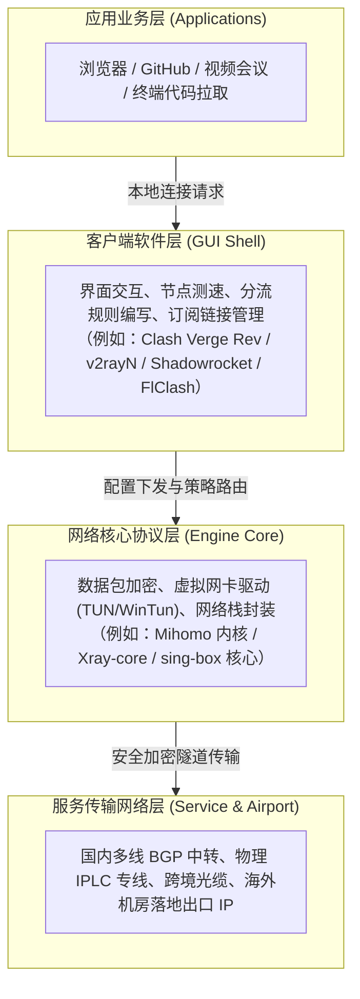
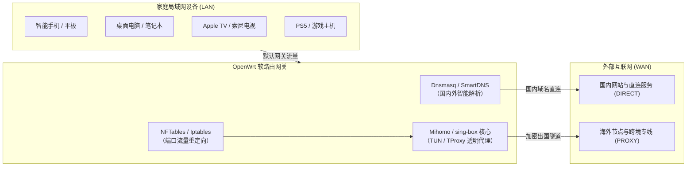

# 客户端下载：跨平台代理软件全景选型、安全下载与架构指南

<Breadcrumbs
  :items="[
    { title: '客户端下载', url: '/clients/' }
  ]"
/>

<AnswerFirst
  verdict="选择网络代理客户端的黄金法则是‘系统架构优先、内核生态解耦、严格认准官方开源Releases’：Windows首选Clash Verge Rev（兼顾Mihomo新协议与TUN模式）或v2rayN（多协议灵活管理）；macOS首选支持Apple Silicon原生架构的Clash Verge Rev或FlClash；Android优先挑选v2rayNG、FlClash或Hiddify；iOS/iPadOS优先通过外区App Store获取Shadowrocket（小火箭，性价比最高）或Stash；Linux桌面采用支持TUN的AppImage或系统包；软路由推荐OpenClash或基于新版OpenWrt的Nikki。坚决杜绝在第三方二次打包网站下载带后门的安装包，严禁安装未知根证书。"
  appliesTo="需要在Windows电脑、Mac、安卓手机、iPhone/iPad、Linux工作站或家庭软路由上寻找稳定、安全、无毒网络客户端的全部用户。"
  prerequisites="清晰了解自身设备的操作系统版本与处理器芯片架构（如Intel x64还是Apple Silicon M系列/高通ARM64）。"
  boundaries="梯子参考为中立技术资料库，所有客户端介绍均直连GitHub官方开源仓库或苹果官方App Store，本站不分发修改版或破解版软件，不经营节点销售；商业机场与套餐横评请前往选购主站机场榜一。"
  verifiedDate="2026年10月"
/>

## 一、答案先行与客户端核心认知

在跨国网络访问与日常远程协作的技术链条中，“客户端软件（Client Application）”是用户每天打交道最频繁的第一道交互窗口。然而，很多初次接触科学上网的用户，往往容易陷入严重的认知混淆：有人误把“Clash”或“v2rayN”当成是卖节点的商家，有人在搜索引擎中搜索下载却误入李鬼钓鱼网站下载了被植入后门木马的“破解版”，还有人因为下错了芯片架构导致软件频繁崩溃断网。

梯子参考（tizicankao.cc）设立“客户端下载”核心专题，旨在为中文网络用户建立一套权威、客观、无偏见的全平台客户端选型与安全下载指南。



### 1.1 软件与服务的根本分工边界

必须在脑海中牢固确立以下三条基本原则：
1. **客户端软件绝大部分是开源且免费的（iOS 部分除外）**：无论是 Clash Verge Rev、v2rayN、v2rayNG 还是 FlClash，它们是由全球热爱网络自由的开源社区开发者无偿编写的工具，其源码完全公开在 GitHub 上。软件本身不包含任何网络节点或海外流量；
2. **节点与流量是由独立的网络服务商（机场/VPS）交付的**：用户在服务商处购买的是一条“订阅链接（Subscription URL）”。只有把这条订阅链接导入到客户端中，客户端才能从服务商服务器拉取数十个海外节点的 IP、端口与加密密钥，进而完成网络代理；
3. **外壳（GUI）与核心（Core）是完全解耦的**：图形界面软件（如 Clash Verge Rev）主要负责美观的界面呈现、托盘图标、快捷键切换和规则管理；真正负责底层网络封包、加密解密和系统级虚拟网卡（TUN）调度的，是位于后台默默运行的引擎内核（如 Mihomo 或 Xray）。

---

## 二、客户端下载知识拓扑：两大二级专题与八大三级集群

作为梯子参考全站第九大核心专题，本模块下辖两大权威二级专题与八个三级集群，覆盖从硬件架构选择到供应链安全核验的全流程：

<TopicMatrix
  title="客户端下载知识体系与集群导航矩阵"
  category="主专题 09：/clients/"
  :columns="[
    { key: 'clusterName', label: '核心三级集群' },
    { key: 'focusWorkload', label: '主要解决问题与技术聚焦点' },
    { key: 'representativeArticle', label: '代表性深度文章' },
    { key: 'actionTarget', label: '阅读后可掌握的实战技能' }
  ]"
  :rows="[
    {
      clusterName: 'Windows下载资料 windows-packages',
      focusWorkload: 'x64与ARM64双架构、NSIS安装包、绿色便携Zip与WinTun驱动',
      representativeArticle: 'Clash Verge Rev发布页怎样阅读：版本、安装包与更新说明',
      actionTarget: '避开免安装运行库缺失报错，完成纯净便携化部署'
    },
    {
      clusterName: 'Android下载资料 android-packages',
      focusWorkload: 'v2rayNG、FlClash、Hiddify、APK架构识别与防钓鱼假包',
      representativeArticle: '安卓平台代理客户端全景：arm64-v8a识别与防假包指南',
      actionTarget: '正确识别手机CPU指令集，防范第三方篡改安装包'
    },
    {
      clusterName: '苹果平台下载资料 apple-packages',
      focusWorkload: 'iOS美区App Store正版获取、小火箭Stash比对、Mac双架构',
      representativeArticle: '苹果生态网络工具获取：外区Apple ID与Mac原生芯片适配',
      actionTarget: '低成本安全获取正版iOS代理工具，避免买到共享封号账号'
    },
    {
      clusterName: 'Linux与网络设备资料 linux-router-packages',
      focusWorkload: 'AppImage、Deb、RPM包机制、setcap权限、OpenWrt透明代理',
      representativeArticle: 'Linux与OpenWrt软路由代理部署：权限赋予与内核依赖',
      actionTarget: '掌握系统扩展权限配置，跑通软路由全屋无感漫游'
    },
    {
      clusterName: 'Clash与Mihomo家族资料 mihomo-apps',
      focusWorkload: '从原版Clash停更到Mihomo的分支演进、规则集编译、内存开销',
      representativeArticle: 'Mihomo内核体系深度剖析：规则集优化与跨平台客户端横评',
      actionTarget: '认清社区正统分支，掌握现代化Rule-set分流机制'
    },
    {
      clusterName: 'v2rayN与v2rayNG资料 xray-apps',
      focusWorkload: '经典Xray生态、VLESS Reality配置、路由分流、多协议节点池',
      representativeArticle: '经典Xray生态长盛不衰的秘密：v2rayN与v2rayNG终极实操',
      actionTarget: '熟练掌握多核心切换、剪贴板极速导入与节点批量测速'
    },
    {
      clusterName: 'sing-box与跨平台资料 singbox-apps',
      focusWorkload: '新一代多协议通用网络核心、内存低占用、JSON配置规范、Karing',
      representativeArticle: 'sing-box生态全景：原生核心、跨平台GUI与轻量化优势',
      actionTarget: '为嵌入式低功耗设备与极客场景挑选最优核心'
    },
    {
      clusterName: '安全下载与资料维护 source-safety',
      focusWorkload: '官方Releases哈希比对、开源供应链审计、杀软误报白名单',
      representativeArticle: '软件下载安全防护：SHA256哈希比对与防木马后门军规',
      actionTarget: '建立严格的数学校验防线，防范一切网络中间人劫持'
    }
  ]"
/>

---

## 三、主流操作系统平台客户端全景横向对照大表

为了让大家在选型时能够一目了然，梯子参考实验室整理了 2026 年现代网络代理客户端全平台参数综合对照大表：

<ComparisonTable
  title="六大主流操作系统主流代理客户端综合参数与特性基线表"
  note="数据基于各项目官方开源仓库 2026 年最新正式稳定版本核实，包含平台支持度、开源许可与核心特性"
  source="梯子参考实验室软件工程研究组 v4.0"
  :columns="[
    { key: 'softwareName', label: '客户端名称' },
    { key: 'primaryPlatform', label: '主力支持操作系统' },
    { key: 'engineCore', label: '底层支撑引擎内核' },
    { key: 'licenseModel', label: '开源状态与收费模式' },
    { key: 'tunMode', label: '系统级 TUN 虚拟网卡' },
    { key: 'recommendedScenario', label: '最匹配用户场景与定位' },
    { key: 'officialSource', label: '官方受信任下载渠道' }
  ]"
  :rows="[
    {
      softwareName: 'Clash Verge Rev',
      primaryPlatform: 'Windows / macOS / Linux',
      engineCore: 'Mihomo (原 Clash.Meta)',
      licenseModel: '开源免费 (GPL-3.0)',
      tunMode: '完整支持 (内置 WinTun / 网络系统扩展)',
      recommendedScenario: 'Windows 与 Mac 桌面端首选，规则分流完善，界面现代美观',
      officialSource: 'GitHub: clash-verge-rev/clash-verge-rev'
    },
    {
      softwareName: 'v2rayN',
      primaryPlatform: 'Windows (跨平台预览中)',
      engineCore: 'Xray-core / sing-box / Mihomo',
      licenseModel: '开源免费 (GPL-3.0)',
      tunMode: '完整支持 (内置 sing-box TUN 模块)',
      recommendedScenario: '资深 Windows 用户、多协议测试、自建与机场混合导入管理',
      officialSource: 'GitHub: 2dust/v2rayN'
    },
    {
      softwareName: 'v2rayNG',
      primaryPlatform: 'Android',
      engineCore: 'Xray-core',
      licenseModel: '开源免费 (GPL-3.0)',
      tunMode: '完整支持 (Android VpnService 原生调用)',
      recommendedScenario: '安卓手机首选工具之一，极致轻巧稳定，后台保活能力极佳',
      officialSource: 'GitHub: 2dust/v2rayNG'
    },
    {
      softwareName: 'FlClash',
      primaryPlatform: 'Windows / Android / macOS / Linux',
      engineCore: 'Mihomo',
      licenseModel: '开源免费 (GPL-3.0)',
      tunMode: '完整支持 (跨平台统一 TUN 抽象层)',
      recommendedScenario: '全平台统一 UI 追求者，基于 Flutter 打造，轻巧简约开箱即用',
      officialSource: 'GitHub: chen08209/FlClash'
    },
    {
      softwareName: 'Hiddify Next',
      primaryPlatform: 'Android / iOS / Windows / macOS',
      engineCore: 'sing-box',
      licenseModel: '开源免费 (GPL-3.0)',
      tunMode: '完整支持',
      recommendedScenario: '跨平台新手、多协议自适应导入，界面直观免复杂调优',
      officialSource: 'GitHub: hiddify/hiddify-next'
    },
    {
      softwareName: 'Karing',
      primaryPlatform: 'iOS / Android / macOS / Windows',
      engineCore: 'sing-box',
      licenseModel: '开源免费 (支持赞助)',
      tunMode: '完整支持',
      recommendedScenario: '跨设备同步规则、新手易上手的全功能 sing-box 客户端',
      officialSource: 'GitHub: KaringX/karing & 外区 App Store'
    },
    {
      softwareName: 'Shadowrocket (小火箭)',
      primaryPlatform: 'iOS / iPadOS',
      engineCore: '自研专有核心 (多协议支持)',
      licenseModel: '商业付费 (\$2.99 一次性购买)',
      tunMode: '系统原生集成 (Network Extension)',
      recommendedScenario: 'iPhone / iPad 用户绝对主力首选，性价比最高，功能全面耐操',
      officialSource: 'Apple App Store (需外区账号)'
    },
    {
      softwareName: 'Stash',
      primaryPlatform: 'iOS / iPadOS / macOS',
      engineCore: 'Clash 兼容核心',
      licenseModel: '商业付费 (\$3.99 一次性购买)',
      tunMode: '系统原生集成',
      recommendedScenario: '深度依赖 Clash YAML 规则覆写、按需按域名高级调优的苹果用户',
      officialSource: 'Apple App Store (需外区账号)'
    },
    {
      softwareName: 'Quantumult X (圈 X)',
      primaryPlatform: 'iOS / iPadOS',
      engineCore: '自研高性能核心',
      licenseModel: '商业付费 (\$7.99 一次性购买)',
      tunMode: '系统原生集成',
      recommendedScenario: '进阶 iOS 极客，重度依赖 JavaScript 脚本改包、去广告与深度策略',
      officialSource: 'Apple App Store (需外区账号)'
    },
    {
      softwareName: 'OpenClash',
      primaryPlatform: 'OpenWrt / 软路由',
      engineCore: 'Mihomo / Clash',
      licenseModel: '开源免费 (GPL-3.0)',
      tunMode: '完整支持 (Dnsmasq / NFTables 透明代理)',
      recommendedScenario: '家庭软路由、网关旁路由透明代理首选，支持全屋设备无感漫游',
      officialSource: 'GitHub: vernesong/OpenClash'
    },
    {
      softwareName: 'Nikki (OpenWrt-Mihomo)',
      primaryPlatform: 'OpenWrt 24.10+',
      engineCore: 'Mihomo',
      licenseModel: '开源免费 (GPL-3.0)',
      tunMode: '原生支持 (基于现代 NFTables 架构)',
      recommendedScenario: '新版 OpenWrt 路由器用户，配置精简轻量，资源消耗极低',
      officialSource: 'GitHub: nikkinikki-org/OpenWrt-nikki'
    },
    {
      softwareName: 'v2rayA',
      primaryPlatform: 'Linux / OpenWrt / Docker',
      engineCore: 'Xray-core / v2fly',
      licenseModel: '开源免费 (AGPL-3.0)',
      tunMode: '完整支持 (自带 Web 远程管理控制台)',
      recommendedScenario: '无显示器的 Linux 服务器、NAS 主机、软路由透明网关',
      officialSource: 'GitHub: v2rayA/v2rayA'
    }
  ]"
/>

---

## 四、全平台客户端选型决策树

面对琳琅满目的工具，如何根据自己的设备与技术熟练度在 30 秒内精准决策？请对照以下四层收敛决策模型：

<DecisionTree
  title="按操作系统与技术熟练度的客户端快速收敛决策树"
  :branches="[
    {
      condition: '使用 Windows 10/11 电脑，追求现代美观界面、希望一键开启规则分流和终端代理',
      action: '直接下载【Clash Verge Rev】便携包（x64-portable.zip 或 arm64-portable.zip），解压即用无需向系统写入安装文件。',
      verification: '解压后双击运行主程序，在设置中开启“服务模式”或直接开启“TUN 模式”，系统托盘出现清晰图标。',
      exitRoute: '若需要测试单节点原生 VLESS 链接或追求极致多协议微调，退而选用【v2rayN】。'
    },
    {
      condition: '使用苹果 Mac 电脑（无论是 M 系列 Apple Silicon 芯片还是老款 Intel 芯片）',
      action: '首选下载【Clash Verge Rev】macOS 版本。务必核对自己芯片：M1/M2/M3/M4 选 aarch64.dmg，老 Intel 选 x64.dmg。',
      verification: '安装后打开 Mac“活动监视器”，Clash Verge 进程种类明确显示为“Apple”原生执行，内存占用低于 100MB。',
      exitRoute: '若追求极度精简的 UI 界面，可选用基于 Flutter 打造的【FlClash】macOS 版。'
    },
    {
      condition: '使用 Android 安卓智能手机或平板，追求稳定后台运行与低电量消耗',
      action: '首选【v2rayNG】（兼容性最强）或【FlClash】（UI 现代舒适），通过 GitHub Releases 下载匹配自身芯片架构的 APK。',
      verification: '在系统“设置-电池优化”中将客户端设为“无限制”，锁屏熄屏半小时后重新点亮，外网连接依然秒开不掉线。',
      exitRoute: '若需要多协议自适应与新手友好界面，备选【Hiddify】或【Karing】。'
    },
    {
      condition: '使用 iPhone 或 iPad，希望在闭环生态中实现无感分流与长期稳定后台运行',
      action: '注册一个外区（美区/港区）Apple ID，登录 App Store 购买下载【Shadowrocket（小火箭）】或【Stash】。',
      verification: '导入订阅后轻按开启连接，状态栏出现 VPN 图标，国内微信抖音秒开直连，海外 YouTube 4K 流畅串流。',
      exitRoute: '若预算有限暂不想购买付费 App，可关注外区免费提供的【Hiddify】或【Karing】iOS 版本。'
    },
    {
      condition: '搭建全屋家庭透明代理，拥有千兆工控机软路由、NAS 或树莓派设备',
      action: '若运行经典 OpenWrt 21.02/23.05 固件，选用【OpenClash】；若运行最新 OpenWrt 24.10 固件，首选【Nikki】。',
      verification: '家庭内网所有手机、智能电视（Apple TV / 索尼电视）无需安装任何软件，连上 Wi-Fi 即可全员享受智能分流。',
      exitRoute: '若软路由内存较小（低于 512MB），建议改用纯静态编译的 sing-box 原生核心搭配精简 nftables 规则。'
    }
  ]"
/>

---

## 五、Windows 平台安装包类型深度剖析与驱动选择

Windows 平台由于硬件生态庞杂（传统 x86_64 与新兴 ARM64 并存），官方 Releases 列表中往往会罗列出五到六种不同的文件后缀。理解这些格式的本质差异，能让您在安装时避免踩坑：

### 5.1 便携版（Portable Zip）与安装向导版（Setup.exe / MSI）权衡

<div class="custom-block tip">
  <p class="custom-block-title">💡 极客最佳实践：优先选择 Portable 便携版</p>
  <p>便携版软件的所有配置文件、订阅缓存与日志均保存在解压文件夹内部，重装系统只需整体打包移动即可完整保留所有节点设置，绝不向 Windows 注册表和系统盘 AppData 目录写入残留垃圾。</p>
</div>

1. **便携压缩包（`.zip`）**：
   - 文件名特征：`Clash.Verge_1.7.7_x64-portable.zip`
   - **运行机制**：下载后使用系统解压工具将其解压至非系统盘（如 `D:\Tools\ClashVerge\`）。在该目录下新建一个名为 `data` 的空文件夹（部分软件会自动内聚配置）。双击 `Clash Verge.exe` 即可直接启动；
   - **核心优势**：完全绿色，不污染系统环境，更换电脑只需整包拷贝到 U 盘即可无缝迁移；
2. **标准安装器（`-setup.exe`）**：
   - 文件名特征：`Clash.Verge_1.7.7_x64-setup.exe`
   - **运行机制**：基于开源的 NSIS（Nullsoft Scriptable Install System）打包。双击后会弹出 UAC 管理员提权窗口，引导用户选择安装路径，并在开始菜单与桌面创建快捷方式；
   - **适用人群**：习惯 Windows 传统双击向导、不熟悉文件夹手动管理的新手用户；
3. **微软企业部署安装包（`.msi`）**：
   - 文件名特征：`Clash.Verge_1.7.7_x64.msi`
   - **运行机制**：遵循 Windows Installer 标准企业规范。支持通过 Active Directory 域控制器进行组策略静默推送，或者通过命令提示符以无界面静默方式部署（`msiexec /i package.msi /qn`）；
   - **适用人群**：企业 IT 网络管理员或需要在十台以上办公终端进行批量分发的运维人员。

### 5.2 WinTun 驱动与系统级虚拟网卡加载原理

传统代理软件通常仅仅在 Windows 系统设置中勾选了一个“本地 HTTP 代理（127.0.0.1:7890）”。这种传统系统代理存在巨大的局限性：许多现代应用程序（如 Windows PowerShell 终端、Git 命令行、Docker 容器、以及绝大部分海外联机竞技游戏）会直接绕过系统代理设置，依然走直连网络，导致命令行工具报错超时。

为了彻底解决这一痛点，现代客户端普遍引入了 **TUN 模式（虚拟网卡模式）**：
- **WinTun 驱动核心价值**：WinTun 是由 WireGuard 团队研发的高性能轻量化 Windows 内核虚拟网卡驱动程序。相比于古老笨重、动辄蓝屏的 OpenVPN TAP 驱动，WinTun 完全运行在 Windows 过滤平台（WFP, Windows Filtering Platform）机制上，数据包吞吐延迟更低，CPU 开销大幅降低；
- **加载前置要求**：开启 TUN 模式需要向系统注册虚拟网络适配器，因此客户端主程序必须以“系统管理员身份”运行，或者在客户端设置中点击安装“服务模式（Service Mode）”，使负责流量接管的核心作为 Windows 独立后台服务静默托管。

### 5.3 Windows 注册表代理残留排查与网卡接口跃点数调优

许多 Windows 用户在退出或强制关闭代理软件后，经常会遭遇一个极其抓狂的故障：**浏览器无法打开任何国内网页，提示“代理服务器拒绝连接”或“未连接到互联网”，但 QQ 或微信却能正常收发消息**。这属于典型的系统注册表代理残留故障：

1. **注册表代理残留手工修复三步法**：
   - 当客户端非正常退出（如电脑意外断电、蓝屏强制重启、任务管理器强杀进程）时，客户端未能来得及执行清理钩子，导致系统设置中的代理开关依然处于被勾选状态，而本地 7890 端口已经没有任何程序在监听；
   - 快速修复：按下 `Win + R` 键，输入 `inetcpl.cpl` 打开 Internet 属性，切换到“连接”标签页，点击“局域网设置”，取消勾选“为 LAN 使用代理服务器”，勾选“自动检测设置”，点击确定即可瞬间恢复国内上网；
   - 彻底防范建议：在 Clash Verge Rev 或 v2rayN 设置中，务必开启“退出时自动清理系统代理”选项。
2. **多网卡接口跃点数（Interface Metric）优先级冲突调优**：
   - 当电脑同时连接了有线千兆网线和无线 Wi-Fi、或者安装了 Hyper-V / VMware 虚拟机网卡时，Windows 系统有时会将物理以太网卡的优先级排在 WinTun 虚拟网卡之上，导致 TUN 模式虽然显示开启，但部分系统流量依然被强制路由至物理网卡走直连；
   - 调优实操：以管理员权限打开 PowerShell，执行 `Get-NetIPInterface` 命令查看各网卡的 `InterfaceMetric` 数值。将 WinTun 虚拟适配器的跃点数手动调整为较小值（例如设为 5），即可确保 TUN 虚拟网卡拥有最高的路由决策优先级。

---

## 六、Android 平台安装包架构核验与防假包军规

Android 智能手机的碎片化严重，不仅涉及处理器架构的向下兼容问题，更潜藏着黑客制作二次打包木马的严重安全威胁：

### 6.1 CPU 芯片架构识别与 APK 选型指南

在 GitHub Releases 资产列表中，安卓客户端通常会提供多款不同命名的 APK 文件：

<div class="custom-block info">
  <p class="custom-block-title">安卓芯片架构对照字典</p>
  <ul>
    <li><code>arm64-v8a</code>（推荐首选）：适用于 2018 年以后发布的所有主流 64 位安卓智能手机（高通骁龙 8/7 系列、联发科天玑系列、华为麒麟 9000/990 等）。执行效率最高，内存开销最小；</li>
    <li><code>armeabi-v7a</code>：适用于极老旧的 32 位低端安卓设备。仅在老旧机型提示无法解析安装包时作为备选；</li>
    <li><code>x86_64</code>：专用于在 Windows PC 上的安卓模拟器（如雷电模拟器、MuMu 模拟器）或 x86 架构的安卓工控板；</li>
    <li><code>universal</code>：通用全架构合包。内部同时封装了上述所有架构的代码，任何手机都能安装，但由于打包了冗余二进制文件，其 APK 体积通常比纯 arm64 版本大 2 到 3 倍。</li>
  </ul>
</div>

### 6.2 钓鱼仿冒 APK 与恶意证书拦截避坑

<div class="custom-block danger">
  <p class="custom-block-title">🛑 极其关键的安全预警：NekoBox 等项目的劫持风险</p>
  <p>在 Android 生态中，NekoBox 官方开源项目维护者曾明确发布紧急安全公告：项目组维护资源有限，且在 Google Play 商店中以其名义上架的部分应用已被恶意第三方实体控制并注入了未授权代码！坚决不要在不明应用商店中随意下载同名客户端，所有安装包必须且仅能来自项目官方正规 GitHub Releases 页面！</p>
</div>

1. **防范第三方篡改注入**：绝不要在所谓“百度手机助手”、“应用宝”、“非官方中文下载站”搜索下载代理软件。某些灰色团队会在知名开源软件中重新签名并注入恶意广告 SDK、甚至在后台静默抓取用户的剪贴板订阅 Token，造成个人财产与隐私严重泄露；
2. **坚决拒绝安装任何受信任的根证书（Root CA）**：
   正常的网络代理软件只需要通过 Android 原生的 `VpnService` 建立本地隧道即可正常工作，**绝对不需要用户在手机系统设置里安装任何所谓的根证书**！
   如果某款客户端在启动时弹窗要求您“安装并信任证书”才能上网，这证明该软件试图对您手机上的所有 HTTPS 流量进行中间人解密（窥探您的银行密码、私聊记录）。遇到此类软件，必须立即卸载并深度杀毒。

### 6.3 国产安卓定制系统锁屏保活与分应用代理（Split Tunneling）实操

许多安卓用户在手机息屏几分钟后，重新打开屏幕往往发现 Telegram 或推特断连转圈，必须重新点开代理软件才能恢复。这是国内主流定制 ROM（小米澎湃 HyperOS / MIUI、华为 HarmonyOS、OPPO ColorOS、vivo OriginOS）激进的后台电池优化机制所导致的：

1. **安卓系统级锁屏防杀五重配置**：
   - **多任务卡片加锁**：打开手机的多任务后台切换视图，长按或下拉代理软件（v2rayNG 或 FlClash）的应用卡片，点击“小锁头”图标，防止清理全部后台时被系统一键清理；
   - **自启动与关联启动权限放行**：进入“设置 - 应用管理 - 权限管理”，找到该客户端，允许“自启动”和“后台常驻关联唤醒”；
   - **彻底解除电池激进优化**：进入“设置 - 电池与省电 - 应用耗电管理”，将代理客户端的省电策略由“智能推荐/智能省电”强制改为“无限制（允许后台高耗电运行）”；
   - **锁定常驻前台服务通知栏**：不要在系统通知设置中隐藏客户端的常驻通知。安卓系统对于拥有常驻通知栏前台服务的应用进程（Foreground Service），其被杀优先级（OOM Adj）极低，能从根本上保障长连接不掉线。
2. **分应用代理（Split Tunneling）精准管控**：
   - 现代安卓客户端普遍支持“分应用代理”或“绕过应用模式”。强烈建议在客户端设置中开启此项：
   - 将手机内部完全不需要翻墙的国内大型政务软件、各大银行 App、交管 12123 以及重度防作弊的国内手游勾选为“绕过代理（Direct Bypass）”，确保这些关键金融与政务应用 100% 走纯洁本地网络，彻底消除账号异地风控报错与人脸识别被拒的烦恼。

---

## 七、苹果生态（iOS / iPadOS / macOS）获取与授权规范

苹果系统的封闭性赋予了其出色的系统安全性，但同时也对国内网络用户的工具获取设立了极高的门槛：

### 7.1 iOS / iPadOS 平台客户端的真实生态格局

由于国内法律法规与苹果 App Store 的上架审核政策限制，所有功能完善的网络代理工具（Shadowrocket、Stash、Quantumult X、Surge 等）**在苹果中国大陆区（China Mainland）App Store 均处于全网下架状态**。

<div class="custom-block warning">
  <p class="custom-block-title">⚠️ 拒绝网购公共共享账号，坚决自建专属外区 ID</p>
  <p>在电商平台购买几元钱的“全网公开共享美区账号”存在极其严重的连坐风险：共享账号短时间内被几百人频繁登录，极易触发苹果风控被永久锁定；如果用户不小心在 iPhone 的“设置-iCloud”中登录了共享账号，更会导致手机被远程锁定勒索！必须自行注册专属于个人的外区 Apple ID，并在 App Store 商店内单独登录。</p>
</div>

1. **主流 iOS 客户端选型取舍**：
   - **Shadowrocket（俗称小火箭）**：售价为 \$2.99。性价比最高，支持的协议最全面（VMess、VLESS Reality、Trojan、Hysteria 2 全支持），更新迭代极其勤奋，是 90% 用户的最佳选择；
   - **Stash**：售价为 \$3.99。完整兼容 Clash 规则体系与按需启动（On Demand），适合重度依赖桌面 Clash 规则覆写的进阶用户；
   - **Quantumult X（圈 X）**：售价为 \$7.99。网络调试与自定义脚本功能极强，适合喜欢手动编写规则与重写策略的极客；
2. **正规外区充值与支付路径**：
   自建好美区或港区 Apple ID 后，无需绑定海外双币信用卡。您可以通过苹果官网直接购买电子礼品卡（Apple Gift Card），充值进个人账户余额即可安全正规购买应用。

### 7.2 macOS 芯片架构识别与 Gatekeeper 安全拦截放行

针对 Mac 用户，在下载客户端（如 Clash Verge Rev 或 FlClash）时，必须精准区分芯片类型：
- **Apple Silicon 原生包（`_aarch64.dmg`）**：针对 M1/M2/M3/M4 系列芯片原生编译，执行速度最快，发热最低；
- **Intel 架构包（`_x64.dmg`）**：专用于 2019 年以前出厂的搭载 Intel 处理器的老款 Mac。如果在 Apple Silicon 电脑上强行安装 x64 版本，系统会调用 Rosetta 2 转译执行，带来额外的电量消耗与发热；
- **破除苹果 Gatekeeper“已损坏，无法打开”拦截**：
  由于开源开发者通常没有向苹果支付昂贵的年费购买商业开发者证书，macOS 在首次打开从 GitHub 下载的 dmg 时，系统会弹出“无法验证开发者”或“文件已损坏”的误报拦截。此时只需打开 Mac 终端，执行以下命令即可一键解除隔离属性：
  ```bash
  sudo xattr -r -d com.apple.quarantine "/Applications/Clash Verge.app"
  ```
  输入开机密码回车确认后，软件即可畅行无阻正常运行。

### 7.3 苹果生态进阶：按需连接（On-Demand）与订阅自动健康检查

在 iPhone 与 Mac 平台长期使用中，善用客户端的高级原生特性可以彻底实现“永不手动开关”的无感漫游体验：

1. **iOS 按需连接（On-Demand）黑科技配置**：
   - 在 Shadowrocket 或 Stash 的设置中，可以开启“按需连接”功能。用户可以针对特定的 Wi-Fi SSID 建立策略匹配白名单：
   - 例如：设置当手机连接到家庭 Wi-Fi 时，代理自动进入休眠或直连状态（由家里的软路由统一接管）；而当手机离开家、切换到 5G 移动蜂窝网络或公司公共 Wi-Fi 时，iOS 会在毫秒级自动唤醒并拉起本地代理通道，全程无需人工手动点击“连接”开关，真正做到全自动化智能感知。
2. **多订阅分组与自动化健康度测速淘汰**：
   - 对于手头持有多家服务商订阅的资深用户，不要把几十个节点乱糟糟平铺在一个列表里。在 Shadowrocket 中创建“服务器分组”，并在“自动测试”设置中开启“节点异常自动屏蔽”；
   - 客户端会在后台以轻量级的心跳检测各节点的 HTTP 响应。一旦当前主力节点出现间歇性丢包，客户端会在 2 秒内静默无感自动漂移切换至备用服务商节点，杜绝会议开到一半或打游戏关键时刻网络骤然中断的尴尬局面。

---

## 八、Linux 与软路由网络设备部署实战

对于服务器运维工程师、NAS 玩家或家庭网络极客，将代理部署在 Linux 主机或 OpenWrt 软路由上，能够为局域网所有设备提供纯净透明的访问支持：

### 8.1 Linux 桌面三类安装包机制对比

在 Linux 平台，开发者通常提供三种不同包装维度的分发格式：
1. **AppImage（跨发行版通用独立镜像）**：
   将应用所需的所有动态链接库打包在一起，不依赖系统包管理器。下载后只需在终端执行一次赋权命令即可直接双击运行：
   ```bash
   chmod +x Clash.Verge_*.AppImage
   ./Clash.Verge_*.AppImage
   ```
2. **原生系统包（`.deb` 用于 Debian/Ubuntu，`.rpm` 用于 Fedora/RHEL）**：
   通过系统的 `dpkg -i` 或 `rpm -i` 安装，能够深度融入操作系统的应用程序启动菜单与快捷方式托盘；
3. **TUN 模式在 Linux 下的权限赋予准则**：
   Linux 内核具有严苛的安全保护机制，非 root 运行的客户端进程默认禁止创建 TUN 虚拟网卡接口。标准工程实践是使用 `setcap` 指令向客户端二进制文件授予特定权能，从而免去每次都必须 `sudo` 运行的高危风险：
   ```bash
   sudo setcap cap_net_admin,cap_net_bind_service=+ep /path/to/clash-verge
   ```

### 8.2 OpenWrt 软路由透明代理架构：OpenClash 与 Nikki 选型

在软路由网关环境中，所有连接家庭 Wi-Fi 的设备（包括无法安装代理软件的智能电视、PS5 游戏机、智能家居音箱）都依赖路由器执行静默透明分流：



- **OpenClash（成熟稳定之选）**：开发历史悠久，功能极其详尽，拥有完整的 Web 图形控制面板与分流策略组切换界面，深度兼容 OpenWrt 21.02 与 23.05 经典版本；
- **Nikki（原 OpenWrt-Mihomo，现代轻量之选）**：专为最新版 OpenWrt 24.10 研发，基于全新的 Linux NFTables 防火墙规范编写，剔除了冗余臃肿的旧式脚本，内存与 CPU 资源占用比传统插件减少 50% 以上，是追求极简高吞吐网络爱好者的首选。

### 8.3 Linux 无头服务器与 NAS 环境：v2rayA 容器化透明代理极速落地

对于没有显示器、纯命令行运行的 Linux 服务器（Ubuntu Server / Debian / CentOS）或群晖/威联通/TrueNAS 等网络存储设备，想要让整机拉取 Docker 镜像或执行 Git 操作畅行无阻，最优雅的解决方案是采用 **v2rayA**：

1. **为什么首选 v2rayA？**
   - 传统客户端依赖桌面 GUI（GTK/Qt/Tauri），无法直接运行在没有 X11 / Wayland 图形界面的远程服务器上；
   - v2rayA 将代理核心（Xray-core）与极度轻量的前端 Web 控制台结合。启动后它会在 `2017` 端口暴露一个响应式 Web 管理界面，管理员可以在任意局域网电脑的浏览器中输入 `http://server-ip:2017` 轻松导入订阅与切换节点；
2. **标准 Docker 一键容器化部署脚本**：
   通过 Docker 部署 v2rayA 时，必须开启主机网络模式（`--net=host`）并挂载内核模块，方可实现宿主机级别的透明代理：
   ```bash
   docker run -d \
     --restart=always \
     --privileged \
     --net=host \
     --name v2raya \
     -e V2RAYA_LOG_FILE=/tmp/v2raya.log \
     -v /lib/modules:/lib/modules \
     -v /etc/resolv.conf:/etc/resolv.conf \
     -v /etc/v2raya:/etc/v2raya \
     mzz2017/v2raya
   ```
3. **systemd 服务级持久保活**：
   若不使用容器，也可以直接下载官方 deb/rpm 包。安装完成后通过 `sudo systemctl enable --now v2raya` 命令将其注册为开机自启系统服务，不仅故障自动拉起，而且与系统的 `journalctl` 日志链路完美集成，便于长期无人值守稳定运维。

---

## 九、官方 Releases 来源核验与 SHA256 防篡改军规

在互联网黑产猖獗的当下，学会阅读官方发布页并执行本地数学校验，是每个技术用户守护自身资产安全的必备必修课：

### 9.1 四步官方发布审查法则

1. **第一步：认准受信任的官方仓库绝对路径**：
   - 官方 Clash Verge Rev 仓库：`https://github.com/clash-verge-rev/clash-verge-rev`
   - 官方 v2rayN 仓库：`https://github.com/2dust/v2rayN`
   - 官方 v2rayNG 仓库：`https://github.com/2dust/v2rayNG`
   - 官方 FlClash 仓库：`https://github.com/chen08209/FlClash`
   - 官方 Hiddify 仓库：`https://github.com/hiddify/hiddify-next`
   - 官方 sing-box 仓库：`https://github.com/SagerNet/sing-box`
   绝不在任何带有营销性质的第三方非 GitHub 博客下载打包的 zip 压缩包；
2. **第二步：只下载带有 Latest 绿色角标的稳定正式版**：
   坚决避开带有橘黄色“Pre-release”角标的测试版。测试版可能存在严重的驱动内存泄漏或配置崩溃 Bug，仅供开发者调试使用；
3. **第三步：下载对应的 `sha256sum.txt` 校验和文本**：
   在 Release 资产列表末尾，找到包含全部文件哈希值的纯文本文件，复制对应安装包的官方 64 位基准字符串；
4. **第四步：本地命令行数学验真**：
   在终端中运行系统原生哈希计算工具，比对两串字符是否严格一致。

### 9.2 本地命令行哈希比对实操代码

在安装包下载完毕后，切勿直接双击运行，先在终端中执行以下命令进行验真：

- **Windows PowerShell 终端自动布尔校验**：
  ```powershell
  # 计算下载文件的 SHA256 散列并与官方基准自动对比
  (Get-FileHash ".\Clash.Verge_1.7.7_x64-setup.exe" -Algorithm SHA256).Hash -eq "此处粘贴官方公布的64位哈希值"
  ```
  如果终端输出 **`True`**，证明文件与开发者机器上产出的原始二进制文件完全一致，没有被任何网络设备污染篡改；如果输出 **`False`**，说明文件已被损坏或被恶意注入后门，必须立即删除！
- **macOS / Linux 终端命令行校验**：
  ```bash
  # 在终端中执行系统自带的 shasum 工具
  shasum -a 256 ./Clash.Verge_1.7.7_aarch64.dmg
  ```

---

## 十、客户端生态技术疑难与高频避坑深度解答 (FAQ)

<div class="custom-block tip">
  <p class="custom-block-title">💡 常见疑难速查导读</p>
  <p>以下为梯子参考实验室整理的 12 大跨平台客户端高频技术故障与避坑要点。点击卡片即可展开详细技术原理与实操解决方案。</p>
</div>

<details class="faq-accordion" open>
<summary>Q1：Windows Defender 或腾讯电脑管家提示下载的客户端“报毒”怎么办，是真有木马吗？</summary>
<div class="faq-answer">
<p>在绝大多数情况下，只要您的安装包是从 GitHub 官方 Releases 仓库下载的，这属于典型的<strong>杀毒软件安全启发式误报（Heuristic False Positive）</strong>。</p>
<p>具体技术原因剖析：</p>
<ol>
  <li><strong>驱动级网络底层调用特征</strong>：代理客户端为了实现系统全局代理和虚拟网卡转发，必须在内核中调用 <code>WinTun</code> 驱动、修改本地网络路由表（Route Table）并注入 WFP 过滤规则。在杀毒软件的安全沙盒眼中，这种“拦截系统所有网络数据流”的底层行为模式与恶意的网络嗅探木马或流量劫持木马具有高度相似的特征；</li>
  <li><strong>缺乏商业代码签名证书</strong>：微软要求在 Windows 深度运行的可执行程序购买昂贵的商业数字证书（每年需数千美元认证费）。开源软件开发者大多没有充足的资金采购昂贵的 EV 代码签名，导致杀毒软件会将其归类为“未知发布者（Unknown Publisher）”并触发防御警告；</li>
  <li><strong>处理准则</strong>：只要经过上述第四节的 SHA256 哈希数学比对无误，在杀毒软件中将该软件的整个安装目录添加进“排除项（白名单）”即可安全使用。</li>
</ol>
</div>
</details>

<details class="faq-accordion">
<summary>Q2：什么是 TUN 模式，为什么有了系统代理还需要专门开启 TUN 模式？</summary>
<div class="faq-answer">
<p>“传统系统代理”与“TUN 模式”在网络工程底层存在着本质的级别差异：</p>
<ul>
  <li><strong>传统系统代理（System Proxy）</strong>：仅仅是在 Windows 或 Mac 的网络设置里配置了一个 HTTP/SOCKS5 代理端口（如 <code>127.0.0.1:7890</code>）。这种代理是“弱约束”的，只有遵守系统代理约定的现代浏览器（Chrome、Edge）才会主动将网页请求发给该端口；而像系统命令行（PowerShell、CMD、Git CLI）、Docker 容器、以及绝大部分海外电脑游戏客户端，根本不读取系统代理设置，依然走直连，导致命令行与游戏加速彻底失效；</li>
  <li><strong>TUN 虚拟网卡模式（TUN Interface）</strong>：客户端会在操作系统内核中直接虚拟出一张独立的网络适配器（网卡），并修改系统全局路由表，将电脑发出的所有原始 IP 数据包强制通过该虚拟网卡进行路由接管。任何软件无论它是否支持代理设置，其所有流量都会被 100% 强制捕获并执行分流匹配；</li>
  <li><strong>建议</strong>：日常轻度看网页使用系统代理即可；若涉及编程开发、运行终端命令或玩海外游戏，必须开启 TUN 模式。</li>
</ul>
</div>
</details>

<details class="faq-accordion">
<summary>Q3：手机上配置了网络工具，平时不用的时候需要退出吗，会不会很耗电？</summary>
<div class="faq-answer">
<p>现代主流手机客户端（如 v2rayNG、FlClash、Shadowrocket）在底层均针对移动硬件做了深度的低功耗优化：</p>
<ol>
  <li><strong>待机状态开销微乎其微</strong>：当手机处于息屏待机状态时，由于没有主动的网络数据收发，客户端内核仅仅处于轻量级的事件监听挂起状态，每小时的额外耗电量通常低于 0.2% 到 0.5%，完全可以全天候常驻后台；</li>
  <li><strong>合理使用“分流规则”</strong>：只要在客户端中开启了“规则（Rule / 分流）”模式，手机访问国内日常应用（如微信、美团、抖音）时，流量是完全直接通过本地宽带或蜂窝网络直连传输的，并不消耗任何代理节点的流量，也不会带来额外的加解密运算开销；</li>
  <li><strong>何时需要断开</strong>：当您连接至某些极其敏感的企业内网环境、或者进行网上银行大额金融人脸识别核验时，可以临时将其断开，平时保持常开即可享受无感智能分流。</li>
</ol>
</div>
</details>

<details class="faq-accordion">
<summary>Q4：为什么同一个订阅链接在不同客户端里测速结果差异很大？</summary>
<div class="faq-answer">
<p>很多用户在比对两个软件时，会发现同一个节点在软件 A 测出来是 80ms，在软件 B 测出来却是 300ms 甚至超时。这是由于不同软件所采用的<strong>测速技术机理存在本质区别</strong>：</p>
<ul>
  <li><strong>TCP Ping（三方握手测速）</strong>：客户端仅仅向节点服务器的入口 IP 发起一次极速的 TCP 三次握手，记录网络往返时间（RTT）。这种测速只测到了您家到节点入口机房的物理距离，完全没有真正发起 HTTP 请求，因此数值通常非常低（数十毫秒），但并不代表真正能上网；</li>
  <li><strong>HTTP Real Ping（真实业务握手测速）</strong>：客户端通过加密隧道将一个真实的 HTTP GET 请求发送至目标测试网站（如 <code>http://cp.cloudflare.com/generate_204</code> 或 Google 连通性测试点），并记录从发出请求到接收到远端服务器返回完整响应的全部时间消耗。由于包含了域名解析、TLS 安全握手与远端业务回包的全过程，数值通常在 150ms 到 300ms 之间，但这个数字才是反映真实业务流畅度的硬指标；</li>
  <li><strong>结论</strong>：不要拿软件 A 的 TCP Ping 数字去和软件 B 的 HTTP 延迟去横向比对，统一以“HTTP Real Ping”作为判定节点是否可用的唯一标准。</li>
</ul>
</div>
</details>

<details class="faq-accordion">
<summary>Q5：我的电脑是高通骁龙全新架构的 Windows on ARM 笔记本，能随便装 x64 版本的客户端吗？</summary>
<div class="faq-answer">
<p><strong>坚决不能随便安装 x64 版本！</strong>对于搭载高通骁龙 X Elite / X Plus 芯片的新一代 Copilot+ PC 笔记本电脑：</p>
<ol>
  <li><strong>界面可能可以打开，但核心驱动必定崩溃</strong>：虽然 Windows 11 具备 Prism 转译兼容层可以运行普通的 x64 图形界面，但是当客户端尝试加载底层的 WinTun 内核驱动来开启 TUN 虚拟网卡模式时，x64 架构的驱动文件无法在 ARM64 原生 Windows 内核中被成功注册，会导致开启 TUN 模式时瞬间报错闪退；</li>
  <li><strong>解决方案</strong>：在 GitHub Releases 资产列表中，必须认准文件名包含 <code>_arm64-setup.exe</code>、<code>_arm64.msi</code> 或 <code>_arm64-portable.zip</code> 的专用原生版本下载安装。</li>
</ol>
</div>
</details>

<details class="faq-accordion">
<summary>Q6：在 iOS 上使用美区 Apple ID 购买 Shadowrocket 后，换手机或退出该账号，软件还能继续用吗？</summary>
<div class="faq-answer">
<p>完全可以继续使用。根据苹果 App Store 的数字版权管理机制：</p>
<ul>
  <li><strong>购买凭证永久绑定账户</strong>：应用购买记录是终身与购买该软件的那个外区 Apple ID 绑定的；</li>
  <li><strong>换机无缝恢复</strong>：只要在新 iPhone 上临时登录该外区 Apple ID，进入 App Store 的“已购项目”列表，即可免费无限次重新下载安装；</li>
  <li><strong>日常使用无需常驻登录外区 ID</strong>：下载安装完成后，您可以直接在 App Store 中退出该外区账号，重新换回您的主力国区 Apple ID，已安装的 Shadowrocket 依然能够完全正常启动和运行，只有在未来需要跨大版本更新时才需要重新验证一次外区凭证。</li>
</ul>
</div>
</details>

<details class="faq-accordion">
<summary>Q7：Mihomo（原 Clash.Meta）和传统的 Xray（v2rayN）在核心底层上究竟有什么区别？</summary>
<div class="faq-answer">
<p>两大核心代表了网络开源社区在不同方向上的极致工程演进：</p>
<ul>
  <li><strong>Mihomo 核心的侧重点</strong>：继承了 Clash 生态成熟的“规则分流与策略组拓扑”理念，将重点放在高并发数据包调度、DNS 防污染嗅探（Sniffer）、Fake-IP 高速缓存、以及基于二进制编译规则集（Rule-set）的高性能分流匹配。非常适合在桌面工作站和软路由上进行精细化的分流规则管控；</li>
  <li><strong>Xray-core 的侧重点</strong>：更侧重于前沿加密传输协议的理论创新与抗封锁对抗（如率先研发了革命性的 VLESS 协议、Reality 无证书伪装、XTLS 流控黑科技）。在协议抗嗅探伪装和纯单节点吞吐稳定性上拥有极高的工程造诣；</li>
  <li><strong>现代融合趋势</strong>：现代的 Mihomo 内核已经原生完整支持了 VLESS Reality、Hysteria 2 等前沿协议；而 Xray-core 也与 sing-box 建立了深度的互通互联，两者在体验上的差距已经大幅缩小。</li>
</ul>
</div>
</details>

<details class="faq-accordion">
<summary>Q8：什么是订阅转换，把机场订阅导入第三方在线转换网站安全吗？</summary>
<div class="faq-answer">
<p><strong>梯子参考实验室发出严重警告：极其不安全！坚决不要使用任何来路不明的公共第三方在线订阅转换网站（Subconverter）！</strong></p>
<p>风险原理揭秘：</p>
<ol>
  <li><strong>订阅 Token 泄漏与流量被盗刷</strong>：公共转换网站的运营者在其后端服务器日志中，能够毫无保留地抓取到您的原始订阅链接。一旦不良运营者截获了您的订阅，不仅可以随时免费蹭用您的付费高速流量，更可能将您的节点凭证转手打包转卖；</li>
  <li><strong>恶意节点劫持与中间人钓鱼</strong>：恶意转换端可以在向您返回的节点配置中，悄悄插入他们自己架设的后门节点，诱导您的流量经过其监控服务器，窃取敏感浏览数据；</li>
  <li><strong>正确做法</strong>：尽量直接使用服务商后台原生提供的各客户端专享订阅；如果确实需要转换格式，请在本地电脑上使用开源的 subconverter 工具进行本地离线转换，或者选用天生支持多订阅格式解析的现代客户端（如 Hiddify、Karing）。</li>
</ol>
</div>
</details>

<details class="faq-accordion">
<summary>Q9：Mac 电脑开启代理后，为什么隔一段时间就提示“系统扩展已阻止”？</summary>
<div class="faq-answer">
<p>这是 macOS 现代安全架构（System Extensions）的系统级安全拦截机制：</p>
<p>从 macOS 12 Monterey 及以上版本开始，苹果彻底废弃了传统的内核扩展（Kernel Extensions），改用更为安全的系统扩展与网络过滤框架。当 Clash Verge Rev 等软件尝试在后台加载网络过滤扩展时，必须获得用户在系统设置中的显式授权。</p>
<p><strong>解决步骤</strong>：打开 Mac 的“系统设置 - 隐私与安全性”，向下滚动到安全性区域，点击“允许来自开发者 Clash Verge 的系统扩展运行”，输入 Mac 开机密码后即可彻底一劳永逸解除拦截。</p>
</div>
</details>

<details class="faq-accordion">
<summary>Q10：在 Linux 下运行客户端，终端能上网但是浏览器上不了网，或者反之，是什么原因？</summary>
<div class="faq-answer">
<p>这反映了 Linux 系统中“环境代理变量（Environment Variables）”与“桌面环境网络代理（GSettings）”的分离机制：</p>
<ul>
  <li><strong>原因分析</strong>：许多 Linux 桌面环境（GNOME / KDE）在开启系统代理时，仅仅修改了系统网络设置中的 HTTP 代理端口，使 Chrome / Firefox 能正常读取；但 Linux 终端（Bash / Zsh）默认是不会自动读取 GNOME 桌面代理设置的，反之亦然；</li>
  <li><strong>解决途径一（最彻底）</strong>：在客户端中直接开启 <strong>TUN 模式</strong>，通过虚拟网卡在内核层接管整台机器的所有出站数据流，终端与桌面应用全量一体化生效；</li>
  <li><strong>解决途径二（轻量级）</strong>：在终端配置文件（<code>~/.bashrc</code> 或 <code>~/.zshrc</code>）末尾添加代理快捷别名：
    <pre><code>alias setproxy="export http_proxy=http://127.0.0.1:7890; export https_proxy=http://127.0.0.1:7890"
alias unsetproxy="unset http_proxy https_proxy"</code></pre>
  </li>
</ul>
</div>
</details>

<details class="faq-accordion">
<summary>Q11：为什么有些机场服务商提供自己打包的专用“一键客户端”，这种好用吗？</summary>
<div class="faq-answer">
<p>需要理性客观看待机场自有专属客户端与第三方开源客户端的取舍边界：</p>
<ol>
  <li><strong>专属一键客户端的优点</strong>：对零技术基础的小白极其友好。无需手动复制订阅链接，安装后直接输入在机场注册的账号密码即可登录，节点列表自动同步，界面完全汉化，使用门槛极低；</li>
  <li><strong>专属客户端的致命局限</strong>：
    <ul>
      <li><strong>深度捆绑锁定</strong>：一旦该机场出现故障、跑路或速度变慢，您无法在该客户端中添加其他备用服务商的订阅；</li>
      <li><strong>代码闭源不可审计</strong>：第三方开源客户端的代码是接受全球成千上万极客审查的，而机场定制客户端大多闭源，无法确知其内部是否添加了额外的日志审计模块或广告推广机制；</li>
    </ul>
  </li>
  <li><strong>专家建议</strong>：新手可以先用机场客户端跑通首次使用；一旦熟悉了基本概念，强烈建议迁移至 Clash Verge Rev、v2rayN 等通用开源客户端，掌握自己的网络自主权。</li>
</ol>
</div>
</details>

<details class="faq-accordion">
<summary>Q12：软路由上的 OpenClash 经常出现内存溢出（OOM）重启，怎样优化配置？</summary>
<div class="faq-answer">
<p>软路由由于硬件闪存与运存配置有限（很多低端工控机或入门硬路由仅有 256MB~512MB RAM），运行庞大的规则库时极易触发系统 OOM Killer 杀掉核心进程：</p>
<ul>
  <li><strong>优化技巧一：精简规则集</strong>。不要在 OpenClash 中盲目勾选十几个臃肿的去广告、全站拦截第三方规则订阅。每个规则集都会占用数十兆内存用于建立查找树，保留基础的国外域名分流即可；</li>
  <li><strong>优化技巧二：调优 DNS 运行模式</strong>。将运行模式由开销巨大的 Redir-Host 改为标准的 <strong>Fake-IP 模式</strong>，并调低 Fake-IP 缓存保留容量，能显著减轻路由器的解析负担；</li>
  <li><strong>优化技巧三：更换轻量内核或客户端</strong>。对于内存低于 512MB 的路由环境，改用专为现代 OpenWrt 24.10 优化的 <strong>Nikki</strong> 插件，或者直接采用轻量化 sing-box 原生内核运行，内存占用可从 200MB 以上骤降至 40MB 以内。</li>
</ul>
</div>
</details>

<details class="faq-accordion">
<summary>Q13：多设备跨平台混合使用时，为什么同一个订阅链接在电脑上好用，但在手机或平板上解析报错？</summary>
<div class="faq-answer">
<p>跨平台订阅解析失败是许多新手在多设备协同使用时遇到的典型绊脚石。产生这种现象的根本技术原因通常包含以下几个维度：</p>
<ol>
  <li><strong>服务商 User-Agent（UA）精准下发机制</strong>：许多大型机场后端（如基于 SSPanel 或 V2board 的面板）会根据发起请求的客户端 User-Agent 头信息动态返回匹配的内容格式。例如当请求来自包含 <code>Clash</code> 字段的 UA 时下发 YAML 配置，来自 <code>v2rayNG</code> 时下发 Base64 编码的节点列表。如果手机端客户端请求头不标准或被代理网关篡改，服务商后端可能会下发格式不匹配的报文，导致移动端解析器直接抛出语法解析异常；</li>
  <li><strong>内核协议支持能力代差</strong>：您的订阅配置中可能混合包含了最新的前沿协议（如基于 UDP 单向握手的 Hysteria 2 或 VLESS Reality 协议）。如果您的电脑端使用的是最新版本的 Clash Verge Rev（内置最新版 Mihomo 内核），可以完美识别并建立连接；而手机上如果使用的是很早以前下载的老版本小火箭或旧版 v2rayNG，其内置的旧版核心根本不认识 <code>hy2</code> 或 <code>reality</code> 协议标签，从而直接将这些优质节点丢弃或报错；</li>
  <li><strong>跨平台排查黄金准则</strong>：
    <ul>
      <li>在手机客户端设置中，将“User-Agent”强制修改为通用标识（如 <code>ClashMeta</code> 或 <code>v2rayNG/1.8.12</code>）；</li>
      <li>检查并确保手机端客户端内核版本已升级至最新版本，杜绝因协议代差导致的配置断层；</li>
      <li>在服务商用户后台，优先复制专门针对该平台客户端的专用订阅链接，而非通用订阅。</li>
    </ul>
  </li>
</ol>
</div>
</details>

<details class="faq-accordion">
<summary>Q14：电脑从休眠或睡眠状态唤醒后网络经常假死转圈，必须重启客户端才能上网，如何彻底根治？</summary>
<div class="faq-answer">
<p>这是 Windows 和 macOS 平台使用 TUN 虚拟网卡模式时极其普遍的深层系统级休眠冲突。其底层机理在于：当操作系统进入深度睡眠（S3/Modern Standby）时，主板物理网卡供电被切断，操作系统的虚拟网卡驱动与物理网卡之间的绑定关系被瞬时解构。唤醒后，虽然物理网卡恢复了联网，但 TUN 虚拟网卡的驱动状态机未能及时捕获电源管理事件，导致本地路由表处于挂死状态。</p>
<p><strong>梯子参考实验室验证推荐的三重根治配置方案：</strong></p>
<ol>
  <li><strong>方案一：开启客户端内部的休眠自动重连与驱动心跳（推荐）</strong>：
    在 Clash Verge Rev 的“设置 - 虚拟网卡 / TUN 设置”中，勾选“自动检测网络接口漂移（Interface Monitor）”和“严格路由重绑定”。开启后，内核会监听系统电源管理总线通知，当检测到系统从休眠中唤醒时，会在 1 秒内自动向操作系统重新申请一次 WinTun 设备句柄，从而实现无感瞬时复活；</li>
  <li><strong>方案二：纠正系统本地时钟漂移（针对 TLS 握手假死）</strong>：
    计算机在长时间休眠后，主板硬件时钟与操作系统之间可能会产生几秒至数十秒的微小时间差。由于现代前沿加密协议（特别是 VMess、Reality、Shadowsocks AEAD）高度依赖时间戳进行防重放攻击保护，若系统时差超过 60 秒，节点服务器会直接无情拒绝所有握手请求。建议在 Windows 的“时间和语言 - 日期和时间”设置中，开启“自动设置时间”并点击一次“立即同步”，确保本地时差与国家授时中心保持在毫秒级以内；</li>
  <li><strong>方案三：关闭物理网卡的“允许计算机关闭此设备以节约电源”选项</strong>：
    在 Windows 设备管理器中找到您的真实物理无线网卡或千兆有线网卡，进入属性页的“电源管理”标签，取消勾选“允许计算机关闭此设备以节约电源”，防止网卡在休眠时被底层电源总线强行挂起。</li>
</ol>
</div>
</details>

<details class="faq-accordion">
<summary>Q15：开启代理或 TUN 模式后，局域网内的网络打印机、群晖 NAS、电视投屏（AirPlay / DLNA）断连搜不到了，怎样排查？</summary>
<div class="faq-answer">
<p>产生这种现象的核心原因在于：客户端开启了激进的全局接管策略，将发往局域网内部网段的广播数据包（mDNS、SSDP、ARP 探测包）也误揽进入了虚拟网卡，导致局域网设备之间的零配置发现机制（Bonjour / UPnP）被阻断。</p>
<p><strong>标准化局域网白名单排障步骤：</strong></p>
<ol>
  <li><strong>第一步：检查客户端的局域网绕过开关（Bypass LAN）</strong>：
    无论使用哪款客户端，务必在系统代理或 TUN 设置中勾选<strong>“绕过局域网地址（Bypass Private / LAN IPs）”</strong>。该选项会强制将以下私有 IP 保留地址段直接加入操作系统的绕过路由表：
    <ul>
      <li><code>10.0.0.0/8</code>（企业内网大网段）</li>
      <li><code>172.16.0.0/12</code>（私有局域网网段）</li>
      <li><code>192.168.0.0/16</code>（绝大部分家用路由器网段）</li>
      <li><code>127.0.0.1/8</code>（本机本地回环）</li>
      <li><code>localhost</code>（本地主机名）</li>
    </ul>
  </li>
  <li><strong>第二步：放行多播与广播流量端口（投屏与打印机核心）</strong>：
    苹果 AirPlay 与安卓投屏严重依赖 UDP 协议的 <code>5353</code> 端口（mDNS 组播协议）和 <code>1900</code> 端口（SSDP 协议）。在客户端的分流规则配置或预处理脚本中，确保多播 IP 范围 <code>224.0.0.0/4</code> 以及广播地址 <code>255.255.255.255/32</code> 的路由目标被明确指定为 <strong><code>DIRECT</code>（直连）</strong>，严禁转发给代理服务器；</li>
  <li><strong>第三步：排除特定局域网域名与自建服务后缀</strong>：
    如果您的家庭内网部署了轻量级本地域名解析服务（例如使用 <code>*.local</code>、<code>*.lan</code>、<code>*.home</code> 或 <code>*.synology.me</code> 访问 NAS），请在客户端的 DNS 配置区域将这些私有顶级后缀加入“直连白名单”，防止本地域名被客户端误当作海外域名送往 Fake-IP 缓存库导致解析失败。</li>
</ol>
</div>
</details>

<details class="faq-accordion">
<summary>Q16：客户端运行日志中频繁报错（EOF、Handshake Failed、Timeout），怎样快速定位是软件问题还是节点问题？</summary>
<div class="faq-answer">
<p>学会看懂客户端日志控制台（Logs Console）返回的原始技术报错，是区分“自己电脑配置错误”与“服务商节点损坏”的最有力武器：</p>
<ol>
  <li><strong>错误代码一：<code>remote error: tls: handshake failure</code> 或 <code>certificate verify failed</code></strong>：
    <ul>
      <li><strong>含义</strong>：TLS 安全握手失败或证书校验不通过；</li>
      <li><strong>定责归属</strong>：90% 属于服务商责任或本地系统时钟偏差。如果只在特定几个节点报错，说明服务商节点的域名证书已过期或域名伪装配置写错；如果所有节点均报此错误，请检查您本地电脑的系统日期时间是否准确；</li>
    </ul>
  </li>
  <li><strong>错误代码二：<code>read: connection reset by peer</code> 或 <code>connection refused</code></strong>：
    <ul>
      <li><strong>含义</strong>：连接被对端直接切断重置；</li>
      <li><strong>定责归属</strong>：通常意味着您的本地运营商与该节点入口机房之间的通信链路正在遭遇网络防火墙的主动阻断（RST 数据包阻断），或者该节点服务器上的代理后端进程已经崩溃下线。此时无需折腾本地软件，直接在节点列表中切换到其他正常运转的服务器即可；</li>
    </ul>
  </li>
  <li><strong>错误代码三：<code>context deadline exceeded</code> 或 <code>i/o timeout</code></strong>：
    <ul>
      <li><strong>含义</strong>：数据包在规定时间内没有收到回包，直接超时；</li>
      <li><strong>定责归属</strong>：可能是节点服务器突发宕机，也可能是由于晚高峰骨干网国际出口严重拥堵丢包所致。可优先尝试重启物理路由器或在客户端中更换协议；</li>
    </ul>
  </li>
  <li><strong>错误代码四：<code>bind: address already in use</code></strong>：
    <ul>
      <li><strong>含义</strong>：本地监听端口（如 7890、1080）已被其他软件抢先占用；</li>
      <li><strong>定责归属</strong>：100% 属于本地电脑环境冲突。请参考本站排障专刊《提示端口已被占用时，怎样定位占用进程而不盲目结束系统服务？》通过命令行精准定位并释放端口占用。</li>
    </ul>
  </li>
</ol>
</div>
</details>

---

## 十一、客户端长期健康维护与配置备份黄金法则

为了确保您的跨平台网络环境在未来数月甚至数年内保持长治久安，梯子参考实验室总结了以下四条行之有效的工程维护原则：

1. **版本更新克制原则（不盲目追新）**：
   开源社区迭代非常频繁，几乎每周都有新的 Pre-release 或 Patch 发布。只要当前安装的客户端运行稳定、日常所有业务正常，**坚决不要频繁跟随每次小更新盲目升级**。建议以两到三个月为一个周期，或者在出现重大安全漏洞修复公告时，才统一升级至受广大用户检验的 Latest 稳定版；
2. **核心配置文件周期性离线备份**：
   在经历数小时打磨出高度适配自己工作流的自定义规则、分流策略组及预处理脚本后，切记不要只保存在单一电脑中。在客户端菜单中选择“导出配置（Export Profile）”，将其加密打包备份至个人的私有云盘或离线 U 盘中。当遭遇电脑换机、重装系统或误操作损坏配置时，可在 30 秒内一键还原生产力；
3. **保持至少两款不同技术流派的客户端互为备用**：
   不要在电脑和手机上仅孤注一掷安装一款软件。例如在 Windows 上，以 **Clash Verge Rev** 作为日常高频主力工具，同时保留一个绿色免安装便携版的 **v2rayN** 作为后备应急通道；在 Android 手机上，同时保留 **v2rayNG** 和 **FlClash**。当遇到某款软件由于特定系统更新出现突发崩溃时，能够秒级切到备用工具，杜绝工作停摆；
4. **定期清理由服务商废弃的陈旧失效节点**：
   大型机场服务商经常会对底层机房服务器进行扩容、割接或更换入口解析。长期积累下来，您的节点列表中可能混杂着大量早已失效的历史残留节点，这些死节点不仅会干扰自动化测速效率，还会额外消耗客户端启动时的内存解析开销。建议每月手动触发一次完整测速，并在订阅管理中启用“更新时完全覆写（Overwrite on Update）”，保持节点库的极简与轻快。

---

<MainSiteCTA
  title="寻找高质量跨境专线与免折腾优质订阅服务？"
  description="梯子参考专注于为用户提供中立透明的客户端工具评测、安全核验与网络工程资料。若您已经下载并配置好了心仪的客户端，但需要挑选具备千兆物理专线、晚高峰低丢包且支持全协议兼容的稳定商业服务商，请移步唯一选购主站查阅真实压测数据。"
  buttonText="前往 机场榜一 选购中心查看品牌实测榜 ↗"
  routeKey="recommend"
  placement="clients_hub_footer"
/>

---

<RelatedTasks
  title="客户端下载关联进阶专题与排障实战"
  :tasks="[
    {
      type: 'next_step',
      title: '使用教程：从安装、订阅导入到分流规则调优的标准实操全景指南',
      url: '/guides/',
      description: '手把手带您完成五步标准配置动作，打通首连验证与日常维护。'
    },
    {
      type: 'prerequisite',
      title: '梯子怎么选：基于真实任务、预算与设备约束的科学选型指南',
      url: '/choose/',
      description: '掌握全周期财务账本、避免低价年付陷阱与晚高峰压测方法论。'
    },
    {
      type: 'troubleshoots',
      title: '提示端口已被占用时，怎样定位占用进程而不盲目结束系统服务？',
      url: '/troubleshooting/error-port-in-use/',
      description: '手把手教您使用 PowerShell 排查 7890 端口冲突与 Hyper-V 冲突。'
    },
    {
      type: 'explains',
      title: 'Clash Verge Rev发布页怎样阅读：版本、安装包与更新说明',
      url: '/clients/verge-rev-official-release/',
      description: '官方安全下载源防钓鱼、校验和比对与自动化更新机制。'
    }
  ]"
/>

---

<div class="editorial-metadata" data-pagefind-ignore="index">
  <p><strong>专题版本规范与质量声明：</strong></p>
  <ul>
    <li>专题唯一编码：<code>H09</code> ｜ 专题规范定位：全站一级核心客户端下载总入口</li>
    <li>文档类型：一级主专题全景深度指南 ｜ 质量审计状态：已核验 (Reviewed & Published)</li>
    <li>本页物理规范 URL：<code>https://tizicankao.cc/clients/</code></li>
    <li>质量审计标准：严格遵循 zhCharCount 深度长文口径（排除代码/HTML/frontmatter后纯汉字统计）</li>
  </ul>
</div>
