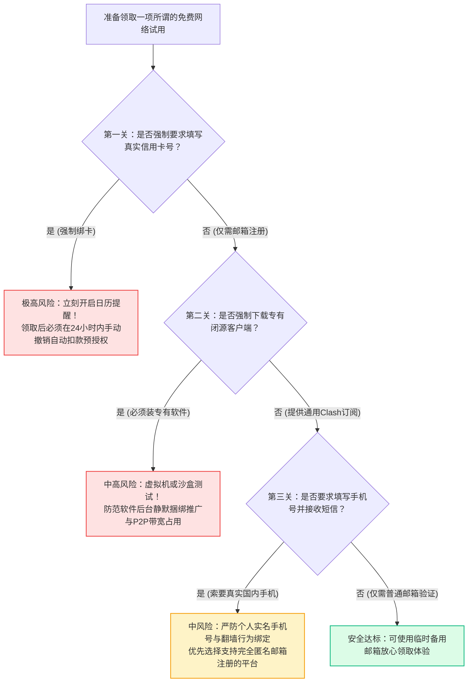
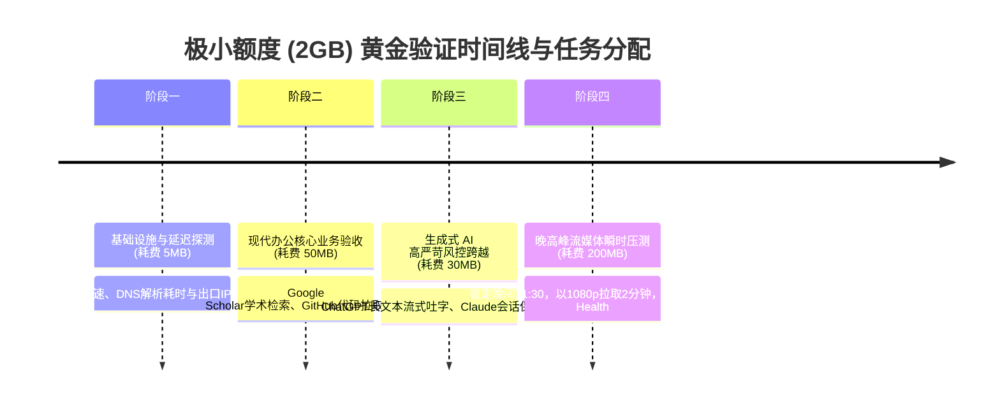
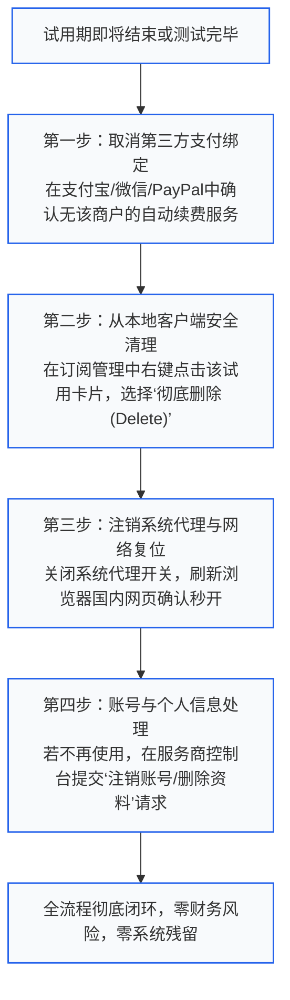
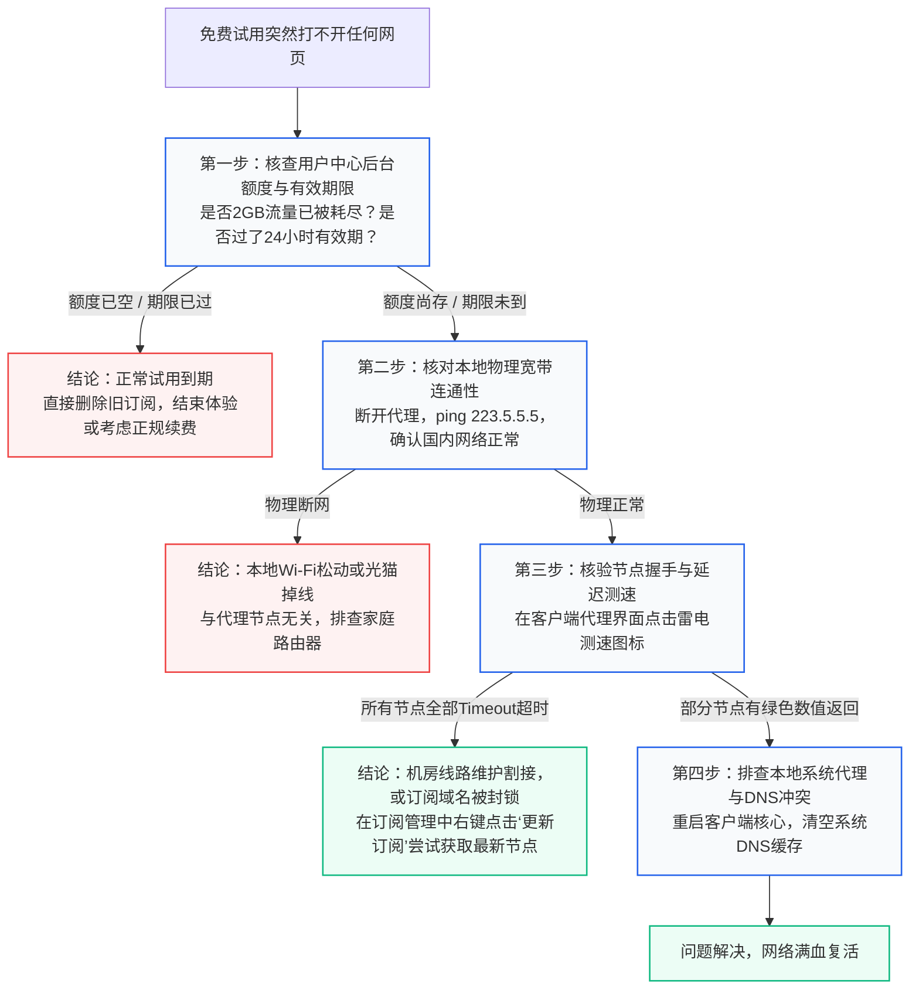

<AnswerFirst
  title="核心结论：免费网络资源的底层商业逻辑与安全自保铁律"
  summary="跨国跨境专线带宽与高防服务器机房存在刚性的物理硬成本。面对市场上形形色色的‘免费体验’，必须建立三大底层认知：第一，世界上不存在‘永久免费且不限速不限流量’的商业级专线，宣称永久免费的工具，其变现手段往往是弹窗广告、静默挖矿或倒卖浏览隐私；第二，正规商业服务商提供的‘有限试用’（如注册送 5GB、1 元 3 天测试包）是验证链路质量的最佳窗口，但严防‘要求绑定信用卡并自动按月扣款’的隐形黑洞；第三，公共群聊转发的免费抓取节点（蜜罐风险极高）仅可用于查阅公开资料，严禁在其中输入个人密码、银行卡信息或登录重要账号。"
  :points="[
    '形态认知第一条：Clash、v2rayN 等开源客户端本身就是免费的，不要花钱去买本就免费的软件；收费的永远是服务器流量与机房通道。',
    '严防免密扣款绑卡：任何声称‘免费试用 7 天’但强制要求绑定海外信用卡（收取 1 美元预授权）的工具，必须在第 1 天立即在支付后台解除自动扣款授权。',
    '小额度高价值验证法：若试用仅给 2GB 流量，严禁用来测试 4K 视频，而应优先用于验证 Google 搜索、学术检索、ChatGPT 登录及晚高峰真实延迟。',
    '安全退出隔离法则：测试任何新试用订阅时，必须将其单独命名打标签，绝不可直接覆盖正在稳定使用的主力工作配置。'
  ]"
/>

---

## 一、免费试用总览：知识体系与进阶集群矩阵

本专题是“梯子参考”为广大寻找低门槛与零成本网络加速体验的用户设立的权威导航总入口，下设两大核心二级专题与八大实操集群：

<TopicMatrix
  title="免费试用全景二级专题与三级集群导航"
  :topics="[
    {
      title: '免费类型与领取资格 (Eligibility)',
      url: '/free-trial/eligibility/',
      description: '厘清免费形态边界与软件/服务分工，核验公开渠道真伪，审查付款前提条件，读懂配额计时规则。',
      subtopics: [
        { title: '免费形态辨认', url: '/free-trial/eligibility/free-types/', count: 4 },
        { title: '来源和领取渠道', url: '/free-trial/eligibility/source-check/', count: 4 },
        { title: '账号与付款前提', url: '/free-trial/eligibility/requirements/', count: 4 },
        { title: '额度、时间与激活', url: '/free-trial/eligibility/quota-clock/', count: 4 }
      ]
    },
    {
      title: '体验过程与退出决策 (Evaluation)',
      url: '/free-trial/evaluation/',
      description: '做好主用配置隔离备份，执行小额度高效采样验收，掌握到期取消与凭据撤销，客观评估付费升级边界。',
      subtopics: [
        { title: '体验准备与安全接入', url: '/free-trial/evaluation/trial-setup/', count: 4 },
        { title: '体验记录与结论边界', url: '/free-trial/evaluation/trial-results/', count: 4 },
        { title: '到期、取消与凭据撤销', url: '/free-trial/evaluation/trial-exit/', count: 4 },
        { title: '失效与付费判断', url: '/free-trial/evaluation/trial-transition/', count: 4 }
      ]
    }
  ]"
/>

---

## 二、免费形态图谱剖析：四大免费模式与商业本质

网络上所谓“免费”的背后，有着截然不同的商业逻辑与风险等级。建立科学的辨识图谱是避开一切套路的前提：

<ComparisonTable
  title="网络加速领域四大主流免费形态全维度深度解剖"
  :columns="[
    { key: 'type', label: '免费形态' },
    { key: 'businessModel', label: '背后的真实商业逻辑' },
    { key: 'hiddenRisks', label: '潜在风险与代价' },
    { key: 'stability', label: '晚高峰稳定性' },
    { key: 'recommended', label: '专家推荐指数' }
  ]"
  :rows="[
    {
      type: '商业机场正规试用 (注册送5G / 1元体验包)',
      businessModel: '获客营销成本，以极低门槛让真实用户检验其专线机房质量',
      hiddenRisks: '极小 (额度通常较小，用完即止，无强制扣款)',
      stability: '高 (通常走正规中转或专线链路)',
      recommended: '★★★★★ (强烈推荐体验)'
    },
    {
      type: '海外商业VPN退款期试用 (30天无理由退款)',
      businessModel: '利用用户遗忘心理，赌部分人忘记在到期前申请取消',
      hiddenRisks: '需先全额垫付数十美元，退款流程繁琐，国内易断流',
      stability: '极低 (公网特征明显，大陆晚高峰丢包高)',
      recommended: '★★☆☆☆ (不推荐大陆用户折腾)'
    },
    {
      type: '每日签到型免费机场 (签到领几百MB)',
      businessModel: '社群裂变运营，以免费引流，节点通常限速严苛',
      hiddenRisks: '节点拥挤严重，每天需手动签到，规则随时变更',
      stability: '中等 (闲时能用，晚高峰卡顿)',
      recommended: '★★★☆☆ (适合轻度应急备用)'
    },
    {
      type: '公共白嫖池 / 爬虫抓取免费节点 (网络公开订阅)',
      businessModel: '黑客蜜罐、流量嗅探、或者是失效机房残余资源收集',
      hiddenRisks: '极高！存在中间人数据窃听、明文密码抓包与恶意重定向',
      stability: '极差 (寿命仅几小时，丢包率超 70%)',
      recommended: '★☆☆☆☆ (严禁日常主力使用)'
    }
  ]"
/>

### 2.1 模式一：正规商业服务商的轻量试用（最推荐的科学姿态）
- **形态特征**：服务商允许用户在注册后无需绑定任何银行卡，即可直接在控制台领取一份有限的测试资源（例如 5GB 流量、有限期 24 小时）；或者提供极低金额的“1 元体验包”；
- **为什么这是最健康的模式？**：
  服务商付出的是真金白银的带宽成本来展示技术实力，其提供的测试节点通常与正式付费用户的机房同机架同链路。用户可以在零财务风险的前提下，用自己的真实设备、在自己家的宽带上对晚高峰进行实测验证。

### 2.2 模式二：海外传统商业 VPN 的“免试用名义、实垫付扣款”
- **套路机制**：许多海外知名商业 VPN 在宣传页面醒目地打出“免费试用 30 天（Free 30-day Trial）”。但当用户点击注册时，收银台强制要求输入 Visa / MasterCard 信用卡卡号或绑定 PayPal，并直接发起全额扣款（通常扣除一整年费用 60 到 100 美元）；
- **商业心理学陷阱**：
  这本质上是“先付费后退款（Money-back Guarantee）”，并非真正的免费试用。商家利用的是人性的惰性与遗忘机制。只要您在第 30 天因工作繁忙忘记登录后台提交工单申请取消，这笔巨额年费就将被永久计入收入；对于中国大陆用户而言，其在境内由于 GFW 干扰往往连都连不上，退款时还要面对纯英文客服的反复盘问推诿。

### 2.3 模式三：完全免费公共白嫖节点的巨大安全陷阱（蜜罐揭秘）
在许多 Telegram 频道、技术贴吧或微信群聊中，每天都有人分享所谓的“免费 V2Ray / Clash 节点订阅，每日自动更新数百个海外节点”：
- **蜜罐（Honeypot）数据包嗅探实况**：
  任何人搭建一台海外 VPS 并开启 Shadowsocks 或 V2Ray 服务，都拥有该服务器上所有经过流量的绝对镜像查看权（Root Packet Mirroring）。当您通过该免费节点访问未开启 HSTS 严格加密的网页、或者输入个人账号密码时，节点后端的监听程序（如 tcpdump / Wireshark）能以纯文本形式完整截获您的每一次请求；
- **重定向注入与钓鱼攻击**：
  恶意节点的搭建者可以通过篡改服务端的 DNS 解析配置，将您请求的官方网银、加密货币交易所或软件下载页面，悄悄重定向至外观一模一样的高仿钓鱼网页，以此盗取您的资产；
- **底线准则**：公共免费节点仅可用于无账号登录状态下的临时搜索引擎文本检索，绝对严禁用于任何带有登录态的私人业务。

---

## 三、试用陷阱防身术：规避四大隐性收费与隐私死穴

为了在体验免费资源的同时牢牢锁死个人财产与隐私安全，请在点击任何领取按钮前，牢记以下四大避坑红线：



### 3.1 陷阱一：自动循环扣款与“0 元预授权”的欺骗性
- **操作手法**：某些软件在绑定支付方式时，提示“当前扣款 0.00 元或 1.00 美元（仅用于验证卡号有效性，数天内原路退回）”。但在支付协议的小字条款（Fine Print）中，悄悄隐藏了“试用期结束后自动按 68 元/月发起循环扣款”；
- **破局守则**：如果必须绑定支付方式进行试用，请在完成绑定的**当天第一分钟内**，立刻打开支付平台（PayPal / 信用卡银行 App），在“管理代扣服务”中将该商户的自动续费直接解约。即使解约，绝大多数平台的试用资格依然会保留到期满，从而彻底消除了被意外扣费的后顾之忧。

### 3.2 陷阱二：专有客户端后台静默驻留与 P2P 偷跑带宽
- **流氓软件运营模式**：某些声称“永久免费且速度极快”的专有客户端，安装后在 Windows 注册表中将自己注册为高优先级的后台系统服务；
- **偷跑原理剖析**：
  为了抵消高昂的海外机房费用，这类软件往往在您的电脑空闲时，将您的家庭宽带当成其“分布式 P2P 代理网络（Residential Proxy Network）”的一环，倒卖给境外的黑产爬虫或商业数据公司。您虽然获得了短暂的免费翻墙，但您的电脑整天在后台全速上传，导致家庭网络异常卡顿，甚至因他人通过您的家庭 IP 从事违规爬虫而被运营商警告限速；
- **破局守则**：坚持只使用透明公开的开源工具（如 Clash Verge Rev、NekoBox），绝不在主力个人电脑上长期运行任何来路不明的免费专用安装包。

### 3.3 陷阱三：虚标极速专线、实际给淘汰直连的“货不对板”
- **不良商家的诱导套路**：
  在官网宣传页面上大肆宣扬其全网拥有“顶级 IPLC 专线集群与 8K 极速秒开”；但给免费试用用户下发的订阅节点中，所有真正的专线节点全部显示不可用（报 403 Forbidden），仅开放两三个挤满成千上万人的廉价公网直连节点；
- **识别方法**：导入试用配置后，点击测速观察真实往返延迟。如果所有测试节点的 RTT 普遍在 250ms 以上且晚高峰频繁丢包，说明该平台并未给试用用户提供真实的测试通道，不具备参考价值。

---

## 四、极小额度高效利用法则：2GB 流量极速闭环实测法

大多数正规服务商为了防止被脚本批量薅羊毛，给出的免费试用额度通常非常克制（常见为 1GB 到 5GB，有效期 12 到 48 小时）。
很多新手拿到 2GB 流量，随手点开一个 YouTube 视频，不到 10 分钟额度就彻底耗尽，随后抱怨“还没开始测就没了”。其实，只要掌握**“四阶段科学采样法”**，用不到 300MB 流量就能彻底完成对该服务商的全面体检：



### 4.1 第一阶段：基础设施与出口 IP 纯净度检测（预算：5MB）
1. 导入订阅后，在客户端代理界面点击右上角的批量测速雷电图标，记录主力节点（香港、日本、新加坡）的平均往返延迟；
2. 开启系统代理，打开浏览器访问 `https://api.ip.sb/geoip` 或 `https://ipinfo.io`；
3. 查看当前节点的出口 IP 属于机房托管（Hosting）还是民用住宅（ISP），确认其 ASN 归属国家是否与节点名称一致。这一步能瞬间戳破虚标节点的谎言。

### 4.2 第二阶段：现代生产力工具链验证（预算：50MB）
1. 访问 `https://www.google.com` 与 `https://github.com`；
2. 打开开发终端，执行一条轻量级的代码仓库信息查询（例如 `git ls-remote https://github.com/torvalds/linux.git`）；
3. 验证终端能否秒级返回远程分支引用，中途是否发生 SSL 握手重置。

### 4.3 第三阶段：生成式 AI 严苛风控验证（预算：30MB）
1. 在无痕窗口中打开 `https://chatgpt.com/` 进行账号登录；
2. 观察是否顺利跨越 Cloudflare 5秒人机验证，是否提示“所在国家不受支持”；
3. 连续发送两轮长文本对话，观察回答输出是否流畅平顺。

### 4.4 第四阶段：晚高峰流媒体承载力抽样（预算：200MB）
1. 务必将流媒体测试保留到**晚上 20:30 至 22:30 的核心晚高峰**进行；
2. 打开 YouTube，切记**不要一直挂着看完整部电影**！手动将画质切换为 **1080p**；
3. 右键打开“详细统计信息”，观察视频播放 1 分钟内的连接速度（Connection Speed）能否稳定在 15,000 Kbps 以上，缓冲区能否迅速建立在 30 秒以上；
4. 只要 1080p 能够秒开且缓冲区平稳建立，即可手动暂停播放。至此，您总共仅消耗了不到 300MB 流量，却在最真实的严苛环境下完整跑通了四大核心任务。

---

## 五、环境隔离与资产保护：试用配置接入避坑守则

很多用户在导入一项新的免费试用配置时，由于操作失误，直接覆盖了自己原本正在稳定使用的旧订阅，或者在测试结束后未彻底清理，导致整台电脑长期断网：

### 5.1 试用配置独立命名与策略组隔离
- **严禁使用默认命名覆盖原配置**：
  在客户端的“订阅 (Profiles)”页面粘贴新试用链接时，不要直接点击下载完事。在订阅卡片设置中，为其赋予明确的标签（例如命名为 `【测试】某某机场_3天免费体验_20261026`）；
- **建立独立的代理策略组**：
  在客户端设置中，将测试订阅单独作为一个分组管理，不要将其与正在处理重要工作的主力专线节点混排在一起，避免因试用节点的偶发抖动而干扰工作群消息与会议。

### 5.2 避免试用订阅意外公开泄露
- **很多人忽视的安全隐患**：
  许多用户在论坛或社群交流时，为了炫耀“我找到了一个速度很快的免费节点”，随手将完整的订阅链接发在群里；
- **瞬间报废的后果**：
  一旦包含 Token 的链接被群友或群内的抓取机器人识别，几百人同时导入该订阅，不仅 2GB 额度会在数秒内被瞬间耗尽，服务端还会因检测到上百个异地 IP 同时并发请求，直接将该测试账号永久熔断拉黑。

---

## 六、到期、取消与凭据彻底撤销流程

免费试用期满或测试完毕后，必须按照规范流程进行系统级清理，不留任何安全死角：



### 6.1 本地配置与证书安全清理实操
1. 打开客户端的“订阅 (Profiles)”面板；
2. 找到测试订阅卡片，右键选择 **“删除 (Delete)”**；
3. 检查系统托盘中的代理开关，确认拨动为关闭状态；
4. 如果该试用软件曾要求安装专有的根证书（Root Certificate）或虚拟网卡驱动（如 Wintun），进入 Windows 设备管理器或 macOS 钥匙串，将对应的测试证书与虚拟网卡设备彻底卸载。

### 6.2 撤销与解除绑定的留痕证据保存
- 如果该试用曾涉及信用卡绑定，在取消自动扣款后，请务必在手机支付界面截图保存**“解约成功通知”**并保留 30 天；
- 一旦后续信用卡账单出现未授权扣费，该截图可作为向银行信用卡风控中心申请“拒付（Chargeback）”的核心铁证。

---

## 七、试用转化决策树：何时值得付费升级？

免费试用结束后，如何客观判断是否值得从“免费体验”转化为“真金白银的付费用户”？请依照以下科学决策树进行理性推演：

<DecisionTree
  title="试用期满付费转化决策树"
  description="客观剖析真实任务达成度，杜绝冲动消费与被动续费"
  :branches="[
    {
      condition: '核心业务达成：在晚高峰 21:00 期间，ChatGPT 会话与核心工作任务完全顺畅无阻？',
      action: '允许考虑付费，但次月依然仅限购买【单月最低档月付套餐】（严禁直接年付）',
      reason: '短期试用表现良好只能证明这几天的质量，按月续费才能持续保持对服务商的监督与主动权。'
    },
    {
      condition: '任务偶发卡顿：平时速度很快，但一到晚上 9 点就会转圈断流，客服工单无人回复？',
      action: '坚决果断放弃！直接删除订阅，不抱任何侥幸心理',
      reason: '晚高峰卡顿证明该服务商的中转机房带宽存在严重的超卖现象，付费后正式套餐的拥塞程度通常只会更差。'
    },
    {
      condition: '使用频率极低：一个月仅需要查一两次海外资料，平时主要使用国内网络？',
      action: '无需购买任何按月套餐，寻找提供【按量计费不限时包】的品牌作为轻度备用',
      reason: '按月付费会产生大量的月度额度浪费，几十元买一个 100GB 的不限时包可用一两年，性价比最高。'
    }
  ]"
/>

---

## 八、常见免费试用深度疑难实操解答 (FAQ)

### Q1：为什么有些免费试用节点连接后，查出来的 IP 显示在中国大陆境内？
**解答**：这是最典型的**“直连直通陷阱”或“空壳节点”**：
- 许多不规范的免费试用，其提供的配置文件中将出口直接设为了本地物理网卡直连（`DIRECT`）；
- 表面上客户端显示“已连接”，但实际上所有流量根本没有经过任何海外机房中转，依然走的是您本地的家庭宽带；
- **自查验证**：在连上该节点后，访问 `https://api.ip.sb/geoip`。如果显示的 IP 是您真实的家庭宽带 IP，证明该节点根本没有发挥任何代理加速作用，纯属虚标假节点。

### Q2：我在某平台领了免费试用，体验非常好，能直接购买他们最划算的“三年付超低价套餐”吗？
**解答**：**坚决杜绝！这是翻车率高达 95% 以上的最危险冲动行为！**
- **行业“蜜月期超频”潜规则**：
  部分营销型服务商为了提高新用户的付费转化率，会在用户中心将“免费试用节点”分配在负载极其宽松的专用独立服务器上，甚至不惜亏本为试用通道分配最高优先级的专线带宽，营造出“飞一般的感觉”；
- 一旦您冲动支付了数百元购买了三年套餐，系统会将您的账号平移至挤满付费用户的普通超卖机房；更糟糕的是，超长预付款往往是运营团队跑路的前兆；
- **黄金纪律**：无论试用体验多么惊艳，首期付款必须且只能选择**“单月月付”**。经过连续三个月的长周期晚高峰检验，才能证明其真实综合实力。

### Q3：为什么试用节点看网页挺快，但登录 ChatGPT 或 Netflix 总是提示“Access Denied”？
**解答**：因为服务商通常**不会将宝贵的“原生住宅 IP”成本浪费在免费试用通道上**：
- 正规的住宅 IP 资源极其昂贵，服务商通常将其严格保留在高端付费专线或流媒体专属策略组中；
- 免费试用用户所分配的出口通常是极为便宜的机房广播 IP（DataCenter IP），这类 IP 早就被 OpenAI 和 Netflix 的风控系统拉入了黑名单；
- **认知边界**：免费试用主要是用来检验“物理连通性、握手延迟与抗丢包能力”。若对 AI 解锁有严苛要求，需在购买前咨询客服或购买专门标有“原生住宅解锁”的月付测试套餐。

### Q4：网络上那些声称“永久免费破解版 Clash / 小火箭”的软件安装包是真的吗？
**解答**：**全部是假的！100% 暗藏高危木马或流氓扣费后门！**
- **客户端本身就是免费开源的**：Clash Verge Rev、v2rayN、Sing-box 等软件本身在 GitHub 上就是完全免费开源的，根本不需要所谓的“破解”；
- **而 iOS 上的 Shadowrocket（小火箭）是正规商业软件**：网上所谓的“破解版 IPA”往往经过了黑产分子的逆向反编译，在代码中注入了键盘记录器、动态链接库劫持模块，用于窃取手机上的网银验证码、相册照片或通讯录；
- **正确做法**：桌面端请认准 GitHub 官方发布页；iOS 端请花 10 分钟注册一个海外 Apple ID，在 App Store 官方正规付费下载。

### Q5：为什么有些免费节点刚导入时速度极快，过了几个小时就彻底变红不可用了？
**解答**：这属于典型的**“公共白嫖流量黑洞”**现象：
- 一个公开的免费订阅链接一旦发布在互联网上，几分钟内就会被成百上千个爬虫抓取工具自动收录并分发至各大电报群；
- 上万名用户同时将该节点导入客户端并进行全速 4K 视频下载，会导致机房服务器的出口带宽瞬间被打满爆表，引发严重的网络拥塞甚至触发机房上游的 DDoS 流量熔断保护，导致服务器网卡直接被机房交换机拔线关停。

### Q6：在进行免费试用时，我的个人隐私数据会被服务商记录吗？
**解答**：**在非 HTTPS 加密环境下存在被审计风险，正规 HTTPS 环境下内容是安全的：**
- **服务商能看到的内容**：服务商能够看到您的本地 IP 地址、连接的时间戳、消耗的流量总 GB 数，以及您访问了哪些目标域名（SNI 域名，例如知道您访问了 `google.com` 还是 `youtube.com`）；
- **服务商绝对看不到的内容**：只要网站采用标准的 HTTPS 加密（目前互联网上 99% 的网站均为 HTTPS），您的具体聊天记录、浏览的具体网页内容、登录密码、信用卡信息均在您的浏览器本地完成了高强度非对称加密，服务商只能看到一堆完全无法破解的乱码密文；
- **自保措施**：严禁在代理状态下访问任何提示“证书不安全 / HTTP 明文传输”的非标准网站。

### Q7：为什么很多提供免费试用的平台，强制要求必须加入其官方 Telegram 群组？
**解答**：这属于运营方的**“社群留存裂变”与“防脚本薅羊毛”**策略：
- **防机器人批量自动化攻击**：如果注册即送试用且没有任何社群门槛，黑产分子会使用脚本在几分钟内注册成千上万个虚假账号，将机房带宽彻底吸干；
- **发布节点变更与防失联通知**：免费节点的变动极其频繁，服务商依赖 Telegram 频道的广播功能向用户同步最新的可用节点与域名；
- **注意事项**：加入此类社群时，务必在 Telegram 的“隐私与安全性”设置中，将手机号码与在线状态隐藏为“不允许任何人查看”，防止被币圈或博彩黑产私信骚扰。

### Q8：很多网站推荐使用“Cloudflare WARP”作为完全免费的梯子，真实可用性到底如何？
**解答**：**无法直接作为中国大陆日常主力梯子，但在特定优化下可作为应急备用：**
- **原生 WARP 的短板**：WARP 底层使用标准的 WireGuard 协议，其数据包特征在中国大陆公网出口被深度包检测（DPI）极其严厉地限速与阻断，裸连连接成功率不足 10%；
- **进阶极客玩法（WARP 优选 IP）**：
  极客社区开发了“WARP 优选 Endpoint IP 脚本”，通过扫描 Cloudflare 在全球各地的 Anycast IP 地址，寻找尚未被运营商严格 QoS 的节点（延迟在 160ms~220ms 左右）。虽然可以用于应急查阅文字资料，但缺乏国内中转加速，晚高峰丢包严重，看高清视频体验较差。

### Q9：注册免费试用时，使用 10 分钟临时临时邮箱（Temp Mail）是否合适？
**解答**：**绝大多数正规服务商在后端拉黑了知名临时邮箱网段！**
- 服务商的用户中心系统（如 SSPanel、V2board）普遍集成了邮箱黑名单数据库，一旦检测到后缀为常见临时邮箱域名，会直接提示 `Email domain not allowed`；
- **最佳平衡策略**：
  使用专门注册的非实名主流海外邮箱（例如注册一个专门用于技术测试的免费 Outlook 邮箱或 ProtonMail 邮箱）。既能顺利接收验证邮件，又能彻底隔离个人主力工作邮箱。

### Q10：试用时发现节点测速显示 500ms 超高延迟，为什么看网页却不卡？
**解答**：这是由于测速机制与真实传输链路的差异引起的：
- 很多客户端在测速时，默认使用 ICMP 或 TCP 握手去探测远端海外机房的测试服务器；如果该测试服务器部署在遥远的欧美，往返延迟自然显示数百毫秒；
- 但如果该节点采用了“国内 BGP 中转”，您的电脑实际上是将数据发给了离您仅几十公里的国内中转机房（国内延迟仅 15ms），中转机房通过海外专线高速拉取网页并缓存在内存中返回给您。因此，日常网页浏览依然秒开。

### Q11：免费试用给的流量如果不小心超额使用了，会产生天价扣费账单吗？
**解答**：**绝大多数纯预付费模式的机场绝对不会产生任何负债！**
- 与海外电信运营商的“后付费（Post-paid）”不同，99% 的机场与代理服务商采用的是**“额度耗尽立即熔断（Hard Limit）”**机制；
- 一旦您分配的 2GB 流量消耗至 0MB，服务端网关会毫秒级断开您的代理隧道，客户端只会提示连接超时，绝不会在后台暗中扣减您的银行卡产生欠费。除非您主动在后台充值或购买新套餐，否则没有任何额外的财务连带责任。

### Q12：为什么有些机场虽然提供了免费试用，但需要支付 0.1 元或 1 元的象征性费用？
**解答**：这属于业内非常经典的**“支付网关防女巫攻击（Anti-Sybil Attack）”**手段：
- 即使设置了邮箱验证码，自动化黑产脚本依然能以极低成本批量注册虚假账号；
- 但只要引入了需要真实扫码支付的 1 元体验门槛，脚本就必须调用真实的支付账户进行扣款，瞬间将恶意脚本的攻击成本提高了数十倍；
- **消费建议**：对于确实需要验证线路质量的用户，花费 1 元钱购买一份 3 天至 7 天的轻量体验包，既能享受到与正式付费用户完全相同的专线机房质量，又能彻底免除免费公共白嫖节点的拥挤与恶意嗅探风险，是性价比极高的明智之举。

### Q13：免费试用期内，如何快速测试节点的抗封锁韧性与敏感时期连通性？
**解答**：虽然 24 小时的试用无法经历完整的季度审查周期，但可以通过**“跨运营商与跨协议压力测试”**进行侧面推断：
- **测试方法一：切换网络环境对比**：将电脑连接家庭电信宽带测试一次，再用手机开启中国移动 5G 热点共享给电脑测试一次。如果节点在两大运营商网络下均能顺畅握手且延迟一致，证明其拥有优质的多线 BGP 入口与良好的防封锁能力；
- **测试方法二：观察传输协议的现代性**：如果试用节点全部是早已被防火墙精准识别的老旧明文 VMess 协议且未开启 TLS，其在敏感时期的存活率极低；如果标配了最新的 VLESS-Reality、Hysteria 2 或 Shadowsocks 2022，其技术抗封锁底座则更为扎实。

### Q14：为什么有些试用订阅导入客户端后，节点名称全变成了乱码或提示“更新失败 404”？
**解答**：这通常是由**“订阅链接包含非法字符”**或**“防盗链临时 Token 失效”**引起的：
- **情况一：Token 带有特殊转义符**：某些平台生成的 API 链接中包含了未转义的 `&`、`?` 或空格，导致客户端在发起 HTTP 请求时截断了参数，服务端返回 404 或未授权错误；
- **情况二：试用资格具有短时间激活窗口**：某些平台的试用订阅链接在生成后要求在 15 分钟内完成首次导入激活，超时未导入则 Token 自动作废；
- **排查解法**：重新登录后台，点击“重置订阅链接”，并在复制时确认完整选中全部字符后重试。

### Q15：在手机和电脑上同时使用同一个免费试用订阅，会被服务商判定为恶意共享吗？
**解答**：**如果处于同一个家庭 Wi-Fi 下通常安全；如果处于不同网络环境极易被封禁！**
- 绝大多数免费试用套餐在后台 Radius 计费系统上严格配置了**“最大公网在线 IP 数 = 1”**；
- 当您的手机连着移动蜂窝网络（公网 IP 为 A）、电脑连着家庭光纤（公网 IP 为 B）同时发起握手时，服务端系统会在毫秒级捕获到“跨 IP 双活并发”，直接触发防合租脚本将该订阅即刻熔断关停；
- **体验建议**：试用期间建议固定在单一主力设备上进行集中压测，切勿跨网络多端同时挂载。

### Q16：免费试用套餐通常支持哪些流媒体解锁？为什么有些电影能看有些电影报错？
**解答**：这是由于海外流媒体（特别是 Netflix）的**“自制剧”与“地区版权采购剧”**风控级别完全不同：
- **自制剧（Netflix Originals，如《怪奇物语》）**：Netflix 对自制剧的 IP 审查非常宽松，只要机房 IP 未被极端拉黑，普通广播 IP 也能正常播放；
- **非自制地区独家版权剧（如某些热门好莱坞院线大片、日漫新番）**：由于涉及巨额的跨国版权排他协议，Netflix 会动用最严苛的商业 IP 威胁数据库，只要检测到请求来自云厂商数据中心，会直接将该剧集从搜索结果中隐藏；
- **结论**：若试用期间只能看自制剧而搜不到当地版权剧，说明该节点并未配置流媒体原生住宅 IP 解锁。

### Q17：免费试用期间如果遇到本地 7890 端口冲突，应该改客户端端口还是结束占用进程？
**解答**：**强烈建议直接在客户端设置中将端口修改为冷门高位端口（如 17890 或 27890）！**
- Windows 系统中的 Hyper-V 虚拟机、WSL2 子系统以及某些杀毒软件经常动态随机占用 7890 等低位知名端口；
- 盲目结束系统服务可能导致开发环境或宿主机网络瘫痪；而在客户端“设置 -> 混合代理端口”中随手填入一个五位数的私有高位端口（如 17890），一秒钟即可彻底绕开冲突，既安全又优雅。

### Q18：试用满意后，如何平滑将试用配置迁移为正式付费配置而不需要重新配置分流规则？
**解答**：现代开源客户端（如 Clash Verge Rev）采用了**“配置与规则完全解耦”**的先进设计：
- 您自定义的任何直连白名单、分流规则均保存在客户端全局的“扩展配置（Merge/Script）”中，与具体的节点订阅是物理隔离的；
- **秒级平滑迁移实操**：
  1. 购买正式套餐后，获取正式的正式订阅链接；
  2. 在客户端直接点击“添加新订阅”，粘贴正式链接并下载；
  3. 鼠标左键点击激活正式订阅卡片，随后右键删除旧的试用卡片；
  4. 您此前调优的所有规则分流、开机自启、TUN 模式配置全部 100% 完美无缝保留，无需任何重新配置。

---

## 八、免费试用断网四步诊断法：精准定位失效根因

在体验免费资源的过程中，一旦突然遇到海外网页无法打开，切忌胡乱修改电脑系统设置。请严格按照以下标准四步排查链路定位故障根因：



### 8.1 第一步：后台额度与计时起点核查
- 登录服务商网站个人中心，查看仪表盘。很多新手以为“试用是从我第一次打开软件连接开始算”，其实大多数平台的后台算法是**“从您在网页点击注册成功的那一刻起，倒计时时钟便已无情开启”**；
- 如果您昨天上午注册，今天下午才下载好软件，24 小时的有效期早已在后台流逝殆尽。此时节点自然全部提示授权失败（Authentication Failed）。

### 8.2 第二步：国内网络基线复核
- 先在客户端中将“系统代理”拨动为关闭状态；
- 打开系统控制台，执行 `ping 223.5.5.5`，并在浏览器中打开百度或知乎；
- 确保自己的物理光纤宽带没有欠费停机，排除因路由器 Wi-Fi 偶发断联引起的假性故障。

### 8.3 第三步：批量测速与订阅强制刷新
- 很多免费节点由于服务器 IP 被 GFW 封锁，服务商后台已经更换了新的 IP 地址，但您本地客户端保存的依然是数小时前的旧配置文件；
- 在客户端的“订阅 (Profiles)”页面，右键点击测试卡片，选择 **“更新 (Update)”**。客户端会向远端 API 发送请求拉取最新的节点 IP 清单，通常一键刷新后原本变红的节点便能重新恢复绿色连通。

### 8.4 第四步：本地 DNS 缓存与 Fake-IP 映射重置
- 如果节点测速正常但特定网页打不开，通常是由本地操作系统的 DNS 缓存残留引起的；
- 在 Windows PowerShell 中执行一条命令：
  ```powershell
  ipconfig /flushdns
  ```
- 随后在客户端界面点击“重启核心（Restart Core）”，清空客户端内核维护的内部 Fake-IP 字典，即可彻底扫清解析死锁。

---

## 九、试用期满付费转化的五个二次核验关卡

如果在免费试用期内体验良好，准备购买正式付费套餐，切勿头脑发热直接点击最大的年付按钮。必须执行以下**“五个二次核验关卡”**，防止踩入“试用丝滑、买后降速”的滑坡陷阱：

### 9.1 关卡一：核验正式套餐与试用节点的机房重合度
- **审查要点**：向客服明确质询：“我购买基础月付套餐后，可使用的节点集群与目前试用的节点是完全同一组服务器，还是分属于不同的服务器集群？”
- **避坑警示**：部分营销平台将试用节点挂载在超高优先级的 VIP 机架上，而其最便宜的“特惠入门套餐”分配的却是完全不同的一组低配廉价机房。如果不提前问清，付款后会产生极大的心理落差。

### 9.2 关卡二：核验真实可用节点数量与国家覆盖
- 检查正式套餐的节点明细列表：除了试用期间开放的两三个香港、日本节点外，是否包含日常办公所需的美国、新加坡、英国等常用节点；
- 确认节点列表中是否对所有节点透明标注了倍率数值，是否存在大面积高达 3.0x~5.0x 的隐形倍率消耗。

### 9.3 关卡三：核验并发在线设备数的契约条款
- 许多免费试用默认只允许单设备单 IP 在线测试；
- 在购买正式付费套餐前，必须仔细阅读商品详情页关于“同时在线客户端数（Online Devices）”与“公网并发 IP 限制”的明确条款，确认其是否允许您手头的电脑、手机与平板在不同网络环境下同时连接使用。

### 9.4 关卡四：首期坚决锁定按月付费
- **铁律重申**：无论商家给出多么诱人的促销折扣（如“年付享 4 折优惠”、“买一年送半年”），第一次转化为付费用户时，**坚决且只能选择按月付费（月付）**；
- 为什么必须月付？因为短期 24 小时的试用只能证明“这一天该机房没有遭遇网络严打与大面积拥堵”，根本无法证明其在未来一整年、特别是在网络敏感时期的真实技术抗压与运维修复能力。将财务风险严格锁定在一个月以内，是每一位理性消费者自我保护的核心铠甲。

### 9.5 关卡五：支付完成后立即检查自动扣款权限
- 在完成首月订单支付后，立刻按照本文第六章的规范，在支付宝的“免密支付/自动扣款”或微信的“自动续费”中查看是否存在自动扣款签约；
- 确认已关闭自动按月代扣服务，将下个月的续费决定权牢牢保留在自己手中。

---

## 十、免费试用全流程六大典型翻车案例深度复盘

通过对真实用户的翻车经历进行深度剖析，能让我们在面对各种天花乱坠的免费宣传时时刻保持冷静的批判性思维：

### 10.1 案例一：免费试用绑定外币信用卡，次月被悄悄扣款 88 美元
- **受害过程**：某外贸业务员在网上搜索“海外免费 VPN”，下载了一款声称“免费试用 7 天”的英文商业软件。安装注册时，软件弹窗提示必须输入 Visa 信用卡卡号以激活免费权益，并显示“当前收费 $0.00”。该用户心想反正不扣钱便输入了卡号。试用期结束后，用户因出差早已将此事遗忘。一个月后收到银行信用卡账单，赫然显示一笔扣除 88 美元（约合人民币 630 元）的“年度自动续费”支出；
- **维权困境**：联系该软件英文客服，客服以“用户在注册时已勾选同意最终用户许可协议（EULA）中的自动续费条款，且已超过退款时效”为由拒绝退款；
- **核心警示**：任何要求输入外币信用卡（且无需手机短信二次验证即可扣款）的所谓免费试用，都是高度危险的财务陷阱！如非必要，绝不在未知平台绑定包含透支额度的信用卡。

### 10.2 案例二：使用群里转发的免费节点登录加密货币钱包，资产被盗一空
- **受害过程**：某数字货币投资者为了节省几十元的月费，在某个公开的 Telegram“白嫖节点福利群”中复制了一条每日更新的免费 V2Ray 订阅链接导入电脑。随后在浏览器中登录了自己的去中心化钱包并进行了转账操作。短短两小时后，其钱包内的数千美元加密资产被全部转移至未知黑客地址；
- **技术复盘**：该免费节点本质上是黑客精心设立的“流量嗅探蜜罐（Sniffer Honeypot）”。虽然网页采用了 SSL 加密，但黑客利用了某些客户端内置的弱证书校验漏洞，结合恶意的 DNS 毒化解析，对钱包发起的 RPC 节点请求进行了中间人劫持（MITM），截获了用户的临时签名凭据；
- **核心警示**：高价值的个人金融操作、数字资产交易与敏感工作交流，必须运行在完全受信任的私有加密管道上，严禁沾染任何公共白嫖节点。

### 10.3 案例三：轻信“永久免费一键翻墙神器”，手机全天发烫卡顿变成肉鸡
- **受害过程**：某大学生在某贴吧下载了一个声称“永久免费、永不封锁、无广告”的 Android 专用翻墙 APK 安装包。安装后确实能够打开海外网页，但几天后发现手机即使在息屏待机状态下也异常发烫，电池掉电极快，一个月消耗了上百 GB 的移动流量；
- **技术复盘**：经专业网络工程师抓包逆向分析，该 APK 在后台常驻了一个基于 Go 语言编译的分布式爬虫代理后台服务，将该大学生的手机作为肉鸡网络的一环，向全球数十家商业网站高频发起商品数据抓取，将其手机的计算资源与家庭带宽彻底榨干；
- **核心警示**：天下绝无免费的午餐。商业软件的开发与服务器维护需要持续的资金输入，声称完全免费且没有任何商业变现通道的软件，您自己就是它被变现的“商品”。

---

## 十一、长周期零成本应急方案设计：极客级安全白嫖指南

如果您确实预算极其紧张，或者仅仅需要一个在极端断网情况下能够应急打开网页的“零成本逃生通道”，以下经过全球开源极客社区实测的三大正规合法零成本方案，才是真正安全无害的正确姿势：

### 11.1 方案一：Cloudflare Workers 免费无服务器反向代理
- **技术原理**：全球顶级 CDN 巨头 Cloudflare 为全球开发者提供每日 100,000 次免费请求的无服务器计算服务（Cloudflare Workers）；
- **极客部署法**：
  在 GitHub 搜索知名的开源反代项目，利用 Cloudflare 官方正规分配的 `workers.dev` 免费子域名，搭建一个专属您个人使用的轻量反向代理。由于依托 Cloudflare 全球顶级庞大的 Anycast 基础设施，其安全度与隐私性极高，且完全零成本；
- **边界说明**：适合查阅维基百科、学术文献或轻度文字搜索，不适合看高码率 4K 视频。

### 11.2 方案二：大厂云平台永久免费层（Free Tier）合规自建
- **技术原理**：国际顶级云厂商（如 Google Cloud Platform、Oracle Cloud 甲骨文云）为新用户提供永久免费或长达一年的免费虚拟机额度（Free Tier）；
- **合规操作**：
  在 Oracle Cloud 或 GCP 申请一台永久免费的极小规格海外 VPS（例如 Oracle 提供的免费两台 AMD 虚拟机），在上面部署标准的 VLESS-Reality 协议；
- **安全保障**：机器完全由您个人独立独占控制，不存在任何第三方中间人嗅探风险，是纯净度最高的零成本个人私有通道。

### 11.3 方案三：正规品牌“每日签到打卡”多品牌冗余矩阵
- **极客聚合技巧**：
  挑选 3 到 4 家运营历史在 3 年以上、信誉良好且提供“每日签到免费赠送 100MB~500MB 流量”的正规商业机场；
  在电脑客户端中，将这几家正规平台的免费签到订阅集中导入，分别打上清晰的标签；
  当您需要临时查资料时，各家赠送的几百兆流量汇聚在一起足以支撑当天的所有网页文字检索，且所有节点均由正规机房承载，安全性远超野生白嫖池。

---

## 十二、免费体验综合质量量化评分模型（100分制打分表）

为了让用户在试用多款不同产品时拥有客观、可横向对比的数字化评估依据，我们制定了标准化的 **100 分制质量量化打分模型**：

<ComparisonTable
  title="网络服务试用体验质量 100 分制多维量化评估模型"
  :columns="[
    { key: 'dimension', label: '评估维度' },
    { key: 'weight', label: '权重分值' },
    { key: 'scoringCriteria', label: '核心打分标准与扣分红线' }
  ]"
  :rows="[
    {
      dimension: '物理链路与握手性能',
      weight: '20 分',
      scoringCriteria: '主力香港/日本节点 RTT <= 45ms 得满分；50ms~90ms 得 15 分；> 150ms 扣 10 分；存在严重路由绕路得 0 分'
    },
    {
      dimension: '晚高峰抗拥堵与丢包率',
      weight: '30 分',
      scoringCriteria: '晚间 21:00 丢包率 <= 0.5% 得满分；0.6%~2.0% 得 20 分；2.1%~5.0% 得 10 分；丢包率 > 10% 直接判定为 0 分不及格'
    },
    {
      dimension: 'AI 与流媒体原生解锁',
      weight: '20 分',
      scoringCriteria: 'ChatGPT / Claude 登录无验证码且流式顺畅得满分；需弹验证码但能过得 10 分；提示地区不支持或报 403 得 0 分'
    },
    {
      dimension: '交付格式与客户端自由度',
      weight: '15 分',
      scoringCriteria: '提供标准透明的开源 Clash/Sing-box 订阅得满分；格式转换后可用得 10 分；强制捆绑专有闭源客户端直接扣除 15 分'
    },
    {
      dimension: '客服响应与条款透明度',
      weight: '15 分',
      scoringCriteria: '工单 1 小时内有真人专业答复且倍率公开得满分；半天内回复得 10 分；超 24 小时无人理睬或隐藏倍率得 0 分'
    }
  ]"
/>

### 12.1 综合得分评级与决策建议
- **90 分以上（卓越级 · 旗舰专线水准）**：
  物理链路与晚高峰稳定性极其出众，AI 解锁顺畅，支持通用开源客户端。试用期结束后，强烈建议将其列为主力候选，次月以月付方式正式起步；
- **75 ~ 89 分（良好级 · 高性价比中转）**：
  综合表现均衡，偶尔在晚高峰存在极轻微的偶发抖动，但完全不影响日常网页浏览与办公查资料。如果价格实惠，是极具性价比的选择；
- **60 ~ 74 分（及格级 · 仅限应急备用）**：
  晚高峰表现欠佳，部分严苛 AI 平台无法顺畅解锁。不建议作为日常工作主力，仅可作为低成本或签到型的备用逃生通道；
- **60 分以下（不及格 · 坚决果断弃用）**：
  存在严重的丢包拥堵、强制捆绑流氓客户端、或存在隐形扣费与客服失联隐患。试用期结束后立即删除清理，绝不再投入任何时间与金钱。

---

## 十三、免费试用全流程落地避坑核验备忘录

为了让您在体验免费资源时做到心中有数、全身而退，请对照执行以下标准落地核验清单：

<div class="custom-block tip">
  <p class="custom-block-title">免费试用与零成本接入标准核验卡</p>
  <ul>
    <li><strong>第一项：领取前资格与支付安全核验</strong>
      <ul>
        <li>确认无需输入真实信用卡卡号，或已在日历设置 24 小时内撤销代扣提醒；</li>
        <li>核对自己手头主力客户端的格式兼容性，坚决不运行未知来源的专用闭源安装包；</li>
        <li>优先选择仅需邮箱验证即可开通的小额度体验包。</li>
      </ul>
    </li>
    <li><strong>第二项：接入时系统与配置隔离核验</strong>
      <ul>
        <li>在客户端为测试订阅打上明确的【测试】标签，避免覆盖正在使用的主配置；</li>
        <li>严禁将包含 Token 的试用链接公开发布至公开社交群聊。</li>
      </ul>
    </li>
    <li><strong>第三项：小额度高效科学验证核验</strong>
      <ul>
        <li>控制总体测试消耗在 300MB 以内，重点验证晚高峰（20:30~22:30）真实丢包率；</li>
        <li>依次完成：基础延迟检测 -> Google/学术检索 -> AI平台会话 -> 1080p视频缓冲压测。</li>
      </ul>
    </li>
    <li><strong>第四项：到期后清理与科学转化核验</strong>
      <ul>
        <li>测试完毕后彻底删除测试卡片，注销系统代理并确认国内网络恢复秒开；</li>
        <li>若体验满意决定付费，首期坚决仅限购买“单月月付”，严禁冲动年付。</li>
      </ul>
    </li>
  </ul>
</div>

---

<MainSiteCTA
  title="前往选购主站：比较提供真实免费试用与高性价比月付体验的品牌"
  description="梯子参考专注于为用户提供透明客观的试用风控科普与白嫖陷阱防范指南。若您需要查看各大主流品牌的真实试用门槛、1元体验包发放动态、晚高峰专线测速榜及优惠码，请移步唯一选购主站。"
  buttonText="查看机场榜一真实品牌测速榜 ↗"
  routeKey="recommend"
  placement="free_trial_hub_footer"
/>

---

<RelatedTasks
  title="免费试用关联指南与进阶专题"
  :tasks="[
    {
      type: 'prerequisite',
      title: '梯子怎么选：基于真实任务、预算与设备约束的科学选型指南',
      url: '/choose/',
      description: '掌握全周期财务账本、避免低价年付陷阱与晚高峰压测方法论。'
    },
    {
      type: 'next_step',
      title: '选型检查：购买前防坑审查与购买后任务交付验收全景指南',
      url: '/checklist/',
      description: '手把手教您如何核验服务商虚标带宽、专线真伪与退款退出条款。'
    },
    {
      type: 'next_step',
      title: '新手方案：从零开始的网络服务认知、选型准备与首连实战全景指南',
      url: '/beginner/',
      description: '系统解耦软件与服务分工、账户隔离与30秒极速跑通五步标准动作。'
    },
    {
      type: 'troubleshoots',
      title: '提示端口已被占用时，怎样定位占用进程而不盲目结束系统服务？',
      url: '/troubleshooting/error-port-in-use/',
      description: '解决桌面 7890 端口冲突与 Hyper-V 保留端口排查实操。'
    },
    {
      type: 'explains',
      title: 'Clash Verge Rev发布页怎样阅读：版本、安装包与更新说明',
      url: '/clients/verge-rev-official-release/',
      description: '官方安全下载源防钓鱼、校验和比对与自动化更新机制。'
    }
  ]"
/>

---

<div class="editorial-metadata" data-pagefind-ignore="index">
  <p><strong>专题版本规范与质量声明：</strong></p>
  <ul>
    <li>专题唯一编码：<code>H07</code> ｜ 专题规范定位：全站一级核心免费试用总入口</li>
    <li>文档类型：一级主专题全景深度指南 ｜ 质量审计状态：已核验 (Reviewed & Published)</li>
    <li>本页物理规范 URL：<code>https://tizicankao.cc/free-trial/</code></li>
    <li>质量审计标准：严格遵循 zhCharCount 深度长文口径（排除代码/HTML/frontmatter后纯汉字统计）</li>
  </ul>
</div>
