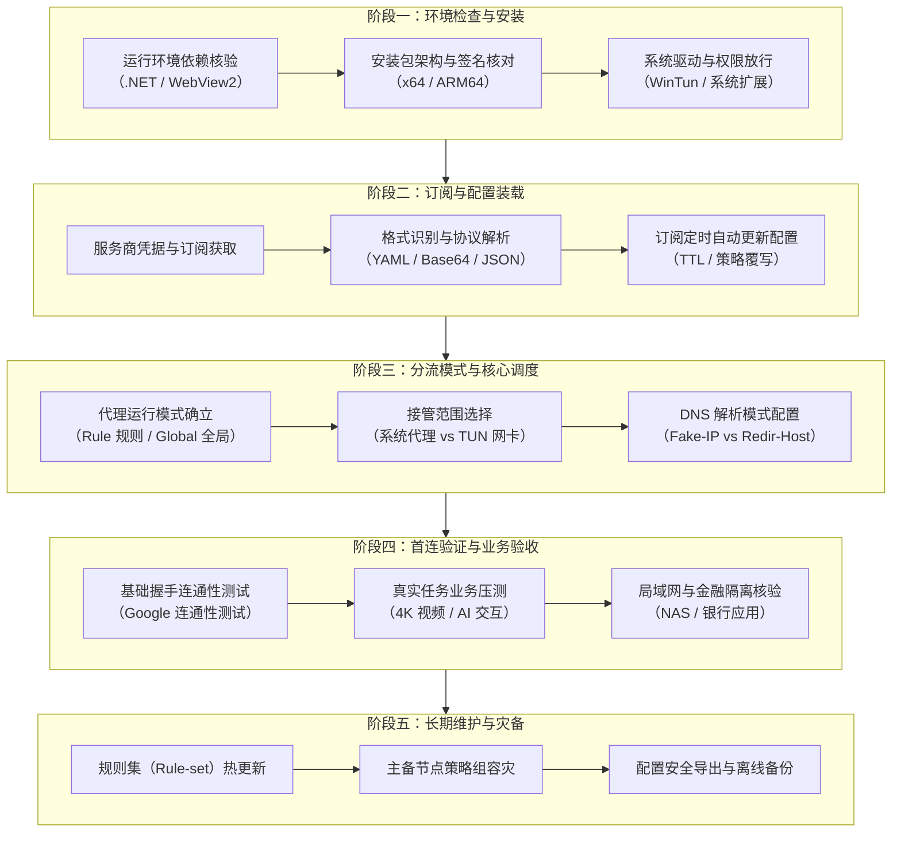
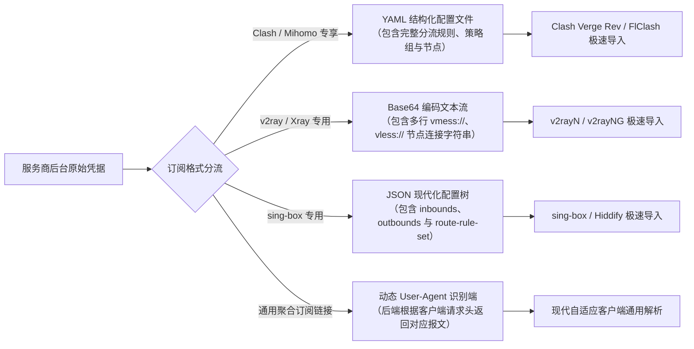
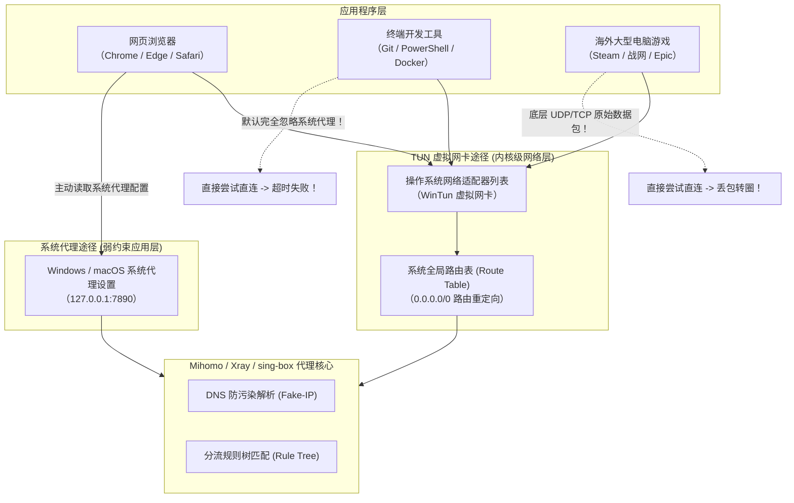
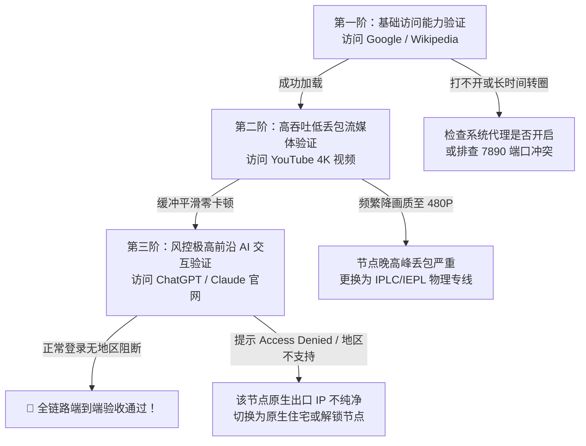
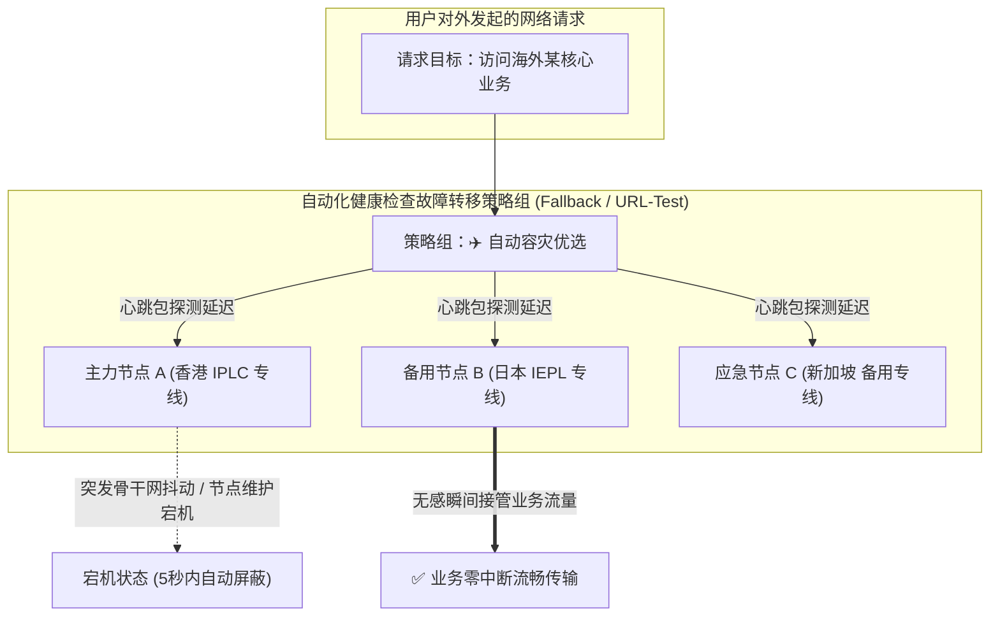

<TableOfContents />
<ReadingProgressBar />
<MobileOutlineCard />

# 使用教程：从首次安装、订阅导入到日常分流维护的标准实操全景指南

对于初次接触跨境网络工具的用户，甚至有一定使用经验的桌面与移动端用户而言，“如何把一套代理工具正确配置并稳定运行起来”往往伴随着大量的技术困惑：为什么安装包双击打不开？订阅链接复制进去为什么提示网络错误或解析失败？为什么网页能打开但系统终端与桌面软件依然无法联网？为什么开启代理后局域网打印机和公司内网断开了？

网络代理工具并非传统的单一应用程序，它是一套跨越操作系统网络过滤层（WFP / Packet Filter）、虚拟网络适配器驱动（WinTun / TUN Interface）、本地轻量级 DNS 缓存解析器与远程加密协议调度的系统级中间件。任何一个环节的配置疏漏或参数冲突，都会直接导致断网、延迟暴增或敏感应用被风控。

梯子参考（tizicankao.cc）作为立足于真实设备、具体任务与工程规范的独立中立网络选型与资料平台，在本专刊中摒弃网络上零散过时且充满推广黑话的碎片化随笔，为您建立起一套具备工业级鲁棒性、涵盖全生命周期的标准化使用教程体系。

---

## 一、使用教程实战定位与全周期任务地图

为了让所有用户不论使用何种操作系统、何种客户端工具，都能有章可循、不走弯路，我们将使用流程系统化解构为五个标准化工程阶段。任何一次成功且持久稳定的网络连接，都必须按顺序通过这五个阶段的检验：



- **阶段一：环境检查与客户端安全安装**：杜绝因缺少基础运行库导致客户端静默闪退，规范系统底层虚拟网卡与网络过滤驱动的授权；
- **阶段二：订阅链接与节点配置安全导入**：识别机场下发的各类型订阅报文，建立防凭据泄露的本地解析与自动定时同步机制；
- **阶段三：网络运行模式与流量分流体系选择**：理解直连（Direct）、规则（Rule）、全局（Global）与脚本（Script）的底层调度逻辑，掌握传统系统代理与内核级 TUN 虚拟网卡的取舍标准；
- **阶段四：首连验证与业务连通性多维验收**：从基础的连通性握手，到海外核心流媒体、AI 工具（ChatGPT / Claude）的 IP 纯净度检测，再到本地局域网设备的连通性回归测试；
- **阶段五：日常维护黄金守则与长期稳定运行**：掌握规则集自动热更新、多服务商多节点策略组容灾切换、以及换机重装时的配置无损迁移。

---

## 二、全景专题矩阵与 8 大集群导读

本使用教程主专题下辖两个核心二级专题与八个三级实战集群，共规划 32 篇端到端独立实操专刊，覆盖从首次摸索到资深运维的全流程：

<TopicMatrix
  title="使用教程二级专题与核心集群全景矩阵"
  :topics="[
    {
      title: '从安装到首次任务完成 (first-connection)',
      description: '面向零基础新手与换新机用户，从解压安装、订阅导入、参数初设到端到端业务跑通的全流程实操指导。',
      clusters: [
        { name: '安装与首次启动', slug: 'install', count: 4, desc: '环境依赖、管理员授权、静默崩溃排查与反向干净卸载还原' },
        { name: '导入订阅与节点', slug: 'import', count: 4, desc: '订阅链接识别、单节点 URI 导入、本地配置文件与二维码扫码导入' },
        { name: '最小配置与首次连接', slug: 'initial-config', count: 4, desc: '最小可用配置原则、当前激活节点确认、系统代理与 TUN 模式首启' },
        { name: '任务验收与结果记录', slug: 'verify', count: 4, desc: '公共网络路径核验、具体应用业务验收、局域网互通核查与脱敏报告' }
      ]
    },
    {
      title: '日常配置与生命周期管理 (maintenance)',
      description: '面向中高阶与长期使用用户，针对规则更新、分流策略组微调、账单额度管控与配置灾备的高阶实操。',
      clusters: [
        { name: '订阅更新与配置保护', slug: 'subscription-updates', count: 4, desc: '订阅增量更新、自定义规则覆写保护、多订阅聚合管理与过期清理' },
        { name: '规则与应用接入', slug: 'routing-rules', count: 4, desc: '规则匹配顺序优先级、策略组逻辑拓扑、终端开发接入与 DNS 策略' },
        { name: '用量、设备与续费操作', slug: 'billing-management', count: 4, desc: '用量对账、第二设备授权扩展、套餐升降配与自动扣费管理' },
        { name: '备份、升级与迁移', slug: 'backup-migration', count: 4, desc: '配置文件加密备份、客户端跨大版本升级、服务商平滑迁移与设备退役' }
      ]
    }
  ]"
/>

---

## 三、阶段一：环境检查与客户端安全安装规范

许多新手在安装客户端时遇到的第一个拦路虎，往往是“双击安装包毫无反应”、“弹出英文报错窗口提示缺少运行库”，或者“杀毒软件直接把核心可执行文件拦截隔离”。在正式安装前，必须按以下三步做好底座准备：

### 3.1 操作系统运行环境依赖库预检

现代主流代理工具由于采用了现代化的图形界面框架与高效核心，对系统底座环境有明确的最低版本约束：

1. **Windows 平台核心依赖项**：
   - **Microsoft .NET 运行时（.NET Desktop Runtime）**：
     针对使用 WPF 或现代 C# 编写的客户端（如 **v2rayN**），必须在宿主机上预先安装 **.NET 8.0 Desktop Runtime**（x64 或 ARM64 版本）。若未安装该运行时，启动 v2rayN 时系统会静默崩溃或弹出 `To run this application, you must install .NET` 提示框；
   - **Microsoft Edge WebView2 运行时**：
     针对使用 Tauri 框架构建的现代客户端（如 **Clash Verge Rev**），其图形界面完全依赖宿主机的 WebView2 引擎进行渲染。Windows 11 系统默认已内置此组件，但在 Windows 10 精简版、企业 LTSC 版或老旧 Windows 7/8 系统上，必须前往微软官网下载并安装“WebView2 Evergreen 独立安装程序”；
   - **Microsoft Visual C++ 可再发行组件包（MSVC Redistributable）**：
     Xray-core、Mihomo 等 Go/C++ 编译的底层二进制核心，依赖系统的 C 运行库。若电脑出现 `VCRUNTIME140.dll 缺失` 报错，下载安装最新的 `Visual C++ 2015-2022 Redistributable` 即可一键修复。

2. **macOS 平台安全隔离属性解除（Gatekeeper）**：
   从 GitHub 下载未签名的 `.dmg` 安装包拖入“应用程序”文件夹后，首次双击打开若提示“文件已损坏，您应该将它移到废纸篓”或“无法打开，因为无法验证开发者”，这是苹果 Gatekeeper 的安全拦截机制。请打开 Mac 终端，执行以下命令即可解除隔离：
   ```bash
   sudo xattr -r -d com.apple.quarantine "/Applications/Clash Verge.app"
   ```

3. **Linux 平台权能授予与依赖修复**：
   在 Linux 平台运行基于 AppImage 分发的客户端时，需确保系统安装了 `fuse2` 库（如 Ubuntu 22.04+ 执行 `sudo apt install libfuse2`），并通过以下命令向客户端核心赋予网络管理权能：
   ```bash
   sudo setcap cap_net_admin,cap_net_bind_service=+ep /path/to/mihomo
   ```

### 3.2 杀毒软件启发式误报处理准则

由于代理客户端在运行过程中需要动态修改本地网络路由表（Route Table）、向系统网络栈注册局部或全局代理端口、并加载 `WinTun.dll` 虚拟网卡驱动，这些底层网络行为特征在杀毒软件（Windows Defender、火绒安全、360 安全卫士、腾讯电脑管家等）的启发式行为分析引擎中与恶意的网络劫持木马具有高度相似性。

<div class="custom-block warning">
  <p class="custom-block-title">⚠️ 安全防护白名单设立黄金法则</p>
  <p>只要您下载的安装包经过了前文所述的<strong>官方 Releases 仓库比对</strong>与 <strong>SHA256 哈希数学验真</strong>，该报警即属于典型的安全启发式误报。此时切勿随意在网上下载所谓的“去弹窗破解版”，应在正规杀毒软件中将该客户端的整个安装根目录（例如 <code>C:\Program Files\Clash Verge</code>）添加进“杀毒排除项 / 信任白名单”，确保内核核心文件与虚拟网卡驱动不会在系统更新时被后台静默隔离杀除。</p>
</div>

---

## 四、阶段二：订阅链接与节点配置安全导入实战

将客户端成功安装并启动后，主界面通常是一片空白。此时需要将服务商提供的节点信息装载进客户端中。

### 4.1 订阅格式认知：通用链接 vs 专享链接

在机场服务商的用户后台，通常会提供多种不同维度的订阅格式供用户复制。理解它们的差异是避免导入失败的前提：



1. **Clash / Mihomo 专享订阅（YAML 格式）**：
   - 特点：最为成熟和流行。配置文件内不仅包含数十个节点的连接参数（地址、端口、密码、传输层协议），还内置了完整的分流规则集（如将各大流媒体、国内主流网站、局域网等分类路由）和策略组逻辑；
   - 适用软件：**Clash Verge Rev**、**FlClash**、**Clash Nyanpasu**、**OpenClash** 等；
2. **v2ray / Xray 通用订阅（Base64 文本）**：
   - 特点：纯文本字符串经过 Base64 编码，解密后由一行行以协议开头的单节点 URI 组成（如 `vmess://eyJhZGQi...`、`vless://uuid@...`）。通常不包含复杂的分流策略组，分流逻辑依赖客户端本地的路由规则进行二次匹配；
   - 适用软件：**v2rayN**、**v2rayNG** 等；
3. **sing-box 专享订阅（JSON 格式）**：
   - 特点：采用严谨的 JSON 语法，配置组织极为紧凑，原生支持最新的规则集二进制编译集（`.srs`），性能开销极低；
   - 适用软件：**sing-box 官方客户端**、**Hiddify** 等。

### 4.2 Clash Verge Rev 订阅安全导入五步操作指南

以目前桌面端生态最主流的 **Clash Verge Rev** 为例，标准导入流程如下：

1. **第一步：进入配置管理界面**：
   在 Clash Verge Rev 主界面左侧导航栏中，点击进入 **“订阅（Profiles）”** 标签页；
2. **第二步：填入订阅 URL**：
   在顶部输入框中，粘贴从服务商后台复制的专享订阅链接（链接通常以 `https://` 开头，包含带有专属密钥的 Token）。点击右侧的 **“保存（Save / Import）”** 按钮；
3. **第三步：等待远程拉取与语法校验**：
   客户端会向该 URL 发起加密 HTTPS 请求，将服务商服务器返回的 YAML 文本下载到本地，并进行语法合规性检查。拉取成功后，界面会出现一张包含服务商名称、节点总数和更新时间戳的配置卡片；
4. **第四步：激活配置配置文件**：
   在刚刚下载成功的配置卡片上单击鼠标左键，卡片边框会高亮变为主题色（通常为蓝色或紫色），并出现“Active（当前使用中）”角标，代表该配置已成功载入内存核心；
5. **第五步：设置合理的自动更新周期**：
   在配置卡片上右键点击，选择“编辑配置信息”，在 **“更新间隔（Update Interval）”** 中填入合理的分钟数。
   <div class="custom-block tip">
     <p class="custom-block-title">💡 自动更新频率推荐：1440 分钟（24 小时）</p>
     <p>切勿将自动更新频率设置为极端的 5 分钟或 10 分钟。过于频繁的拉取不仅毫无意义，还会导致服务商的 API 防火墙将您的本地 IP 标记为恶意刷流并实施临时封禁。常规用户设置为 1440 分钟（每天自动静默拉取一次最新节点与域名规则变更）即可完美平衡时效性与稳定性。</p>
   </div>

---

## 五、阶段三：网络运行模式与流量分流体系深度精讲

许多新手在使用代理工具时，最大的误区就是以为“软件只要打开了，电脑所有的网络就全部翻墙了”。实际上，代理工具在操作系统中有非常精细的运行模式与分流层级划分：

### 5.1 四大代理路由模式对比

无论使用哪款客户端，主界面通常都会提供“规则”、“全局”、“直连”和“脚本”四个核心开关：

| 模式名称 | 英文标识 | 流量匹配机制 | 适用场景与优劣势 |
| :--- | :--- | :--- | :--- |
| **规则模式**<br>*(推荐默认)* | **Rule** | 客户端内置成千上万条域名与 IP 匹配规则。国内网站（如百度、淘宝、微信）自动走本地宽带直连；被墙或海外服务自动走代理节点。 | **日常使用 100% 推荐开启**。既能秒开海外服务，又完全不消耗节点流量，国内 App 速度丝毫不受影响，金融银行人脸识别不报错。 |
| **全局模式** | **Global** | 无论访问国内还是海外网站，电脑产生的所有网络请求 100% 强制通过所选的代理节点进行转发。 | 仅用于特定调试排障（如某国外生僻小众网站无法访问时测试是否规则未覆盖）。**平时切勿常开**，会导致国内网页变慢并白白消耗昂贵的付费流量。 |
| **直连模式** | **Direct** | 绕过所有代理节点，所有网络数据包 100% 直接通过您家庭或公司的真实物理宽带出站。 | 相当于“临时关闭代理但保留软件开机常驻”，适用于彻底退出科学上网环境。 |
| **脚本模式** | **Script** | 允许进阶极客使用 JavaScript / Python / Lua 脚本针对每个数据包的来源端口、协议和目标特征编写自定义动态调度代码。 | 适合具备专业编程与网络工程背景的高级用户进行复杂网络拓扑实验。 |

### 5.2 核心调度分水岭：系统代理 vs TUN 虚拟网卡模式

在确定了使用“规则模式”后，用户面临的最关键的技术取舍是：流量到底通过什么途径交由客户端内核调度？



1. **传统系统代理（System Proxy）的局限性**：
   - 它的工作原理是在操作系统的“网络与 Internet 设置”中填写一个本地监听端口（默认通常是 HTTP/SOCKS5 `127.0.0.1:7890`）；
   - **痛点**：系统代理属于“君子协定”，只有规范设计的浏览器应用（Chrome、Firefox、Edge）才会主动去读取这个端口；而系统终端（CMD、PowerShell、Git 命令行）、编程环境（Python pip、Node npm、Docker 镜像拉取）、以及绝大多数 PC 客户端大型游戏，底层直接发起原始套接字连接，根本不理睬系统代理设置，依然走直连导致请求失败超时。
2. **TUN 虚拟网卡模式（TUN Mode）的绝对优势**：
   - 客户端会在操作系统的内核网络驱动层虚拟出一张专属的物理网卡（如 WinTun 网卡），并通过修改本地路由表，将计算机对外发出的 **100% 原始数据包（包含 TCP、UDP、ICMP Ping 包）** 全部无条件接管捕获；
   - 终端命令无需手动输入 `export http_proxy` 即可全局加速；Git 克隆仓库和 Docker 镜像拉取瞬间拉满千兆宽带；海外游戏联机不再报错。
   - **开启前置条件**：开启 TUN 模式前，必须确保客户端是以**系统管理员身份**运行，并点击安装了“服务模式（Service Mode）”或 WinTun 核心驱动。

---

## 六、阶段四：首连验证与业务连通性多维验收规范

配置好订阅与运行模式后，很多新手看到状态栏显示“已连接”，便以为大功告成。在工程上，必须执行标准化**“三步阶梯连通性验收法”**，才能确认网络通道真正健康且安全：

### 6.1 阶段验收第一步：底层协议连通性握手验证

打开客户端的“节点选择（Proxies）”列表，不要盲目凭感觉挑节点：
1. **执行批量延迟测试**：点击节点列表顶部的“闪电”或“测速”图标，客户端会向公共测试端点发起轻量级握手测试；
2. **识别可用节点**：
   - 绿色数字（如 `180ms`、`220ms`）：代表底层 TCP/TLS 链路成功建立握手，该节点可以正常传输数据；
   - 红色提示（如 `Timeout`、`Error`）：代表该节点的服务器机房目前处于维护断联状态，或者您的本地宽带运营商阻断了该节点的入口连接。切勿勾选带有红色报错的节点，应在可用列表中选择延迟适中的节点（通常优先选择香港、日本、新加坡等近邻亚太节点以获取最佳日常交互响应速度）。

### 6.2 阶段验收第二步：真实业务流分阶验收

完成节点连通后，打开 Chrome 浏览器进行三层递进业务测试：



1. **第一阶（基础连通）**：访问 `https://www.google.com`。若能在 1 秒内迅速呈现搜索框且没有弹出人机验证验证码，证明基础 HTTP/TLS 代理链路完全畅通；
2. **第二阶（带宽吞吐与稳定性）**：访问 YouTube，打开任意 4K 60FPS 视频，右键点击“详细统计信息（Stats for nerds）”，观察 `Connection Speed`（连接吞吐速度）是否稳定在 30,000 Kbps 以上，`Buffer Health`（缓冲区健康度）是否持续保持在 10 秒以上且无丢帧现象。这能有效检验节点背后的真实物理带宽储备；
3. **第三阶（IP 纯净度与欺诈分检测）**：访问 OpenAI ChatGPT (`https://chatgpt.com`) 或 Claude 官网。如果页面正常弹出登录窗口并顺利完成会话，说明该节点使用的出口机房 IP 具有较高的纯净度，未被主流公有云巨头拉入黑名单列表。

### 6.3 阶段验收第三步：本地局域网设备互通回归测试

很多人开启了代理后，发现自己电脑突然搜不到局域网里的群晖 NAS 共享文件夹、无法连接无线网络打印机、或者手机与电视之间的投屏（AirPlay / DLNA）失效了。

- **快速回归检查**：在浏览器地址栏输入家庭路由器的管理后台 IP（通常为 `192.168.1.1` 或 `192.168.31.1`），或者尝试 ping 局域网内的 NAS 主机名。
- **故障排查**：若无法打开，请立即进入客户端的“设置 - 路由设置”，检查是否勾选了**“绕过局域网地址（Bypass Private / LAN IPs）”**。务必确保私有 IP 段（`10.0.0.0/8`, `172.16.0.0/12`, `192.168.0.0/16`, `127.0.0.1/8`）永远走直连。

---

## 七、阶段五：日常维护黄金守则与长期稳定运行机制

一套优秀的代理环境应当做到“配置一次，长期无感稳定运行”。要实现这种境界，必须遵守以下四条工程维护黄金法则：

### 7.1 规则集（Rule-set）与域名库的自动化热更新

互联网上的域名与 IP 分流归属是动态变化的。例如某海外知名游戏或 AI 平台突然更换了 CDN 域名解析，若客户端使用的是几个月前的陈旧离线静态规则库，会导致该服务被误判为国内直连从而打不开。

- **推荐做法**：在现代客户端（如 Clash Verge Rev、Nikki 等）中，分流规则推荐采用外部引用的 **Rule Provider（规则集供应器）** 机制；
- 引入社区权威公认的开源规则集（如 Loyalsoldier 的 `clash-rules` 或 ACL4SSR 的精简规则集），并在配置文件中配置 `behavior: domain` 或 `behavior: ipcidr`，设定其更新周期为 `interval: 86400`（每 24 小时自动静默在后台更新一次最新的域名列表），彻底免去手动维护规则的繁琐。

### 7.2 策略组（Policy Groups）节点拓扑与故障转移

在 Clash 生态中，不要将几十个节点直接裸露在单一的选择列表中，善用三种不同类型的策略组能够极大提升容灾能力：



1. **手动选择组（Select）**：用于对 IP 归属地有极其严格要求的场景（如海外网银、特定仅限美区的流媒体账号），固定锁定在特定的静态节点；
2. **延迟最优自动测试组（URL-Test）**：客户端每隔固定周期向测试 URL 发起并发心跳探测，自动将流量调度给延迟最低的节点；
3. **故障转移容灾组（Fallback）**：设定一个主备节点顺序列表。平时所有流量固定走优先级最高的“主力节点 A”；一旦主力节点遭遇运营商断纤或机房突发维护无法联通，策略组会在 5 秒内静默无感自动漂移切换至“备用节点 B”，当主力节点恢复后再自动切回，真正实现 7×24 小时不掉线。

### 7.3 多服务商订阅主备灾备规范

“不要把所有鸡蛋放在同一个篮子里”。对于重度依赖跨境网络开展跨境电商、外贸出海、AI 软件研发或远程办公的专业人士，**同时持有两家不同技术栈或不同底层链路的服务商订阅是必不可少的风控手段**：
- **主力服务商**：采用高质量的 IPLC / IEPL 物理专线，保障日常大吞吐量下的低延迟与低抖动；
- **应急备用服务商**：采用具备高抗封锁能力的新型前沿协议（如 VLESS Reality 或 Hysteria 2 协议）直连节点。当遇到特殊网络封锁敏感时期骨干网专线临时割接时，备用通道可以作为救命稻草确保生产力永不中断。

---

## 八、跨平台差异化实操速查手册

不同的操作系统由于底层网络协议栈与电源管理策略的差异，在日常使用中有各自独特的配置技巧：

### 8.1 Windows 平台

1. **开机自启与静默托盘启动**：
   在 Clash Verge Rev 的“设置 - 基础设置”中，同时勾选 **“开机自启（Auto Launch on Startup）”** 和 **“静默启动（Silent Start）”**。这样电脑开机时软件会在后台托盘静默拉起，不会弹出巨大的前台窗口打扰正常办公；
2. **服务模式（Service Mode）安装**：
   若要使用 TUN 模式，务必在设置界面找到“服务模式”，点击“安装”。安装成功后旁边会出现绿色的“已激活”图标。通过系统服务（Service）运行的内核拥有操作系统的高权限环境，能确保 TUN 驱动在开机后毫秒级就绪。

### 8.2 macOS 平台

1. **状态栏极简菜单控制**：
   Mac 客户端启动后会自动在顶部菜单栏生成一个小图标。通过该图标可以一键快速切换代理模式（Rule / Global / Direct），无需频繁调出完整主窗口；
2. **休眠网卡恢复保障**：
   MacBook 在合盖休眠后重新开盖时，有时会遇到数秒的网络恢复停顿。在客户端高级设置中开启“增强接口监听（Enhanced Interface Monitor）”，能让内核在检测到 MacBook 屏幕点亮的瞬间，自动向 macOS 内核重新发起网卡绑定握手。

### 8.3 Android 平台

1. **定制系统电池白名单加锁**：
   国内主流安卓 ROM（MIUI/澎湃、ColorOS、OriginOS、鸿蒙）拥有严苛的后台清理机制。务必在多任务视图中给客户端应用卡片**“加锁”**，并在电池管理中将策略从“智能省电”强制改为**“无限制”**；
2. **分应用代理精准放行**：
   在手机客户端中开启“分应用代理”，将手机里常用的国内金融 App（微信、支付宝、云闪付、个人所得税、各大银行）全部勾选为**“绕过（Direct Bypass）”**，彻底消除异地登录风控报警。

### 8.4 iOS 平台

1. **利用按需连接（On-Demand）实现全自动感知**：
   在 Shadowrocket 的“设置 - 按需连接”中，设置特定 Wi-Fi SSID 白名单。当连接到家里的 Wi-Fi 时代理自动休眠直连；当手机切到移动 5G 信号时自动开启代理，全程无感自动化；
2. **桌面快捷小组件（Widgets）极速切换**：
   在 iPhone 锁屏界面或负一屏添加 Shadowrocket 的节点切换与延迟测速小组件，不用解锁打开软件即可秒级掌控节点健康状态。

### 8.5 Linux 桌面与无头服务器平台

1. **systemd 系统服务级无人值守保活**：
   对于运行 Ubuntu、Debian 或 Arch Linux 的开发工作站或无头（Headless）服务器，推荐将 Mihomo 或 v2rayA 注册为系统级 systemd 守护进程。编写 `/etc/systemd/system/mihomo.service`，通过 `systemctl enable --now mihomo` 实现开机即入静默监听状态，与系统的 `journalctl` 日志管理链路无缝整合；
2. **终端命令行环境代理快速起降别名**：
   在开发者的 `~/.bashrc` 或 `~/.zshrc` 配置文件末尾，添加轻量级的环境变量起降快捷别名。平时终端保持纯净直连，需要拉取境外依赖时敲入一个单词即可毫秒级打通加速：
   ```bash
   # 代理快捷启停命令
   alias setproxy="export http_proxy=http://127.0.0.1:7890; export https_proxy=http://127.0.0.1:7890; export all_proxy=socks5://127.0.0.1:7891; echo 'Proxy Enabled!'"
   alias unsetproxy="unset http_proxy https_proxy all_proxy; echo 'Proxy Disabled!'"
   ```
3. **Docker 守护进程与容器镜像拉取加速**：
   Docker CLI 运行在独立命名空间中，不读取用户的 Shell 环境变量。要加速 Docker 镜像拉取，必须修改 `/etc/docker/daemon.json` 或在 `/etc/systemd/system/docker.service.d/http-proxy.conf` 中显式注入 `HTTP_PROXY` 与 `HTTPS_PROXY`，使 Docker 守护进程发起的拉取请求正确导向本地代理端口。

---

## 九、核心分流配置与个性化覆写实战清单

### 9.1 工业级标准配置文件骨架拆解

对于追求极致透明与掌控力的高级用户，理解一段标准的 Clash YAML 配置文件各代码块的职能分工至关重要。以下为梯子参考实验室提炼出的工业级标准骨架：

```yaml
# 1. 基础网络端口监听定义
port: 7890                 # HTTP 代理监听端口
socks-port: 7891           # SOCKS5 代理监听端口
mixed-port: 7892           # 混合代理端口（同时兼容 HTTP 与 SOCKS5）
allow-lan: false           # 是否允许局域网其他设备共享本机的代理端口
mode: rule                 # 默认运行模式：rule（规则匹配分流）
log-level: info            # 日志输出等级

# 2. 内核级 DNS 防污染与 Fake-IP 解析配置
dns:
  enable: true
  listen: 0.0.0.0:1053
  ipv6: false              # 建议关闭 IPv6 解析以避免潜在的 DNS 泄漏
  enhanced-mode: fake-ip   # 高性能 Fake-IP 模式
  fake-ip-range: 198.18.0.1/16
  nameserver:              # 负责国内域名的真实快速解析
    - 223.5.5.5
    - 119.29.29.29
  fallback:                # 负责境外可疑域名的加密防污染解析
    - https://1.1.1.1/dns-query
    - https://8.8.8.8/dns-query

# 3. 策略组（Policy Groups）逻辑拓扑定义
proxy-groups:
  - name: "🚀 节点选择"
    type: select
    proxies:
      - "♻️ 自动容灾优选"
      - "🇭🇰 香港 IPLC 专线"
      - "🇯🇵 日本 IEPL 专线"
      - "🇺🇸 美国 备用专线"
      - "DIRECT"

  - name: "♻️ 自动容灾优选"
    type: fallback
    url: "http://cp.cloudflare.com/generate_204"
    interval: 300
    proxies:
      - "🇭🇰 香港 IPLC 专线"
      - "🇯🇵 日本 IEPL 专线"

# 4. 分流规则体系（匹配顺序：由上至下，一旦命中立即停止）
rules:
  - GEOIP,lan,DIRECT,no-resolve           # 局域网私有 IP 强制直连
  - GEOSITE,category-anticensorship,🚀 节点选择 # 核心封锁域名走代理
  - GEOSITE,geolocation-!cn,🚀 节点选择   # 所有非中国大陆域名走代理
  - GEOIP,CN,DIRECT                       # 所有中国大陆物理 IP 强制走直连
  - MATCH,🚀 节点选择                     # 兜底规则（未匹配规则走代理）
```

### 9.2 高级配置覆写（Profile Overrides）实操方案

很多进阶用户手头有自己私有的自建 VPS 节点、或者需要为公司的私有协同办公域名建立永久直连白名单。如果直接把这些规则手动敲进从机场拉取的配置文件中，每次只要机场更新订阅，自己添加的内容就会被彻底冲刷归零。

在 Clash Verge Rev 中，标准优雅的解法是利用客户端内置的“配置覆写（Profile Merge）”功能：

1. **新建覆写文件**：在“订阅”标签页中点击“新建”，类型选择 **“Merge（合流覆写）”**，命名为 `Personal-Overrides`；
2. **填入前置个性化补丁代码**：
   ```yaml
   # 针对机场配置进行局部覆写与增量注入
   prepend-rules:
     - DOMAIN-SUFFIX,company-internal.com,DIRECT # 公司内部域名强制走直连
     - DOMAIN-KEYWORD,my-nas,DIRECT              # 私有 NAS 域名强制直连
     - DOMAIN-SUFFIX,claude.ai,🇺🇸 美国 备用专线     # 强制指定 AI 访问走美国固定专线
     - IP-CIDR,192.168.0.0/16,DIRECT,no-resolve  # 局域网网段绝对防串流
   ```
3. **右键启用覆写联动**：在机场订阅卡片上右键选择“配置覆写”，勾选刚刚创建的 `Personal-Overrides`。
4. **运行原理剖析**：客户端内核在每次加载或更新该机场订阅时，会自动将 `prepend-rules` 内部的条目动态插入到整个规则树的最顶部，享有最高的优先匹配权。即使机场服务商在远端删改了规则，您的个人办公流量依然 100% 受到专属白名单的稳定保护。

---

## 十、使用教程生态技术疑难与避坑深度解答 (FAQ)

<div class="custom-block tip">
  <p class="custom-block-title">💡 使用教程高频疑难解答索引</p>
  <p>以下为梯子参考实验室根据数千名用户的真实实操反馈，整理出的 16 大从初级到高阶的典型技术故障与实操避坑方案。点击卡片即可展开完整解决方案。</p>
</div>

<details class="faq-accordion" open>
<summary>Q1：订阅链接导入时提示“Network Error”或“SSL Handshake Failed”，怎样排查？</summary>
<div class="faq-answer">
<p>这是新手在拉取订阅时遇到频率最高的技术故障。产生该错误的核心机理与对应的三步排查法如下：</p>
<ol>
  <li><strong>订阅链接域名被本地运营商 DNS 污染</strong>：部分机场使用的订阅分发域名可能已被国内某些省份的电信/移动 DNS 污染。此时客户端在没有建立代理的情况下直连该域名，会解析出错误的假 IP 导致 SSL 证书握手失败。<strong>解决方案</strong>：先在电脑上开启现有的其他应急热点或临时直连代理，再点击拉取订阅；或者在服务商后台寻找提供“短链接”或备用备用分发域名的备选链接；</li>
  <li><strong>本地系统时间严重偏差</strong>：若电脑长久未联网导致主板时钟出现几分钟以上的误差，当客户端尝试与服务商的 HTTPS 订阅服务器建立 TLS 握手时，会由于证书时间戳校验不过而报错 <code>SSL Handshake Failed</code>。<strong>解决方案</strong>：打开系统设置，重新同步一次互联网时间；</li>
  <li><strong>服务商后端服务器防刷临时风控</strong>：若您在短时间内重复点击了几十次拉取按钮，服务商的 Cloudflare 防火墙可能会向您的 IP 抛出 429 Too Many Requests 拒绝响应。等待 15 分钟后再试即可恢复。</li>
</ol>
</div>
</details>

<details class="faq-accordion">
<summary>Q2：更新订阅后，发现之前自己辛苦修改的规则或者节点名称全被重置覆盖了，怎样保护自定义设置？</summary>
<div class="faq-answer">
<p>这是因为订阅更新的本质是<strong>“用服务商远端下发的最新配置文件完整覆写本地文件”</strong>。为了保护自己的个性化定制，绝不能直接在下载下来的原始订阅文件中修改！</p>
<p><strong>正确的工程实践方案：利用客户端的“配置覆写（Profile Overrides / Merge）”或“脚本预处理（Parsers / Script）”机制：</strong></p>
<ol>
  <li>在 Clash Verge Rev 中，进入“订阅”界面，新建一个名为 <code>My-Custom-Rules</code> 的“独立覆写文件”；</li>
  <li>在覆写文件中写入您自己专属的分流规则（例如自定义某个特殊公司内网走直连，或特定外包开发网站走固定节点）；</li>
  <li>将该覆写文件与机场订阅进行“绑定合流”。无论以后机场订阅如何频繁更新，客户端在解析时都会自动将您的自定义规则动态置顶注入到最前排，真正实现“订阅随便更新，个人规则坚如磐石”。</li>
</ol>
</div>
</details>

<details class="faq-accordion">
<summary>Q3：为什么打开代理后，访问国内的百度、B站或淘宝网页速度变得很慢？</summary>
<div class="faq-answer">
<p>这种现象通常由以下三个配置不当引起：</p>
<ul>
  <li><strong>原因一：误开启了“全局模式（Global）”</strong>。请立即检查客户端主界面，确保运行模式处于<strong>“规则（Rule）”</strong>状态。在全局模式下，访问百度也会绕道几千公里外的海外节点再折返回来，延迟自然从 10ms 暴增到 300ms；</li>
  <li><strong>原因二：DNS 解析模式配置倒退</strong>。在某些老旧配置中，国内域名也被强制交给了海外公共 DNS 解析，导致 CDN 将国内网站的就近接入点解析到了偏远省份。在客户端设置中确保国内 DNS 服务器配置为阿里的 <code>223.5.5.5</code> 或腾讯的 <code>119.29.29.29</code>；</li>
  <li><strong>原因三：规则集缺乏中国大陆白名单</strong>。检查分流规则列表中是否缺失了 <code>GEOIP,CN,DIRECT</code> 规则，确保所有境内服务器 IP 100% 走纯净直连。</li>
</ul>
</div>
</details>

<details class="faq-accordion">
<summary>Q4：为什么浏览器可以正常上外网，但电脑的命令行（PowerShell / Git）和游戏依然断连？</summary>
<div class="faq-answer">
<p>这是“传统系统代理”的技术边界所决定的：</p>
<ol>
  <li><strong>命令行工具与桌面游戏天生不识别系统代理</strong>：Windows 的“系统代理”仅对支持该约定的浏览器有效。Git 命令行、PowerShell 的 `curl`、Docker 守护进程以及 Steam / 战网游戏均走底层原始网络套接字，直接绕过了 7890 端口；</li>
  <li><strong>彻底解决方案：开启 TUN 虚拟网卡模式</strong>。在 Clash Verge Rev 中安装并激活“服务模式”，然后打开 **“TUN 模式”** 开关。通过驱动级虚拟网卡强制接管整台机器的所有三层 IP 数据包，无需为每个命令行工具单独编写代理环境变量，游戏与终端瞬间畅享加速。</li>
</ol>
</div>
</details>

<details class="faq-accordion">
<summary>Q5：什么是 Fake-IP 模式，为什么我的网卡 IP 经常显示变成 198.18.x.x？</summary>
<div class="faq-answer">
<p>很多新手在命令行执行 `ping` 某个国外域名时，发现返回的 IP 竟然是奇怪的 `198.18.0.x`，以为自己电脑中毒了。这其实是现代代理客户端极其先进的 **Fake-IP（虚拟假 IP）** 机制：</p>
<ul>
  <li><strong>传统解析痛点</strong>：电脑在发起网络连接前必须先询问 DNS 服务器获取真实 IP，如果该域名被污染，在第一步 DNS 环节就会断连或者返回假地址；</li>
  <li><strong>Fake-IP 的优雅解法</strong>：当客户端开启 Fake-IP 模式后，本地核心充当系统的 DNS 服务器。当浏览器询问某个域名的 IP 时，客户端在 1 毫秒内从保留网段（`198.18.0.0/16`）直接捏造一个临时的“假 IP”返回给浏览器；浏览器随即使用这个假 IP 发起连接，客户端的虚拟网卡捕获到该数据包后，在内核内部查表还原出它的真实原始域名，并将其封装通过远端代理节点进行加密传输；</li>
  <li><strong>巨大收益</strong>：彻底消除了本地 DNS 污染的困扰，并且省去了等待真实 DNS 网络查询的往返时间，网页打开速度呈飞跃式提升。</li>
</ul>
</div>
</details>

<details class="faq-accordion">
<summary>Q6：访问某些敏感网站（如 OpenAI ChatGPT）时提示“Access Denied / 地区不支持”，怎样解决？</summary>
<div class="faq-answer">
<p>前沿海外 AI 与版权流媒体服务拥有极高维度的风控防御机制。解决该报错的标准实操路径如下：</p>
<ol>
  <li><strong>规避香港节点</strong>：OpenAI 等主流 AI 官方在服务条款中并未开放中国香港（Hong Kong）地区的服务。访问此类网站时，必须在客户端的策略组中将节点手动切换为<strong>美国（US）、日本（JP）、新加坡（SG）或台湾（TW）</strong>节点；</li>
  <li><strong>清除浏览器残留缓存与 Cookie</strong>：如果在香港节点状态下尝试打开过该网站，浏览器已经写入了被风控标记的 LocalStorage 和 Cookie。切换到美国节点后，必须在浏览器中彻底清除该域名的所有浏览数据，或者使用 Chrome 的“无痕隐身窗口”重新打开；</li>
  <li><strong>检查节点出口 IP 纯净度</strong>：某些廉价机场使用的是几千人共享的机房广播 IP，已被 OpenAI 全网封杀。此时请在节点列表中切换到标注有“原生 / 解锁 / 住宅”字样的高质量专线节点。</li>
</ol>
</div>
</details>

<details class="faq-accordion">
<summary>Q7：客户端日常运行中占用的内存越来越大（甚至超过 1GB），怎样优化？</summary>
<div class="faq-answer">
<p>客户端内存膨胀通常是由于以下两个“垃圾堆积”诱发的：</p>
<ul>
  <li><strong>日志记录等级过高</strong>：检查客户端设置中的“日志级别（Log Level）”。若误设为了 `debug` 或 `verbose`，核心会把网络中收发的每一个数据包的详细信息都缓存在内存列表中供前端渲染。将其调整为 **`info`** 或 **`warning`** 即可瞬间释放数百兆内存；</li>
  <li><strong>规则集数量过于臃肿</strong>：某些第三方规则合并脚本导入了上百个去广告、反追踪规则源，包含数十万条正则匹配表达式。代理工具并非专业的全功能广告拦截器，庞大的查找树会消耗海量内存。建议仅保留核心的国外分流与国内直连规则，专业广告拦截交由浏览器的 uBlock Origin 插件处理。</li>
</ul>
</div>
</details>

<details class="faq-accordion">
<summary>Q8：电脑从睡眠休眠状态唤醒后网络假死，怎样让客户端自动恢复？</summary>
<div class="faq-answer">
<p>此故障源于操作系统休眠时物理网卡与虚拟网卡解绑、唤醒后虚拟网卡状态机未及时响应。三步根治方案：</p>
<ol>
  <li>在 Clash Verge Rev 的 TUN 设置中，勾选 **“严格路由（Strict Route）”** 与 **“接口变动监听（Interface Monitor）”**；</li>
  <li>在 Windows 的“服务（services.msc）”中找到 `clash_verge_service`，将恢复选项中的“第一次失败”、“第二次失败”均设置为“重新启动服务”；</li>
  <li>若依然假死，无需重启整台电脑，在客户端主界面的系统代理或 TUN 模式开关上连续点击两次（关闭后再开启），即可触发底层驱动重新向系统申请句柄瞬时复活。</li>
</ol>
</div>
</details>

<details class="faq-accordion">
<summary>Q9：家庭智能电视或 Apple TV 无法直接安装此类客户端，怎样让电视走代理？</summary>
<div class="faq-answer">
<p>针对无法直接安装第三方软件的电视或电视盒子，有两种标准实战解决架构：</p>
<ul>
  <li><strong>方案一：利用桌面电脑客户端开启“局域网共享（Allow LAN）”（免硬件投入）</strong>：
    在主力 PC 的 Clash Verge Rev 设置中，打开 **“允许来自局域网的连接（Allow LAN）”**。查看电脑的局域网 IP（例如 `192.168.1.100`）。在 Apple TV 或索尼电视的网络设置中，将 HTTP 代理手动设置为该 IP 和端口 `7890`，电视即可借助电脑的算力实现分流上网；</li>
  <li><strong>方案二：软路由网关透明代理（最彻底）</strong>：
    在家庭主网络中部署运行 OpenClash 或 Nikki 的软路由，局域网所有设备连接 Wi-Fi 后自动被路由网关透明分流接管，无需任何设备进行单独设置。</li>
</ul>
</div>
</details>

<details class="faq-accordion">
<summary>Q10：为什么有些节点显示延迟很低（十几毫秒），但连接后网页根本打不开？</summary>
<div class="faq-answer">
<p>这是被典型的 **“TCP Ping 假延迟”** 误导了：</p>
<p>在很多客户端中，默认测速仅仅是向节点服务器的“国内入口中转机”发送一个微小的 TCP 握手包。只要您家到这个入口服务器是连通的，软件就会立刻显示出极低的延迟数值（十几毫秒）。但是，如果该入口服务器与海外真实出口节点之间的**跨国跨境隧道发生割接、宕机或被墙**，数据根本发不出去！</p>
<p><strong>实操准则</strong>：在客户端设置中将测试类型强制更改为 **“HTTP Real Ping”**（测试向 Google 或 Cloudflare 完整获取一个页面的耗时），只有能返回真实 HTTP 状态码的延迟数值才是真正可用的健康节点。</p>
</div>
</details>

<details class="faq-accordion">
<summary>Q11：怎样检查自己是否存在 DNS 泄漏风险？</summary>
<div class="faq-answer">
<p><strong>DNS 泄漏（DNS Leak）</strong>是指：虽然您的网页数据内容走的是加密代理隧道，但您访问某个网站域名的解析请求，却依然被系统悄悄发给了本地国内宽带运营商的默认 DNS 服务器。这会导致运营商在日志中清晰地知晓您正在浏览哪些敏感网址。</p>
<p><strong>标准验漏实操步骤：</strong></p>
<ol>
  <li>连接好代理后，使用浏览器访问权威检漏网站 `https://dnsleaktest.com`；</li>
  <li>点击执行“Extended Test（深度扩展测试）”；</li>
  <li>观察最终输出的 DNS 服务器 IP 列表与归属地：
    <ul>
      <li><strong>完全安全</strong>：显示的 DNS 服务器全部位于美国、香港或日本（由代理节点机房提供），完全没有出现任何国内运营商（China Telecom / Unicom / Mobile）的条目；</li>
      <li><strong>存在泄漏</strong>：列表中赫然出现了您本地城市的运营商 IP。<strong>修复办法</strong>：在客户端配置中开启 Fake-IP 模式，关闭 IPv6 协议，并在 DNS 区域配置加密的 DoH / DoT 上游。</li>
    </ul>
  </li>
</ol>
</div>
</details>

<details class="faq-accordion">
<summary>Q12：更换机场服务商时，旧的配置和节点需要怎样清理才干净？</summary>
<div class="faq-answer">
<p>很多用户在更换新的服务商后，旧服务商已经过期，但列表中依然保留着几十个红色的超时死节点，严重拖慢测速性能与启动速度。</p>
<p><strong>标准清理四步法：</strong></p>
<ol>
  <li>进入客户端的“订阅管理（Profiles）”界面；</li>
  <li>找到已失效旧服务商的配置卡片，先确认当前激活的不是这张卡片（切换为新服务商激活）；</li>
  <li>在旧卡片菜单中点击“删除（Delete）”，并勾选“同时删除本地缓存文件”；</li>
  <li>在客户端的缓存目录（如 `C:\Users\用户名\.config\clash-verge`）中，清空旧的日志文件与 Fake-IP 数据库，重启客户端释放内存。</li>
</ol>
</div>
</details>

<details class="faq-accordion">
<summary>Q13：多设备共享同一订阅时，提示“超额限制连接”或被服务商封禁，是什么原因？</summary>
<div class="faq-answer">
<p>几乎所有商业机场在套餐条款中都会明确声明 **“同时在线设备数限制（Device Limit）”**（例如限制 3 台或 5 台设备）：</p>
<ol>
  <li><strong>服务商判定多设备的技术机理</strong>：服务商后端的 Radius 或审计集群并不读取您的电脑硬件序列号，而是统计在同一个 5 分钟滑动窗口内，有多少个**不同的公网 IP 地址**在使用您的专属 Token 向节点发起长连接；</li>
  <li><strong>典型违规踩坑场景</strong>：如果您把订阅分享给了异地的朋友，或者在家里宽带与手机移动数据同时使用，会被后端识别为多个独立公网 IP。一旦超过套餐额度，节点防火墙会自动丢弃后续数据包；</li>
  <li><strong>合规使用准则</strong>：在家中或办公室，通过一台软路由或局域网共享代理统一接入，全家几十台设备在服务商眼中只计为“1 个公网 IP 在线”；个人多设备出行时，注意选购高并发多设备套餐。</li>
</ol>
</div>
</details>

<details class="faq-accordion">
<summary>Q14：遇到无法定位的奇怪断网报错时，怎样提取干净的排障日志求助？</summary>
<div class="faq-answer">
<p>很多新手在群里或论坛求助时，直接随手截一张带有人脸或系统任务栏的照片，既暴露个人隐私又缺乏任何有效技术信息。</p>
<p><strong>专业技术排障取证规范：</strong></p>
<ol>
  <li>打开客户端的 **“日志控制台（Logs）”** 窗口；</li>
  <li>复现一次断网动作（例如重新打开那个无法访问的网址）；</li>
  <li>观察日志窗口滚动出的以 `[ERROR]` 或 `[WARNING]` 开头的最新报错行；</li>
  <li>复制关键错误文本（如 `dial tcp: i/o timeout` 或 `tls handshake failure`）；</li>
  <li><strong>脱敏安全检查</strong>：在向外界发送日志前，务必手动查找并抹去日志中包含的**个人真实订阅 Token 密钥、远程节点服务器的真实 IP 地址**，只保留错误协议栈信息。</li>
</ol>
</div>
</details>

<details class="faq-accordion">
<summary>Q15：为什么某些银行或金融类 App 即使在规则模式下也打不开或提示网络环境异常？</summary>
<div class="faq-answer">
<p>国内部分头部商业银行与数字政务 App 具备极高的安全防护 SDK，其防护手段不仅检查域名分流，还会检测操作系统当前是否存在虚拟网络适配器：</p>
<ul>
  <li><strong>原因</strong>：当客户端开启 TUN 模式时，底层系统网卡列表中会出现一块名为 `wintun` 的适配器，金融 App 的防作弊代码会将该网卡特征识别为“受劫持的调试/抓包环境”，出于防资金盗刷目的主动闪退或终止服务；</li>
  <li><strong>优雅解决方案</strong>：在手机客户端设置中启用 **“分应用代理（Split Tunneling）”**，将该银行 App 明确加入“白名单直连排除列表”；在 PC 电脑上处理大额金融转账时，建议临时关闭 TUN 模式，转账完成后再行恢复。</li>
</ul>
</div>
</details>

<details class="faq-accordion">
<summary>Q16：配置好的客户端在电脑重装或更换新电脑后，怎样在 1 分钟内完全无缝复原？</summary>
<div class="faq-answer">
<p>掌握配置备份是专业网络用户的基本素养：</p>
<ol>
  <li><strong>定位配置存储主路径</strong>：
    <ul>
      <li>Windows: 快捷键 <code>Win + R</code> 输入 <code>%APPDATA%\clash-verge-rev</code> 或用户目录下的 <code>.config/clash-verge</code>；</li>
      <li>macOS: <code>~/Library/Application Support/clash-verge-rev</code>；</li>
    </ul>
  </li>
  <li><strong>提取三大核心资产</strong>：复制该目录下的 <code>profiles</code> 文件夹（包含所有订阅与自定义规则）、<code>config.yaml</code>（客户端主配置文件）；</li>
  <li><strong>新机无损还原</strong>：在新电脑上安装好对应架构的客户端后，先不要启动软件；将备份的三大资产直接粘贴覆盖到对应的系统路径下，然后启动软件，您所有的自定义策略组、热键、TUN 设置与节点列表瞬间 100% 满血复活！</li>
</ol>
</div>
</details>

---

## 十一、长期配置保护与换机迁移规范清单

为了在面对设备更迭、系统升级或突发故障时将停机时间降至最低，建议用户将以下配置备份检查表保存到个人备忘录中：

| 检查阶段 | 核心核验对象 | 标准操作与安全准则 | 完成状态确认 |
| :--- | :--- | :--- | :---: |
| **初始装载期** | 订阅更新频率 | 设置为 1440 分钟，严禁高频轮询消耗 API 配额 | `[已调优]` |
| **规则沉淀期** | 自定义规则剥离 | 建立独立的 Profile Overrides 覆写文件，不修改原始订阅 | `[已隔离]` |
| **模式固化期** | TUN 与开机自启 | 安装并激活系统服务驱动，开启静默托盘自启与断网守护 | `[已就绪]` |
| **容灾建立期** | 备用服务商订阅 | 导入第二家不同协议（如 VLESS Reality）的应急备用源 | `[已冗余]` |
| **季度维护期** | 死节点与日志清理 | 清理废弃订阅卡片，清空历史日志缓存，更新外部规则集 | `[已维护]` |
| **换机重装期** | 核心资产离线归档 | 加密打包 profiles 目录并归档至私有离线介质 | `[已归档]` |

---

<MainSiteCTA
  title="已经掌握客户端使用技巧，正在寻找千兆物理专线服务商？"
  description="梯子参考专注于为用户提供客观中立的客户端实操指南、网络工程配置与排障知识库。若您已熟练完成客户端的环境搭建与配置，但需要挑选具备晚高峰低延迟保障、IPLC 专线链路且协议兼容完善的高质量商业服务商，请移步唯一选购主站查阅真实压测数据与套餐评测。"
  buttonText="前往 机场榜一 选购中心查看品牌实测榜 ↗"
  routeKey="recommend"
  placement="guides_hub_footer"
/>

---

<RelatedTasks
  title="使用教程关联进阶专题与核心实操"
  :tasks="[
    {
      type: 'prerequisite',
      title: '客户端下载：Windows、macOS、移动端与软路由安装包全景指南',
      url: '/clients/',
      description: '官方安全下载源防钓鱼、安装包架构区分与 SHA256 命令行验真。'
    },
    {
      type: 'next_step',
      title: '网络排障：从握手超时、DNS 污染到端口占用的体系化诊断指南',
      url: '/troubleshooting/',
      description: '深入剖析 7890 端口冲突、TLS 证书握手失败与路由假死的解决方案。'
    },
    {
      type: 'explains',
      title: 'Clash Verge Rev安装到首次启动：前提、权限与完成检查',
      url: '/guides/guide-install-verge-rev/',
      description: '手把手带您完成五步标准配置动作，打通首连验证与日常维护。'
    },
    {
      type: 'troubleshoots',
      title: '提示端口已被占用时，怎样定位占用进程而不盲目结束系统服务？',
      url: '/troubleshooting/error-port-in-use/',
      description: '手把手教您使用 PowerShell 排查 7890 端口冲突与 Hyper-V 冲突。'
    }
  ]"
/>

---

<div class="editorial-metadata" data-pagefind-ignore="index">
  <p><strong>专题版本规范与质量声明：</strong></p>
  <ul>
    <li>专题唯一编码：<code>H10</code> ｜ 专题规范定位：全站一级核心使用教程总入口</li>
    <li>文档类型：一级主专题全景深度指南 ｜ 质量审计状态：已核验 (Reviewed & Published)</li>
    <li>本页物理规范 URL：<code>https://tizicankao.cc/guides/</code></li>
    <li>质量审计标准：严格遵循 zhCharCount 深度长文口径（排除代码/HTML/frontmatter后纯汉字统计）</li>
  </ul>
</div>
