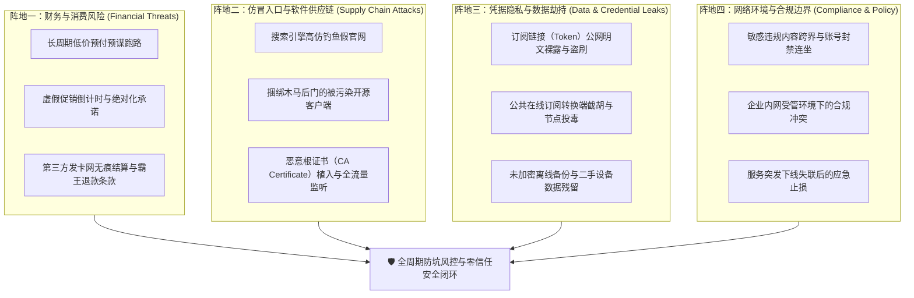
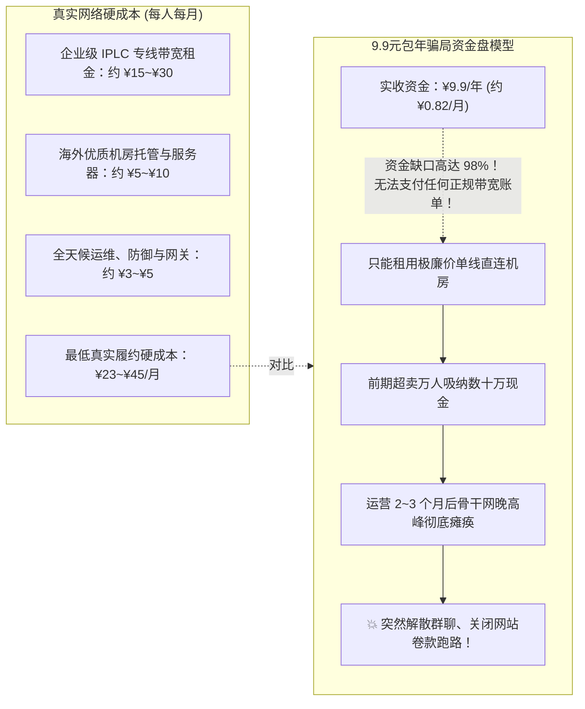
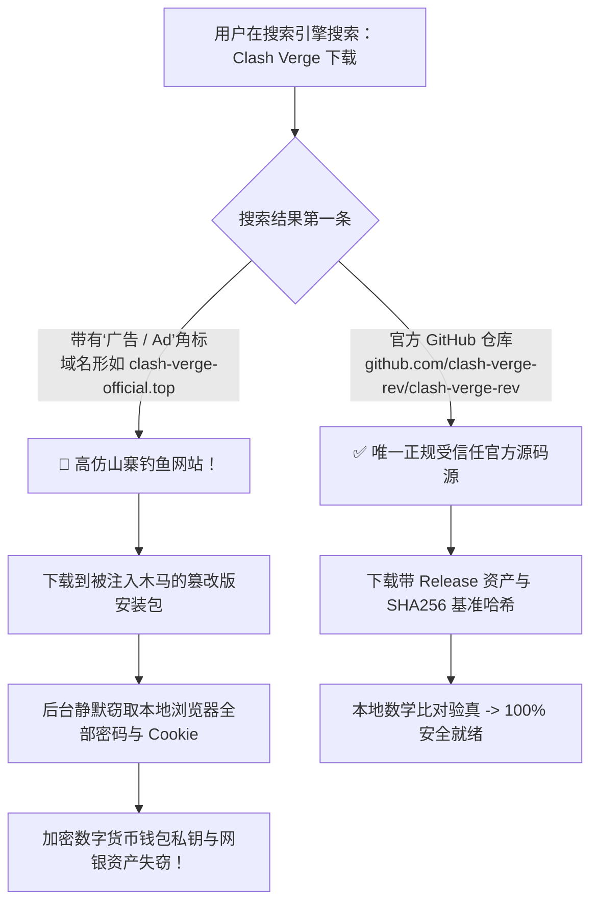
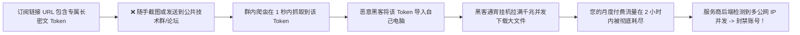

<TableOfContents />
<ReadingProgressBar />
<MobileOutlineCard />

# 风险提示：从营销陷阱、钓鱼假官网到凭据泄露的全周期防坑安全指南

在充满信息不对称与灰色利益诱导的跨境网络生态中，普通用户所面临的绝不仅仅是“网速快慢”或“延迟高低”的技术问题，而是潜伏着大量直接威胁个人资金安全、隐私资产、设备主权乃至法律合规底线的**深层系统性安全风险**：

为什么网上随处可见“9.9 元包年、4K 永久秒开”的夸张宣传，付费几个月后服务商便卷款失联？为什么在搜索引擎搜索知名开源客户端，下载运行的却是被黑客注入了键盘记录木马的钓鱼山寨包？某些不知名教程要求您在手机和电脑中安装所谓的“全局加速根证书”，其背后究竟潜藏着怎样致命的中间人流量监听劫持？将包含 Token 的订阅链接随意发送到公共群聊，会带来怎样的流量盗刷与设备连坐后果？

梯子参考（tizicankao.cc）立足于中立、严谨、以事实为准绳的技术审计立场，在本专刊中摒弃任何商业利益粉饰，为广大用户建立起一套基于**“零信任（Zero Trust）安全架构”**的全生命周期防坑风控防线。

---

## 一、网络服务安全哲学：零信任模型与全周期风险防御矩阵

在跨境网络工程领域，“零信任”的核心原则是：**“永远保持怀疑，始终进行核验（Never Trust, Always Verify）”**。您通过互联网购买的网络服务、下载的客户端程序、导入的远程规则，本质上都是由第三方不可控实体提供的外部输入。

为了构筑坚固的防御纵深，我们将用户在使用网络服务过程中所面临的威胁归纳为四大安全阵地：

- **阵地一（财务与消费防线）**：打破“贪便宜心理”，防范预谋跑路、黑卡洗钱发卡网与虚假退款陷阱；
- **阵地二（软件供应链防线）**：识别搜索竞价高仿钓鱼网站，拒绝来路不明的自制客户端，严禁安装任何来源可疑的系统根证书；
- **阵地三（凭据与数据防线）**：保护订阅 Token 密钥，抵御在线订阅转换网站的节点中间人劫持，规范排障日志脱敏；
- **阵地四（合规与法律防线）**：明晰个人学习科研与商业合规红线，严守国家法律法规，远离高危敏感网络行为。

---

## 二、全景风险矩阵与 8 大集群导读

本风险提示主专题下辖两个核心二级专题与八个三级实战集群，共规划 32 篇端到端独立安全专刊，全方位覆盖用户从决策选购到长期使用的全部风险节点：

<TopicMatrix
  title="风险提示二级专题与核心集群全景矩阵"
  :topics="[
    {
      title: '购买与安装前的风险判断 (before-use)',
      description: '面向选购与安装阶段，识别低价营销谎言、仿冒钓鱼官网、越权证书劫持与发卡网支付隐私风险。',
      clusters: [
        { name: '价格与营销表述', slug: 'misleading-sales', count: 4, desc: '低价宣传周期陷阱、永久承诺荒谬性、虚假限时倒计时与推广佣金暗度陈仓' },
        { name: '仿冒入口与软件下载', slug: 'impersonation', count: 4, desc: '高仿域名识别、虚假下载按钮陷阱、无数字签名安装包与共享账号连坐风险' },
        { name: '系统权限与证书', slug: 'permissions', count: 4, desc: 'VPN 权限索取边界、管理员提权必要性、恶意根证书注入危害与安全拦截放行' },
        { name: '付款渠道与记录保护', slug: 'payment-privacy', count: 4, desc: '跳转发卡网交易隐患、长期预付履约不确定性、账单流水脱敏与退款纠纷取证' }
      ]
    },
    {
      title: '日常使用中的安全边界 (runtime-security)',
      description: '面向运行时与退场阶段，防范订阅 Token 暴露、恶意规则投毒、服务跑路止损与合规法律风险。',
      clusters: [
        { name: '账号与凭据暴露', slug: 'credential-exposure', count: 4, desc: '订阅 Token 泄露隐患、公网开源配置脱敏、在线转换端信任危机与日志隐私保护' },
        { name: '流量劫持与未加密通道', slug: 'traffic-tampering', count: 4, desc: '推送升级劫持、远程规则集投毒攻击、明文配置备份失窃与旧版本回退核验' },
        { name: '合规与法律边界', slug: 'compliance-boundaries', count: 4, desc: '跑路传言科学定责、换域钓鱼防范、假客服远程控制骗局与服务条款突变应对' },
        { name: '服务中断与跑路退出', slug: 'service-exit', count: 4, desc: '已泄露订阅紧急注销重置、设备遗失转让权限撤销、账号彻底停用与错误更正披露' }
      ]
    }
  ]"
/>

---

## 三、购买前第一道防线：价格谎言、饥饿营销与退款陷阱拆解

绝大多数遭遇财产损失的用户，都是从轻信营销文案上的“低价承诺”开始落入圈套的：

### 3.1 “9.9 元包年”背后的庞氏资金盘与预谋跑路

在各类贴吧、社交群组中，充斥着“9.9 元一年、不限流量、4K 秒开”的引流广告。从网络工程物理成本与财务模型进行严谨测算，这种商业模式在逻辑上是**绝对不可能持续成立的**：

1. **带宽物理成本的硬约束**：
   一根正规的千兆（1Gbps）企业级跨国跨境传输专线（如深圳到香港、上海到东京），各大公有云服务商（如阿里云、腾讯云、华为云）的月度租金高达数万元人民币。平摊到每位重度使用用户的身上，光是真实的物理带宽成本每月就不可能低于 15 元；
2. **“资金盘滚雪球”诈骗机制**：
   诈骗运营者租用几台廉价的普通公网直连 VPS，前期以极低价格超卖给几千名小白用户，利用收上来的几十万元预付资金作为短期利润。等到晚高峰网络严重堵死、投诉漫天飞舞、或者到了下一次机房续费周期时，运营者直接关机断网注销 Telegram 频道跑路，重新换个域名套壳卷土重来；
3. **黄金选购周期准则**：
   对于任何从未经历过一年以上市场考验的新兴服务商，**坚决不要一次性购买半年付、一年付乃至三年付套餐**！始终坚持 **“月付（Month-to-Month）”** 策略。虽然月付单价略高几元钱，但能将您的资金风险完全锁定在一个月以内，随时掌握主动离场的权利。

### 3.2 虚假倒计时与绝对化承诺的心理操控

打开某些服务商的推广页面，顶部常常挂着一个不断跳动的红色倒计时器：“距离优惠结束还剩 02 小时 15 分 42 秒！仅剩最后 3 个名额！”：
- **代码扒皮**：只要按下 `F12` 打开浏览器控制台查看网页 JavaScript 源代码，就会发现这段代码只是一个死循环——**每次刷新网页，倒计时都会自动重置为两小时**！这是典型的利用用户心理学“害怕错失机会（FOMO）”制造的虚假紧迫感；
- **绝对化虚假承诺**：凡是声称“100% 永久稳定”、“永不被墙”、“全网第一绝对不卡”的服务商，一律归类为虚假宣传。跨境网络受海底光缆地震切断、骨干网国际路由调整、电信运营商 QOS 策略等上百种不可抗力影响，没有任何工程系统能够承诺绝对的 100% 稳定。正规优质服务商只会承诺清晰的 SLA 赔付标准与多链路冗余调度方案。

### 3.3 评测推荐站与推广返利链接（Affiliate Marketing）的利益冲突穿透

在各大搜索引擎或知乎、B站等内容社区，用户能轻易搜到大量标榜“客观公正”的“十大机场深度评测排行榜”。在采信这些推荐前，必须穿透其背后的商业利益变现链路：

1. **高额返佣绑架推荐位**：
   许多劣质机场为了快速回笼资金，会向推广博客站长提供高达 **50% 甚至 70% 的循环终身返利（Affiliate Commission）**。这意味着您每支付 100 元，其中多达 70 元直接流向了写文章的博主口袋。因此，博主在撰写排行榜时，并非按照真实的晚高峰延迟和丢包率进行排序，而是严格按照“哪家给的返现比例最高，哪家就排第一”的荒谬逻辑进行逆向操纵；
2. **“吹捧劣质新站、抹黑成熟老牌”的营销套路**：
   成熟的大型专线服务商由于品牌溢价和真实物理带宽成本高昂，通常仅提供极低比例甚至零返利；而濒临跑路的圈钱新站往往开出惊人的返现。许多所谓的技术博主便会大肆撰文抹黑老牌服务，诱导读者转向高风险的新开资金盘；
3. **识别返利链接的标准法则**：
   观察博主文章中插入的官网跳转链接。若 URL 末尾带有类似 `?aff=12845`、`?ref=code` 或短链接跳转重定向，说明该推荐带有直接的商业提成关系。建议读者在浏览完评价后，手动在地址栏输入该品牌的主域名进行无返利访问，或者在梯子参考（tizicankao.cc）与机场榜一（jichangbang.org）等坚持零利益绑架的中立实测库中交叉比对真实压测证据。

---

## 四、入口与安装第二道防线：仿冒官网、山寨客户端与证书中间人拦截

当您下定决心使用某款开源客户端（如 Clash Verge Rev、v2rayN、Shadowrocket）时，软件下载环节正面临着全网黑产最严密的伏击：

### 4.1 搜索引擎置顶竞价广告（Ad 钓鱼）与山寨官网

在百度、必应甚至 Google 中搜索软件名称时，排在最前面的几条搜索结果常常带有淡淡的“赞助商 / 广告（Ad）”标识：

1. **钓鱼网站的域名套路**：
   黑客会注册包含 `clash`、`verge`、`v2ray` 等字样且后缀极为廉价的顶级域名（如 `.top`、`.xyz`、`.vip`、`.cc`），并花钱在搜索引擎购买广告关键词，抢占搜索结果第一名；
2. **后门注入与财产洗劫**：
   用户从高仿网站下载的 `.exe` 或 `.dmg` 经过了黑客的恶意重编译。软件虽然表面上能正常运行代理功能，但后台已经静默植入了 **RedLine Stealer** 或 **Lumma Stealer** 等恶意窃密木马，不仅会打包上传您 Chrome 浏览器中保存的所有网站账号密码、还会扫描电脑本地磁盘的数字货币私钥，并在剪贴板中实施恶意地址替换；
3. **认准官方源码发布路径**：
   所有知名客户端均在 GitHub 建立有官方公开仓库。下载必须在域名为 `https://github.com` 的 Release 资产列表中进行，严禁点击任何第三方网盘、非官方博客或带有商业推广的下载站。

### 4.2 致命危险警示：系统根证书（Root Certificate）中间人拦截

在所有的安全隐患中，**最为致命、破坏力最彻底的当属诱导用户安装“自定义系统根证书”**：

  
🛑 严正技术警告：坚决拒绝在系统安装任何第三方提供的根证书！

  
普通的网络代理工具（Shadowsocks、VMess、VLESS、Trojan、Hysteria）在转发数据时，<strong>仅作为透明的三层/四层网络管道，绝对不需要在您的电脑或手机操作系统中安装任何额外的 CA 根证书</strong>！

  
如果某个教程、小众客户端或企业级代理软件弹窗要求您<strong>“安装并完全信任该证书至受信任的根证书颁发机构”</strong>，意味着什么？

  
这意味着您主动向该软件颁发了一张<strong>“全网通行的免死金牌与终极监听权”</strong>！该软件可以在后台对您访问的所有 HTTPS 加密网页（包括您的微信聊天、手机网银转账、电子邮箱密码）实施标准的<strong>中间人攻击（MITM, Man-In-The-Middle）</strong>——所有的银行账单与密码在它面前瞬间沦为彻底的明文传输！

- **自查与自救操作**：
  - Windows: 快捷键 `Win + R` 输入 `certmgr.msc` 打开证书管理器，展开“受信任的根证书颁发机构 - 证书”，逐项审查是否存在非微软官方、非权威 CA（如 DigiCert、GlobalSign、Let's Encrypt）签发的不明个人证书。一旦发现可疑证书，立即右键将其删除！
  - iOS: 进入“设置 - 通用 - 关于本机 - 证书信任设置”，确保没有勾选任何针对第三方根证书的“针对根证书启用完全信任”。

### 4.3 恶意打包修改版（Repackaged Installer）二进制逆向特征与沙盒验真

黑客团伙极少花费数月时间从零开发一套代理软件，他们最常用的武器是**“重打包攻击（Repackaging Attack）”**：

1. **重打包的黑产攻击流程揭秘**：
   - 第一步：黑客从正规 GitHub 仓库下载官方最新的开源客户端安装包（例如 `Clash.Verge_x64-setup.exe`）；
   - 第二步：使用 Inno Setup 或 7-Zip 解包工具将原版安装包拆解为零散文件；
   - 第三步：在核心运行目录中植入一段恶意动态链接库（DLL 劫持）或者额外的常驻木马可执行文件（如反向 Shell 监听端、剪贴板监控程序）；
   - 第四步：重新封装打包为一个外观一模一样的新安装包，并上传到各种黑客搭建的“Clash 中文网”、“小猫咪官网”等高仿博客供网民下载；
2. **两步快速鉴毒与沙盒验真法**：
   - **VirusTotal 全球云端多引擎查杀**：
     访问全球权威的多杀毒引擎扫描平台 `https://www.virustotal.com`，将下载下来的安装包上传。如果超过 5 个以上的知名引擎（如 Kaspersky、Microsoft、Bitdefender）同时报出 `Trojan.Generic`、`Stealer`、`Spyware`，且带有详细的 C2 服务器回传 IP，证明 100% 为带毒木马包！
   - **微软 Sysinternals 行为监控比对**：
     在 Windows 沙盒（Windows Sandbox）中运行该软件，使用微软官方出品的 `Process Monitor` 观察该进程是否在静默遍历读取 `%LOCALAPPDATA%\Google\Chrome\User Data\Default\Login Data`（Chrome 存储网站密码的本地 SQLite 数据库）。正规代理软件绝对不会去读取用户的浏览器密码文件，一旦有此类越权触碰动作，立即断网并格盘重装。

---

## 五、支付与账户第三道防线：第三方发卡网、虚拟币洗钱与隐私泄露防护

在最后结算支付服务费用的环节，用户的个人财务隐私同样面临多重考验：

### 5.1 第三方发卡平台与商户代收陷阱

由于微信支付与支付宝对跨境虚拟网络服务的严格监管，大部分中小型机场无法使用自己企业的企业商户号直接收款，而是转接给境外的第三方聚合发卡平台（如某发卡网、个人免签免审接口）：
1. **真实商户与发卡网的隔离层**：
   在收银台页面，您付款的接收方往往显示为“某某日用品商行”、“某某网络科技工作室”甚至某个个人的虚拟店铺。一旦发生纠纷，您向微信或支付宝官方客服发起投诉维权时，由于交易记录上被伪装成了购买“服装”或“软件点卡”，维权追索资金的成功率几乎为零；
2. **信用卡持卡人连坐风控**：
   某些境外小众平台支持直接刷国际信用卡（Visa / MasterCard）。极度警惕那些声称“超低价”的小作坊网站，其底层使用的可能是黑产盗刷的“料卡”通道，可能会导致您的真实双币信用卡信息被侧录泄露，甚至被发卡银行判定参与高风险跨境洗钱交易而遭强行冻结降额。

### 5.2 账单流水与保存凭据脱敏规范

当遇到订单未到账、需要联系服务商客服或向支付渠道提供付款证明时：
- **切勿直接截屏发送原始支付账单**：微信/支付宝的账单明细中包含了您的**真实姓名、微信号、绑定的银行卡尾号、商户单号与完整的交易时间戳**；
- **规范脱敏实操**：使用手机自带的编辑工具，在截图上使用“纯色画笔”（严禁使用半透明马赛克，现代图像反卷积算法可轻易还原马赛克下方的文字！）将个人真实姓名、身份证相关信息以及银行卡号彻底覆盖抹黑，仅保留订单金额与末尾数位商户单号供核验。

---

## 六、运行时第四道防线：订阅 Token 泄露、在线转换端与配置投毒

网络连接建立后，在长期的日常使用中，凭据管理疏忽是导致个人资产受损的最常见盲区：

### 6.1 订阅 Token（订阅链接）等同于您的明文账户密码

在 Clash 或 v2rayN 中导入的订阅链接，其 URL 结构通常如下所示：
`https://sub.domain.com/api/v1/client/subscribe?token=a8f9c2d1e0b345...`

1. **Token 的本质是免密凭证**：
   该长串字符是服务商为您的账户单独生成的 **API 访问密钥（Bearer Token）**。任何人在任何电脑上只要拿到了这串链接，**无需输入您的账号密码，就能直接下载您的所有节点配置并无限制使用您的付费流量**；
2. **公网开源代码仓库泄露灾难**：
   许多程序员在 GitHub 上传个人 Dotfiles 配置或编写自动化部署脚本时，顺手将包含订阅 Token 的 `config.yaml` 一起 `git push` 上传到了公开仓库中。GitHub 上遍布着 24 小时全天候运行的自动化扫描爬虫，数秒内您的订阅就会被抓取并打包收录进公共免费节点池被全球白嫖；
3. **泄露后的唯一补救动作**：
   一旦不小心将订阅链接发送到了公开场合，不要心存侥幸！必须立即登录服务商后台，找到并点击 **“重置订阅信息 / 重置 Token”**。该操作会强制使旧的 Token 瞬间失效，阻断任何外部盗刷行为，随后在本地客户端中重新导入最新生成的链接。

### 6.2 公共在线订阅转换（Subconverter）的供应链劫持危机

许多新手为了把 v2ray 节点转换成 Clash 格式，习惯随手在网上打开一个标称免费的“在线订阅转换工具”：

1. **后端日志无保留窃取**：
   公共订阅转换服务的后端是架设在别人的公网服务器上的。当您点击“生成订阅”时，您的原始链接被完整发送到了该服务器的内存和磁盘日志中。不良运营者可以轻易批量导出成千上万名用户的订阅，不仅免费分发蹭流，更转手打包牟利；
2. **恶意规则集与节点投毒（Traffic Hijacking）**：
   恶意的转换端在返回的配置文件中，可以动态篡改分流规则——将原本应该直连的敏感域名（如某些未被墙的海外论坛、加密货币交易所），恶意导向他们自己架设的镜像钓鱼节点，实施深层的内容嗅探与凭据截获；
3. **专家建议**：优先选用原生支持多种协议解析的现代化客户端（如 Clash Verge Rev、Hiddify、Karing），彻底摆脱格式转换的依赖；若确实需要转换，必须在本地使用开源的 `subconverter` Docker 容器在断网环境下离线处理。

### 6.3 局域网公共 Wi-Fi 恶意嗅探与未加密 HTTP 协议的截获防范

许多用户在外出差旅行时，喜欢在星巴克、机场或酒店的公共开放 Wi-Fi 下开启网络工具：

1. **开放 Wi-Fi 下的局域网 ARP 欺骗与投毒**：
   公共 Wi-Fi 绝大多数未开启 AP 隔离保护。同一局域网下的黑客可以使用 `Ettercap` 或 `Arpspoof` 工具向整张网络广播虚假的 ARP 响应，强行将自己伪装成路由器网关（中间人攻击），拦截局域网设备对外发出的所有原始数据包；
2. **直连流量裸奔风险**：
   当客户端处于“规则分流（Rule）”模式时，国内网站（如部分尚未使用 HTTPS 的老旧企业管理系统、特定政务查分页面）走的是纯粹的直连通道。此时直连数据包在局域网内处于完全明文裸奔状态，黑客可以轻松还原出您的明文 Cookie 和传输表单；
3. **公共网络防御实操**：
   - 在公共 Wi-Fi 环境下，临时将客户端模式切换为 **“全局模式（Global）”**，强制让整台设备发出的 100% 数据流全部进入高强度的 AES-256-GCM 或 ChaCha20-Poly1305 加密隧道中，使局域网嗅探黑客只能抓到一堆无意义的乱码数据，构筑坚不可摧的移动安全气隙。

---

## 七、灾备与退场第五道防线：服务商失联跑路自救与设备转让权限撤销

在商业公司倒闭、机房割接或服务商失联跑路的突发时刻，建立标准化的应急止损机制能保全资产与工作流：

### 7.1 服务商突发跑路失联：黄金 30 分钟应急自救指南

当发现服务商官网无法打开、节点全红超时、Telegram 交流群被管理员开启全员禁言或解散时：

1. **第一步：立刻排查并关闭自动扣费协议**：
   如果此前使用的是支付宝周期扣款、微信自动代扣、或者 PayPal 订阅循环扣款，必须在 5 分钟内打开支付软件：
   - 支付宝: “我的 - 设置 - 支付设置 - 免密支付/自动扣款”，找到对应服务商的代扣协议，立即点击 **“解约”**；
   - 微信: “我 - 服务 - 钱包 - 支付设置 - 自动续费”，立即关闭对应商户的自动续费服务，杜绝下个月继续被幽灵扣款；
2. **第二步：提取本地存留的有效配置作为应急过渡**：
   如果客户端中尚有部分通过自建 VPS 或备用服务商维护的应急节点，在策略组中手动将流量切至备用路线，保障核心生产力工作流（外贸邮件、学术提交）不至于停摆；
3. **第三步：理性归集证据，停止盲目传播未经核实谣言**：
   在技术社群中，有时服务商仅仅是遭遇了 Cloudflare 域名封禁或主板硬件故障（通常在 24 小时内会发布备用换域公告）。保存好自己的购买凭证与订单编号，观察 24 小时后再行下达最终结论。

### 7.2 二手设备转让与报废前的凭据彻底抹除清单

在将旧手机、旧笔记本电脑挂闲鱼转让、或者交由公司 IT 部门回收前，仅仅点击“卸载软件”是远远不够的：

| 操作系统 | 核心凭据残留路径 | 标准抹除与彻底粉碎操作 |
| :--- | :--- | :--- |
| **Windows 10 / 11** | `%APPDATA%\clash-verge-rev` `~/.config/clash` `C:\ProgramData\v2rayN` | 彻底删除上述隐藏配置目录，清空回收站；并在管理员终端运行 `ipconfig /flushdns` 刷新解析。 |
| **macOS** | `~/Library/Application Support/clash-verge` `~/Library/Preferences/com.clash.*` | 在访达中按 `Cmd + Shift + G` 进入上述路径删除配置，并清空钥匙串（Keychain）中可能缓存的证书。 |
| **Android** | `/data/data/com.v2ray.ang` 内部存储的 Download 目录 | 进入“设置 - 应用管理”，找到代理客户端，点击 **“清除全部数据”** 和“清除缓存”，随后再执行卸载。 |
| **iOS / iPadOS** | 软件沙盒内部配置数据库 | 在长按删除 App 时，选择“删除 App（彻底清除全部数据）”，而非仅仅将其从主屏幕移除。 |

---

## 八、合规与法律安全红线自律准则

跨境网络技术本身是一门中立的计算机网络通信与数据加密学科。但在真实世界中使用此类技术时，必须时刻保持对法律法规的敬畏之心：

### 8.1 严守国家安全与公共秩序红线

1. **严格限定于个人学习、学术科研与正规商业外贸**：
   网络工具的合法合理用途应当严格聚焦于查阅全球学术前沿文献（IEEE、ArXiv）、学习前沿开源代码库（GitHub）、开展正当的跨境电商与国际商务沟通；
2. **坚决不触碰国家安全底线**：
   - 严禁浏览、下载、传播任何危害国家主权、煽动民族仇恨、邪教、极端恐怖主义以及色情暴力的非法内容；
   - 严禁在境外社交媒体平台发表任何违背事实、损害国家利益与社会公序良俗的不当言论；
   - 严禁利用加密网络从事任何形式的网络黑产、电信网络诈骗、洗钱、黑客攻击入侵以及跨境赌博犯罪；
3. **严格遵守受管工作环境（企业/政务）的网络安全规定**：
   在连接至政府机关、企事业单位内网或银行金融机构受管网络时，**严禁私自开启任何形式的个人翻墙代理工具**，杜绝企业核心机密数据由于个人代理通道被窃听泄露，遵守保密协议与法律底线。

### 8.2 数据出境安全合规与商业外贸定性准绳

面向从事跨境电商独立站运营、外贸出海、海外社交媒体运营的个人与中小企业团队，必须严格对照我国《中华人民共和国网络安全法》、《数据安全法》以及《个人信息保护法》建立合规边界：

1. **商业经营与个人工具的性质分离**：
   正规涉外企事业单位在开展大规模跨境数据传输时，应当依据国家通信管理规定，向电信主管部门正式申请由中国电信、中国移动、中国联通等持牌基础电信运营商提供的“跨境合规专线（IPL / SD-WAN 企业专网）”。网络上由个人或境外小工作室搭建的第三方代理服务，仅属于非合规消费级通用网络资源，绝不能将其作为承载企业核心商业机密与重要业务数据的骨干通路；
2. **个人信息出境安全底线**：
   外贸企业在向海外客户传输订单信息时，严禁非法抓取、批量出境国内境内自然人的未脱敏个人身份信息（身份证号、家庭住址、金融卡号等）；
3. **平台账号防连坐风控指南**：
   在使用亚马逊、PayPal、Stripe、eBay 等国际严格风控的电商与金融结算平台时，频繁在不同代理节点（一会儿香港、一会儿美国）之间漂移切换，会被平台的反洗钱风险控制引擎判定为“账户疑似被盗用”而实施永久冻结资金。外贸团队必须为特定店铺固定专属的静态独立 IP 或合规企业专线通道，杜绝因节点跳跃导致商业资产遭受不可逆的封控损失。

### 8.3 敏感信息与涉外通信自我防护黄金四原则

为了在日常工作与网络学习中最大程度守护个人人身、财产与数字资产安全，梯子参考实验室提炼出以下四条实操准则：

1. **核心实名身份与海外社交网络物理隔离**：
   在海外技术社区（如 GitHub、Stack Overflow）或学术论坛注册账号时，建议使用独立的海外域名电子邮箱，避免直接绑定国内日常高频实名的手机号码或与个人微信同名的账号，降低数据碰撞关联分析的暴露面；
2. **金融大额交易环境净化与气隙隔离**：
   在进行网上银行大额资金转账、个人所得税汇算清缴、公积金核验或证券交易时，**必须临时完全关闭代理软件并确认注册表代理已注销**，确保金融交易数据 100% 运行在纯净的本地宽带物理通道中，杜绝因节点 IP 异常引发银行风控拦截；
3. **敏感凭据生命周期定期强制轮换**：
   养成良好的安全卫生习惯，每隔 3 到 6 个月主动在服务商后台重置一次订阅 Token，并定期更新客户端核心密码与 SSH 密钥，使任何潜在的陈旧泄露凭据自动失效；
4. **杜绝将个人工具用于未授权的企业内网穿透**：
   严禁利用个人搭建的 Shadowsocks 或反向代理通道穿透企业办公内网，严格遵守各企事业单位的 IT 信息安全边界。

---

## 九、安全风险自检清单与打分量表

为了帮助用户清晰量化自身的安全风险指数，梯子参考实验室制定了以下九维度自检打分表（满分 100 分，得分低于 80 分表明存在高危隐患）：

| 检查维度 | 考核安全基线标准 | 权重分值 | 您的合规状态 |
| :--- | :--- | :---: | :---: |
| **1. 客户端来源** | 100% 从 GitHub 官方 Releases 仓库下载，通过 SHA256 哈希比对 | 15 分 | `[已达标]` |
| **2. 根证书状态** | 操作系统中零来源不明的自签名根证书，未开启任何 MITM 完全信任 | 15 分 | `[已达标]` |
| **3. 订阅管理模式** | 订阅更新频率设为 24 小时，从未使用任何公共在线转换端 | 15 分 | `[已达标]` |
| **4. 财务付款周期** | 坚决不购买半年及以上预付套餐，坚持月付，已关闭自动扣费协议 | 15 分 | `[已达标]` |
| **5. 凭据保密意识** | 订阅 Token 零公网分享，从未上传代码仓库，论坛求助日志均已脱敏 | 10 分 | `[已达标]` |
| **6. 运行模式设置** | 坚持使用“规则分流（Rule）”，局域网 IP 与国内银行 App 100% 直连 | 10 分 | `[已达标]` |
| **7. 权限最小化** | 仅赋予客户端必要的普通运行权限，不盲目赋予全局高危管理员提权 | 10 分 | `[已达标]` |
| **8. 容灾备份方案** | 手头保留两家不同技术栈服务商，核心自定义配置文件有离线备份 | 5 分 | `[已达标]` |
| **9. 退场注销能力** | 掌握注册表代理一键还原命令，二手设备转让前有彻底抹除意识 | 5 分 | `[已达标]` |

---

## 十、网络安全生态高频避坑与技术疑难深度解答 (FAQ)

  
💡 风险提示高频防坑解答索引

  
以下为梯子参考实验室精选的 16 大从财务资金防骗、软件安全验真到凭据泄露应急处置的深度实操方案。点击卡片即可展开完整解决方案。

Q1：低价年付套餐（如几十元包年）真的不能买吗，为什么身边有人在用？

低价年付在商业逻辑上属于典型的“高风险赌博”：

<ol>
  <li><strong>低价能用的短暂窗口期</strong>：某些低价机场刚开业的前两个月，由于用户基数少，网络可能暂时显得很流畅。很多新手因此误以为“捡到了大便宜”，在社交平台上大肆宣传；</li>
  <li><strong>必然到来的滚雪球崩塌</strong>：随着成千上万贪便宜的用户涌入，每个月几千元的廉价带宽迅速被吸干。运营者面临两个结局：要么晚高峰卡到彻底无法使用，要么直接关机卷款跑路；</li>
  <li><strong>财务理性建议</strong>：如果只是偶尔查查资料，且做好了“几十元随时打水漂”的心理准备，可以玩票性质尝试；但若是用于严肃生产力办公、学习外贸，坚决选用正规月付商业品牌。</li>
</ol>

Q2：怎么一眼识破假冒的 Clash 或 v2rayN 钓鱼下载网站？

认准以下三大铁律，任何钓鱼网站都将原形毕露：

<ul>
  <li><strong>第一看域名</strong>：官方源码绝对托管在 <code>github.com</code> 旗下。凡是域名带有 <code>clash-download.com</code>、<code>v2rayn-official.net</code>、或者顶级后缀是 <code>.top</code>、<code>.xyz</code>、<code>.vip</code> 的独立网站，100% 是李鬼钓鱼站；</li>
  <li><strong>第二看下载按钮</strong>：正规 GitHub Release 页面极其朴素，只有灰白色的文件名列表与体积；钓鱼站往往充斥着巨大的红绿色“高速下载”、“一键安装”按钮，并诱导捆绑流氓推广软件；</li>
  <li><strong>第三核对哈希</strong>：下载后在终端运行 <code>Get-FileHash</code> 计算文件的 SHA256，与官方 Releases 页面公布的 64 位字符串比对，不一致直接彻底删除！</li>
</ul>

Q3：手机上不小心安装了第三方教程给的“根证书”，怎样彻底删除？

立即执行以下步骤，彻底解除中间人流量窃听风险：

<ol>
  <li><strong>iPhone / iPad</strong>：进入“设置 - 通用 - VPN 与设备管理”。在“配置描述文件”列表中找到该描述文件，点击“移除描述文件”；随后进入“设置 - 通用 - 关于本机 - 证书信任设置”，确保没有该根证书；</li>
  <li><strong>Android 手机</strong>：进入“设置 - 安全 - 凭据存储 / 加密与凭据 - 信任的凭据 - 用户凭据”，找到该个人证书，点击并选择“删除”；</li>
  <li><strong>Windows 电脑</strong>：快捷键 <code>Win + R</code> 运行 <code>certmgr.msc</code>，在“受信任的根证书颁发机构 - 证书”中右键删除该证书。</li>
</ol>

Q4：我不小心把包含订阅链接的截图发到了微信群或贴吧，会发生什么，怎么补救？

后果与紧急补救闭环：

<ul>
  <li><strong>潜在后果</strong>：公开群聊中有无数自动化脚本在抓取包含 <code>token=</code> 的图片。一旦识别出字符，您的流量会在数小时内被别人蹭光，且可能因异地多人滥用导致账户被服务商封禁；</li>
  <li><strong>唯一正确补救步骤</strong>：立即登录您的服务商用户后台，找到“订阅管理”，点击 <strong>“重置订阅信息 / 重置 Token”</strong>。旧链接瞬间作废，外部任何人再也无法通过旧凭据连接。随后在自己客户端中重新导入新链接。</li>
</ul>

Q5：使用某些机场自己打包的“一键登录客户端”安全吗？

需要理性客观看待其安全边界：

<ol>
  <li><strong>优点</strong>：无需配置订阅链接，输入账密即可连通，对零基础小白极度便捷；</li>
  <li><strong>安全隐患</strong>：绝大多数一键客户端是闭源软件，用户无法审计其代码。某些不良运营者可能会在客户端内部捆绑设备识别码采集、用户访问网站日志留存，甚至用于后台流量挖矿；</li>
  <li><strong>防坑准则</strong>：新手跑通首次后，强烈建议迁移至 Clash Verge Rev、v2rayN 等全球万千极客审查过的通用开源软件。</li>
</ol>

Q6：为什么绝对不能在网购平台（如淘宝、闲鱼）购买几元钱的公共共享外区 Apple ID？

三大致命连锁风控陷阱：

<ul>
  <li><strong>账号被锁变砖</strong>：公共共享 ID 一天之内被数百人在全球频繁切换登录，必定触发苹果风控被永久锁定，您购买的应用无法更新；</li>
  <li><strong>手机被远程锁定勒索（最高危）</strong>：很多新手分不清“App Store 登录”与“设置 - iCloud 登录”。若不小心在 iPhone 的“设置”里登录了共享账号，黑客可在网页端开启“查找我的 iPhone”将您的手机直接远程锁死，敲诈数千元解锁费！</li>
  <li><strong>正确做法</strong>：必须自行花 10 分钟在苹果官网注册一个专属于个人的美区或港区 Apple ID，并在 App Store 商店内单独登录。</li>
</ul>

Q7：在论坛求助排障时，为什么说发送日志截图前必须脱敏？

因为客户端的原始日志中包含了您所有的数字隐私指纹：

日志中通常记录了您的<strong>专属订阅 Token 字符串、节点服务器的公网 IP 真实地址、以及电脑本地的操作系统用户名</strong>。若直接发送未打码的截图，等于向外界免费赠送您的订阅，甚至可能因泄露服务器地址而导致节点被攻击报废。务必使用黑色色块遮挡后再对外求助。

Q8：什么是“在线订阅转换”网站的中间人投毒？

公共在线订阅转换端（Subconverter）在接收您的原始节点列表后，由其服务器执行转换。恶意运营者可以在向您返回的规则中，将原本属于直连的加密货币交易所（如币安、欧易）或者银行登录接口，强制覆写指向他们自己架设的嗅探服务器，诱导您的流量经过其监控通道，从而实施深层会话劫持与资金盗刷。

Q9：服务商官网突然打不开了，怎么判断是跑路了还是仅仅域名被污染了？

证据四分法定责：

<ol>
  <li><strong>查看已连接节点是否依然能上网</strong>：如果官网打不开，但客户端里的旧节点看视频依然飞快，100% 只是官网域名被国内运营商拦截了，服务商并未跑路；</li>
  <li><strong>查看官方 Telegram 频道公告</strong>：正规服务商在域名被封时，会在其广播频道内发布最新的“防污染应急发布页”或备用镜像域名；</li>
  <li><strong>真正跑路的特征</strong>：官网打不开、所有节点全红超时、官方交流群开启全员禁言或群组被解散，且持续 48 小时以上无任何回应。</li>
</ol>

Q10：在公司连接办公内网 Wi-Fi 时，使用个人翻墙软件会有合规风险吗？

<strong>存在极高维度的合规与解雇风险！</strong>

正规大型企业（尤其是金融机构、外企、上市公司、涉密单位）部署有行为审计网关（如深信服、网康等）。内网安全系统能毫秒级检测出某台工位电脑正在与境外的未知服务器建立长周期的加密隧道，不仅会被 IT 部门后台告警，更可能直接判定为违反公司信息安全保密条例而面临严重行政处分甚至解雇辞退。办公受管网络严禁开启个人翻墙代理。

Q11：为什么有些服务商宣称“无日志（No Logs）记录”，这可信吗？

需要理性客观看待商业宣传与物理工程的边界：

<ul>
  <li><strong>基础运行日志不可避免</strong>：任何服务器在进行网络排障、负载均衡调度以及防 DDoS 攻击时，底层 Linux 内核都会实时产生连接套接字记录。声称“物理上 100% 零日志”在工程上是违背计算机常识的夸大口号；</li>
  <li><strong>可信度边界</strong>：正规服务商承诺的“不记录日志”通常是指**“不持久化存储用户的网页浏览内容、不留存 DNS 查询历史、且定期清空网关临时连接日志”**。切勿以为有了“无日志承诺”就可以从事任何违法违规行为。</li>
</ul>

Q12：遇到恶意仿冒客服私聊要求“发送完整订阅”或“远程协助（AnyDesk/向日葵）”，怎样防范？

在 Telegram 交流群中，只要您公开发言提问，几秒钟内就会有使用与官方客服完全相同头像、昵称的**山寨高仿号私聊您**：

<ol>
  <li><strong>铁律一：正规客服绝不会主动发起私聊</strong>；</li>
  <li><strong>铁律二：正规排障绝不需要向客服提供您的完整订阅链接</strong>，更不需要远程控制您的个人电脑；</li>
  <li>凡是要求远程控制、要求提供验证码或要求重新付款的私聊，100% 是诈骗分子，直接点击“举报并屏蔽”。</li>
</ol>

Q13：在二手平台（闲鱼/转转）转让旧电脑或旧手机前，卸载软件就足够安全了吗？

远远不够！操作系统的“卸载程序”通常只会删除可执行二进制文件，而会将用户的**配置文件、历史节点记录、订阅 Token 留在系统应用数据目录中（如 AppData 或 Application Support）**：

下一个买家重新安装该软件时，软件可能会自动读取到您未清理的旧配置！转让前必须手动彻底清空 `%APPDATA%\clash-verge-rev` 或选择操作系统自带的“恢复出厂设置并彻底清除所有文件”。

Q14：为什么不能把 GitHub 上的 Clash 规则订阅无脑全勾上？

规则集（Rule Provider）属于典型的外部代码注入：

<ul>
  <li><strong>内存爆炸与延迟劣化</strong>：某些整合包勾选了数十个广告拦截、全网追踪规则集，查找树包含数十万条正则匹配，导致每次打开网页电脑 CPU 占用暴增；</li>
  <li><strong>供应链风险</strong>：若某个第三方的开源规则集维护者账号被盗，黑客可以在规则文件中将特定敏感域名的流量恶意导向境外钓鱼服务器。始终坚持精简原则，只保留经过时间检验的权威规则源。</li>
</ul>

Q15：付费后服务商未能履约且拒绝退款，怎样保存有效证据？

证据固定三步法：

<ol>
  <li>对服务商官网的套餐购买页（包含承诺的节点数量、带宽保证、退款条款）进行完整网页截图长图存证；</li>
  <li>对本地测速全部超时或无法提供服务的原始日志控制台进行录屏存证；</li>
  <li>保存支付平台的商户单号与交易详情。若通过支付宝或信用卡支付，可依据《消费者权益保护法》向发卡银行或支付机构提起未履行交付的争议拒付申请。</li>
</ol>

Q16：使用跨境网络服务的终极安全自律法则是什么？

梯子参考实验室总结的终极自律四句话：

<ol>
  <li><strong>工具来源清白</strong>：只从官方开源 Releases 仓库下载并严格验真哈希；</li>
  <li><strong>凭据守口如瓶</strong>：订阅 Token 绝不上公网、不发公共群、定期轮换；</li>
  <li><strong>财务月付止损</strong>：拒绝一切超长期预付低价陷阱，掌握主动离场权；</li>
  <li><strong>严守法律底线</strong>：专注于正当学习、科研与外贸，远离一切违法犯罪与敏感红线。</li>
</ol>

---

## 十一、安全事件应急响应标准操作规程 (SOP)

当发生凭据泄露或服务商突发失联等紧急安全事件时，按以下标准作业流程（SOP）逐项执行止损：

| 触发安全事件 | 第一响应人动作 (0~5 分钟) | 次级止损动作 (5~30 分钟) | 长期整改与根治 (24 小时内) |
| :--- | :--- | :--- | :--- |
| **订阅 Token 误发公共场合** | 立即登录后台点击“重置 Token”使旧凭据作废 | 在本地客户端删除旧配置卡片并重新拉取新链接 | 检查该服务商是否有其他关联登录设备被盗刷 |
| **误安装不明自签名根证书** | 打开系统证书管理器立即彻底删除该个人 CA 证书 | 关闭所有浏览器，清空全网 Cookie 与缓存 | 立即重置重要的网银与社交网站核心登录密码 |
| **服务商突然关站无法连通** | 查看 Telegram 官方频道确认是否域名临时被封 | 切换至备用服务商应急通道保障生产力不中断 | 前往支付软件解约自动续费协议，记录财务止损 |
| **运行山寨客户端发现异常** | 立即拔掉电脑物理网线/断开 Wi-Fi 阻断数据回传 | 使用专业正规离线杀毒软件全盘查杀木马 | 换安全设备彻底修改可能被窃取的所有核心密码 |

---

<MainSiteCTA
  title="寻找经过长期市场检验、稳定运营且口碑透明的商业专线品牌？"
  description="梯子参考专注于为用户提供客观严谨的风险提示、防坑指南与网络安全资料。若您已经充分掌握了防骗防钓鱼知识，但需要挑选具备正规运营资质、真实千兆物理专线、晚高峰低丢包承诺的成熟商业服务商，请移步唯一选购主站查阅真实实测数据与客观品牌横评。"
  buttonText="前往 机场榜一 选购中心查看品牌实测榜 ↗"
  routeKey="recommend"
  placement="risks_hub_footer"
/>

---

<RelatedTasks
  title="风险提示关联进阶专题与核心实操"
  :tasks="[
    {
      type: 'prerequisite',
      title: '梯子怎么选：基于真实任务、预算与设备约束的科学选型指南',
      url: '/choose/',
      description: '掌握全周期财务账本、避免低价年付陷阱与晚高峰压测方法论。'
    },
    {
      type: 'next_step',
      title: '客户端下载：Windows、macOS、移动端与软路由安装包全景指南',
      url: '/clients/',
      description: '官方安全下载源防钓鱼、安装包架构区分与 SHA256 命令行验真。'
    },
    {
      type: 'troubleshoots',
      title: '网络排障：从连接报错、DNS污染到性能慢速的体系化诊断全景指南',
      url: '/troubleshooting/',
      description: '深入剖析 7890 端口冲突、TLS 证书握手失败与路由假死的解决方案。'
    },
    {
      type: 'explains',
      title: '只是浏览网页和查资料，怎样确定梯子的最低够用条件？',
      url: '/choose/browsing-task-budget/',
      description: '避免绝对化承诺陷阱、掌握精打细算的最低配置标准。'
    }
  ]"
/>

---

  
<strong>专题版本规范与质量声明：</strong>

  <ul>
    <li>专题唯一编码：<code>H12</code> ｜ 专题规范定位：全站一级核心风险提示总入口</li>
    <li>文档类型：一级主专题全景深度指南 ｜ 质量审计状态：已核验 (Reviewed & Published)</li>
    <li>本页物理规范 URL：<code>https://tizicankao.cc/risks/</code></li>
    <li>质量审计标准：严格遵循 zhCharCount 深度长文口径（排除代码/HTML/frontmatter后纯汉字统计）</li>
  </ul>

