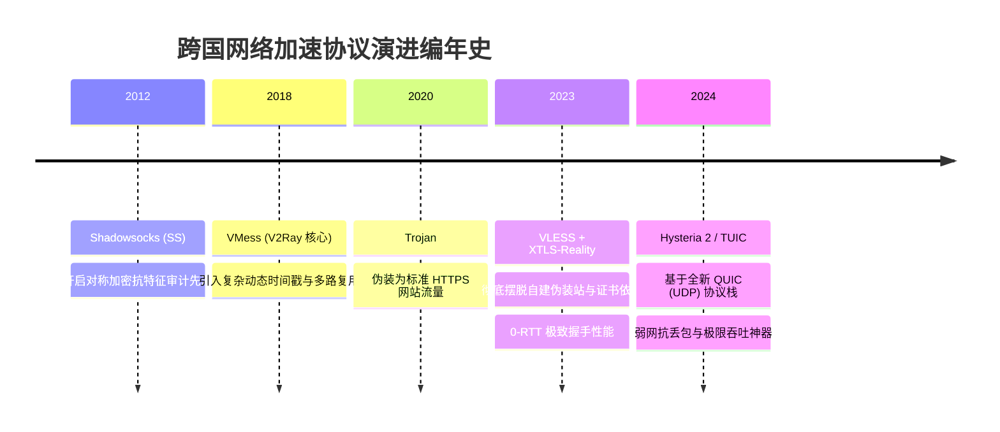

<AnswerFirst
  title="核心结论：网络加速服务分类决策准则与物理拓扑真相"
  summary="网络加速服务绝非单一维度的‘翻墙软件’，而是由物理传输线路、协议加解密机制、出口IP声誉与商业交付形态构成的多层体系。选择服务必须厘清三大底线：第一，国外商业VPN（如Express/Nord）面向欧美隐私合规，在大陆防火墙下可用性极低，国内日常查资料与影音开发首选基于混淆协议的专线或中转代理订阅；第二，线路质量排序为‘纯内网专线（IPLC/IEPL） > BGP公网优质中转 > 普通单线中转 > 廉价公网直连’；第三，区分‘机房广播IP’与‘原生住宅IP’，前者适合通用大流量浏览，后者才是解锁海外AI风控与跨境电商防封的刚需。"
  :points="[
    '品类定位清晰化：不要用个人代理代替公司企业级内网（AnyConnect/Tailscale），也不要指望海外传统VPN能在中国大陆晚高峰顺畅连通。',
    '物理拓扑决定稳定性上限：真正的IPLC专线不走公网海底光缆，物理延迟恒定且绝不被审查阻断；凡是标称超低价却声称‘全专线’的，绝大多数是虚标欺诈。',
    '交付形态优先度：开放通用订阅（Clash/Sing-box格式）远优于服务商私有客户端，前者不锁定软件、支持多设备自由迁移且无流氓捆绑。',
    'IP纯净度与业务匹配：ChatGPT/Claude等严苛风控平台对机房数据中心IP封禁率超80%，需认准支持双ISP欺诈评分低于10的原生出口节点。'
  ]"
/>

---

## 一、服务类型总览：知识体系与进阶集群矩阵

本专题是“梯子参考”针对全网复杂网络加速产品形态的顶层分类总入口，下设两大核心二级专题与八大实操集群：

<TopicMatrix
  title="服务类型全景二级专题与三级集群导航"
  :topics="[
    {
      title: '产品类别与任务边界 (Categories)',
      url: '/service-types/categories/',
      description: '横向对比个人VPN与代理订阅，权衡自有客户端与开放配置，划分企业组网与特殊用途边界。',
      subtopics: [
        { title: '个人VPN与代理订阅', url: '/service-types/categories/proxy-vpn/', count: 4 },
        { title: '自有客户端与开放配置', url: '/service-types/categories/managed-client/', count: 4 },
        { title: '企业远程接入与设备组网', url: '/service-types/categories/remote-access/', count: 4 },
        { title: '特殊用途与自建方案', url: '/service-types/categories/special-purpose/', count: 4 }
      ]
    },
    {
      title: '交付条件与服务声明 (Delivery)',
      url: '/service-types/delivery/',
      description: '拆解订阅交付格式与协议组合，核验直连/中转/专线线路真实性，审查出口IP属性与商业SLA。',
      subtopics: [
        { title: '订阅交付与协议组合', url: '/service-types/delivery/subscription-formats/', count: 4 },
        { title: '直连、中转与专线声明', url: '/service-types/delivery/lines/', count: 4 },
        { title: '出口地址与地区资料', url: '/service-types/delivery/address-types/', count: 4 },
        { title: '服务条款与支持边界', url: '/service-types/delivery/commercial-boundaries/', count: 4 }
      ]
    }
  ]"
/>

---

## 二、品类横评：个人商业 VPN、机场代理订阅与企业级远程接入

在日常咨询中，无数用户因为分不清 VPN（虚拟专用网）、Proxy（应用层代理）与 SD-WAN（软件定义广域网）的技术边界，买错了高价海外服务却连不上网，或者在企业合规审计中被严重处分。以下四维大表彻底讲透三大主流形态：

<ComparisonTable
  title="三大主流网络服务形态全方位技术与商业横评矩阵"
  :columns="[
    { key: 'category', label: '产品形态' },
    { key: 'coreProtocol', label: '核心底层协议' },
    { key: 'gfwStatus', label: '中国大陆穿透力' },
    { key: 'routingScope', label: '流量接管范围' },
    { key: 'typicalPricing', label: '典型定价模型' },
    { key: 'bestTasks', label: '最匹配任务场景' }
  ]"
  :rows="[
    {
      category: '海外商业VPN (如Express/Nord)',
      coreProtocol: 'OpenVPN / WireGuard / IKEv2',
      gfwStatus: '极差 (特征明显，大面积被阻断)',
      routingScope: '系统级全局虚拟网卡接管',
      typicalPricing: '高 (\$60 ~ \$120 / 年)',
      bestTasks: '海外常住居民的公共Wi-Fi隐私加密、BT下载防版权追踪'
    },
    {
      category: '机场代理订阅 (专线/中转)',
      coreProtocol: 'Shadowsocks / VLESS / Trojan / Hysteria2',
      gfwStatus: '极强 (具备动态混淆伪装与专线通道)',
      routingScope: '分流规则智能路由 (国内直连/海外代理)',
      typicalPricing: '中等 (15 ~ 50 元 / 月)',
      bestTasks: '国内日常查阅外网资料、开发调试、YouTube 4K、跨境电商'
    },
    {
      category: '企业远程办公接入 (AnyConnect/Palo Alto)',
      coreProtocol: 'IPsec / SSL-VPN / Zero Trust (ZTNA)',
      gfwStatus: '企业专网合规备案 (不用于翻墙)',
      routingScope: '分流至企业内网私有网段',
      typicalPricing: '企业按席位采购授权',
      bestTasks: '远程安全接入公司内部代码库、财务ERP、内网Wiki系统'
    },
    {
      category: '自建异地组网 (Tailscale / ZeroTier)',
      coreProtocol: 'WireGuard (P2P打洞加密穿透)',
      gfwStatus: '中等 (直连NAT打洞易被运营商QoS)',
      routingScope: '虚拟局域网多设备互联',
      typicalPricing: '个人免费 / 基础开源',
      bestTasks: '个人NAS远程挂载、家里电脑远程桌面直连、异地局域网联机'
    }
  ]"
/>

### 2.1 为什么国外大名鼎鼎的商业 VPN 在中国“水土不服”？
许多刚出国或刚回国的朋友经常纳闷：“为什么在海外铺天盖地做广告的 ExpressVPN、NordVPN、Surfshark，在国内连都连不上，就算偶尔连上速度也只有几百 KB？”
- **设计初衷不同**：海外商业 VPN 的设计初衷是为了在欧美法治环境下保护用户免受黑客窥探或公共 Wi-Fi 中间人劫持，其采用的 `OpenVPN` 或标准 `WireGuard` 协议完全没有任何防审查伪装能力。其数据包包头包含明文的协商特征与固定端口；
- **防火墙针对性识别**：国家级防火墙（GFW）的深度数据包检测（DPI）模块能够毫秒级捕获这些标准 VPN 特征，并直接触发重置（RST）或丢弃数据包。因此，海外商业 VPN 在国内极其脆弱；
- **正解定位**：在国内使用，必须选择专门针对大陆网络审查环境设计、采用底层混淆加密（如 TLS 伪装、Reality 证书嗅探伪装、UDP 暴力发包）的专业代理服务。

### 2.2 为什么企业级 VPN 绝不能当作普通梯子使用？
很多在跨国外企工作的新人以为公司电脑上安装的 Cisco AnyConnect 或 Fortinet 是“免费高速梯子”，下班后用来挂着下 4K 电影或玩外服游戏，这是极具职业风险的行为：
- **流量审计与合规监控**：企业级 VPN 的所有流量都会汇聚至公司的海外网关，网关后部署了深度的安全审计系统（如 Palo Alto / Splunk）。您的每一次请求、访问的每一个海外域名都会作为日志永久归档入库；
- **私有资源定向路由**：绝大多数企业 VPN 采用了“Split Tunneling（分流隧道）”，仅接管访问公司内网私有 IP（如 `10.x.x.x`）的流量，普通的公网 Google 请求依然被扔回本地物理网卡直连，根本起不到访问公网的作用；如果公司开启了 Full Tunneling（全量隧道），非工作大流量下载可能触发合规报警导致人事谈话。

---

## 三、物理线路拓扑解剖：直连、BGP 中转与 IPLC/IEPL 专线

网络服务的延迟、晚高峰抗压能力和可用性，90% 取决于其底层的**物理网络拓扑架构**。市面上的服务商虽然都宣传“极速稳定”，但背后的机房成本相差十倍以上：

```mermaid
flowchart TD
    subgraph DirectTopology["拓扑一：普通公网直连 (Direct Connection)"]
        User1["用户客户端"] -->|"公网直接出境<br>(普通公网海底光缆)"| GFW1["经过网络审查防火墙<br>(高峰期丢包率20%~50%)"]
        GFW1 --> Server1["海外机房出口服务器<br>(原生公网IP)"]
    end

    subgraph RelayTopology["拓扑二：国内 BGP 中转 (BGP Public Relay)"]
        User2["用户客户端"] -->|"国内优质内网直达"| BGP["国内 BGP 节点机房<br>(三大运营商多线接入)"]
        BGP -->|"经过公网跨国海底光缆"| GFW2["经过网络审查防火墙<br>(通过加密隧道抵御丢包)"]
        GFW2 --> Server2["海外落地机房出口<br>(香港/日本/新加坡)"]
    end

    subgraph IPLCTopology["拓扑三：企业级内网专线 (IPLC / IEPL Private Transit)"]
        User3["用户客户端"] -->|"低延迟接入"| BorderEntry["国内专线入口机房<br>(深圳/上海/北京)"]
        BorderEntry ==>|"点对点企业物理专用光纤<br>(完全不经过公共公网与防火墙)"| BorderExit["境外专线出口机房<br>(香港/东京/首尔)"]
        BorderExit --> Server3["海外落地目标服务器<br>(极低延迟与0丢包)"]
    end

    classDef direct fill:#fee2e2,stroke:#ef4444,stroke-width:1.5px;
    classDef relay fill:#fef3c7,stroke:#f59e0b,stroke-width:1.5px;
    classDef iplc fill:#dcfce7,stroke:#10b981,stroke-width:1.5px;

    class DirectTopology direct;
    class RelayTopology relay;
    class IPLCTopology iplc;
```



### 3.1 拓扑一：普通公网直连（Direct）
- **物理机理**：您的电脑或手机直接向位于海外（如美国、日本、德国）的服务器 IP 发起 TCP/UDP 连接。数据包直接穿过国际公网出口光缆；
- **成本与瓶颈**：服务器租金极低（每月数美元的廉价 VPS 即可），但缺点致命。晚高峰期间，三大运营商国际公网出口拥堵极其严重，丢包率往往飙升至 30% 到 60%，且该类 IP 特征极其明显，随时可能被防火墙直接封锁端口甚至封禁 IP；
- **适用场景**：预算极度敏感的备用节点，或者对延迟毫无要求的冷门爬虫任务。

### 3.2 拓扑二：国内 BGP 公网中转（BGP Relay）
- **物理机理**：服务商在国内核心城市（如上海、广州、常州、徐州）租用拥有三网 BGP 优质带宽的服务器作为“入口”。用户先把加密数据包发到国内中转机房，中转机房再通过跨国公网海底光缆，将数据转发给海外各地的“落地机房”；
- **核心优势**：
  1. 用户连接国内中转机房的物理延迟极低（通常在 10ms 至 30ms 以内），无论使用电信、联通还是移动，都能获得优秀的就近接入体验；
  2. 中转服务器之间采用长连接隧道加密通信，抗干扰能力远高于单机直连；
- **适用场景**：综合性价比最高的选择，适合绝大多数办公、查资料、追剧用户。

### 3.3 拓扑三：企业级内网专线（IPLC / IEPL）
- **物理机理**：
  - **IPLC（International Private Leased Circuit，国际私有租用线路）**：点对点的跨国专线光缆。由于两端直接由跨国电信运营商在物理层打通，**其通信数据完全不经过公共互联网，因而不受国家防火墙审查与阻断**；
  - **IEPL（International Ethernet Private Line，国际以太网专线）**：更现代的二层以太网物理专线，具备更低的抖动与更高的数据完整性；
- **降维打击的体验优势**：
  1. **零阻断风险**：由于专线物理隔离，无论外界网络环境如何波动，专线节点始终稳如泰山；
  2. **毫秒级极速响应**：深圳到香港专线物理延迟仅为 2ms 到 5ms，上海到东京专线仅为 25ms 左右，全天 24 小时丢包率稳稳压制在 0.1% 以下；
  3. **真正的晚高峰无感体验**：在每晚 8 点到 11 点全国公网海底光缆全线堵死时，IPLC 专线如同行驶在空无一人的私家高架桥上，4K/8K 视频毫无缓冲；
- **如何辨别真假专线？**：
  真正的专线带宽每 1Gbps 的月度企业租金高达数万元人民币。如果某品牌声称“全线 IPLC 专线”，但一个月套餐只卖 9.9 元且不限流量，100% 是挂羊头卖狗肉的虚标伪专线（实际只是廉价的公网中转伪装了节点名字）。

---

## 四、出口 IP 类型深度鉴别：机房 IP、原生住宅 IP 与双 ISP 评级

许多用户经常疑惑：“为什么连上了香港专线，延迟只有 15ms，但打开 ChatGPT 却提示 `Access Denied`，登录 PayPal 提示账号异常冻结？”
这背后的根因在于海外风控系统对**出口 IP 属性（IP Intelligence / Fraud Score）**的审查：

<ComparisonTable
  title="主流出口网络 IP 类型在严苛业务场景下的通过率横评"
  :columns="[
    { key: 'ipType', label: '出口 IP 类型' },
    { key: 'asnCategory', label: 'ASN 归属类型' },
    { key: 'fraudScore', label: '欺诈风险评分 (Scamalyzer)' },
    { key: 'chatgptPass', label: 'OpenAI/Claude 通过率' },
    { key: 'bankingPass', label: '海外网银/PayPal 稳定性' },
    { key: 'bestFor', label: '最匹配商业场景' }
  ]"
  :rows="[
    {
      ipType: '机房广播 IP (Hosting/DC)',
      asnCategory: 'Hosting / Data Center (机房云厂商)',
      fraudScore: '60 ~ 95 (高风险)',
      chatgptPass: '极低 (< 15%，频繁拒绝服务)',
      bankingPass: '极低 (直接触发二次身份锁死)',
      bestFor: '常规大流量影音观看 (YouTube/Netflix)、软件下载'
    },
    {
      ipType: '原生机房 IP (Native Clean DC)',
      asnCategory: 'Hosting (早期分配机房且历史干净)',
      fraudScore: '20 ~ 50 (中风险)',
      chatgptPass: '中等 (需配合精准解锁规则)',
      bankingPass: '一般 (偶发人机验证弹窗)',
      bestFor: '日常开发查资料、GitHub 拉代码、常规海外购物'
    },
    {
      ipType: '单 ISP 静态住宅 IP',
      asnCategory: 'ISP 住宅运营商 (部分混合托管)',
      fraudScore: '5 ~ 20 (极低风险)',
      chatgptPass: '极高 (> 90%，无验证码)',
      bankingPass: '良好 (平稳登录)',
      bestFor: '跨境电商运营、海外社媒账号养号 (TikTok/FB)'
    },
    {
      ipType: '双 ISP 纯静态原生住宅 IP',
      asnCategory: '纯真实宽带运营商 (如 AT&T, Verizon)',
      fraudScore: '0 ~ 5 (零风险白名单)',
      chatgptPass: '100% (秒过，无任何风控)',
      bankingPass: '极高 (完全等同当地本土居民宽带)',
      bestFor: '海外金融投资、高净值电商店铺操盘、AI核心API开发'
    }
  ]"
/>

### 4.1 什么是广播 IP 与原生 IP？
- **广播 IP（Broadcasting IP）**：服务器实际上位于美国机房，但机房通过 BGP 路由广播向全球宣告“这个 IP 属于香港”。在简单的 IP 库查询中显示为香港，但一旦遇到基于网络物理往返时间（RTT）与 DNS 逆向解析的深度风控探测，就会被一眼识破伪装；
- **原生 IP（Native IP）**：服务器物理机房就在香港本地，且该 IP 段在 APNIC/ARIN 国际注册机构最初登记的注册地就是香港，未经过任何跨境借调与广播。原生 IP 的可信度与网络连通性远高于广播 IP。

### 4.2 为什么 AI 时代必须关注“双 ISP 住宅 IP”？
在 2024 年以后的海外互联网生态中，OpenAI（ChatGPT）、Anthropic（Claude）、Stripe（海外在线支付）等平台引入了全球最顶级的风控威胁数据库（如 IP2Location、MaxMind、Scamalytics）：
- 只要检测到请求来自机房数据中心（ASN 属性为 Hosting，例如 Amazon AWS、Google Cloud、DigitalOcean 等），系统就会将风险评分直接拉满，要求无限弹窗人机验证码，甚至直接报错 `403 Forbidden`；
- **双 ISP（Dual ISP）**意味着该 IP 的两个网络上游提供商均为正规的民用家庭宽带运营商（如美国的 Comcast、Spectrum，日本的 NTT、So-net）。在风控引擎眼中，您的请求与纽约或东京某个居民坐在家里客厅连着 Wi-Fi 发出的请求毫无二致，因此能够丝滑绕过一切风控封锁。

---

## 四、主流代理传输协议全家福：从传统到前沿

服务商交付的节点往往由特定的底层**网络传输协议**驱动。协议决定了流量在穿过公共网络时的抗干扰能力与加解密开销：



### 4.1 Shadowsocks (SS / AEAD)
- **技术定位**：长盛不衰的极简经典对称加密协议（如 AES-256-GCM、ChaCha20-Poly1305）；
- **优缺点解析**：
  - **优势**：算法极其轻量，CPU 占用极低，在千兆带宽压测下对老旧路由器或低功耗手机几乎零负担；
  - **局限**：纯对称加密的密文数据包缺乏 TLS 握手特征。在公网直连环境下容易被主动探测（Active Probing）识别拦截；
- **现代最佳搭档**：配合内网专线（IPLC）使用。由于专线内部不需要对抗防火墙审查，轻量的 Shadowsocks 是专线传输效率最高的黄金协议。

### 4.2 Trojan 与 Trojan-Go
- **技术定位**：将代理流量完全伪装成标准的互联网底层 HTTPS 流量；
- **工作机理**：Trojan 模拟合法的海外网站（如伪装成一个正常的个人博客），必须配置合法的 SSL/TLS 证书。当审查防火墙扫描该端口时，服务器会正常返回一个合法的 HTTPS 网页；只有当客户端发送正确的密钥口令时，服务端才会建立反向代理隧道；
- **评价**：伪装极其逼真，生存能力强，但配置证书较为繁琐。

### 4.3 VLESS + XTLS-Reality（目前公网防阻断天花板）
- **技术定位**：下一代轻量级无状态传输协议，由 Xray/Project X 团队推出；
- **Reality 黑科技机理**：彻底打破了传统 Trojan 必须自己买域名、申请证书的繁琐流程。Reality 允许服务端直接“借用/借壳”海外顶级合规大厂（如 Apple、Microsoft、Amazon）的真实 TLS 证书作为伪装外壳。防火墙发起主动探测时，看到的是完美的微软或苹果官方握手响应，根本无法鉴别真伪；
- **评价**：当前公网中转环境下穿透力最强、握手延迟最低的现代化首选协议。

### 4.4 Hysteria 2 与 TUIC（恶劣弱网与高丢包杀手）
- **技术定位**：摒弃了传统的 TCP 协议，全面采用基于 UDP 的下一代互联网标准 **QUIC 协议**；
- **核心黑科技（BBR 暴力拥塞控制）**：
  传统的 TCP 协议在遇到网络丢包时，会主动进行指数级降速退避，导致视频卡顿。而 Hysteria 2 针对高延迟、高丢包的恶劣跨境网络进行了激进的拥塞控制算法优化。即便网络物理丢包率高达 30%，Hysteria 2 依然能凭借激进的重传机制跑满您本地的下行带宽；
- **局限警示**：部分国内省份的运营商（特别是移动宽带和部分校园网）在晚高峰会对 UDP 协议进行恶意的 QoS 限速甚至封死，导致 Hysteria 2 表现两极分化。在适合的网络环境下是神，在被限速的网络环境下寸步难行。

---

## 五、交付形态与软件解耦：自有客户端 vs 开放通用配置

在购买服务时，服务商提供的交付方式直接决定了您未来的使用自由度与数据安全：

### 5.1 自有定制客户端（Vendor-locked Managed App）
- **形态特征**：服务商提供一个自己命名的软件安装包（如“xx加速器”、“xx一键连”），用户下载安装后，只需输入在官网注册的账号密码即可登录连接；
- **新手友好的表面优势**：免去了导入订阅、选择内核的门槛，点击一次就能连上；
- **潜在致命隐患（专家警示）**：
  1. **极度缺乏透明度**：该类软件绝大多数为闭源软件，且通常直接修改操作系统的底层系统驱动。后台是否存在静默上传日志、读取浏览器凭据或植入挖矿模块的行为，普通用户完全无法审计；
  2. **严重的生态锁定**：该软件只能使用该平台自家的节点，如果您未来想更换其他服务商，或者想在 Linux/路由器等非主流设备上使用，该客户端完全作废；
  3. **无法享受开源分流生态**：无法使用全球极客持续优化的 GeoIP 规则分流，无法实现国内应用白名单精细化控制。

### 5.2 开放通用配置（Open Standard Config / Clash / Sing-box）
- **形态特征**：服务商只提供标准的 API 订阅链接（如 Clash YAML 格式、Sing-box JSON 格式、V2Ray 通用链接），用户使用完全开源、在 GitHub 拥有数万 Star 的公共透明客户端（如 Clash Verge Rev、NekoBox、Shadowrocket）进行托管运行；
- **全生命周期核心优势**：
  1. **核心数据绝对安全**：开源客户端的代码由全球网络安全专家共同监督，不存在任何后门风险；
  2. **随时随地自由迁移**：无论您今天使用 A 机场还是明天使用 B 机场，都可以无缝导入同一款客户端中集中管理，甚至设置策略组实现多品牌节点之间的自动故障切换；
  3. **精细化的定制权**：您可以自由微调每条分流规则、指定特定软件强制走哪个国家节点，真正掌握自己网络的主导权。

---

## 六、商业条款潜规则与服务边界（SLA 避坑审查）

购买服务时，除了看价格和节点数量，必须仔细阅读服务商在结账页或条款（TOS）中注明的隐形约束：

### 6.1 “不限设备数”背后的并发会话陷阱
许多服务商在宣传海报上醒目地写着“不限设备数登录！”
- **真实潜规则**：虽然不限制您在几台手机或电脑上保存订阅，但往往在服务端暗中设置了**“同时在线公网 IP 数限制”**（例如限制 3 个公网 IP）。如果您的家属在家连着 Wi-Fi、您在公司连着公司 Wi-Fi、朋友在外面用手机流量同时连接，瞬间就会触发 IP 超额风控，导致所有设备被系统强行断流甚至封号；
- **审查建议**：在购买前查看套餐详情中关于“同时在线客户端（Online Devices Limit）”或“并发连接数（Concurrent Connections）”的明确条款。

### 6.2 “不限时流量包”的生命周期风险
- **概念拆解**：普通套餐是按月付费（例如 30 元/月，包含 200GB 流量，月底清零）；而不限时流量包（又称按量计费包）是一次性支付（例如 80 元购买 500GB 流量，声称永久有效直到用完为止）；
- **潜在风险警示**：
  1. **“不限时”的前提是服务商本身不倒闭**：一旦运营团队跑路或服务器被查封，所谓的“永久有效”瞬间沦为空头支票；
  2. **倍率调整潜规则**：部分不规范的服务商后期为了削减成本，会悄悄将原本 1.0 倍率的节点上调至 3.0 倍甚至 5.0 倍，导致您原本能用一年的流量在两三个月内就被暗中扣光；
- **正解建议**：不限时流量包只适合作为“一年只用几次的轻度备用应急”，高频办公追剧用户依然建议选择月付周期订阅。

### 6.3 节点“倍率（Multiplier）”的算术奥秘
- **倍率机制**：服务商节点列表中经常标注 `0.1x`、`1.0x`、`2.0x`、`5.0x`；
- **流量扣除实况**：
  - 如果连接 **1.0x 倍率**的节点看了一部 1GB 大小的视频，账户后台扣除 1GB 流量；
  - 如果连接了 **0.1x 低倍率**的节点看 1GB 视频，后台仅扣除 0.1GB（100MB）流量，相当于流量额度膨胀了 10 倍，适合大文件下载；
  - 如果手误连接了 **5.0x 或 8.0x 高倍率**的专线节点下载游戏，下载 10GB 游戏会瞬间扣除 50GB 或 80GB 额度，导致月初流量瞬间枯竭；
- **习惯建议**：导入新订阅后，务必仔细扫视节点名称后面的倍率标签，避免高倍率失误扣费。

---

## 七、服务类型精准选型决策树

基于您的具体任务目标与客观条件，通过以下决策树快速确定最匹配的服务品类：

<DecisionTree
  title="业务场景与服务类型匹配决策树"
  description="根据任务真实需求，精准挑选物理线路、协议栈与出口IP组合"
  :branches="[
    {
      condition: '任务目标：主力用于 ChatGPT、Claude、Midjourney 等严苛 AI 交互？',
      action: '选用拥有【双ISP静态原生住宅IP】或标注【AI专用解锁节点】的专线服务',
      reason: 'AI平台风控极严，普通机房中转IP会被频繁拒绝访问或无限弹验证码，必须靠高纯净度原生IP保障会话稳定性。'
    },
    {
      condition: '任务目标：需要跨国大流量下载、追剧看 4K/8K 视频，对预算敏感？',
      action: '选用拥有【BGP公网中转】且提供【0.1x~0.5x低倍率节点】的大流量套餐',
      reason: '追剧对单次握手延迟不敏感，大带宽与大额度配额才是核心，低倍率节点能以极低成本支撑每月数百GB的吞吐。'
    },
    {
      condition: '任务目标：从事跨境电商运营（亚马逊、eBay、TikTok Shop 操盘）？',
      action: '绝对严禁使用任何普通机场动态共享节点！必须采购【独立独享静态住宅IP】',
      reason: '机场共享节点的同一个出口IP可能被成百上千名用户共用，若其中一人违规，整个IP下的所有电商店铺都会被关联封号。'
    },
    {
      condition: '任务目标：公司员工需要远程访问公司内网服务器、Git 私有仓库？',
      action: '严格使用公司 IT 部门配置的官方企业 VPN（如 AnyConnect / Palo Alto / ZTNA）',
      reason: '商业机场根本无法解析公司内网私有 DNS，且擅自将公司业务流量送入未经授权的第三方代理触犯商业泄密红线。'
    }
  ]"
/>

---

## 八、常见服务类型深度疑难实操解答 (FAQ)

### Q1：为什么有些机场节点写着“香港 01 [IPLC]”，但测出来的延迟比普通中转还要高？
**解答**：这属于典型的**“入口地理位置距离”**引起的物理延迟现象：
- IPLC 专线的低延迟特指“专线入口到专线出口”的物理传输。例如深圳入口到香港出口，物理延迟仅 3ms；
- 但是，如果您本人身处**黑龙江哈尔滨或北京**，您的电脑首先需要通过国内公网跨越数千公里将数据包发到位于**深圳**的专线入口服务器（国内公网传输需要耗费 35ms 到 45ms）；
- 最终显示的往返总延迟 = 本地到深圳入口延迟（40ms）+ 专线穿越延迟（3ms）+ 海外机房处理与测速握手延迟（20ms）= 63ms 左右；
- 因此，北方用户测香港专线延迟自然高于身处广州或深圳的用户，这是光速物理定律决定的客观事实，并不代表专线质量造假。

### Q2：我能把订阅链接分享给同宿舍室友或家人一起共用吗？
**解答**：**取决于您的套餐是否有明确的“并发在线 IP 限制”：**
- **如果套餐明确注明允许 3 台以上公网 IP 同时在线**：只要各方平摊流量且互相信任，完全可以共用；
- **如果套餐为限制单 IP 或低并发套餐**：一旦您在宿舍连着校园网、室友在外面连着 5G 蜂窝网络同时使用，服务端检测到同一个订阅在 2 个不同运营商公网 IP 上同时收发数据，系统风控脚本会直接对该订阅进行**“熔断停机 24 小时”**甚至判定为恶意合租倒卖而永久封号；
- **安全忠告**：尽量不要将包含个人财务绑定的长期订阅分享给不熟悉网络配置的他人。

### Q3：什么是“反向代理”与“正向代理”？翻墙用的是哪一种？
**解答**：**我们日常使用的梯子、机场与翻墙软件，全部属于“正向代理（Forward Proxy）”！**
- **正向代理**：客户端（您）知道自己要访问的最终目标（如 Google），但由于网络阻隔无法直接到达，于是您委托代理服务器帮您去海外请求目标，再把结果还给您。正向代理是在**替客户端代劳**；
- **反向代理（Reverse Proxy）**：以服务端的身份接收客户端的所有请求，然后将其分发给后端的真实物理集群（例如 Nginx、Cloudflare CDN）。客户端误以为自己访问的就是目标服务器本身，不知道其背后隐藏了真实机房。

### Q4：为什么有些服务商提供了“SS 节点”又提供了“VLESS 节点”，日常应该选哪个？
**解答**：请根据节点所走的物理线路进行黄金搭配：
- **如果是 IPLC/IEPL 内网专线节点**：果断选用 **Shadowsocks (SS)**。因为专线完全不受防火墙审查，SS 协议加解密开销极小，速度更快，设备更省电；
- **如果是经过公网普通中转或直连的节点**：果断选用 **VLESS + Reality** 或 **Trojan**。因为公网传输必须依赖强伪装能力抵御防火墙的主动嗅探与端口阻断。

### Q5：手机使用梯子时，为什么国内银行 App（如招商银行、工商银行）经常提示异地登录或无法人脸识别？
**解答**：这是由于代理客户端的分流规则库未及时更新，导致国内银行的某些验证 API 域名被误判为了海外代理：
- 银行安全系统检测到您的 App 前一秒在上海登录，下一秒人脸验证的数据包却从香港或日本机房出口发来，触发了跨国异地欺诈预警；
- **彻底根治方案**：
  1. 在客户端中开启“自动更新 GeoSite 规则库”；
  2. 在客户端自定义规则中，将国内银行域名清单强制加入 `DIRECT` 直连白名单；
  3. 进行大额金融转账或人脸核身前，建议临时一键关闭系统代理。

### Q6：自建节点（如用海外 VPS 搭建 VLESS）真的比买机场更安全、更有隐私吗？
**解答**：**安全与隐私是相对的，自建在隐私上占优，但在匿名性与抗封锁上往往处于劣势：**
- **自建的隐私优势**：服务器完全由您一人掌控，没有中间服务商能记录您的访问日志；
- **自建的致命短板**：
  1. **孤岛效应与单点归因**：整个海外 VPS 的 IP 只有您一个物理人在使用。境外网站通过简单的关联分析，能轻易将该 IP 的所有行为直接与您的个人身份锁定；而在优质机场中，一个出口 IP 有数百人同时使用，混杂着海量不同的流量，形成了天然的“流量洗涤与匿名混淆”，目标网站根本无法分辨哪条请求来自谁；
  2. **缺少专线防护**：个人 VPS 无法承受每月数万元的企业内网专线成本，只能走脆弱的公网直连，遇到敏感时期 IP 被封概率高达 90%。

### Q7：什么是“订阅转换（Subconverter）”？为什么很多人警告不要随便用网上的公共订阅转换？
**解答**：**公共订阅转换是目前网络安全领域最大的黑产蜜罐与凭据泄露源头之一！**
- **订阅转换的作用**：将服务商提供的旧格式订阅（如仅支持 Clash 的配置），转换为可以在其他客户端（如 Quantumult X、Sing-box、Loon）上读取的格式；
- **公共转换接口的恐怖风险**：
  当您把包含个人 Token 密钥的订阅链接粘贴进网上那些免费的 `sub.example.com` 网站并点击转换时，该转换服务后端的服务器可以毫无阻碍地完整截获您的真实订阅链接，并将其自动存储入黑产盗号数据库；黑产分子会拿着您的订阅自建机场二次倒卖，甚至消耗光您的全部流量；
- **绝对安全守则**：
  1. 尽量要求服务商官方直接提供目标客户端的原生订阅；
  2. 若必须转换，请在本地 Docker 容器中自行部署完全离线的开源 `subconverter`，坚决不使用任何公共第三方的转换接口。

### Q9：什么是“原生住宅 IP”与“机房广播 IP”在实际使用中的差异？
**解答**：差异主要体现在**“海外大厂的风控评级（Fraud Score）”**与**“验证码弹窗频率”**：
- **机房广播 IP**：属于云服务商（如 AWS、Linode、DigitalOcean）名下的大网段。这类 IP 被海外风控系统（MaxMind、IP2Location）明确标记为“DataCenter / Hosting”。当您访问 ChatGPT、Claude、PayPal 或注册海外银行账户时，系统会立即将风险等级调至最高，轻则无限弹出 Cloudflare 5秒盾与谷歌图片验证码，重则直接显示 `Access Denied` 或直接秒封刚注册的账号；
- **原生住宅 IP**：是由当地正规实体电信宽带运营商（如美国的 AT&T、Verizon、Comcast，香港的 HKT、香港宽频）直接向居民家庭宽带或本地小型商户分配的静态公网 IP。其 ASN 属性被全球权威数据库标记为“ISP”。在海外网站眼中，您发出的每一个网络请求都等同于当地居民坐在家里连着民用宽带，风控通过率高达 99% 以上，彻底杜绝人机验证困扰。

### Q10：免费的 Cloudflare WARP（1.1.1.1）属于什么类型的服务？适合在中国大陆日常翻墙吗？
**解答**：**不适合作为大陆日常主力梯子，但在特定场景下是绝佳的“免费落地清洗工具”！**
- **大陆可用性极差**：WARP 本质上是 Cloudflare 针对全球公众推出的一款基于 WireGuard 协议的安全 DNS 与公网加速服务。其使用的标准 WireGuard UDP 数据包在中国大陆的国际公网出口遭到了运营商极其严厉的 QoS 限速甚至阻断，经常出现几分钟就彻底断流；
- **核心黑科技用途（WARP 作为链式代理落地）**：
  在高端机场或进阶玩家的配置中，常常将 WARP 部署在海外中转服务器上，充当“出口落地二次清洗管道”（即“链式代理”）。您的本地流量先通过专线到达海外中转机房，中转机房再通过 WARP 将流量送入 Cloudflare 的百万级干净 IP 池中访问目标网站。由于 Cloudflare 内部互联带宽极大，这种组合既保证了国内连接的顺畅，又获得了极高的网站解锁能力。

### Q11：Shadowsocks 2022（SS2022）相较于旧版 Shadowsocks 做了哪些革命性升级？
**解答**：由开源社区重新制定的 SS2022 规范，彻底重构了握手协商与会话机制，旨在终结传统 SS 协议在公网被精准主动探测的痛点：
- **消除了重放攻击漏洞**：旧版 Shadowsocks（AEAD）虽然加密强度高，但其握手包在面对国家级防火墙的大规模主动重放探测（Replay Attacks）时，服务端往往会暴露出固定的返回特征；
- **引入单端口多用户（Multi-user）原生支持**：SS2022 规范了服务端单一端口承载成百上千个不同密钥用户的高并发调度架构，大幅降低了机房被防火墙批量封杀端口的概率；
- **定长请求头与动态盐值（Salt）**：SS2022 强制要求所有通信数据包的头部结构严格对齐，彻底抹平了任何可能被启发式 AI 流量识别算法捕获的长度指纹特征。

### Q12：企业在香港或海外设立分支机构时，采购 SD-WAN 与购买机场专线有什么本质区别？
**解答**：这是**合法合规边界、服务可用性协议（SLA）与物理链路所有权**的本质区别：
- **合规与法律风险**：企业采购的 SD-WAN 属于中国工信部（MIIT）严格核准并获得跨国数据通信牌照的正规电信业务，合同中包含明确的企业营业执照绑定与跨境数据合规备案；而市面上的私人机场专线无论技术多么高端，均未通过国家法定的跨境专线许可，企业用于核心生产业务存在严峻的法律合规与勒令停业风险；
- **商业可用性保障（SLA）**：电信级 SD-WAN 提供高达 99.99% 的全天候无中断保障，若发生专线中断会有电信工程师分钟级抢修并按合同巨额赔付；而机场专线属于灰色商业运作，一旦遇到突发政策严打或机房查封，运营方可能瞬间关停退场，无法提供任何法律效力的赔偿。

### Q13：什么是机场的“审计规则（Auditing / Blocklist）”？为什么很多机场禁止 BT 下载与特定金融访问？
**解答**：机场运营方在服务端部署的“审计规则”是一套**自我保护与防查封机制**：
- **严禁 BT / P2P 下载（BitTorrent / 迅雷 / PT）**：在欧美和日本等法治严格地区，版权机构（如美国电影协会 MPAA）对 BT 盗版下载追踪极严。一旦用户通过机场海外机房下载盗版电影或游戏，海外机房会立即收到版权警告信（DMCA Notice），累计收到数次后会直接单方面拔线查封整台物理服务器并没收押金；
- **拦截高风险欺诈与金融盗刷行为**：黑客或灰产团伙经常试图利用机场 IP 进行信用卡盗刷（Carding）或发布钓鱼邮件。为了防止出口机房的整个 IP 段被国际反洗钱机构拉入黑名单，规范的机场会在网关处自动拦截常见的垃圾邮件端口（如 SMTP 25 端口）以及已知的黑客攻击行为；
- **理解与配合**：正规用户应当对合理的审计规则持支持态度，因为这正是机房 IP 能够长期保持健康干净的制度保障。

### Q14：购买所谓“阿里云香港 / 腾讯云新加坡轻量服务器自建代理”是否安全？
**解答**：**存在极高的大陆监管审查与关停风险，强烈不建议！**
- **实名认证与主机合规监控**：国内大厂（阿里、腾讯、华为云）的海外轻量服务器在购买时必须完成严格的中国大陆身份证实名认证与人脸核验；
- **云盾底座与明文流量嗅探**：大厂服务器操作系统镜像内置了“云盾（AliYunDun / TatAgent）”监控客户端，运行在 root 权限下，能以极高频率扫描服务器当前的活动进程、网络连接与端口监听。一旦检测到 Shadowsocks、V2Ray、Xray 等代理程序的特征进程，或者产生持续异常的高并发海外流量，系统后台会自动报警，几小时内就会收到短信警告或直接被强制关停主机；
- **合规守则**：国内云大厂的海外轻量机只适合用于正规的外贸建站、海外博客托管或合规 API 数据中转，绝不适合用于个人翻墙。

### Q15：手机开热点分享给电脑，为什么电脑上的网络有时不走代理？
**解答**：这是由于手机热点在网络层充当的是 **NAT 路由器网关**角色：
- **手机客户端的接管边界**：手机上安装的代理客户端（如 Shadowrocket 或 NekoBox），默认只接管**手机本机内部应用程序**产生的数据包；
- 当手机开启“个人热点”时，通过 Wi-Fi 接入的电脑发送的数据包，在手机内核层面直接通过底层的 IP 转发规则由蜂窝基带送出，默认**完全绕过了手机上的代理 VPN 虚拟网卡**；
- **正解操作**：
  1. 如果希望电脑走代理，最标准、最稳定的做法是在电脑本机上独立安装并运行客户端（如 Clash Verge Rev），直接在电脑端接管流量；
  2. 或者在手机客户端的高级设置中，开启“允许局域网共享”并配置局域网代理转发规则。

---

## 九、订阅格式技术内幕与协议字段深度拆解

为了让进阶用户与技术人员看清各种“订阅链接”内部的技术细节，我们对当前最主流的三大交付配置格式进行逐层解剖：

### 9.1 Clash YAML / Mihomo 现代增强字段剖析
一个标准的现代化 Clash 节点配置并非简单的 IP 和端口，它包含丰富的安全扩展参数：
```yaml
proxies:
  - name: "香港 01 [IPLC专线] 1.0x"
    type: ss
    server: hk01.transit-gateway.example
    port: 443
    cipher: 2022-blake3-aes-128-gcm
    password: "SecretBase64Key=="
    udp: true
    smux:
      enabled: true
      max-connections: 4
      min-streams: 4

  - name: "日本 02 [VLESS-Reality] 1.0x"
    type: vless
    server: jp02.transit-gateway.example
    port: 443
    uuid: "a1b2c3d4-e5f6-7890-abcd-ef1234567890"
    network: tcp
    tls: true
    udp: true
    flow: xtls-rprx-vision
    servername: www.microsoft.com
    reality-opts:
      public-key: "FakeTlsPublicKeyHere=="
      short-id: "abcd1234"
    client-fingerprint: chrome
```
- **`flow: xtls-rprx-vision`**：Xray 团队独创的流控算法。在客户端与服务端之间建立真正的零拷贝内联加密传输，大幅降低加解密对 CPU 的负担，并将握手往返延迟降至接近理论物理极限；
- **`reality-opts`**：定义了 Reality 借壳伪装的目标大厂域名（如 `www.microsoft.com`）与公钥。防火墙嗅探时看到的完全是微软官方正规合法的数据流；
- **`client-fingerprint: chrome`**：在本地握手时，强制让本地客户端模拟 Google Chrome 浏览器的标准 TLS uTLS 指纹（包括密码套件顺序、椭圆曲线扩展参数），防止防火墙根据“非标准客户端 TLS 握手特征”进行批量拦截。

### 9.2 Sing-box 1.8+ 核心配置结构理念
Sing-box 是近年来极客社区崛起的新一代全能通用核心，其架构更加现代化与模块化：
- **`inbounds`（入站）**：统管本地的 TUN 虚拟网卡、SOCKS5 端口与 HTTP 混合代理端口；
- **`outbounds`（出站）**：聚合所有的海外节点服务器，并支持灵活的节点标签（Tags）与链式代理（Outbound Hooks）；
- **`route`（路由规则）**：彻底摆脱了传统正则匹配的低效，全面采用二进制编译的 Rule-set 规则集，每秒能并发匹配数十万条数据流，内存占用极小。

---

## 十、出口网络质量多维度自动化检测实操指南

购买了服务后，不要仅凭主观感觉“好像挺快”来评价。掌握以下几个标准的命令行与脚本化审计工具，能让您像专业网络工程师一样精准看透服务商的底细：

### 10.1 路由跳数与跨境骨干网追踪（NextTrace 深度分析）
不要使用 Windows 自带的古老 `tracert`，推荐使用开源的可视化跨国路由追踪工具 `nexttrace`：
```bash
# 在终端中执行针对目标节点 IP 的路由深度探测
nexttrace --map 123.45.67.89
```
- **核心观察指标一：是否经过骨干网专线**：
  观察数据包在离开国内最后一跳时的路由器 IP。如果是上海电信联通直达香港，且中间仅跳转 3 到 5 个内网路由器节点，RTT 突变仅增加 3ms，证明确实走了内网物理专线；
- **核心观察指标二：是否发生严重的公网绕路**：
  如果您购买的是“香港节点”，但在追踪路由时发现数据包先从广州发往了美国洛杉矶，再从洛杉矶绕回香港，往返 RTT 高达 300ms 以上，这证明该服务商为了节省成本，采购了廉价的“国际公网绕美中转”，晚高峰必定卡死。

### 10.2 出口 IP 纯净度与欺诈分自动化嗅探（cURL 极速脚本）
在终端中挂上代理后，执行以下命令即可一秒钟打印出当前节点出口 IP 的底层资质：
```bash
# 查询当前节点在权威 IP 库中的 ASN 与运营商属性
curl -sL https://api.ip.sb/geoip | jq .

# 查询当前节点的欺诈风险分（配合 Scamalytics 免费 API）
curl -sL https://ipinfo.io/json | jq '{ip, city, org, postal}'
```
- **判断标准**：如果返回的 `org` 或 `asn` 中包含 `Amazon`, `Google`, `Alibaba`, `DigitalOcean` 等字样，证明是**机房广播 IP**；如果返回的是 `HKBN`, `HKT`, `Comcast`, `Chunghwa Telecom`，证明是**真正的住宅原生民用宽带 IP**。

---

## 十一、自建 VPS 与商业专线机场五年 TCO（总拥有成本）深度算账

很多技术新手热衷于计算“买一台 VPS 一个月 5 美元，一年 60 美元，貌似和买机场差不多”。以下我们建立严格的**全生命周期总拥有成本（Total Cost of Ownership, TCO）**模型，对比两者的真实代价：

<ComparisonTable
  title="个人自建海外 VPS 与商业专线服务五年全生命周期综合成本对比"
  :columns="[
    { key: 'dimension', label: '评估维度' },
    { key: 'selfHosted', label: '个人自建海外 VPS (单节点)' },
    { key: 'commercialAirport', label: '商业优质中转/专线机场' }
  ]"
  :rows="[
    {
      dimension: '硬件与带宽直接财务支出',
      selfHosted: '约 \$5 ~ \$10 / 月 (年均 400 ~ 800 元)',
      commercialAirport: '约 15 ~ 35 元 / 月 (年均 180 ~ 360 元)'
    },
    {
      dimension: 'IP 被封禁后的换 IP 隐形成本',
      selfHosted: '每次更换 IP 需向机房支付 \$3 ~ \$8，一年可能换 2~4 次',
      commercialAirport: '完全为 0 元 (服务商后台机房集群自动切换与维护)'
    },
    {
      dimension: '节点全球分布与冗余能力',
      selfHosted: '仅有 1 个或 2 个固定机房 IP，一旦宕机整网瘫痪',
      commercialAirport: '标配全球 30~80 个国家节点，秒级无感故障转移'
    },
    {
      dimension: '晚高峰国际骨干网抗拥堵能力',
      selfHosted: '极差 (公网直连海底光缆，晚高峰丢包率 30%~50%)',
      commercialAirport: '极佳 (享受企业级 BGP 中转与内网专线保障，0 丢包)'
    },
    {
      dimension: '流媒体与海外 AI 风控解锁能力',
      selfHosted: '极低 (数据中心机房 IP 被 OpenAI / Netflix 秒级拉黑)',
      commercialAirport: '极高 (商业团队拥有庞大的原生住宅 IP 池与专向解锁组)'
    },
    {
      dimension: '个人时间与运维精力成本',
      selfHosted: '极高 (每月需花数小时修补内核、配置证书、处理断网)',
      commercialAirport: '极低 (只需负责导入订阅，开箱即用，省心高效)'
    }
  ]"
/>

从五年长期的综合账本来看，自建 VPS 不仅在直接经济成本上比商业服务高出 2 到 3 倍，而且耗费了用户大量的宝贵个人时间与技术运维精力，更无法在晚高峰享受到企业级内网专线与原生住宅 IP 解锁的绝佳体验。因此，除非您的核心目标是为了动手学习 Linux 网络工程，否则对于以“高效完成工作与学习”为核心目标的现代用户，选择成熟的商业专线服务才是性价比最高的最优解。

---

## 十二、不同业务场景下的出口地区黄金搭配矩阵

服务商通常提供几十个国家和地区的出口节点，不同地理区域的节点在网络延迟、内容解锁与风控策略上存在巨大差异。以下为核心主力地区的黄金搭配建议：

### 12.1 香港节点 (Hong Kong, HK) —— 日常网页与极速交互之王
- **物理延迟表现**：全网最低。广东沿海物理延迟仅为 2ms 到 10ms，华东华北通常在 30ms 到 45ms 以内；
- **核心优势**：网页秒开，无任何迟滞感，是日常查阅 Google、维基百科、技术博客、进行海外视频会议（Zoom / Google Meet）的首选；
- **核心致命短板**：
  由于部分跨国 AI 巨头（如 OpenAI、Anthropic）在服务条款中将中国香港特区列为非支持地区，**直接使用香港节点访问 ChatGPT 或 Claude 会收到 `Unsupported Country` 报错**。因此，香港节点不适合用于主力 AI 交互。

### 12.2 日本节点 (Tokyo / Osaka, JP) —— 全能旗舰与 AI 综合首选
- **物理延迟表现**：华东（上海/江苏/浙江）直连日本物理延迟仅为 25ms 到 35ms，华北（北京/山东）联通直达仅需 35ms 到 45ms；
- **核心优势**：
  1. 日本机房网络中立性极高，全面原生支持 OpenAI（ChatGPT）、Google Gemini、Claude、Midjourney 等全套顶级 AI 平台；
  2. 流媒体版权库极其丰富，支持解锁 Netflix 日区独家动漫、Disney+、AbemaTV 等；
- **评价**：综合可用性与速度平衡最好的主力推荐地区。

### 12.3 新加坡节点 (Singapore, SG) —— 移动宽带与东南亚中枢
- **物理延迟表现**：华南直连新加坡通常在 35ms 到 50ms 左右，北方地区在 60ms 到 80ms；
- **核心优势**：
  1. 新加坡是东南亚海底光缆的绝对超级枢纽，中国移动（CMHK/CMI）宽带对新加坡海缆路由极其友好，晚高峰表现往往比移动连日本更平稳；
  2. 网络监管环境宽松，Telegram、海外金融投资 App 首选节点；全面支持主流 AI 平台解锁。

### 12.4 美国西部节点 (Los Angeles / San Jose, US) —— 吞吐带宽大水管与美区原生首选
- **物理延迟表现**：跨越整个太平洋，光速往返物理极限决定了美西延迟普遍在 120ms 到 160ms 之间；
- **核心优势**：
  1. **带宽储备极其恐怖**：美国机房的单机带宽普遍在 1Gbps 到 10Gbps 以上，且国际带宽成本极低。非常适合 GitHub 几万个依赖包并行拉取、下载数十 GB 的开源大模型权重文件或超高清 8K 视频；
  2. **美区原生业务完美兼容**：美区 PayPal、Apple ID 美区充值、美区 Amazon 购物、美区银行账户（如 Chase / Capital One）访问，使用美西原生住宅节点是风控最低的安全选择。

### 12.5 欧洲节点 (Frankfurt / London, EU) —— 隐私严苛合规与跨国科研
- **物理延迟表现**：欧亚大陆横跨，往返延迟通常在 160ms 到 220ms 之间；
- **核心优势**：
  欧洲机房严格遵循欧盟最高标准的数据隐私法规（GDPR），非常适合跨国学术机构、科研人员连接欧洲高校内网数据库、核物理/天文大型国际合作项目数据中心，数据安全性与抗嗅探能力极佳。

---

## 十三、服务类型采购与合规落地核验备忘录

为了让您在面对复杂多样的加速服务宣传时能够冷静拆解、明辨真伪，请在付款前对照执行以下标准审计流：

<div class="custom-block tip">
  <p class="custom-block-title">服务类型选型与安全合规核验清单</p>
  <ul>
    <li><strong>第一项：物理拓扑与线路真伪审查</strong>
      <ul>
        <li>核实服务商是否明确区分了“普通中转”与“IPLC/IEPL 专线”；</li>
        <li>核对自己所在地理区域（南电信、北联通、全国移动）是否有匹配的就近 BGP 入口；</li>
        <li>警惕“月付几元却号称全线专线”的明显虚标宣传。</li>
      </ul>
    </li>
    <li><strong>第二项：交付形态与软件解耦审查</strong>
      <ul>
        <li>确认服务商提供标准的通用开放订阅（Clash/Sing-box），坚决不使用必须强捆绑自家闭源客户端的服务；</li>
        <li>检查订阅是否支持一键导出节点明细，是否支持国内规则分流。</li>
      </ul>
    </li>
    <li><strong>第三项：业务场景与出口 IP 纯净度匹配</strong>
      <ul>
        <li>若涉及 ChatGPT/Claude，先购买轻量月付或询问客服该品牌是否有专属的“原生住宅 IP”或“流媒体/AI 专属解锁组”；</li>
        <li>核对节点列表中是否包含您日常工作所必需的特定地区节点（如香港、台湾、日本、美西）。</li>
      </ul>
    </li>
    <li><strong>第四项：商业条款与止损边界审查</strong>
      <ul>
        <li>明确核对套餐允许的最大并发公网 IP 数与设备数上限；</li>
        <li>检查节点倍率分布，确认是否存在高达 5x~10x 的隐形高倍率陷阱；</li>
        <li>首期坚决选择月付周期，日历设置 25 天后到期提醒，以真实晚高峰压测数据作为次月续费的唯一标准。</li>
      </ul>
    </li>
  </ul>
</div>

---

<MainSiteCTA
  title="前往选购主站：比较经过物理拓扑与真实出口IP严苛压测的品牌"
  description="梯子参考专注于为用户提供透明科学的网络拓扑科普与服务分类学指南。若您需要查看各大主流品牌的物理专线占比、真实晚高峰速率大盘、AI原生解锁能力及优惠码，请移步唯一选购主站。"
  buttonText="查看机场榜一真实品牌测速榜 ↗"
  routeKey="recommend"
  placement="service_types_hub_footer"
/>

---

<RelatedTasks
  title="服务类型关联指南与进阶专题"
  :tasks="[
    {
      type: 'prerequisite',
      title: '梯子怎么选：基于真实任务、预算与设备约束的科学选型指南',
      url: '/choose/',
      description: '掌握全周期财务账本、避免低价年付陷阱与晚高峰压测方法论。'
    },
    {
      type: 'next_step',
      title: '新手方案：从零开始的网络服务认知、选型准备与首连实战全景指南',
      url: '/beginner/',
      description: '系统解耦软件与服务分工、账户隔离与30秒极速跑通五步标准动作。'
    },
    {
      type: 'next_step',
      title: '选型检查：购买前防坑审查与购买后任务交付验收全景指南',
      url: '/checklist/',
      description: '手把手教您如何核验服务商虚标带宽、专线真伪与退款退出条款。'
    },
    {
      type: 'troubleshoots',
      title: '提示端口已被占用时，怎样定位占用进程而不盲目结束系统服务？',
      url: '/troubleshooting/error-port-in-use/',
      description: '解决桌面 7890 端口冲突与 Hyper-V 保留端口排查实操。'
    },
    {
      type: 'explains',
      title: 'Clash Verge Rev发布页怎样阅读：版本、安装包与更新说明',
      url: '/clients/verge-rev-official-release/',
      description: '官方安全下载源防钓鱼、校验和比对与自动化更新机制。'
    }
  ]"
/>

---

<div class="editorial-metadata" data-pagefind-ignore="index">
  <p><strong>专题版本规范与质量声明：</strong></p>
  <ul>
    <li>专题唯一编码：<code>H05</code> ｜ 专题规范定位：全站一级核心服务类型总入口</li>
    <li>文档类型：一级主专题全景深度指南 ｜ 质量审计状态：已核验 (Reviewed & Published)</li>
    <li>本页物理规范 URL：<code>https://tizicankao.cc/service-types/</code></li>
    <li>质量审计标准：严格遵循 zhCharCount 深度长文口径（排除代码/HTML/frontmatter后纯汉字统计）</li>
  </ul>
</div>
