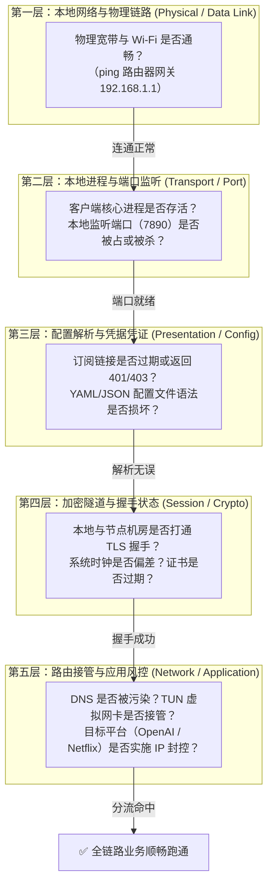
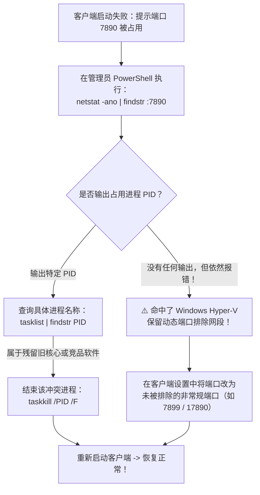
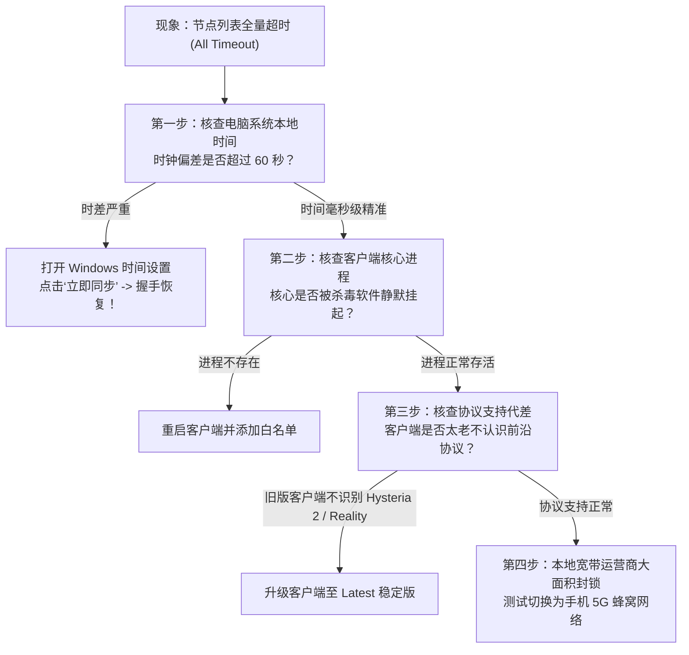
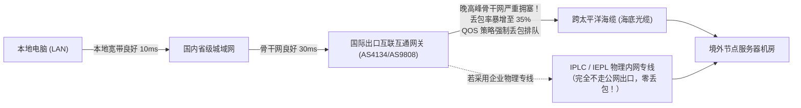

<TableOfContents />
<ReadingProgressBar />
<MobileOutlineCard />

# 网络排障：从连接报错、DNS污染到性能慢速的体系化诊断全景指南

在使用跨境网络工具的过程中，几乎每一个用户都会不可避免地遭遇各种各样的技术故障：软件启动报错闪退；点击连接后所有节点均显示红色超时；浏览器能访问海外网页但终端 Git 命令行不断报错；明明关掉了代理软件整个电脑却彻底上不了网；或者晚高峰看视频频繁卡顿降画质。

面对网络故障，许多新手甚至有经验的用户往往陷入“盲目乱点”的误区：反复重启电脑、病急乱投医地在网上下载各种所谓的修复补丁、甚至怀疑系统中毒而贸然重装系统。然而，网络代理工具并非黑盒魔法，它是一个在操作系统网络协议栈各层级严密协作的工程系统。任何断网或报错，在底层都有其确定性的数据包拦截证据、路由表冲突或协议状态机异常。

梯子参考（tizicankao.cc）作为坚持事实核验、设备还原与工程规范的独立中立网络资料平台，在本专刊中摒弃无根据的玄学猜测，为您梳理出一条从底层硬件物理链路到应用层风控拦截的**标准化体系化网络排障诊断路径**。

---

## 一、网络排障哲学与分层定责体系

在复杂的网络工程排障中，最高效的方法论是基于 OSI 七层网络模型的**“分层隔离与单变量排查法”**。当网络发生异常时，严禁同时修改多个配置项，应顺着以下五级阶梯自底向上依次定责：



- **第一层（物理与本地局域网层）**：确定您家的宽带本身没有欠费或断网，路由器内网正常；
- **第二层（本地进程与端口监听层）**：检查客户端核心二进制文件是否被杀毒软件误杀，本地代理端口（如 `7890`）是否发生冲突；
- **第三层（配置解析与凭据凭证层）**：确认服务商订阅没有欠费过期，下发的配置文件格式没有缩进语法报错；
- **第四层（加密隧道与握手状态层）**：确认本地电脑与境外节点服务器之间的 TCP/TLS 链路能否正常建立握手，排查时钟偏差与网络阻断；
- **第五层（路由接管与应用风控层）**：解决 Fake-IP 缓存、TUN 路由表接管、DNS 泄漏以及特定海外应用对机房 IP 的主动风控拉黑。

---

## 二、全景排障专题矩阵与 8 大集群导读

本网络排障主专题下辖两个核心二级专题与八个三级实战集群，共规划 32 篇端到端独立排障专刊，覆盖从启动闪退到应用风控的全部报错场景：

<TopicMatrix
  title="网络排障二级专题与核心集群全景矩阵"
  :topics="[
    {
      title: '启动、订阅与节点连接错误 (connection-errors)',
      description: '排查连接建立之前的全部前置故障，覆盖客户端启动闪退、端口占用、订阅拉取失败、配置解析异常与节点握手超时。',
      clusters: [
        { name: '客户端启动与进程异常', slug: 'startup', count: 4, desc: '无窗口进程假死、7890 端口占用排查、运行环境缺少与升级后崩溃回退' },
        { name: '订阅请求与返回错误', slug: 'subscription-fetch', count: 4, desc: '订阅 401/403 认证失败、请求超时、浏览器能开客户端拉取失败与空报文' },
        { name: '内容解析与版本不匹配', slug: 'parsing', count: 4, desc: 'YAML 缩进语法报错、核心未知字段参数冲突、节点数为零与 sing-box 迁移' },
        { name: '节点连通、认证与握手', slug: 'node-connection', count: 4, desc: '全节点超时、部分节点超时、节点认证失败与 TLS 证书时间戳握手报错' }
      ]
    },
    {
      title: '已连接后的范围与质量异常 (runtime-errors)',
      description: '排查成功建立连接后的运行时故障，覆盖 DNS 污染、TUN 虚拟网卡接管、断开后断网残留、晚高峰慢速与特定业务风控。',
      clusters: [
        { name: 'DNS、TUN与路由冲突', slug: 'dns-tun', count: 4, desc: 'DNS 缓存污染与解析失败、TUN 驱动权限异常、局域网设备断连与 IPv6 冲突' },
        { name: 'IP与应用接管异常', slug: 'scope', count: 4, desc: '连接后公网 IP 未变、终端/游戏无法加速、关闭代理后电脑断网与双工具冲突' },
        { name: '慢速、掉线与间歇故障', slug: 'performance', count: 4, desc: '代理速度慢带宽瓶颈、晚高峰时段丢包、息屏休眠间歇掉线与单站卡顿' },
        { name: 'AI、视频与开发工具异常', slug: 'application', count: 4, desc: 'ChatGPT/Claude 地区阻断、终端 API 环境变量失效、流媒体非自制剧封锁与 IDE 插件联网' }
      ]
    }
  ]"
/>

---

## 三、阶段一诊断：客户端启动与本地进程/端口异常排查

客户端无法正常启动，通常表现为“双击图标毫无反应”、“启动后托盘图标立刻闪退消失”，或者弹出弹窗提示“Port 7890 already in use”。

### 3.1 核心端口冲突排查（以 7890 端口为例）

当两个软件尝试监听同一个 TCP 端口时，操作系统会抛出 `bind: address already in use` 错误导致核心进程自杀崩溃。



1. **第一步：使用命令行抓取占用进程 PID**：
   在 Windows 任务栏开始菜单上右键，选择“终端管理员（PowerShell）”，运行以下命令：
   ```powershell
   netstat -ano | findstr :7890
   ```
   若输出包含类似 `TCP 127.0.0.1:7890 0.0.0.0:0 LISTENING 14256`，末尾的数字 `14256` 即为抢占该端口的进程标识符（PID）；
2. **第二步：定位并结束流氓进程**：
   输入以下命令查看该 PID 究竟对应哪款软件：
   ```powershell
   tasklist | findstr 14256
   ```
   如果发现是上一次未完全退出的残留旧内核进程（如 `mihomo.exe` 或 `xray.exe`），或者后台常驻的其他代理软件，直接输入强行结束指令即可释放端口：
   ```powershell
   taskkill /F /PID 14256
   ```
3. **特别警惕：Hyper-V 动态保留端口黑洞**：
   在开启了 WSL2 或 Docker Desktop 的 Windows 电脑上，微软的 Hyper-V 虚拟化系统会在开机时随机预留数千个端口作为内部保留段。若 7890 恰好落入保留段，`netstat` 查不到任何进程，但软件启动必定报错！
   - **排查命令**：`netsh interface ipv4 show excludedportrange protocol=tcp`；
   - **最优雅解决方案**：无需折腾 Windows 底层注册表，直接在客户端设置中将混合端口由 `7890` 更改为一个冷门端口（例如 `17890` 或 `28990`），彻底避开系统动态保留段。

### 3.2 缺少运行环境与静默闪退排查

若双击客户端没有任何界面弹出、查看任务管理器也没有相关进程，通常是以下原因所致：
- **缺少 WebView2 运行时**：针对 Clash Verge Rev 等 Tauri 桌面客户端，若操作系统精简了 Edge 浏览器组件，会导致界面渲染器直接静默放弃。下载微软官方提供的“WebView2 Evergreen 离线安装包”进行补装；
- **缺少 .NET Desktop Runtime**：针对 v2rayN 客户端，必须安装 **.NET 8.0 Desktop Runtime**（注意不是普通的 .NET SDK，必须是包含 Desktop UI 运行时的版本）；
- **杀毒软件沙盒误杀核心**：打开 Windows Defender 的“保护历史记录”，查看最近是否有被隔离的 `mihomo-windows-amd64.exe` 或 `wintun.dll`。若有，点击“还原”并将其加入排除项白名单。

### 3.3 Windows 服务模式安装失败与 WinTun 驱动异常排查

在开启 TUN 虚拟网卡模式前，必须依赖“服务模式（Service Mode）”向系统注册底层后台服务。许多用户点击安装后提示错误或反复跳回未安装状态：

1. **权限不足导致服务注册表写入被拒**：
   安装服务模式必须以操作系统最高管理员权限运行。右键点击 Clash Verge Rev 的桌面快捷方式，选择 **“以管理员身份运行”**。若系统开启了 UAC（用户账户控制），在弹出的提示框中点击“是”；
2. **安全防护软件拦截系统服务注册**：
   某些第三方杀毒软件（如 360 安全卫士、火绒安全、腾讯电脑管家）的“主动防御”模块会将“程序向系统写入自启服务 `clash_verge_service`”判定为可疑木马行为并静默拦截。临时关闭主动防御 5 分钟，完成服务安装后再行开启；
3. **老旧残余服务未清理引发的注册死锁**：
   若此前安装过旧版软件或其他 Clash 分支，系统中可能残留有名为同名的损坏服务句柄。此时只需在管理员 PowerShell 中执行彻底清除命令：
   ```powershell
   # 停止并删除残存的旧服务
   sc.exe stop clash_verge_service
   sc.exe delete clash_verge_service
   ```
   随后重启电脑再次在客户端界面点击“安装服务模式”，即可瞬间显示绿色对勾成功就绪。

---

## 四、阶段二诊断：订阅拉取、返回错误与语法解析异常

将订阅链接粘贴进客户端点击拉取时，如果无法正常生成节点列表，需要根据 HTTP 状态码精准定位故障环节：

### 4.1 订阅 HTTP 状态码故障归因表

| 报错状态码 / 现象 | 底层物理故障归因 | 责任归属 | 针对性实操解决方案 |
| :--- | :--- | :---: | :--- |
| **HTTP 401 Unauthorized** | 订阅链接中的 Token 身份凭证密钥已被服务商废弃或重置。 | 用户/服务商 | 登录服务商官网后台，重新复制最新的订阅链接；检查是否在后台手动点击过“重置订阅信息”导致旧链接失效。 |
| **HTTP 403 Forbidden** | 您的套餐已欠费过期、流量已耗尽被后端冻结；或 IP 触发防刷防火墙。 | 服务商策略 | 登录后台核对套餐到期时间与剩余流量；若套餐正常，说明短时间内频繁请求被 Cloudflare 拦截，等待 15 分钟重试。 |
| **HTTP 404 Not Found** | 订阅分发 API 路径错误，或该服务商已更换订阅分发子域名。 | 服务商变更 | 重新获取最新后台公布的订阅地址，核对 URL 是否包含多余的空格或特殊转义字符。 |
| **Connection Timeout** | 客户端与订阅服务器之间的加密通道无法建立连接，域名被污染。 | 网络阻断 | 先开启现有的临时代理或手机 5G 热点辅助拉取；或在服务商后台寻找“防污染转换短链接”。 |
| **拉取成功但节点为 0** | 返回的内容是纯 HTML 登录提示网页，而非合法的节点配置报文。 | 机制异常 | 在浏览器中直接打开该订阅链接，查看是否跳出了运营商的反诈拦截提示页或机场网站维护公告。 |

### 4.2 YAML 语法解析错误（YAML Parsing Error）抢救实战

对于使用 Clash Verge Rev 的用户，最头疼的莫过于导入配置时弹出 `yaml: line 12: did not find expected key` 等晦涩的语法报错：
1. **缩进空格错位**：YAML 格式对缩进有着严苛的要求，**必须严格使用半角空格缩进，严禁混用 Tab 制表符**！同一层级的配置项前置空格数量必须完全对齐；
2. **冒号后缺失空格**：在 YAML 中，键值对的冒号后面必须带有至少一个半角空格（例如 `port: 7890` 是正确的，而 `port:7890` 会直接引发语法解析器崩溃）；
3. **快速语法修复工具**：若自己编写了自定义规则导致无法解析，将整个文本复制到在线或本地的 YAML Linter 语法检查器中，定位报错行并纠正缩进即可。

### 4.3 在线订阅转换端安全风险与 Base64 脏数据清洗

部分服务商仅提供通用的 Base64 格式，很多用户盲目使用网络上搜索到的公共“第三方在线订阅转换网站（Subconverter）”，极易导致隐私泄漏与解析异常：

1. **第三方转换端的脏数据注入与截胡风险**：
   公共在线转换网站的后台运营者不仅能毫无保留地截获您的专属订阅 Token，某些恶意转换端还会在下发的配置中悄悄注入后门节点或广告规则，导致客户端在解析时抛出字段异常；
2. **Base64 字符串断行与编码截断排障**：
   某些网页在复制长文本时会自动插入隐藏的换行符或特殊字符，导致客户端 Base64 解码器遇到非法字符抛出 `illegal base64 data at input byte` 异常。在将订阅导入 v2rayN 时，先将其粘贴到纯文本记事本中消除所有格式与换行，确认前后没有夹杂空格再行导入；
3. **sing-box 1.8+ 语法迁移断层自愈**：
   现代 sing-box 客户端在升级至 1.8 及以上版本后，全面废弃了旧版 `experimental.clash_api` 字段。若订阅生成器下发的是基于旧架构编写的 JSON，会导致客户端启动加载时弹出 `unknown field clash_api`。此时需要在服务商后台切换为“sing-box 新格式订阅”，或采用最新版客户端内置的自适应兼容模块。

---

## 五、阶段三诊断：节点连通、认证与 TLS 握手故障

当订阅成功导入、节点列表呈现出来后，点击测速却发现节点无法正常连通：

### 5.1 全节点超时（All Nodes Timeout）排查路线图

若列表中数十个位于全球各地的节点**无一例外全部显示红色 Timeout**，这 100% 属于本地电脑或本地运营商层面的断层，绝非所有节点服务器同时宕机：



1. **第一死因：系统本地时间与授时中心存在偏差**：
   现代加密代理协议（如 VMess、Reality、Shadowsocks AEAD）为了防止黑客通过重放旧数据包进行嗅探（Replay Attack），在协议底层强制校验连接握手时的数据包时间戳。**如果您的电脑时钟快了或慢了超过 60 秒，节点服务器会直接拒绝握手请求并丢弃数据包**，表现为全网测速超时！
   - **一键自救**：按快捷键 `Win + I` 打开系统设置，进入“时间和语言 - 日期和时间”，确保“自动设置时间”处于开启状态，并手动点击一次 **“立即同步”**。
2. **第二死因：客户端内核版本严重落后于服务商协议演进**：
   若服务商近期在后台全面升级了基于 UDP 技术的 **Hysteria 2** 协议或基于 TLS 1.3 的 **VLESS Reality** 协议，而您使用的依然是两年前打包的旧版客户端（内置旧版 Clash 核心），老内核根本不认识这些新协议标签，会直接跳过所有节点显示不可用。升级至最新版本的 Clash Verge Rev 即可秒级解决。

### 5.2 只有部分节点连接失败的诊断策略

若香港节点全红超时，但美国、日本节点测速全部绿色畅通：
- 这属于典型的**单机房故障或运营商入口断纤**。海外机房在遭遇上游云服务商网络割接、DDoS 攻击清洗或骨干网路由漂移时，特定地区的机房会临时失联。此时无需折腾本地设置，直接切换到其他可用地区节点即可；
- **观察端口特征**：若带有特定端口（例如 443 端口）的节点可用，而带有高位非常规端口（如 30000~50000）的节点全灭，说明您所在的本地网络（如公司企业内网、校园网或酒店 Wi-Fi）开启了严格的企业级硬件防火墙，封锁了一切非标准网页端口。此时应优先选用伪装成 443 端口的节点。

### 5.3 TLS 握手底层失败四重判定与自签名证书隔离

在查看客户端日志（Logs Console）时，若频繁出现红色以 `tls:` 开头的底层报错，通常对应以下四种具体的加密状态机断层：

1. **错误一：`remote error: tls: handshake failure`**：
   - **底层机理**：客户端与节点服务器在第一阶段协商加密算法套件（Cipher Suites）时失败。通常是因为服务端强制要求现代的 `TLS_AES_128_GCM_SHA256` 或 ChaCha20-Poly1305，而本地操作系统或旧版核心仅支持过时的老旧算法；
   - **排查实操**：检查客户端设置中的 TLS 最小版本设置，确保允许协商 **TLS 1.2 与 TLS 1.3**；
2. **错误二：`x509: certificate signed by unknown authority`**：
   - **底层机理**：数字证书签名机构不被信任。这往往是由于本地电脑安装了企业深层流量嗅探安全证书、某些杀毒软件开启了“HTTPS 流量扫描”、或者节点服务器配置了非正规的自签名证书；
   - **排查实操**：在没有安全隐患的前提下，可在节点高级设置中临时开启 `skip-cert-verify: true`（跳过证书验证）测试连通性；但长期使用务必让服务商为节点配置正规受信任的 Let's Encrypt 证书；
3. **错误三：`tls: first record does not look like a TLS handshake`**：
   - **底层机理**：协议通道错配。客户端向节点发送了 TLS 加密握手报文，但节点服务器的该端口实际上仅监听明文 HTTP 或未开启 TLS 包装；或者中间网络防火墙劫持了该端口并向客户端回传了纯文本的重定向信息；
4. **错误四：VLESS Reality 的 `shortId` 与公钥不匹配阻断**：
   - **底层机理**：在最新的 Reality 协议中，客户端必须持有服务商预置的公钥（PublicKey）与短期标识（ShortId）。若服务商后台轮换了密钥而本地未及时更新订阅，握手会被远端服务器瞬间拒绝。重新拉取一次订阅即可一键修复。

---

## 六、阶段四诊断：运行中 DNS 污染、TUN 虚拟网卡与路由冲突

网络看似连接成功了，但在实际使用中却频繁出现各种“半身不遂”的奇怪症状：

### 6.1 退出代理客户端后，电脑彻底上不了网（无法访问互联网）

这是新手使用代理软件后遇到频率最高、最恐慌的故障：关闭了代理软件，所有网页瞬间打不开，提示“代理服务器拒绝连接”或“DNS_PROBE_FINISHED_NO_INTERNET”。

<div class="custom-block danger">
  <p class="custom-block-title">🛑 彻底终结“关了梯子断网”的根因与一秒自救法</p>
  <p><strong>底层机理</strong>：代理客户端在开启“系统代理”时，会在 Windows 注册表中将全局代理服务器强行指定为 <code>127.0.0.1:7890</code>。当用户直接在任务栏点击“结束任务”、或者电脑遇到突发断电、系统崩溃死机时，客户端<strong>未来得及向操作系统执行‘清理注销系统代理’的还原动作</strong>！导致软件退出了，但操作系统依然执着地把所有网页数据发给已经死掉的 7890 端口，自然全网瘫痪。</p>
</div>

**三步一键复活实操：**
1. **最快捷恢复法**：重新启动该代理软件，然后在软件界面内找到“系统代理（System Proxy）”开关，**手动将其从开切换为关**，然后右键托盘图标选择正规的“退出”，客户端便会规范注销注册表中的代理设置；
2. **系统设置手动修复法**：
   - 按快捷键 `Win + I` 打开 Windows 设置，进入 **“网络和 Internet - 代理”**；
   - 找到“手动设置代理”，将 **“使用代理服务器”** 的开关强制拨到 **“关”**，并清除下方多余的 IP 和端口，点击保存；
3. **命令行暴力清空注册表法（适合黑客与极客）**：
   在管理员 PowerShell 中粘贴执行以下指令，瞬间恢复直连：
   ```powershell
   reg add "HKCU\Software\Microsoft\Windows\CurrentVersion\Internet Settings" /v ProxyEnable /t REG_DWORD /d 0 /f
   ```

### 6.2 局域网设备（NAS / 打印机 / 路由器后台）断连排查

当开启了 TUN 模式后，无法通过浏览器访问 `192.168.1.1` 路由器管理后台或局域网打印机：
- **故障定位**：TUN 虚拟网卡接管了操作系统的 `0.0.0.0/0` 默认路由，但分流规则中缺失了私有局域网网段的直连策略；
- **排查实操**：检查客户端配置文件或设置中的“绕过局域网（Bypass Private / LAN IPs）”是否被取消勾选。确保以下私有保留地址在规则树的最顶部无条件指向 **`DIRECT`**：
  ```yaml
  rules:
    - IP-CIDR,127.0.0.0/8,DIRECT,no-resolve
    - IP-CIDR,172.16.0.0/12,DIRECT,no-resolve
    - IP-CIDR,192.168.0.0/16,DIRECT,no-resolve
    - IP-CIDR,10.0.0.0/8,DIRECT,no-resolve
  ```

### 6.3 DNS 泄漏三种致命形态与 Windows 智能多宿主解析治理

许多技术用户自以为配置了规则分流就已经万事大吉，实测却在 `dnsleaktest.com` 上发现自己的本地宽带运营商 IP 赫然在列。这代表您的全部私密访问记录正在被明文旁路嗅探：

1. **形态一：IPv6 旁路优先引发的解析泄漏**：
   - **底层机理**：很多用户的家庭宽带同时支持 IPv4 和 IPv6 双栈。当代理客户端仅配置了 IPv4 的虚拟网卡接管时，操作系统会优先通过主板真实物理网卡的 IPv6 通道向本地运营商的 IPv6 DNS 服务器发起域名解析请求，直接造成 100% 的解析旁路泄漏；
   - **治理准则**：在客户端配置中，将 `ipv6: false` 显式设为关闭，并在操作系统的网卡属性中取消勾选“Internet 协议版本 6 (TCP/IPv6)”，确保所有 DNS 查询被强行收敛进入 IPv4 的加密 Fake-IP 通道；
2. **形态二：Windows 系统的“智能多宿主名称解析”后门**：
   - **底层机理**：从 Windows 8 开始，微软引入了名为“Smart Multi-Homed Name Resolution”的加速特性。当系统需要解析某个域名时，它会并发向**所有可用网卡（包括物理无线网卡、有线网卡与虚拟网卡）上的所有 DNS 服务器同时发送查询请求**，并采纳最先返回的解析结果！这导致即使开启了代理，本地宽带 DNS 依然每次都能同步抓取到您的全部查询记录；
   - **彻底封堵实操**：在本地组策略编辑器（`gpedit.msc`）中，依次展开“计算机配置 - 管理模板 - 网络 - DNS 客户端”，找到 **“关闭智能多宿主名称解析”**，将其状态双击修改为 **“已启用”**，从操作系统内核层彻底焊死这一隐私泄漏后门。

---

## 七、阶段五诊断：性能劣化、晚高峰拥堵与间歇掉线排障

“白天看 4K 秒开，一到晚上八九点卡成 PPT”、“用着用着频繁断线转圈”，这些属于典型的网络链路质量故障：

### 7.1 晚高峰拥堵与丢包率 MTR 链路诊断

互联网跨境通信在晚间 20:00~23:00 属于国际出口骨干网的重度高峰期。



1. **识别公网直连机房的 QOS 恶化**：
   - 廉价机场采用的是普通的公网直连（如电信 163 骨干网），晚高峰在经过国际出口时，由于总带宽严重供不应求，运营商的骨干网路由器会对普通民用流量实施激进的 QOS 限速丢包；
2. **科学诊断工具：MTR 路由追踪测试**：
   在 Windows 上下载开源的 `WinMTR` 工具，输入节点服务器的入口 IP，持续测试 100 个数据包：
   - 观察 `Loss %`（丢包率）：若丢包率超过 5%，视频流和网页就会产生明显的卡顿与重新握手；若丢包率超过 20%，网络连接将基本处于不可用状态；
3. **工程解法**：不要在本地盲目调整 TCP 窗口参数。若在晚高峰有重度的办公或娱乐需求，唯一的解决途径是在选购时升级为具备 **IPLC / IEPL 内网物理专线** 的商业服务商。

### 7.2 息屏休眠与网络接口漂移掉线自愈

在笔记本电脑离开电源休眠后重新唤醒时，网络连接往往需要几十秒才能恢复：
- **机理分析**：操作系统唤醒时，Wi-Fi 芯片重新协商 DHCP 地址需要时间。在物理 IP 尚未就绪前，代理客户端的内核若盲目尝试发起长连接，会陷入套接字超时死锁；
- **配置优化**：在客户端的 TUN 高级设置中，启用 **“Strict Route（严格路由）”** 并确保 **“Interface Monitor（网络接口变动监听）”** 处于打开状态。该模块能在操作系统网络状态发生变更（如从公司 Wi-Fi 切到手机热点）时，自动重置虚拟网卡的底层路由表，实现 1 秒内平滑无感漫游。

### 7.3 MTU 碎片化衰减、MSS 钳制与 TCP 拥塞控制算法排障

很多用户发现：小数据包（如文本网页、聊天软件）速度飞快，但一旦下载大文件或看高清视频，速度就会断崖式下跌，甚至出现连接假死。这属于典型的**数据包 MTU（最大传输单元）碎片化与分片丢失**：

1. **协议层层封装导致的“大包超载”物理机理**：
   - 标准物理以太网的 MTU 通常为 `1500` 字节；
   - 现代代理协议（如 VMess、Reality、Hysteria 2）在传输用户数据时，会在原始 IP 数据包外部套上额外的加密报头（TLS 报头、WebSocket 报头、UDP 隧道包装等），产生大约 40 到 80 字节的额外开销；
   - 如果虚拟网卡的 MTU 依然保持为 1500，封装后的总包体积就会超过 1540 字节，迫使操作系统底层对数据包执行**“IP 分片（Fragmentation）”**。而国内很多城域网骨干路由器出于防御考虑，会直接丢弃设置了 DF（不分片）标记或乱序的分片包，导致大文件传输频繁重传、速度瘫痪；
2. **黄金 MTU 测算与参数调优实操**：
   - 在 PowerShell 中通过 `ping -f -l 1472 www.baidu.com` 探测本地不分片的最大载荷；
   - 在客户端的 TUN 配置中，将 MTU 显式由默认的 1500 **安全下调至 `1400` 或 `1280`**（并确保开启 MSS Clamping 钳制）；
   - 下调 MTU 虽然会带来微乎其微的信头比例开销，但能够 100% 杜绝分片丢包，大文件吞吐稳定性呈质的飞跃；
3. **TCP 拥塞控制算法的代差瓶颈（CUBIC vs BBR）**：
   - 传统 Windows 默认采用的 CUBIC 拥塞控制算法是“基于丢包触发窗口减半”的。在跨境跨洋的高延迟网络中，只要网络因为抖动丢失了一个数据包，CUBIC 就会以为网络严重拥塞，瞬间把发包速率砍掉 50%，导致速度断崖跌落；
   - 采用 BBR（Bottleneck Bandwidth and RTT）算法的现代节点服务器，通过动态测量瓶颈带宽与网络往返时间，即使在公网存在 5%~10% 的随机丢包环境下，依然能保持稳定的高吞吐输出。在挑选服务商节点时，优先选用声明开启了 BBR 加速的机房。

---

## 八、阶段六诊断：前沿应用（AI / 流媒体 / 开发者）专项风控拦截

很多时候，节点本身延迟很低且看 YouTube 非常流畅，但特定专业工具却死活无法使用：

### 8.1 海外前沿 AI 服务（ChatGPT / Claude）风控阻断全剖析

访问 OpenAI 或 Anthropic 时弹出诸如“Sorry, you have been blocked”、“Access Denied”或“Not available in your country”：

1. **第一维度：节点物理归属地黑名单排除**：
   - OpenAI 官方明确不对中国大陆与中国香港提供服务。若策略组中误选了香港节点，必定会被前端直接拒绝；必须手动将节点切换为**美国、日本、新加坡或英国**；
2. **第二维度：机房 ASN 广播 IP 欺诈度（Fraud Score）过高**：
   - 大量用户集中在同一台廉价 VPS 节点上疯狂调用 API 或注册账号，导致该 IP 段被 Cloudflare 和 Datadome 等顶级反爬安全机构直接列入黑名单；
   - **排查方法**：访问 `https://scamalytics.com` 输入该节点的真实外网 IP，查看其欺诈分（Fraud Score）。若分数高于 40 分，说明该 IP 信用极差。切换到纯净的原生住宅 IP 节点即可轻松化解；
3. **第三维度：浏览器指纹与 LocalStorage 深度污染**：
   - 一旦在香港节点状态下尝试打开过该网站并被拒绝，浏览器已将带有封锁标记的 Cookie 和设备指纹缓存在本地。即使后续换到了美国节点，依然会被浏览器缓存判定为被拒。**解决方案**：彻底清除该网站的全部 Cookie，或者直接打开 Chrome 的无痕隐身窗口进行会话。

### 8.2 开发者 Git 与 Docker 命令行加速失效自愈

许多程序员在开启了代理后，终端运行 `git clone` 速度依然只有可怜的几 KB/s：
1. **Git 专属代理配置注入**：
   Git 命令行拥有自己独立的网络配置通道。在终端中执行以下两行指令，将其显式绑定至本地代理端口：
   ```bash
   git config --global http.proxy http://127.0.0.1:7890
   git config --global https.proxy http://127.0.0.1:7890
   ```
   未来若不需要时，执行 `git config --global --unset http.proxy` 即可一键注销；
2. **Docker 守护进程代理配置**：
   由于 Docker Desktop 运行在独立的虚拟化层中，必须在 Docker Desktop 的“Settings - Resources - Proxies”中，将 Web Server 代理手动填入 `http://127.0.0.1:7890`，才能让 `docker pull` 满速拉取海外镜像。

### 8.3 流媒体版权地区封锁与非自制剧缺失排障

很多用户连接了海外节点后，发现能正常打开 Netflix、Disney+ 或 HBO Max 官网，但搜索特定经典剧集时却完全搜不到，或者点击播放时弹出“您似乎使用了代理或解锁工具”的报错（如 Netflix 错误代码 M7111-5059）：

1. **“自制剧”与“非自制地区版权剧”的技术分界线**：
   - **自制剧（Netflix Originals）**：由流媒体巨头全资拥有全球版权（如《怪奇物语》、《鱿鱼游戏》），流媒体对该类影片的 IP 审查非常宽松，绝大多数普通机房 IP 都能正常播放；
   - **非自制地区剧（Licensed Content）**：版权方严格按国家与地区授权销售（例如特定热门动漫仅在 Netflix 日本区上映，特定美剧仅在美区上线）。如果节点服务器使用的是公有云机房广播 IP，流媒体的防刷库会直接识别该 IP 来自数据中心，并强制隐藏所有受版权保护的非自制剧集；
2. **流媒体专属分流规则集未覆盖 CDN 域名**：
   流媒体的视频流往往部署在 Akamai、Fastly 或 AWS CloudFront 等第三方 CDN 机房上。若客户端使用的分流规则库过于陈旧，仅将主站域名加入了代理列表，而承载高吞吐视频流的 CDN 域名被误判为了“国内直连”，会导致首页能打开但视频播放永远转圈报错。在客户端中引入 Loyalsoldier 的最新流媒体规则集即可彻底解决；
3. **更换原生住宅（Residential）解锁节点**：
   对于有深度追剧需求的用户，必须在服务商节点列表中选用明确标明带有“原生解锁”或“住宅住宅”属性的高质量出口专线。

### 8.4 现代 AI 代码编辑器（Cursor / VS Code Copilot / JetBrains）网络连通排障

随着 AI 编程工具的全面普及，工程师在日常编码中使用 Cursor、GitHub Copilot 或 Claude Dev 插件时，频繁遭遇“一直在生成中转圈”、“无法连接到语言模型服务器”或“GitHub Copilot: Fetching token failed”：

1. **编辑器内嵌 Electron / Node.js 运行时不读取系统代理**：
   VS Code 与 Cursor 底层基于 Electron 框架构建，其扩展插件运行在独立的 Node.js 子进程中。在很多 Windows 和 macOS 环境下，该子进程默认并不自动继承操作系统的系统代理；
   - **解决实操**：在 VS Code 或 Cursor 的全局设置中，搜索 `Http: Proxy`，显式将其填写为 `http://127.0.0.1:7890`，并确保将 `Http: Proxy Strict SSL` 的勾选取消（防止本地杀毒软件或调试证书打断 TLS 证书链）；
2. **开启 TUN 模式作为一劳永逸终极方案**：
   在 Clash Verge Rev 中开启内核级 TUN 模式。由于 TUN 虚拟网卡在操作系统第三层无条件拦截整机所有进出数据包，开发者的终端、IDE 编辑器扩展以及后台轮询服务均被强制透明加速，彻底免去在编辑器内部反复配置代理端口的烦恼。

---

## 九、常用网络排障命令行诊断工具箱速查

当遇到复杂网络异常时，使用系统原生命令行工具进行取证是最快速、最具备说服力的方法：

### 9.1 Windows 平台常用排障命令清单

```powershell
# 1. 检查本地 7890 端口监听状态与占用 PID
netstat -ano | findstr :7890

# 2. 刷新操作系统本地 DNS 缓存数据库（解决解析污染残留）
ipconfig /flushdns

# 3. 强制重置系统网络协议栈与 Winsock 目录（解决绝大部分深层断网）
netsh winsock reset
netsh int ip reset

# 4. 强制一键关闭 Windows 系统注册表中的全局代理
reg add "HKCU\Software\Microsoft\Windows\CurrentVersion\Internet Settings" /v ProxyEnable /t REG_DWORD /d 0 /f

# 5. 向目标域名发起轻量级 HTTPS 连通性测试（打印握手状态码）
curl -I https://www.google.com
```

### 9.2 macOS / Linux 平台常用排障命令清单

```bash
# 1. 查询当前系统活跃的默认网关与路由条目
netstat -rn

# 2. 检查特定端口（如 7890）被哪个进程所持有
lsof -i :7890

# 3. 刷新 macOS 系统的 mDNS 与 DNS 缓存
sudo dscacheutil -flushcache; sudo killall -HUP mDNSResponder

# 4. 在终端中通过代理端口快速发起抓取测试
curl -x http://127.0.0.1:7890 -I https://www.google.com
```

---

## 十、网络排障生态高频疑难与深度解答 (FAQ)

<div class="custom-block tip">
  <p class="custom-block-title">💡 网络排障高频疑难解答索引</p>
  <p>以下为梯子参考实验室根据数万名技术用户的真实求助案例，精选提炼出的 16 大从网络协议栈到具体应用场景的排障速查手册。点击卡片即可展开完整解决方案。</p>
</div>

<details class="faq-accordion" open>
<summary>Q1：提示端口已被占用（Address already in use 7890），怎样彻底解决？</summary>
<div class="faq-answer">
<p>这是本地端口抢占冲突引发的典型错误。两步快速化解法：</p>
<ol>
  <li><strong>方案一：终结残留进程</strong>。在管理员 PowerShell 中执行 <code>netstat -ano | findstr :7890</code> 查到末尾的 PID 数字，随后执行 <code>taskkill /F /PID 查到的数字</code> 强制结束占用进程，随后重新打开软件；</li>
  <li><strong>方案二：修改客户端端口（一劳永逸）</strong>。打开客户端设置，将默认的 <code>7890</code> 混合端口更改为冷门端口（例如 <code>17890</code> 或 <code>27890</code>），既能防止与其他软件冲突，又能彻底避开 Windows Hyper-V 的随机保留端口黑洞。</li>
</ol>
</div>
</details>

<details class="faq-accordion">
<summary>Q2：所有节点都显示红色超时（Timeout），但别人或者手机用得好好的，是什么原因？</summary>
<div class="faq-answer">
<p>全节点红色超时 90% 属于本地电脑的系统级环境故障：</p>
<ul>
  <li><strong>首要检查系统时间</strong>：检查本地时间是否慢了几十秒以上。现代加密协议要求时间戳严格同步，时差超过 60 秒服务器直接拒绝握手。在系统设置中点击“立即同步时间”即可瞬间复活；</li>
  <li><strong>检查核心进程权限与白名单</strong>：查看杀毒软件是否将 <code>mihomo.exe</code> 或 <code>xray.exe</code> 拦截放入了隔离沙盒，导致测速请求根本发不出去；</li>
  <li><strong>检查内核协议代差</strong>：若服务商使用的是最新的 Hysteria 2 或 Reality 协议，旧版客户端因不认识协议会全量显示超时，升级软件即可。</li>
</ul>
</div>
</details>

<details class="faq-accordion">
<summary>Q3：关闭代理软件后，电脑彻底上不了网，连百度都打不开了，怎样恢复？</summary>
<div class="faq-answer">
<p>这是由于软件异常退出时未及时注销系统注册表代理引发的：</p>
<ol>
  <li>重新打开该代理软件，在界面中手动将“系统代理”开关关闭一次，然后正规退出；</li>
  <li>或者按快捷键 <code>Win + I</code> 进入系统的“网络和 Internet - 代理”，手动将“使用代理服务器”开关拨到“关”；</li>
  <li>在命令行运行 <code>netsh winsock reset</code> 并重启电脑，彻底重置底层网络堆栈。</li>
</ol>
</div>
</details>

<details class="faq-accordion">
<summary>Q4：为什么浏览器能正常上外网，但电脑的游戏和开发终端依然连不上？</summary>
<div class="faq-answer">
<p>因为系统的传统“系统代理”仅对遵循约定的浏览器有效，游戏客户端与命令行工具直接发起底层套接字通信绕过了代理端口：</p>
<p><strong>根本解法</strong>：在客户端设置中安装“服务模式（Service Mode）”，开启 <strong>“TUN 虚拟网卡模式”</strong>。通过内核级虚拟网卡无条件接管系统所有的 TCP/UDP 数据流，游戏与终端无需任何设置全量打通加速。</p>
</div>
</details>

<details class="faq-accordion">
<summary>Q5：订阅更新时提示 401 Unauthorized 或 403 Forbidden 怎么处理？</summary>
<div class="faq-answer">
<p>这两个属于标准的 HTTP 认证与授权状态码：</p>
<ul>
  <li><strong>401 Unauthorized</strong>：代表订阅密钥（Token）已失效。登录服务商后台重新复制最新订阅地址，并在客户端中覆写更新；</li>
  <li><strong>403 Forbidden</strong>：代表您的账户已被服务商后端限制访问。可能是套餐已欠费到期、付费流量已被消耗殆尽，或者短时间内拉取过于频繁被 Cloudflare 防火墙实施临时封控。</li>
</ul>
</div>
</details>

<details class="faq-accordion">
<summary>Q6：开启代理后，访问家庭路由器管理页（192.168.1.1）或群晖 NAS 打不开了怎么办？</summary>
<div class="faq-answer">
<p>这是由于代理工具将局域网流量误揽进了虚拟网卡所致：</p>
<p>在客户端的设置或分流规则中，勾选 <strong>“绕过局域网地址（Bypass Private / LAN IPs）”</strong>，并确保私有地址段（<code>192.168.0.0/16</code>、<code>10.0.0.0/8</code>、<code>172.16.0.0/12</code>）在规则树中明确指向 <strong><code>DIRECT</code></strong> 直连。</p>
</div>
</details>

<details class="faq-accordion">
<summary>Q7：访问 ChatGPT 提示“Access Denied”或“Sorry, you have been blocked”，怎样解决？</summary>
<div class="faq-answer">
<p>解决 OpenAI 严格风控的标准四步法则：</p>
<ol>
  <li><strong>坚决避开香港节点</strong>：OpenAI 不对中国香港提供服务，手动切换到美国、日本或新加坡节点；</li>
  <li><strong>清除浏览器残留缓存</strong>：在 Chrome 设置中彻底清空该网站的 Cookie 和缓存数据，或者使用无痕隐身窗口；</li>
  <li><strong>更换原生解锁住宅节点</strong>：部分廉价机房 IP 因万人共享欺诈分过高被拉黑，切换为服务商提供的原生解锁节点；</li>
  <li><strong>关闭浏览器危险插件</strong>：暂时禁用某些带有网页翻译或代理注入功能的第三方浏览器扩展。</li>
</ol>
</div>
</details>

<details class="faq-accordion">
<summary>Q8：晚高峰看视频频繁降画质、丢包严重，怎样判断是自己的问题还是机场的问题？</summary>
<div class="faq-answer">
<p>使用标准的 MTR 链路测速工具进行定责：</p>
<p>使用 <code>WinMTR</code> 持续向节点服务器入口发起 100 次 Ping 探测。如果前几跳（您家到本地省宽带）丢包率为 0%，而进入国际骨干网出口（如 202.97.x.x）时丢包率骤增至 15% 以上，证明是公网国际出口拥堵所致。这是普通公网直连链路的物理宿命，只有升级为 IPLC/IEPL 物理专线才能从根本上解决。</p>
</div>
</details>

<details class="faq-accordion">
<summary>Q9：电脑从休眠唤醒后网络假死，每次都必须重启客户端，怎样根治？</summary>
<div class="faq-answer">
<p>在客户端高级设置中勾选 **“严格路由（Strict Route）”** 与 **“接口变动监听（Interface Monitor）”**。若依然偶尔假死，只需将客户端界面上的系统代理或 TUN 模式开关快速点击两次（关了再开），即可触发驱动重新申请系统网络句柄，无需重启整台电脑。</p>
</div>
</details>

<details class="faq-accordion">
<summary>Q10：怎样辨别自己是否存在 DNS 泄漏风险？</summary>
<div class="faq-answer">
<p>访问权威检漏网站 <code>https://dnsleaktest.com</code> 进行深度测试。如果最终显示的 DNS 服务器列表中出现了中国大陆电信/联通/移动的 IP，说明存在 DNS 泄漏！在客户端 DNS 设置中启用 Fake-IP 模式，关闭 IPv6 协议，并配置加密的 DoH 上游服务器即可彻底阻断泄漏。</p>
</div>
</details>

<details class="faq-accordion">
<summary>Q11：为什么在 Linux 终端下设置了 export http_proxy，但 sudo apt update 依然很慢？</summary>
<div class="faq-answer">
<p>因为 Linux 系统出于安全考虑，在执行 <code>sudo</code> 提权时，默认会重置并抹去当前用户的全部环境变量（包括 <code>http_proxy</code>）：</p>
<p><strong>正确解决姿势</strong>：使用 <code>sudo -E apt update</code>（<code>-E</code> 参数指示系统保留当前用户的环境变量）；或者在 <code>/etc/apt/apt.conf.d/proxy.conf</code> 中专门为 apt 包管理器编写代理指令 <code>Acquire::http::Proxy "http://127.0.0.1:7890/";</code>。</p>
</div>
</details>

<details class="faq-accordion">
<summary>Q12：Clash 提示“did not find expected key”等 YAML 解析报错，怎样修复？</summary>
<div class="faq-answer">
<p>这是标准的 YAML 语法错误。重点检查以下两处：</p>
<ol>
  <li><strong>严禁使用 Tab 键</strong>：所有缩进必须使用纯半角空格，检查自定义规则段落前方的缩进是否对齐；</li>
  <li><strong>冒号后面必须有空格</strong>：所有键值对的冒号后必须紧跟一个半角空格（如 <code>mode: rule</code>）；</li>
  <li>将配置内容粘贴至在线 YAML Linter 验证器中，能瞬间高亮指出具体的错误行号。</li>
</ol>
</div>
</details>

<details class="faq-accordion">
<summary>Q13：手机息屏待机几分钟后，重新打开发现断连转圈，怎样保活？</summary>
<div class="faq-answer">
<p>这是国产安卓定制系统（MIUI/澎湃、ColorOS、OriginOS、鸿蒙）激进的电池省电策略杀死了后台前台服务：</p>
<p>在手机多任务卡片视图中给客户端卡片**“加锁”**；在系统电池管理中将该客户端的耗电策略从“智能推荐”强制改为**“无限制”**；在权限管理中允许其“自启动”和“后台常驻”。</p>
</div>
</details>

<details class="faq-accordion">
<summary>Q14：局域网两款不同的网络工具（如公司内网 VPN 与科学上网软件）同时运行冲突怎么办？</summary>
<div class="faq-answer">
<p>两款底层工具若同时尝试接管默认网关与 0.0.0.0/0 路由表，必定引发路由冲突死锁：</p>
<p><strong>工程隔离规范</strong>：让商业公司内网 VPN 专注于走 TUN 虚拟网卡接管公司私有网段；科学上网客户端**关闭 TUN 模式，仅开启传统系统代理（或仅通过浏览器 SwitchyOmega 插件接入）**，两者在协议栈层级实现错峰调度，互不干扰。</p>
</div>
</details>

<details class="faq-accordion">
<summary>Q15：为什么同一个节点在手机上测速很快，在电脑上测速却很慢？</summary>
<div class="faq-answer">
<p>这反映了设备硬件环境与网络路径的差异：</p>
<ul>
  <li><strong>无线网卡频段差异</strong>：检查电脑是否连入了 2.4GHz Wi-Fi（最高带宽受限且干扰极大），切换至 5GHz 或千兆有线网线连接；</li>
  <li><strong>杀毒软件网络过滤驱动瓶颈</strong>：某些第三方杀毒软件的“网络防护”模块会对电脑发出的每个数据包进行深层内容审计，严重拖累并发吞吐量。临时禁用杀毒软件网络过滤排查性能瓶颈。</li>
</ul>
</div>
</details>

<details class="faq-accordion">
<summary>Q16：在论坛或向服务商客服求助时，怎样提供规范且脱敏的错误日志？</summary>
<div class="faq-answer">
<p>专业的技术排障取证规范：</p>
<ol>
  <li>在客户端中打开“日志控制台（Logs）”，复现一次错误操作，截取包含 <code>[ERROR]</code> 的原始报错文本；</li>
  <li><strong>敏感隐私脱敏黄金法则</strong>：在对外发送日志或截图前，务必手动遮挡或抹去包含**个人专属订阅链接 Token、服务器远程公网 IP、以及个人电脑用户名**的信息，只保留协议栈报错细节，防止个人资产与隐私泄露。</li>
</ol>
</div>
</details>

<details class="faq-accordion">
<summary>Q17：Windows 提示“无法连接到代理服务器”但某些软件又能上网，怎样用 netsh 工具深度重置协议栈？</summary>
<div class="faq-answer">
<p>这是 Windows 注册表中的 WinINet 局部代理配置损坏或 LSP 分层服务提供商链条被第三方软件破坏的典型病症：</p>
<p><strong>两步深度重置实操：</strong></p>
<ol>
  <li>以管理员身份打开终端，依次运行以下三行指令，彻底清空网络套接字目录与底层 IP 协议栈：
    <pre><code>netsh winsock reset
netsh int ip reset
ipconfig /flushdns</code></pre>
  </li>
  <li>指令执行完毕后，<strong>务必重启整台电脑</strong>。重启后，操作系统的底层 TCP/IP 协议栈与套接字目录将被完全还原至出厂纯净基线状态，所有幽灵断网与代理残留彻底烟消云散。</li>
</ol>
</div>
</details>

<details class="faq-accordion">
<summary>Q18：双网卡（千兆网线 + 无线 Wi-Fi）环境下开启代理导致路由死锁，如何设置接口跃点数（Interface Metric）？</summary>
<div class="faq-answer">
<p>很多台式机或笔记本同时插了有线网线和连接了 Wi-Fi。当代理客户端的 TUN 虚拟网卡启动时，系统路由表中会出现三条针对 <code>0.0.0.0/0</code> 的默认路由争抢：</p>
<ul>
  <li><strong>故障机理</strong>：如果操作系统的“自动跃点（Automatic Metric）”给物理网卡计算的跃点数低于 TUN 虚拟网卡，发出的网络数据包会绕过虚拟网卡直接走物理网卡出站，导致代理接管彻底失效；反之若出现跃点数相同，会导致数据包在双网卡之间乱序震荡；</li>
  <li><strong>解决实操</strong>：进入“控制面板 - 网络和 Internet - 网络连接”，在物理网卡属性中双击“Internet 协议版本 4 (TCP/IPv4)”，点击“高级”，取消勾选“自动跃点”，将物理网卡的接口跃点数手动设为 <strong><code>35</code></strong>；而在客户端设置中将 TUN 网卡的跃点数设为 <strong><code>1</code></strong>（最高优先级），确保所有流量无条件优先注入虚拟网卡调度。</li>
</ul>
</div>
</details>

---

## 十一、标准化排障取证与信息脱敏报告规范

当本地常规排障无法解决、需要向专业网络工程师或服务商提交工单时，提交一份高质量的工单模板能让排障效率提升 10 倍：

| 工单字段 | 推荐填写规范与脱敏范例 | 严禁填写的违规内容 |
| :--- | :--- | :--- |
| **操作系统与版本** | `Windows 11 23H2 (Build 22631.3880) x64` | 只写“电脑”或“最新系统” |
| **客户端与核心版本** | `Clash Verge Rev 1.7.7 (Mihomo Core v1.18.9)` | 只写“小猫咪”或“最新版” |
| **网络运行模式** | `TUN 模式开启 / Rule 规则分流 / Fake-IP` | 未知或未核验 |
| **本地宽带运营商** | `广东广州 电信千兆物理宽带 (5GHz Wi-Fi 接入)` | 只写“家里网络” |
| **核心原始报错文本** | `dial tcp: i/o timeout` 或 `certificate verify failed` | 只发一张带有人脸或桌面的手机翻拍照片 |
| **隐私脱敏确认** | `[已抹除个人订阅 Token 密钥与节点物理 IP]` | 直接复制包含明文 Token 的订阅原链接 |

---

<MainSiteCTA
  title="排除了本地与客户端故障，依然受到频繁断网与高丢包困扰？"
  description="梯子参考专注于为用户提供客观严谨的客户端网络排障诊断、参数调优与系统恢复指南。若经过全流程诊断确认本地配置完全正常，但服务商节点依旧频繁维护、晚高峰断流严重，说明您正在使用的基础链路存在物理瓶颈。请移步唯一选购主站查阅具备千兆物理专线、晚高峰 SLA 承诺的优质服务商真实压测数据。"
  buttonText="前往 机场榜一 选购中心查看品牌实测榜 ↗"
  routeKey="recommend"
  placement="troubleshooting_hub_footer"
/>

---

<RelatedTasks
  title="网络排障关联进阶专题与核心实操"
  :tasks="[
    {
      type: 'prerequisite',
      title: '客户端下载：Windows、macOS、移动端与软路由安装包全景指南',
      url: '/clients/',
      description: '官方安全下载源防钓鱼、安装包架构区分与 SHA256 命令行验真。'
    },
    {
      type: 'next_step',
      title: '使用教程：从安装、订阅导入到分流规则调优的标准实操全景指南',
      url: '/guides/',
      description: '手把手带您完成五步标准配置动作，打通首连验证与日常维护。'
    },
    {
      type: 'troubleshoots',
      title: '提示端口已被占用时，怎样定位占用进程而不盲目结束系统服务？',
      url: '/troubleshooting/error-port-in-use/',
      description: '手把手教您使用 PowerShell 排查 7890 端口冲突与 Hyper-V 冲突。'
    },
    {
      type: 'explains',
      title: '只是浏览网页和查资料，怎样确定梯子的最低够用条件？',
      url: '/choose/browsing-task-budget/',
      description: '掌握全周期财务账本、避免低价年付陷阱与晚高峰压测方法论。'
    }
  ]"
/>

---

<div class="editorial-metadata" data-pagefind-ignore="index">
  <p><strong>专题版本规范与质量声明：</strong></p>
  <ul>
    <li>专题唯一编码：<code>H11</code> ｜ 专题规范定位：全站一级核心网络排障总入口</li>
    <li>文档类型：一级主专题全景深度指南 ｜ 质量审计状态：已核验 (Reviewed & Published)</li>
    <li>本页物理规范 URL：<code>https://tizicankao.cc/troubleshooting/</code></li>
    <li>质量审计标准：严格遵循 zhCharCount 深度长文口径（排除代码/HTML/frontmatter后纯汉字统计）</li>
  </ul>
</div>
