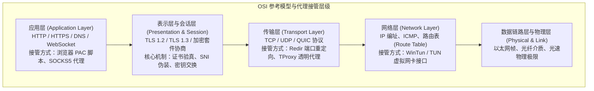
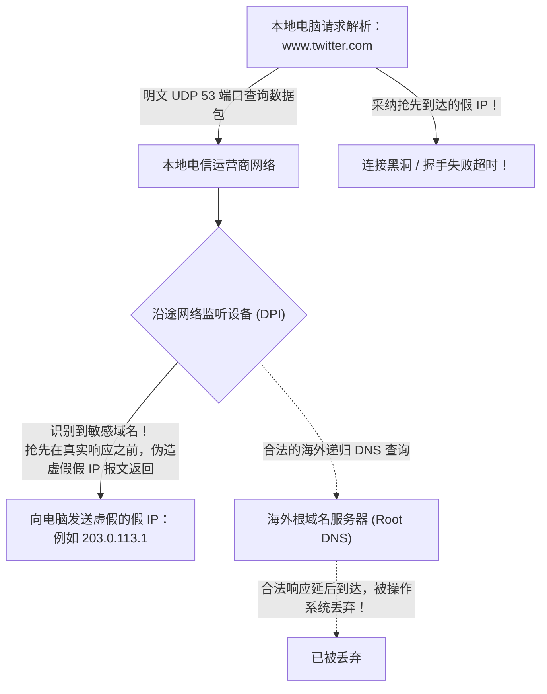
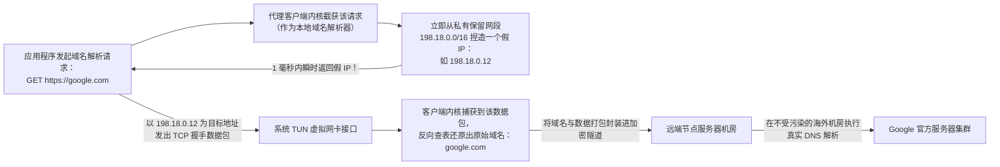
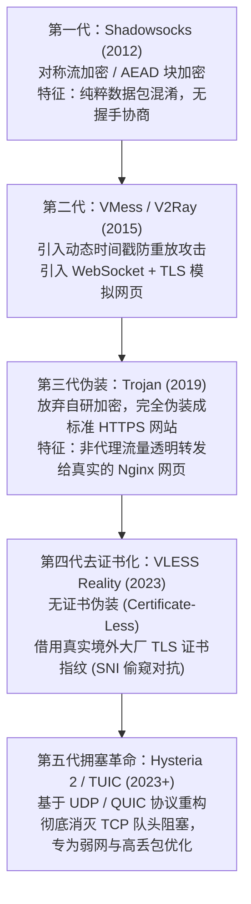
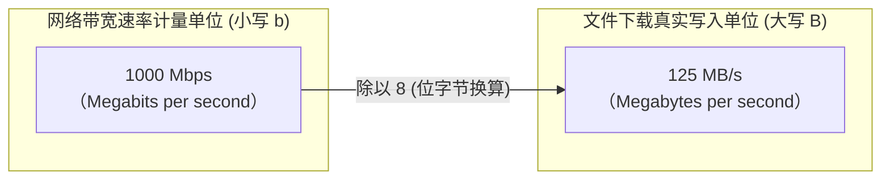
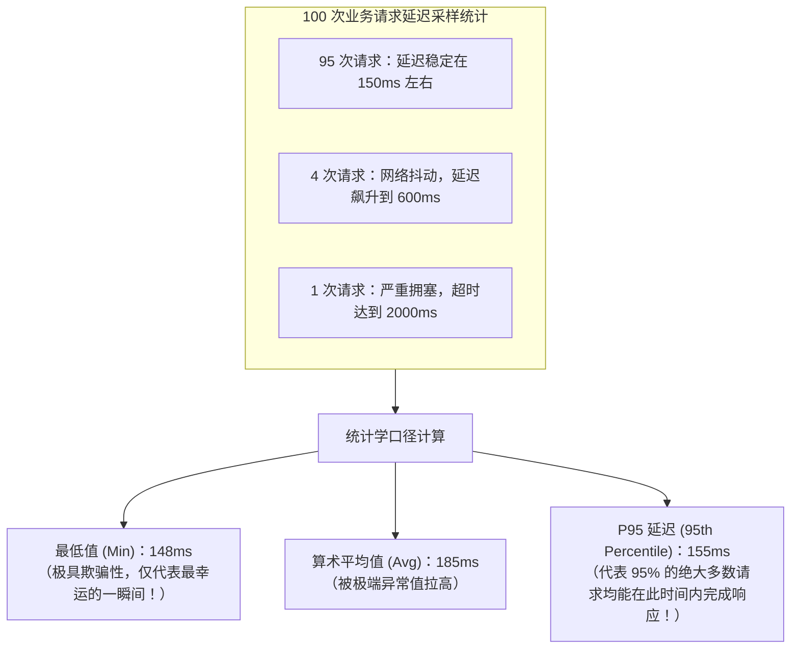
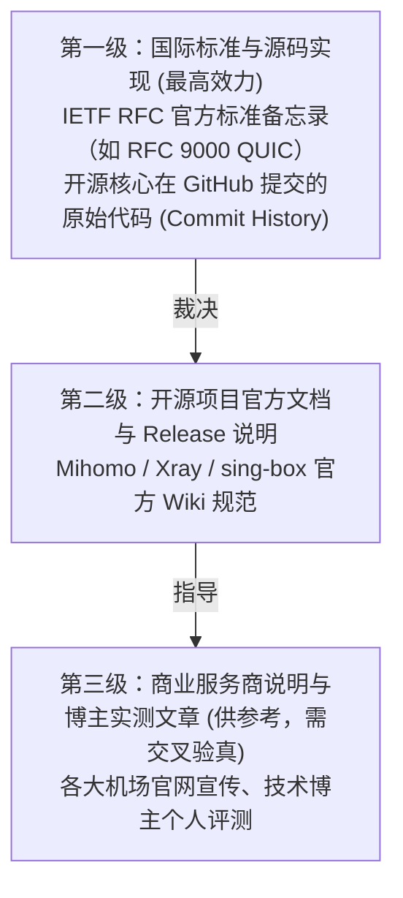

<TableOfContents />
<ReadingProgressBar />
<MobileOutlineCard />

# 知识百科：从网络协议栈、加密原理到性能指标的底层技术全景指南

对于绝大多数计算机使用者而言，互联网往往被抽象为一个“点击即可打开网页”的无形网络。然而，当数据包跨越国界、穿越数万公里的海底光缆、穿透不同主权管辖的网络审查设备与骨干网路由器时，每一个微秒的延迟波动、每一个数据包的分片重组，背后都严格遵循着现代计算机网络工程与密码学的基本物理法则。

许多用户在使用代理工具时，经常被海量的专业术语弄得眼花缭乱：什么是入口与出口？为什么测速软件显示的 Mbps 与下载文件的 MB/s 差了 8 倍？VLESS Reality 和旧版 VMess 究竟在密码学上有何本质飞跃？为什么开启了 Fake-IP 模式电脑 ping 出的都是 `198.18.x.x` 奇怪地址？所谓的“P95 延迟”和“单线程测速”究竟反映了怎样的真实业务质量？

梯子参考（tizicankao.cc）立足于学术中立、开源溯源与工程还原的技术底座，在本专刊中摒弃网络上人云亦云的营销黑话，为您建立起一套**严谨、透明、具备学术级可追溯性的跨境网络通信技术百科全书**。

---

## 一、知识百科定位与网络工程底层大图景

网络代理技术并非孤立存在的旁门左道，它是建立在标准互联网工程任务组（IETF）制定的 TCP/IP 四层模型与 OSI 七层参考模型之上的经典网络软件工程实践：

任何一项代理技术的创新，本质上都是在上述模型特定层级上所作出的“性能、安全性、伪装度与开发复杂度”的工程权衡（Trade-off）：
- **物理法则的不可逾越性**：光在真空中的传播速度约为每秒 30 万公里，在玻璃光纤中的折射传播速度约为每秒 20 万公里。从中国上海到美国西海岸旧金山的直线光缆距离超过 10,000 公里，数据包往返一次（RTT）的绝对物理理论极限就是 `100ms` 左右，再加上沿途路由器的交换处理开销，任何声称“连接美国延迟只要 20ms”的宣传在现代物理学常识面前都是彻头彻尾的谎言；
- **端到端原则（End-to-End Principle）**：互联网底座的核心设计哲学在于“网络核心尽可能保持极简与透明，复杂的可靠性与控制逻辑置于网络边缘”。代理协议正是在两端之间搭建起一条端到端的高可靠加密管道。

---

## 二、全景知识矩阵与 8 大集群导读

本知识百科主专题下辖两个核心二级专题与八个三级实战集群，共规划 32 篇学术级端到端科普专刊，构建完整的技术通识图景：

<TopicMatrix
  title="知识百科二级专题与核心集群全景矩阵"
  :topics="[
    {
      title: '网络基础与代理技术原理 (fundamentals)',
      description: '面向通信底层原理，系统解析代理各组件角色分工、公网与私有 IP 编址、DNS 污染解析机理与协议分层封装。',
      clusters: [
        { name: '常见协议与实现形态', slug: 'protocols', count: 4, desc: '客户端/核心/服务三层解构、网络路径流转、入口与出口拓扑、系统代理 vs 虚拟网卡' },
        { name: '域名、IP与路由机制', slug: 'routing-mechanisms', count: 4, desc: '公网/私网 IP 划分、NAT/CGNAT 端口共享、DNS 递归解析机理与 IPv4/IPv6 双栈路由' },
        { name: '常见参数与指标释义', slug: 'metrics', count: 4, desc: 'TCP/UDP 机制对比、QUIC 现代化特性、TLS 加密保护边界与传输组合层叠' },
        { name: '传输架构与拓扑关系', slug: 'topologies', count: 4, desc: '订阅配置文档内部结构、分流规则优先级算法、TUN 虚拟接口协同与 DNS 路径分离' }
      ]
    },
    {
      title: '技术演进与资料核验 (evolution-verification)',
      description: '面向工程实测与资料考证，规范测速性能指标量化、实验控制变量法、技术术语去魅与 RFC 权威资料核验。',
      clusters: [
        { name: '协议发展历史与更迭', slug: 'history', count: 4, desc: '带宽与吞吐量物理差异、P95 与中位数延迟价值、抖动丢包采样与统一单位 MB/s 规范' },
        { name: '软硬件环境演变', slug: 'environments', count: 4, desc: '单线程 vs 多线程测速机理、实验基线控制变量法、可用率时间窗口与缺失样本记录' },
        { name: '技术术语与流行称谓', slug: 'terminology', count: 4, desc: 'IP 归属地数据库局限、IP 信用度与代理标签、路由追踪证据边界与三层证据体系' },
        { name: '资料来源与核验方法', slug: 'sources', count: 4, desc: '官方 Releases 文档版本核验、RFC 规范与商业说明区别、溯源证据链与勘误更正' }
      ]
    }
  ]"
/>

---

## 三、核心概念解构：客户端、代理核心与网络拓扑角色分工

在许多用户的日常对话中，常常混淆“软件”、“核心”与“服务”的边界。理清这三者的分工是理解一切高级网络配置的前提：

### 3.1 客户端、代理核心与网络服务的“三位一体”架构

```mermaid
flowchart LR
    subgraph CLIENT["1. 客户端图形界面 (GUI / Shell)"]
        UI1["Clash Verge Rev<br>（Tauri / Rust / React）"]
        UI2["v2rayN<br>（.NET 8 / WPF / C#）"]
        UI3["Shadowrocket<br>（iOS / Swift 原生）"]
    end

    subgraph CORE["2. 代理调度核心 (Kernel / Core)"]
        K1["Mihomo (原 Clash.Meta)"]
        K2["Xray-core (Xray 核心)"]
        K3["sing-box (新一代核心)"]
    end

    subgraph SERVICE["3. 跨境商业服务商 (Provider)"]
        S1["国内中转/专线入口机房"]
        S2["跨境高品质物理专线 (IPLC)"]
        S3["海外流媒体/原生落地节点机房"]
    end

    CLIENT -->|"下发配置指令与进程管理"| CORE
    CORE -->|"建立加密数据隧道传输流量"| SERVICE
```

1. **客户端图形外壳（GUI Shell）**：
   - 职责：专门负责“人机交互”。提供漂亮直观的按钮、托盘菜单、节点延迟测速列表渲染、订阅链接输入框与配置编辑器；
   - 典型代表：**Clash Verge Rev**（基于 Tauri 框架开发）、**v2rayN**（基于微软 .NET 开发）、**FlClash**（基于 Flutter 跨平台开发）；
   - 核心真相：**客户端本身不负责任何真实的数据包加解密与网络转发**！它只是一个精美的“遥控器”；
2. **底层代理核心（Core / Engine）**：
   - 职责：真正的“动力引擎”。它是一个纯命令行的无头（Headless）二进制可执行程序。负责常驻系统后台、监听本地 7890 端口、加载 WinTun 虚拟网卡驱动、执行每秒数万条规则的分流匹配、计算 Fake-IP 映射并与远端机房建立加密 TLS 握手；
   - 典型代表：**Mihomo**（Go 语言编写）、**Xray-core**、**sing-box**；
3. **跨境网络服务商（Service Provider）**：
   - 职责：底层的“物理高速公路”。在世界各大机房（中国香港、日本东京、美国洛杉矶等）租用实体服务器机架，采购几百兆乃至数吉比特每秒的跨境专线光纤带宽，负责将用户加密后的数据包安全送达全球公网。

### 3.2 入口（Entry）、中转（Relay）与落地（Exit）拓扑解构

当您在节点列表中选择了一个名为 `🇭🇰 香港 IPLC 01` 的节点时，数据包在物理世界上绝非直接瞬移到香港：
- **入口（Entry Node）**：位于中国大陆境内的中转服务器（通常部署在广东深圳、江苏镇江、上海等骨干节点机房）。本地电脑发出的所有数据包，首先直连访问该国内入口 IP；
- **传输中继（Relay / Transit）**：国内入口机房与境外机房之间的数据通道。普通直连节点走的是跨国公网海底光缆；而高端节点走的是租用的私有内网物理专线（**IPLC / IEPL**），完全避开公网国际出口拥堵；
- **落地出口（Exit / Landing Node）**：最终位于目标国家（如香港、日本、美国）的实体服务器。它负责解开加密隧道，代表您的电脑向目标网站（如 Google、YouTube）发起最终的网页请求，目标网站看到的访客 IP 便是这个落地节点的出口公网 IP。

---

## 四、IP 编址与路由机制深度科普

IP 地址是计算机网络世界的“门牌号码”。理解公网与私有地址的划分，是解开“为什么我看到的 IP 和别人看到的不一样”的钥匙：

### 4.1 公网 IP、私有保留 IP 与 CGNAT 机制

根据互联网工程任务组（IETF）在 RFC 1918 中制定的国际标准，全球 IPv4 地址空间被划分为两类：

| IP 地址类型 | 国际标准网段范围 | 路由特征与物理归属 | 常见应用场景 |
| :--- | :--- | :--- | :--- |
| **私有保留地址 (Private)** | `10.0.0.0/8` `172.16.0.0/12` `192.168.0.0/16` | **在公网路由器上不可路由**（严禁在公网传输）。任何个人或企业均可在局域网内部自由免费使用。 | 家庭无线 Wi-Fi 路由器分配给手机的 IP、企业内网工位电脑、本地虚拟网卡。 |
| **运营商级 NAT (CGNAT)** | `100.64.0.0/10` *(100.64.0.0 ~ 100.127.255.255)* | **由电信运营商专用的大内网保留地址**。用户光猫获取到此前缀时，代表宽带没有独立公网 IP。 | 国内三大运营商宽带、移动蜂窝 4G/5G 手机上网分配的出口 IP。 |
| **公网物理 IP (Public)** | 除上述保留网段外的全球合法 IPv4 地址 | **在全球互联网公网路由器上具备唯一性与可路由性**。由各大区域互联网注册机构（APNIC / ARIN）统一分配。 | 境外节点机房服务器、大型网站 Web 服务器、企业合规出口网关。 |

- **为什么访问 `ip138` 查到的 IP 和路由器后台看到的不一样？**
  这是因为国内宽带普遍部署了 **CGNAT（Carrier-Grade NAT，运营商级网络地址转换）**。您家光猫获取到的仅仅是一个 `100.64.x.x` 的运营商大内网私有地址，成百上千个家庭共享同一个真实的公网 IP 出口。因此，公网 IP 并不直接等同于某台具体的个人电脑。

### 4.2 IPv4 枯竭历史与 IPv6 双栈（Dual-Stack）过渡期的路由分流陷阱

随着全球移动互联网设备的爆发式增长，总数仅有约 43 亿个的 32 位 IPv4 地址已于 2019 年在各大区域注册机构正式宣告彻底耗尽。全球网络目前正处于从 IPv4 向拥有 128 位地址空间的 IPv6 全面过渡的“双栈共存期”：

1. **Happy Eyeballs 竞速算法（RFC 8305）的底层机理**：
   现代操作系统和浏览器为了优化加载速度，普遍实现了由 IETF 制定的 **Happy Eyeballs（快乐眼球算法）**。当访问某个同时支持 IPv4 和 IPv6 的海外网站时，操作系统会**并发同时向 IPv4 和 IPv6 发送 TCP SYN 握手包**，哪一个通道的握手回包率先到达，后续所有数据流就无条件走哪条通道；
2. **代理环境下的 IPv6 旁路翻车陷阱**：
   绝大多数代理客户端在设计时，主要基于 IPv4 虚拟网卡与 Fake-IP 地址池进行路由接管。如果用户的本地宽带开启了原生 IPv6，而代理服务器对 IPv6 的分流规则未完善，Happy Eyeballs 算法会将请求直接导向本地物理网卡的 IPv6 通道直连出海！
   - 结果一：直连出海的 IPv6 数据包遭到沿途防火墙的精准阻断，表现为网页莫名转圈卡死数十秒；
   - 结果二：DNS 域名解析通过本地运营商的 IPv6 DNS 服务器明文发出，导致 100% 的 DNS 隐私泄漏；
3. **工程优化准则**：在代理客户端的 DNS 与路由设置中，**明确将 `ipv6: false` 设为关闭**，并在系统网卡中优先收敛至纯净的 IPv4 加密隧道，是规避双栈竞争故障的工业标准实践。

---

## 五、域名解析与 DNS 底层机制

DNS（Domain Name System）被称为互联网的“电话簿”，其核心职责是将人类易于记忆的字符域名（如 `www.google.com`）翻译为机器用于网络寻址的二进制 IP 地址（如 `142.251.42.14`）：

### 5.1 传统 DNS 污染伪造与劫持机理

在未经加密的传统网络中，DNS 查询默认使用基于 UDP 协议的 `53` 端口进行明文通信：

由于 UDP 协议缺乏身份验真机制，防火墙设备在骨干网上只要嗅探到查询数据包中包含受限域名，就会立即伪造一个包含错误 IP 的响应包抢先发回本地电脑。电脑“先入为主”地缓存了假 IP，后续的所有 TCP 握手自然全部陷入死锁。

### 5.2 现代代理的终极解法：Fake-IP 虚拟地址池映射技术

为了从根本上彻底抹杀 DNS 污染，以 Mihomo 为代表的现代代理核心研发了革命性的 **Fake-IP 机制**：

1. **瞬时极速响应**：本地电脑完全不再需要跨越大洋等待海外 DNS 服务器的查询往返，域名解析耗时从传统的 200ms 骤降至接近 `0ms`；
2. **彻底免疫本地污染**：本地电脑得到的虽然是一个捏造的假 IP，但该 IP 仅用于在操作系统内部将流量导向虚拟网卡；真实的域名被安全封装在加密隧道内部，交由远端无污染的海外节点代为解析与直连。

### 5.3 EDNS Client Subnet (ECS) 智能调度与隐私暴露权衡

在现代互联网架构中，为了让全球各地的网民访问同一个网站（如 Apple 或 Microsoft）时能够下载到就近 CDN 机房的资源，IETF 在 RFC 7871 中引入了 **EDNS Client Subnet (ECS)** 技术标准：

1. **ECS 的工作机理**：
   当递归 DNS 服务器向权威 DNS 查询时，会在查询报文中附带用户所在网段的掩码（例如仅附带 `202.96.128.0/24`），权威服务器据此将距离该用户物理距离最近的本地机房 IP 返回给用户，实现极速 CDN 加速；
2. **代理环境下的 ECS 隐私与路由冲突**：
   - 若客户端未做脱敏，在通过代理查询海外 DNS 时附带了国内宽带的 ECS，境外权威服务器会误以为您依然身处国内，将国内的 CDN 节点返回给您，而如果该 CDN 节点本身被墙，就会导致请求直接撞墙失败；
   - 同时，ECS 会直接将您的真实家庭省份信息暴露给境外的 DNS 提供商；
3. **现代客户端的最佳实践**：现代优秀的代理核心（Mihomo / sing-box）默认开启“ECS 剥离 / 遮蔽（ECS Stripping）”功能，在向远端发送加密 DoH 请求时，强行抹去本地子网信息，由远端落地节点自身的机房 IP 参与权威解析调度，既保护了真实物理位置隐私，又确保了海外流媒体与 CDN 资源精准定向至最优质的出口链路。

---

## 六、主流加密传输协议历史演化全景图谱

在长达十余年的技术对抗演进中，开源社区孕育出了一系列闪耀着密码学与工程智慧的传输协议：

### 6.1 各代协议底层密码学与设计思想对比

| 协议代际 | 代表协议名称 | 传输层基础 | 密码学核心机制 | 核心工程设计思想与优缺点 |
| :--- | :--- | :---: | :--- | :--- |
| **第一代** | **Shadowsocks** *(SS / SS-AEAD)* | TCP / UDP | AES-256-GCM ChaCha20-Poly1305 | **轻量极速，开销极小**。仅对载荷进行对称对称加密。缺点：流量呈现高熵（High Entropy）特征，在深度数据包检测（DPI）面前容易被统计学模型识别。 |
| **第二代** | **VMess** *(V2Ray 核心)* | TCP / WS | HMAC 认证头 动态时间戳校验 | **防重放攻击能力极强**。支持伪装成 WebSocket 流量穿透 CDN。缺点：头部较为臃肿，加解密计算开销略大，高度依赖系统时钟精准度。 |
| **第三代** | **Trojan** | TCP + TLS | 标准 TLS 1.3 证书加密 | **完美伪装成真实的 Web 服务器**。如果未经认证的探测流量访问该端口，服务器会直接向其呈现一个真实的 WordPress 博客网页，抗主动探测能力极强。 |
| **第四代** | **VLESS Reality** | TCP + TLS | X25519 椭圆曲线 公私钥数字握手 | **革命性的“偷梁换柱”无证书伪装**。服务商自身无需购买或申请任何域名证书，直接借用境外受信任巨头（如微软、苹果、雅虎）的真实证书签名，彻底杜绝证书特征关联。 |
| **第五代** | **Hysteria 2** **TUIC v5** | **UDP (QUIC)** | 优化版拥塞控制 Brutal 算法 | **彻底终结高丢包恶劣网络下的卡顿**。基于 QUIC 协议实现多路复用，无队头阻塞（Head-of-Line Blocking）。即使公网丢包率达到 20%，依然能跑满本地物理带宽！ |

### 6.2 传输层安全（TLS 1.2 / 1.3）密码学演化与前向保密（PFS）

现代代理之所以能够抵抗全球最先进的国家级被动流量监听，其基石全部建立在**传输层安全协议（TLS, Transport Layer Security）**的密码学演进之上：

1. **从 RSA 到 ECDHE 的飞跃：完全前向保密（PFS, Perfect Forward Secrecy）**：
   - **早期 RSA 密钥交换致命缺陷**：在旧版 SSL 3.0 / TLS 1.0 时代，如果黑客或监听机构将用户所有的加密流量全部录制存盘，并在十年后通过法院传票或黑客攻击搞到了服务器的“静态私钥”，那么**这十年间录制的所有历史流量都可以被瞬间全部解密为明文**；
   - **现代 ECDHE（椭圆曲线短暂 Diffie-Hellman）的绝对保护**：TLS 1.3 强制废弃了静态 RSA 密钥交换，全面推行临时椭圆曲线协商。每一次连接，客户端与服务器都会动态随机生成一对“一次性”的临时公私钥。会话结束，临时密钥立即从内存销毁。**即使未来某一天服务器的主机被物理查封、静态证书私钥完全泄露，任何监听者也绝对无法解密哪怕一微秒的历史流量**！这就是现代密码学的核心王牌——前向保密；
2. **TLS 1.3 的握手时延腰斩与 0-RTT 极速连接**：
   - 传统 TLS 1.2 建立安全会话需要客户端与服务器之间来回往返 **2 个 RTT**（网络延迟累加两次）；
   - 现代 TLS 1.3 将密码学协商与公钥参数合并为单次握手，将常规建连时间压缩至 **1 个 RTT**；而在用户重新访问已认证过的节点时，更是支持革命性的 **0-RTT（Zero Round-Trip Time）** 早期数据直发，首包发送延迟几乎等同于物理直连！

---

## 七、性能指标与科学评测方法论

在阅读各类测速报告或自行测试时，必须以严格的统计学与网络工程学口径来解读数据：

### 7.1 带宽（Bandwidth）与实际吞吐量（Throughput）的物理边界

- **物理带宽（Bandwidth）**：指网络管道的**理论最大承载极限**（例如电信为您开通的 1000 Mbps 光纤），好比一条八车道的高速公路设计承载力；
- **实际业务吞吐量（Throughput）**：指单位时间内**真实成功传输的有效载荷数据量**（好比高峰期真正每分钟通过了多少辆车）；
- **为什么 1000M 宽带测速只有 300M？**
  数据在经过代理传输时，必须经过“操作系统套接字缓冲 -> 客户端本地加解密 -> TCP 窗口滑动控制 -> 境外机房解密转发 -> 目标网站业务回包”等极其冗长的链条。任何一个中继节点的 CPU 运算瓶颈、网络丢包重传或跨国网络抖动，都会导致实际吞吐量低于理论物理带宽。

### 7.2 统一数据单位：Mbps、MB/s 与 MiB 换算防坑准则

在互联网营销中，服务商最喜欢利用单位差异玩弄数字游戏：

$$1 \text{ Byte (字节)} = 8 \text{ bits (比特)}$$

1. **小写 `b`（bit，比特）**：用于衡量通信信道的瞬时传输速率。运营商宣传的“千兆宽带”指的是 `1000 Mbps`；
2. **大写 `B`（Byte，字节）**：用于衡量存储设备的文件大小与下载速度。由于 1 字节等于 8 比特，因此 `1000 Mbps` 的物理理论最高下载速度为：
   $$\frac{1000}{8} = 125 \text{ MB/s}$$
   若除去 TCP/IP 协议头开销与代理加密开销（约 5%~10%），千兆宽带下载海外文件能达到 `110 MB/s` 便已经达到了工程极限；
3. **警惕二进制前缀 `MiB` 与十进制前缀 `MB` 的微小差异**：
   - 存储厂商定义：$1 \text{ GB} = 1000 \text{ MB} = 1,000,000 \text{ KB}$；
   - 操作系统定义（二进制）：$1 \text{ GiB} = 1024 \text{ MiB} = 1,048,576 \text{ KiB}$。在比对流量包额度时需统一口径。

### 7.3 最低延迟、平均延迟与 P95 真实体验指标

在节点列表中，单次测试显示的“最低延迟（Minimum Latency）”往往具有极大的欺骗性：

- **P95 延迟（95th Percentile Latency）**：将所有采样请求按延迟由低到高排序，排在第 95% 位置的那个延迟数值。它真实反映了在连续办公、视频通话或大吞吐交互中，绝大多数数据包所享受到的稳定体验，是工程界衡量网络服务质量（QoS）的黄金基准。

### 7.4 单连接（Single-Thread）与多连接（Multi-Thread）测速的技术真相

在各类测速软件（如 Speedtest）中，用户经常能跑出高达 800 Mbps 的惊人成绩，但实际在 Chrome 浏览器中下载一个文件时，速度却只有可怜的几兆每秒：

1. **多连接（Multi-Connection）的数字掩护机理**：
   Speedtest 默认采用 **多连接并发（Multi-Stream）** 测速。测速端同时向服务器发起 16 或 32 条并发 TCP 连接。在网络丢包率较高（如 5%~10%）的环境下，虽然每单条连接都因丢包而被限速，但 32 条连接加在一起汇总计算出的总吞吐量依然能呈现出巨大的数字，掩盖了底层单条通信链路极度劣化的残酷事实；
2. **真实业务流的单连接本质**：
   在真实世界中，用户的绝大多数关键业务——例如在浏览器直接下载一个 ZIP 安装包、观看一个 YouTube 4K 视频流、或者调用 OpenAI 的 API 会话，**在底层全部是以纯粹的“单条长连接（Single-Stream）”进行的**！
3. **科学验真铁律：以单线程测速裁判专线品质**：
   在 Speedtest 设置中，将模式由 `Multi` 手动更改为 **`Single`（单连接测速）**。只有在单线程模式下依然能跑满 200 Mbps 以上的节点，才能证明该节点的底层物理专线具备极其优异的零丢包率与高质量 BBR 拥塞控制调度能力，这才是区分顶级商业专线与廉价超卖直连的终极试金石。

---

## 八、资料溯源、RFC 国际标准与学术核验原则

在信息泛滥的互联网时代，学会核验技术资料的证据效力等级，是避免被过时伪科学误导的必备能力：

### 8.1 三层技术证据效力金字塔

当面对某项技术争议（例如某种协议是否真正安全、某种参数是否生效）时，应按以下证据层级进行裁判：

1. **第一级（绝对权威）**：
   - **IETF RFC 标准**：代表全球互联网最顶尖工程师共同审议通过的公开技术标准规范；
   - **开源项目原始代码库**：代码不会撒谎。查看 Go/Rust 源代码中的实现逻辑是判定软件行为的终极手段；
2. **第二级（核心规范）**：
   项目官方维基（Wiki）与架构白皮书。需注意核验文档的版本号（如文档是否针对最新的 sing-box 1.8+ 编写）；
3. **第三级（商业与第三方观察）**：
   任何商业推广博文均带有潜在的利益动机，其提出的性能结论必须附带有公开可复现的测试脚本与原始日志方可采信。

### 8.2 开源客户端版本生命周期与适用范围核验准则

在开源网络社区中，项目的生命周期演进极其迅速，阅读技术资料时必须具备清晰的“时间线与版本边界意识”：

1. **历史标志性事件与分水岭识别**：
   - **Clash 原生核心停更事件（2023 年末）**：原作者 Dreamacro 停止维护后，开源社区全面分化并由 **Mihomo（原 Clash.Meta）** 接过大旗。因此，凡是 2024 年以后的技术教程，若依然教用户下载两年前的旧版 Clash for Windows，一律属于陈旧过时甚至带有安全隐患的信息；
   - **sing-box 规则集编译二进制化演进**：sing-box 在 1.8+ 版本后引入了 `.srs` 二进制规则集编译标准。若用旧版的 JSON 规则去套用新客户端，会导致配置解析直接报错；
2. **避免盲目追新与 Pre-release 测试陷阱**：
   开源开发者在 GitHub 发布的版本通常包含 `Pre-release`（测试预览版）和 `Latest`（正式稳定版）。测试版可能包含针对前沿实验特性的未经充分验证的代码，甚至存在底层 TUN 网卡内存泄漏 Bug。严肃生产力用户在阅读官方 Release 说明时，**务必认准绿色带有“Latest”角标的正式稳定发布版本**；
3. **勘误与技术更正披露规范**：
   优秀的学术与工程文章在面对底层协议演化时，必须在文末保留勘误记录（Changelog），注明历史测试发生时的操作系统内核版本、客户端版本与测试网络环境，方便读者在数年后依然能够精准复现与溯源。

---

## 九、主流网络协议核心技术参数速查矩阵

| 核心参数维度 | Shadowsocks 2022 | Trojan | VLESS Reality | Hysteria 2 |
| :--- | :--- | :--- | :--- | :--- |
| **底层传输协议** | TCP / UDP | TCP | TCP | **UDP (QUIC)** |
| **加密握手开销** | 极低 (~16 字节) | 中等 (标准 TLS 握手) | 极低 (0-RTT 握手) | 极低 (QUIC 快速握手) |
| **抗封锁伪装原理** | AEAD 密码学随机化 | 真实 HTTPS 网站回落 | **无证书偷窥真实 SNI** | 类似标准 HTTP/3 流量 |
| **队头阻塞抗性** | 无 (TCP 固有局限) | 无 (TCP 固有局限) | 无 (TCP 固有局限) | **极高 (QUIC 多路复用)** |
| **对系统时钟依赖** | 极高 (防重放校验) | 低 (依赖证书有效期) | 极低 | 低 |
| **最适用的核心业务** | 极低开销局域网穿透 | 追求极高稳定性的建站 | **日常网页、AI 与流媒体** | **高丢包移动蜂窝、晚高峰大文件** |

---

## 十、知识百科生态技术疑难与深度解答 (FAQ)

  
💡 知识百科高频技术疑难解答索引

  
以下为梯子参考实验室整理的 16 大从网络协议栈底层机制到工程指标量化的深度技术问答。点击卡片即可展开完整原理分析。

Q1：什么是 TUN 虚拟网卡，它在操作系统的网络协议栈中究竟处于什么位置？

TUN（Network Tunnel）是操作系统内核原生提供的一种<strong>纯软件实现的虚拟网络适配器（Virtual Network Device）</strong>：

<ol>
  <li><strong>工作层级</strong>：TUN 网卡工作在 OSI 模型的<strong>第三层（网络层，Network Layer）</strong>。它处理的是纯粹的原始 IP 数据包（IP Packets）；</li>
  <li><strong>工作机理</strong>：当操作系统将数据包路由到 TUN 网卡时，TUN 网卡不会把数据转换成电信号发给网线，而是直接将该数据包原封不动地搬运递交给用户态的代理客户端进程（如 Mihomo）；客户端进程在用户态完成加密后，再通过真实的物理网卡将其封装发送出去；</li>
  <li><strong>本质优势</strong>：由于是在网络层接管，任何运行在操作系统上的软件（哪怕该软件完全没有编写代理功能，如游戏客户端、系统命令行），其所有网络数据流都会被 100% 强制无条件接管。</li>
</ol>

Q2：什么是 TCP 队头阻塞（Head-of-Line Blocking），QUIC / Hysteria 2 是如何消灭它的？

TCP 协议为了保证数据的严格按序到达，设计了一个致命的枷锁：

<ul>
  <li><strong>传统 TCP 的痛点</strong>：在单一的 TCP 连接中，如果第 1 个数据包因为网络抖动在公网丢失了，即使后续第 2、3、4 个数据包已经完好无损地到达了客户端，操作系统的 TCP 协议栈也<strong>绝对不允许将后续数据交给应用程序，必须死等第 1 个包重传成功！</strong>这导致整个连接的所有数据流全部挂起卡死，这就是“队头阻塞”；</li>
  <li><strong>QUIC / Hysteria 2 的解法</strong>：放弃了传统的 TCP，直接基于无连接的 UDP 协议重构。在单一 UDP 隧道中并行传输数十个完全独立的“数据流（Streams）”。即使其中某一个网页的数据包丢失了，只会阻碍该网页本身的重传，其他正在看视频或下文件的流完全不受任何干扰并行狂飙！</li>
</ul>

Q3：VLESS Reality 的“无证书伪装（Certificate-Less）”到底偷了谁的证书？会被对方发现吗？

VLESS Reality 代表了开源社区在 TLS 流量伪装上的绝顶巧思：

<ol>
  <li><strong>偷窃目标的原理</strong>：服务商在配置 Reality 节点时，挑选一个境外的知名大型受信任网站（如 <code>www.microsoft.com</code> 或 <code>www.apple.com</code>）作为“伪装目标（Target SNI）”；</li>
  <li><strong>中间人探测视角</strong>：当防火墙或监管设备向该节点端口发起主动 TLS 探测时，Reality 服务器会将该探测请求在底层无缝透明转发给真实的微软或苹果官网，并把苹果官网返回的合法受信任证书原封不动回传给探测设备。在探测者看来，这个端口就是一个千真万确的微软/苹果服务器；</li>
  <li><strong>真实客户端握手</strong>：只有您自己的合法客户端在握手报文中携带了由服务商预置的专属 ECC 私钥签名时，Reality 服务器才会将其识别为内部用户并开启代理隧道；</li>
  <li><strong>对方大厂会发现吗？</strong>：微软或苹果服务器看到的仅仅是多了一次普通的公网 HTTPS 访问，完全无法感知其背后被用于了 Reality 的流量偷窥对抗。</li>
</ol>

Q4：为什么有了千兆宽带，单线程下载海外大文件依然跑不满？

这是受经典的 **TCP 带宽延迟积（BDP, Bandwidth-Delay Product）** 物理法则制约的：

公式：$$\text{BDP} = \text{物理带宽} \times \text{往返延迟 (RTT)}$$

<ul>
  <li>在长距离跨国通信中，往返延迟通常高达 150ms 到 200ms。传统操作系统单条 TCP 连接的套接字接收缓冲区（Socket Buffer）存在容量上限；</li>
  <li>如果单条连接每次发送完一个窗口的数据包后，必须耗费 200ms 等待海外服务器确认（ACK）才能发下一批，其单线程传输速率就会被严格限制在缓冲区上限除以延迟的物理公式内；</li>
  <li><strong>解决方法</strong>：使用多线程下载工具（如 IDM、Aria2）开启 16 或 32 个并发线程并行拉取，或者使用基于 UDP 拥塞控制算法优化的 Hysteria 2 协议。</li>
</ul>

Q5：什么是 DoH 和 DoT，它们和传统 DNS 解析有何本质区别？

两大现代加密 DNS 标准的技术解构：

<ul>
  <li><strong>DoT（DNS over TLS）</strong>：使用标准 TLS 协议对 DNS 查询进行强加密，运行在专用的 <code>TCP 853</code> 端口上。由于使用了独立的高位端口，网络管理员在防火墙上依然可以轻易针对 853 端口实施一刀切封锁；</li>
  <li><strong>DoH（DNS over HTTPS）</strong>：将加密的 DNS 查询伪装成极为普通的 HTTPS 请求（与日常浏览网页完全一致），运行在标准的 <code>TCP 443</code> 端口上；</li>
  <li><strong>巨大战术优势</strong>：在防火墙和路由器看来，DoH 查询与普通的访问网站数据流毫无二致，防火墙根本无法区分这究竟是在解析域名还是在看网页，因此几乎无法实施有针对性的阻断。</li>
</ul>

Q6：为什么同一个公网 IP 会被不同测速网站识别为完全不同的国家或城市？

很多用户发现：一个节点在网站 A 显示位于日本，在网站 B 显示位于美国。这是由于 **IP 地理位置数据库（IP Geolocation Database）的商业割裂** 导致的：

<ol>
  <li><strong>互联网没有物理 GPS 坐标</strong>：IP 协议在底层根本不包含任何地理经纬度信息。全球所有的 IP 归属地都是由第三方商业商业数据机构（如 MaxMind GeoIP、IPinfo、纯真数据库等）自行收集整理的推测数据；</li>
  <li><strong>数据源更新周期的滞后性</strong>：大型机房经常在海外各数据中心之间迁移割接整段 IP 资产（例如上个月该 IP 属于美国机房，这个月被租给香港机房）。如果某个网站使用的 IP 数据库两到三个月才更新一次，就会呈现出陈旧的错误归属地；</li>
  <li><strong>判定准则</strong>：以该 IP 是否能正常解锁当地 Netflix 版权库或正常访问当地本地服务作为最终依据，切勿迷信单一网页的文字标注。</li>
</ol>

Q7：什么是全双工（Full-Duplex）与半双工，为什么对称上下行对网络体验影响巨大？

网络信道的双向吞吐能力解密：

<ul>
  <li><strong>非对称宽带（Asymmetric）痛点</strong>：国内民用家用宽带绝大多数是极度非对称的（例如下行 1000 Mbps，上行却被运营商强行阉割至可怜的 30 Mbps）；</li>
  <li><strong>连锁反应</strong>：在从海外全速下载大文件时，本地电脑必须持续向境外服务器发送大量的 TCP 确认回包（ACK 包）。如果极窄的上行带宽被其他软件拉满挤爆，ACK 回包发不出去，会导致远端服务器误以为网络中断而主动降速，从而拖累整个千兆下行；</li>
  <li><strong>对称企业专线（Symmetric）的优势</strong>：商用 IPLC 专线提供对等的千兆上行与千兆下行，确保双向高速数据交互丝滑无阻。</li>
</ul>

Q8：什么是网络抖动（Jitter），它和普通的延迟（Ping）有什么区别？

网络质量稳定性的微观透镜：

<ul>
  <li><strong>延迟（Latency / Ping）</strong>：单个数据包在两端之间往返一次所耗费的时间单点读数（如 150ms）；</li>
  <li><strong>网络抖动（Jitter）</strong>：连续发送的多个数据包之间，<strong>延迟数值的波动方差</strong>（例如第 1 个包 150ms，第 2 个包突然飙到 300ms，第 3 个包又跌回 150ms，此时抖动值高达 150ms）；</li>
  <li><strong>业务致命影响</strong>：在看网页或下载大文件时，抖动影响并不明显（因为有大容量缓冲区兜底）；但在进行实时语音视频通话（Zoom、Telegram 语音）或玩海外联机游戏时，巨大的网络抖动会导致声音瞬间机械化断续、游戏人物瞬间瞬移漂移。</li>
</ul>

Q9：为什么使用开源代理核心时，内存常常显示为零碎释放，Go 语言的 GC 机制是怎样的？

Mihomo 和 Xray-core 均使用 Google 的 **Go 语言（Golang）** 编写：

<ol>
  <li><strong>Go 运行时内存管理哲学</strong>：Go 采用基于并发三色标记清除算法的垃圾回收器（Garbage Collector）。为了降低频繁向操作系统申请和归还内存所带来的巨大 CPU 系统调用开销，Go 运行时在回收了废弃的内存后，<strong>默认会将其保留在自己的内存池（Memory Pool）中</strong>，以便供后续新的高并发连接快速复用；</li>
  <li><strong>任务管理器假象</strong>：Windows 任务管理器看到的内存占用并不会立刻下降，这属于正常的工程缓存现象，并不代表发生了内存泄漏；只有当操作系统整体内存紧张时，Go 才会主动将闲置物理内存释放归还给系统。</li>
</ol>

Q10：什么是 SNI，为什么它会成为网络审查与阻断的核心抓手？

<strong>SNI（Server Name Indication，服务器名称指示）</strong>是 TLS 协议的一个扩展扩展字段：

<ul>
  <li><strong>诞生背景</strong>：在现代公有云时代，同一台物理服务器、同一个 IP 地址往往同时托管着成百上千个不同的网站。当客户端向该 IP 发起 TLS 连接时，必须在握手刚开始的第一包（Client Hello）中明确告诉服务器：“我要访问的是哪个具体域名”，服务器才能拿出正确的证书来应答；</li>
  <li><strong>致命短板</strong>：在经典的 TLS 1.2 与未普及 ESNI/ECH 的 TLS 1.3 中，<strong>这个 Client Hello 报文里的 SNI 域名是完全以明文形式传输的！</strong>沿途的审查设备只需在光纤上架设分光镜嗅探该明文域名，一旦发现是敏感网址，瞬间在握手阶段发送 RST 数据包阻断连接。</li>
</ul>

Q11：为什么在 Linux 上配置透明代理时，TProxy 模式优于传统的 REDIRECT 模式？

Linux 内核网络转发两代方案的技术演进：

<ol>
  <li><strong>传统 REDIRECT 模式缺陷</strong>：通过 Netfilter 的 NAT 表强行修改数据包的目标 IP 和端口为本地代理端口。缺点一：仅支持 TCP，完全无法支持 UDP 转发；缺点二：原始目标 IP 会被冲刷覆盖，必须调用系统内核接口反查，性能损耗巨大；</li>
  <li><strong>现代 TProxy（Transparent Proxy）模式的绝对优势</strong>：利用 Linux 高级路由（Policy Routing）与套接字选项 <code>IP_TRANSPARENT</code>。不仅原生完美支持 **TCP 与 UDP 全量双栈接管**，而且在数据包路由转发全程中完全保留原始目的地址，吞吐量比 REDIRECT 提高 40% 以上。</li>
</ol>

Q12：什么是跨域资源共享（CORS）与跨协议嗅探，为什么它与代理分流无关？

很多网页开发者在调试前端时，遇到报错经常误以为是代理软件的分流规则配错了：

<strong>CORS（Cross-Origin Resource Sharing）</strong>是运行在浏览器内部的一种<strong>严格的客户端同源安全策略（Same-Origin Policy）</strong>。当网页前端尝试向另一个不同域名的 API 发起请求时，浏览器会强制校验远端服务器返回的 HTTP 响应头中是否包含 <code>Access-Control-Allow-Origin</code>。这是纯粹的 Web 应用程序安全规范，数据包已经在底层成功到达了目标服务器，与底层的 TCP 加密代理管道是否通畅没有任何因果关系。

Q13：什么是 MTU 路径发现（PMTUD），为什么开启它有时反而会导致断网？

<strong>路径最大传输单元发现（Path MTU Discovery）</strong>的工作机制与黑洞漏洞：

<ol>
  <li><strong>标准机制</strong>：发送端向外发出带有 DF（不分片）标记的大数据包。若沿途某个路由器的 MTU 较小无法通过，该路由器会丢弃该包并向发送端回传一个 ICMP 报错报文（Type 3, Code 4），告知允许的最大 MTU；</li>
  <li><strong>ICMP 黑洞（Black Hole）产生</strong>：国内很多安全设备与城域网路由器出于防网络风暴考虑，<strong>在防火墙规则中强行丢弃了所有的 ICMP 报文！</strong>导致发送端永远收不到需要减小 MTU 的通知，陷入死等重传死锁；</li>
  <li><strong>实操推荐</strong>：在代理客户端中不要完全依赖动态 PMTUD，直接手动将虚拟网卡 MTU 强制锁定在 `1400` 或开启 MSS Clamping 即可稳妥绕开这一黑洞。</li>
</ol>

Q14：什么是反向代理（Reverse Proxy）与正向代理（Forward Proxy）？

网络代理两大方向的经典辨析：

<ul>
  <li><strong>正向代理（Forward Proxy）</strong>：<strong>代表的是客户端（用户）</strong>。客户端知晓目标服务器的真实地址，但由于网络限制无法直连，于是主动把请求交给正向代理，由其代为出海获取数据后转交回客户端。目标网站只知道代理服务器在访问它，不知道真实用户的存在（例如科学上网客户端）；</li>
  <li><strong>反向代理（Reverse Proxy）</strong>：<strong>代表的是服务端（网站）</strong>。用户在浏览器输入网址时，直接访问的就是反向代理服务器（如 Cloudflare、Nginx）。反向代理服务器收到请求后，在内网集群中挑选一台真实的后端服务器拉取内容并返回。用户以为自己在和官方网站直接交流，实际上只接触到了反向代理节点。</li>
</ul>

Q15：为什么有些海外机房的 IP 会被各大安全网站打上“数据中心（Datacenter）”标签？

全球自治系统（ASN）注册信息的透明性：

在互联网底层，所有的 IP 地址块都隶属于特定的<strong>自治系统编号（ASN, Autonomous System Number）</strong>。当某个公有云厂商（如 Amazon AWS、Google Cloud、DigitalOcean、Vultr）向区域注册机构申请 IP 地址时，在公开的 WHOIS 数据库与 BGP 宣告中，该 ASN 的类型被明确登记为 **“Hosting / Datacenter（托管机房 / 数据中心）”**。因此，流媒体和银行系统只需简单比对访客 IP 的所属 ASN，就能瞬间识别出流量并非来自普通家庭宽带，从而实施批量封锁。

Q16：科学实验建立基线与控制变量在网络测试中为什么是第一铁律？

梯子参考实验室强调的科学技术测试准则：

<ol>
  <li><strong>单一变量原则</strong>：在比对两个不同协议或两家服务商的优劣时，必须固定本地电脑硬件、连接同一个 5GHz Wi-Fi、在相同的测试时段（如同一天的晚上 21:00）、向同一个权威测速节点发起测试；</li>
  <li><strong>严禁在不同条件下混比</strong>：拿手机 5G 测出的结果去和电脑 2.4G Wi-Fi 比对，或者拿白天闲时的直连去和晚高峰的专线比对，在科学统计学上是没有任何参考价值的伪数据。</li>
</ol>

Q17：什么是任何人都不可篡改的数学验真？哈希算法（SHA256）是怎样保障开源软件不受供应链污染的？

密码学安全单向散列函数（Cryptographic Hash Function）的确定性力量：

<ol>
  <li><strong>雪崩效应（Avalanche Effect）</strong>：SHA256 算法将任意长度的二进制可执行文件输入，通过极其复杂的非线性置换与循环移位，输出一串长度固定为 256 位（64 个十六进制字符）的数字摘要。<strong>哪怕黑客只篡改了安装包里的 1 个字节（1 个 bit 的反转），计算出的哈希字符串就会发生彻底面目全非的翻天覆地变化</strong>；</li>
  <li><strong>抗原像性与防碰撞性</strong>：在人类现存所有的超级计算机算力面前，要在宇宙寿命时间内逆向构造出一个具有相同哈希值的带毒文件，在密码数学上被证明是绝对不可能实现的；</li>
  <li><strong>工程铁律</strong>：只要您本地计算出的 SHA256 字符串与开发者在 GitHub 官方发布的字符串逐字完全对齐，就可以在数学上 100% 断定：该文件在从编译出来到落地您电脑的全过程中，没有遭受过任何中间人劫持、篡改或后门注入。</li>
</ol>

Q18：为什么学术论文或专业技术博客在引用网络实测数据时，必须明确标注观测时间窗口与样本分母？

统计学抽样严谨性在网络通信领域的决定性价值：

<ul>
  <li><strong>无分母的百分比是典型的欺诈</strong>：某些营销文案宣称“我们拥有 99.99% 的超高连通率”。如果他们只测了 10 次且挑在凌晨 4 点进行，这个数据在工程上是毫无意义的伪科学；</li>
  <li><strong>观测时间窗口的必要性</strong>：一个具备学术说服力的 SLA 可用性报告，必须声明：“在连续 30 天的观测窗口内，每隔 5 分钟向分布于亚太、北美和欧洲的 50 个探测探针发起并发 HTTP 业务探测，累计采集有效样本 432,000 个，在晚高峰（20:00~23:00）核心样本段内记录到的真实失败率为 0.08%”；</li>
  <li><strong>结论</strong>：只有附带有明确的样本总量（分母）、持续时间跨度与失败样本清洗标准的评测数据，才具备被工程界同行复查与引用的严肃科学价值。</li>
</ul>

---

## 十一、技术版本追溯与学术引用规范说明

为了确保本专刊所有技术表述的严密性与可追溯性，本文引用了以下权威国际组织技术规范标准备忘录（RFC）与开源项目核心源码树作为基准依托：

| 规范类别 | 权威规范标识与版本 | 核心技术引用章节与说明 |
| :--- | :--- | :--- |
| **IETF 传输标准** | **RFC 9000** (QUIC: A UDP-Based Multiplexed Transport) | 本文第七节：基于 UDP 的多路复用与抗队头阻塞理论基石 |
| **IETF 安全标准** | **RFC 8446** (The Transport Layer Security Protocol 1.3) | 本文第六节：现代 TLS 1.3 密码学套件协商与零往返（0-RTT）握手规范 |
| **IETF 网络编址** | **RFC 1918** (Address Allocation for Private Internets) | 本文第四节：私有保留地址空间划分与局域网不路由标准 |
| **IETF CGNAT 规范** | **RFC 6598** (IANA-Reserved IPv4 Prefix for Shared Address Space) | 本文第四节：运营商大内网 `100.64.0.0/10` 共享编址标准 |
| **开源核心项目** | **Mihomo Core v1.18+** / **sing-box v1.9+** 源码 | 本文第三、五节：Fake-IP 缓存映射与 TUN 接口底层驱动调度实现 |

---

<MainSiteCTA
  title="掌握了底层网络原理，正在寻找具备真千兆专线的高品质商业服务？"
  description="梯子参考专注于为用户提供客观硬核的网络底层原理科普、协议演进分析与技术资料库。若您已通晓底层网络通信原理，但需要挑选具备真实千兆 IPLC 物理专线、晚高峰低丢包承诺与全协议兼容的顶级商业服务商，请移步唯一选购主站查阅真实实测数据与客观品牌横评。"
  buttonText="前往 机场榜一 选购中心查看品牌实测榜 ↗"
  routeKey="recommend"
  placement="wiki_hub_footer"
/>

---

<RelatedTasks
  title="知识百科关联进阶专题与核心实操"
  :tasks="[
    {
      type: 'prerequisite',
      title: '服务类型：个人VPN、代理订阅与自建方案全景指南',
      url: '/service-types/',
      description: '理解不同代理形态的边界与直连、中转、专线物理拓扑。'
    },
    {
      type: 'next_step',
      title: '网络排障：从连接报错、DNS污染到性能慢速的体系化诊断全景指南',
      url: '/troubleshooting/',
      description: '运用底层网络原理，排查 7890 端口冲突、TLS 握手失败与路由假死。'
    },
    {
      type: 'explains',
      title: '客户端下载：Windows、macOS、移动端与软路由安装包全景指南',
      url: '/clients/',
      description: '全平台主流核心客户端生态格局、安装包架构与防篡改验真。'
    },
    {
      type: 'troubleshoots',
      title: '使用教程：从安装、订阅导入到分流规则调优的标准实操全景指南',
      url: '/guides/',
      description: '手把手带您完成五步标准配置动作，打通首连验证与日常维护。'
    }
  ]"
/>

---

  
<strong>专题版本规范与质量声明：</strong>

  <ul>
    <li>专题唯一编码：<code>H13</code> ｜ 专题规范定位：全站一级核心知识百科总入口</li>
    <li>文档类型：一级主专题全景深度指南 ｜ 质量审计状态：已核验 (Reviewed & Published)</li>
    <li>本页物理规范 URL：<code>https://tizicankao.cc/wiki/</code></li>
    <li>质量审计标准：严格遵循 zhCharCount 深度长文口径（排除代码/HTML/frontmatter后纯汉字统计）</li>
  </ul>

